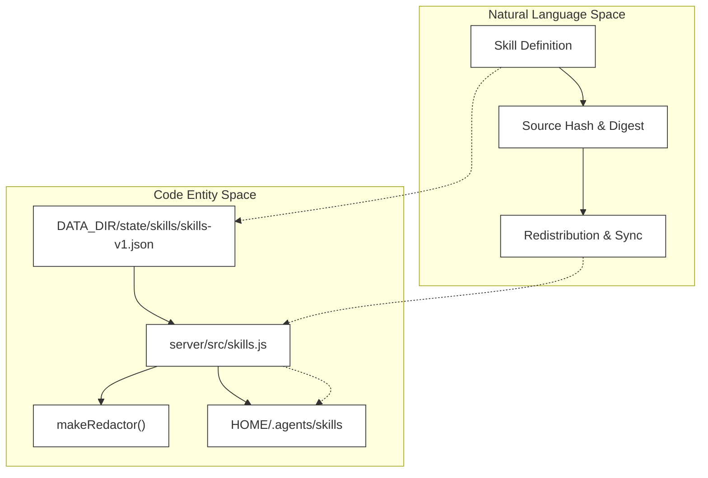
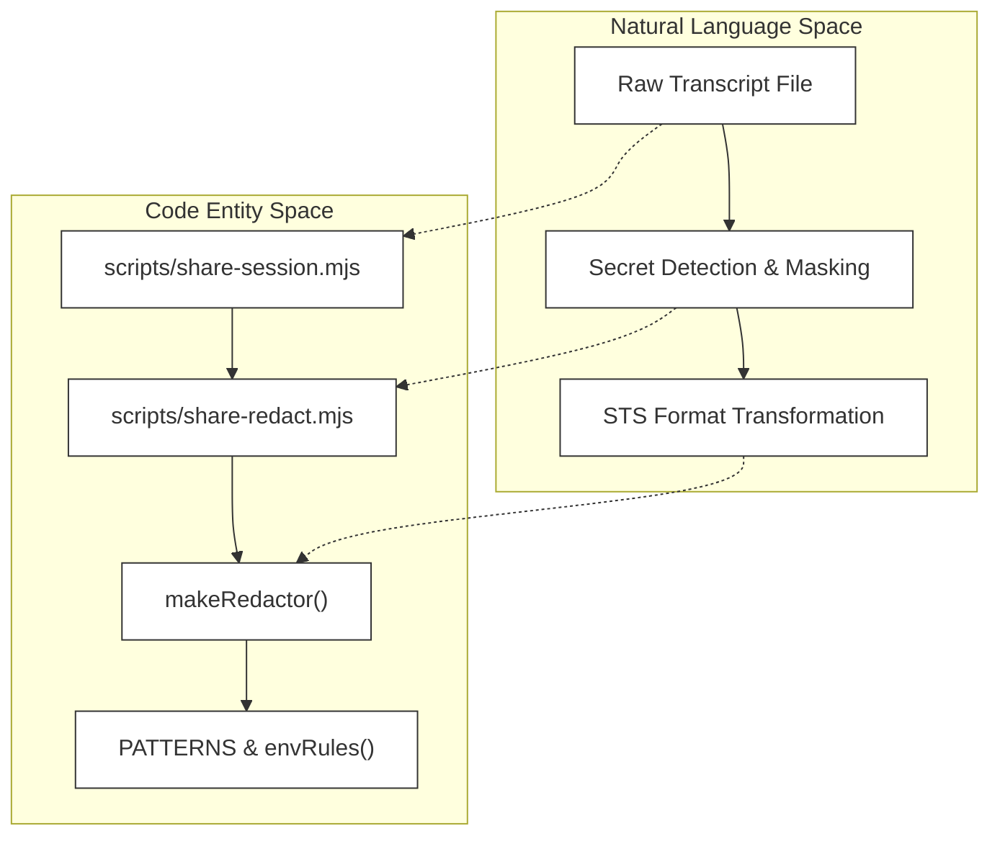

<!-- source: DeepWiki mcp.deepwiki.com · repo huggingface/agent-manager · page 2.5 Features: Skills, Crons, Delegation, Sharing, Remote Agents · fetched 2026-10-26 -->

# Features: Skills, Crons, Delegation, Sharing, Remote Agents

<details>
<summary>Relevant source files</summary>

The following files were used as context for generating this wiki page:

- [docs/agent-delegation-workflow.md](docs/agent-delegation-workflow.md)
- [docs/cron-jobs.md](docs/cron-jobs.md)
- [docs/managed-skills.md](docs/managed-skills.md)
- [docs/remote-agents.md](docs/remote-agents.md)
- [docs/session-sharing.md](docs/session-sharing.md)
- [scripts/share-redact.mjs](scripts/share-redact.mjs)
- [scripts/share-session.mjs](scripts/share-session.mjs)

</details>


This page details the feature subsystems built on top of the Agent Manager runtime: managed skills lifecycle, scheduled cron prompts, agent delegation and dispatch workflows, session sharing with automated redaction, and remote agent ingress streams.

---

## 1. Managed Skills

The managed skills subsystem controls the installation, ownership tracking, and synchronization of prompt skill files across supported CLI tools and paths. The shared lifecycle service (`server/src/skills.js`) serializes reads, writes, and revision checks using an internal operation queue.

### Ownership, Manifests, and Distribution
Skills are tracked using a version 1 manifest stored at `DATA_DIR/state/skills/skills-v1.json` [docs/managed-skills.md:36-38](). This manifest binds the canonical source root and each source filename to its installation ID, creation identity, current source digest, target installation roots, and generated file digests [docs/managed-skills.md:37-38](). 

Distribution is enabled explicitly via `SPACE_ID` or `AM_DISTRIBUTE_SKILLS=1` [docs/managed-skills.md:23-24](). Target directories include `HOME/.agents/skills`, Claude's configured skills directories, `HOME/.hermes/skills`, and Gemini/OpenClaw homes [docs/managed-skills.md:24-26]().


*Figure 1: Managed Skills natural language concepts mapped to runtime code entities.*

Sources: [docs/managed-skills.md:1-116](), [scripts/share-redact.mjs:1-97]()

---

## 2. Scheduled Prompts (Crons)

Cron jobs execute Agent Manager prompts on a standard five-field cron schedule (`minute`, `hour`, `day of month`, `month`, `day of week`) [docs/cron-jobs.md:1-30]().

### Configuration and Lifecycle
* **Storage**: Definitions and last delivery results reside durably in `DATA_DIR/crons.json`, while active timers execute entirely within the server process memory [docs/cron-jobs.md:3-6]().
* **Timezones**: `schedule.tz` requires a valid IANA timezone applied during occurrence calculations, handling daylight saving transitions [docs/cron-jobs.md:27-30]().
* **Execution**: At fire time, the scheduler checks for an existing session with the exact agent name. If found, it reuses the session; otherwise, it synchronously creates one under `workspaces/<slugged-agent-name>` prior to prompt delivery [docs/cron-jobs.md:87-94]().
* **Restart Semantics**: On server startup, running jobs receive newly calculated future occurrences, preventing missed historical replays while honoring `runOnRestart: true` [docs/cron-jobs.md:107-114]().

Sources: [docs/cron-jobs.md:1-118]()

---

## 3. Agent Delegation and Dispatch

Agent delegation allows active sessions to dispatch tasks to peers with a durable completion reply protocol [docs/agent-delegation-workflow.md:1-75]().

### Request and Correlation Protocol
1. **Thread Resolution**: The sender resolves its exact thread mapping using `am-context resolve` [docs/agent-delegation-workflow.md:5-7]().
2. **Payload Submission**: Tasks are submitted using a JSON payload containing a unique `requestId`, task text, and completion delivery preference (`"completion":"notify"`) [docs/agent-delegation-workflow.md:14-25]().
   ```sh
   curl -sS --fail-with-body -X POST \
     "http://localhost:${AM_PORT:-7860}/api/agents/$ID/prompt?from=$AM_ID" \
     -H 'X-AM-Request: 1' -H 'Content-Type: application/json' \
     --data-binary @delegation-request.json
   ```
3. **Status Polling**: Callers inspect progress via `GET /api/delegations/ID?from=$AM_ID` to verify outcome states (`completed`, `blocked`, `failed`, or `uncertain`) [docs/agent-delegation-workflow.md:32-35]().
4. **Passive Observation**: Peers can wait for stability without requesting callbacks using `GET /api/agents/$ID/wait?timeout=55&settle=15&from=$AM_ID` [docs/agent-delegation-workflow.md:48-55]().

Sources: [docs/agent-delegation-workflow.md:1-75]()

---

## 4. Session Sharing and Redaction

Session sharing extracts, redacts, and formats agent conversation traces for transfer [docs/session-sharing.md:1-108]().

### Redaction Engine (`share-redact.mjs`)
Before export, all trace lines pass through an automated redaction pipeline implemented in `scripts/share-redact.mjs` and managed via `makeRedactor()` [scripts/share-redact.mjs:75-97](). 
* **Secret Rules**: Patterns matching private keys, API tokens (`hf_*`, `sk-ant-*`, `sk-*`, `github_pat_*`), AWS key IDs, and custom environment secrets trigger strict blocking or sanitization [scripts/share-redact.mjs:15-59]().
* **Environment Rules**: `envRules()` scans process environment variables to catch sensitive keys and custom values (`TOKEN`, `KEY`, `SECRET`, `PASSWORD`) [scripts/share-redact.mjs:65-73]().


*Figure 2: Session sharing redaction concepts mapped to runtime code entities.*

Sources: [docs/session-sharing.md:1-108](), [scripts/share-redact.mjs:1-97](), [scripts/share-session.mjs:1-414]()

---

## 5. Remote Agents

Remote agents enable Agent Manager to host conversations with worker nodes running outside the container (e.g., local laptops or GPU workers) via inbound HTTP connections [docs/remote-agents.md:1-108]().

### Transport and Polling Architecture
* **Inbound HTTP Only**: Because the containerized Space cannot initiate outbound connections to nodes behind NAT, remote agents poll the Space using blocking NDJSON long-poll requests [docs/remote-agents.md:17-24]().
* **Authentication**: Requests rely on the operator's Hugging Face bearer token validated against the Space edge infrastructure [docs/remote-agents.md:23-25]().
* **Storage Layout**: Messages persist inside a markdown folder store: `workspaces/remote-agents/<name>/00042-agent.md`, where filename sequence numbers serve as transaction cursors (`?since=42`) [docs/remote-agents.md:25-28]().
* **Liveness**: Agent liveness is derived entirely from open and recent poll requests active in server memory [docs/remote-agents.md:28-30]().

Sources: [docs/remote-agents.md:1-108]()

---

