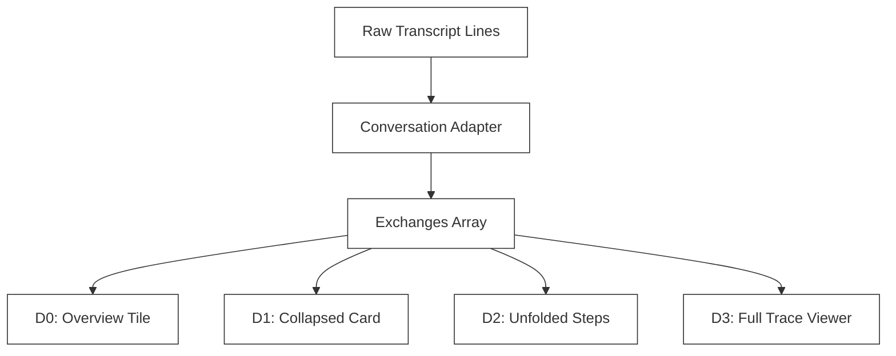

<!-- source: DeepWiki mcp.deepwiki.com · repo huggingface/agent-manager · page 3.1 Conversation Reader UI · fetched 2026-10-26 -->

# Conversation Reader UI

<details>
<summary>Relevant source files</summary>

The following files were used as context for generating this wiki page:

- [docs/conversation-view.md](docs/conversation-view.md)
- [docs/reader-architecture.md](docs/reader-architecture.md)
- [docs/reader-review-followup.md](docs/reader-review-followup.md)
- [docs/reader-validation.md](docs/reader-validation.md)
- [docs/trace-panel-spec.md](docs/trace-panel-spec.md)

</details>


The Conversation Reader UI subsystem implements a unified, deterministic, read-only conversation viewer designed to handle large agent session histories without spawning interactive PTY processes. It collapses the legacy separation between the Overview summary card and the raw trace viewer into a single architectural model with four rendering depths, supported by a dedicated `ReaderStore` and bounded byte-window transport [docs/conversation-view.md:1-12, docs/reader-architecture.md:3-21]().

---

## Architecture and Ownership Boundaries

The reader subsystem separates transport persistence, state retention, and rendering responsibilities across distinct modules. React mounting does not dictate the lifetime of a conversation transcript, and opening a reader never interacts with underlying terminal PTYs [docs/reader-architecture.md:13-21]().

```mermaid
graph TD
    subgraph "Server Side"
        TS["server/src/traces.js"] -->|readTrace()| API["GET /api/trace/:sessionId"]
    end
    subgraph "Client State"
        API -->|Transport Window| RS["ReaderStore (readerModel)"]
        RS -->|Immutable Snapshots| Hook["useReader() Subscription"]
    end
    subgraph "Client Rendering"
        Hook -->|Exchanges & Steps| CV["ConversationView (D0-D3)"]
        CV -->|Semantic Anchor| DOM["DOM Scroller"]
    end

    classDef default stroke:#333,fill:none;
```
*Figure 1: Data flow bridging server-side trace parsing to the client ReaderStore and ConversationView.*

- **Server Trace Ownership**: The server owns source identity and bounded, continuous transport windows via `server/src/traces.js` [docs/reader-architecture.md:9-11]().
- **Client State (`ReaderStore`)**: Manages retained transcript fragments, reconciliation, deadline/retry queues, and an inactive LRU cache to keep navigation warm [docs/reader-architecture.md:13-15]().
- **Subscription Adapter**: The `useReader()` React hook handles subscriptions and visibility adjustments, ensuring transport freshness does not depend on active agent execution [docs/reader-architecture.md:16-17]().
- **Conversation View**: Owns selection, search filtering, disclosure state, and semantic scroll anchoring [docs/reader-architecture.md:18-20]().

Sources: [docs/conversation-view.md:1-12](), [docs/reader-architecture.md:3-21]()

---

## The Unified Renderer and Four Depths (D0–D3)

The conversation view organizes an agent's run into a list of logical **exchanges**, where each exchange consists of a user prompt, intermediate step records, and a final assistant answer [docs/conversation-view.md:47-54](). 

$$\text{Exchange} = \{ \text{prompt}, \text{steps}[], \text{answer} \}$$

A single component (`ConversationView`) renders across four distinct visual depths depending on the surface context [docs/conversation-view.md:56-66]():

| Depth | Surface | Description |
|---|---|---|
| **D0** Brief | Overview tile | One-line prompt summary and execution state word [docs/conversation-view.md:60]() |
| **D1** Card | Overview card (collapsed) | Prompt, single metadata line, answer markdown, and active reply composer [docs/conversation-view.md:61]() |
| **D2** Open | Overview card (unfolded) | Adds intermediate steps between prompt and answer; stepper controls walk backward by exchange [docs/conversation-view.md:62]() |
| **D3** Full | Session pane / reader mode | Windowed vertical stack of exchanges, each individually expandable to D2 [docs/conversation-view.md:63]() |


*Figure 2: Rendering pipeline from raw transcript lines to the four depths.*

Sources: [docs/conversation-view.md:47-66]()

---

## Data Flow and Trace Parsing (`server/src/traces.js`)

Unlike the Overview digest—which is capped at 24 turns and discards tool arguments and thinking blocks—the conversation reader relies on a dedicated on-demand parser function, `readTrace()`, implemented in `server/src/traces.js` [docs/trace-panel-spec.md:42-46, 73-85]().

```js
// server/src/traces.js
export async function readTrace(session, { offset = 0, limit = 200 } = {}) -> {
  harness, sessionId, model, cwd, firstTs, lastTs, total,
  turns: [ Turn, ... ]
}
```
[docs/trace-panel-spec.md:93-97]()

To prevent heavy synchronous operations from locking the Node.js event loop during large session loads (some traces exceed 6 MB), parsing operations avoid blocking the main thread [docs/trace-panel-spec.md:35-39](). Session resolution is handled via `findTrace(session, allSessions)` (imported from `server/src/share.js`), which correctly handles path attribution across all supported CLI harnesses (Claude Code, Codex, OpenCode, Gemini, and Hermes) without guesswork [docs/trace-panel-spec.md:116-121]().

Sources: [docs/trace-panel-spec.md:35-121]()

---

## Store and State Management (`readerModel` / `ReaderStore`)

The client-side `ReaderStore` manages asynchronous data fetching, local caching, and UI anchoring according to strict architectural contracts [docs/reader-architecture.md:13-15]().

- **Deadlines and Cancellation**: Every fetch request carries a cancellation token and generation guard, preventing stale responses from overwriting newer user actions [docs/reader-architecture.md:26-27]().
- **Cold Reader Preloading**: Cold readers load a bounded initial history of approximately 20 recent exchanges in background steps after the first paint, utilizing generation-bound byte cursors to avoid saturating memory [docs/reader-architecture.md:41-46, 85-94]().
- **Scroll Anchor Re-assertion**: When new history arrives or backward pages load, text position is locked by measuring keyed row anchors. History appends or prepends automatically re-assert viewport positions within the same animation frame to eliminate visual jumping [docs/reader-architecture.md:47-49]().

Sources: [docs/reader-architecture.md:13-52]()

---

## Trace Windows and Panel Spec

The trace viewer renders as a passive pane (`TracePane.tsx`) modeled structurally after `FilesPane.tsx` [docs/trace-panel-spec.md:53-65](). It communicates via standard REST and WebSocket client helpers (`web/src/api.ts`) using flat CSS class names [docs/trace-panel-spec.md:63-65]().

To handle large datasets without DOM degradation, the message list is virtualized from inception, rendering only visible DOM nodes [docs/trace-panel-spec.md:39-41](). The pane operates entirely independently from terminal PTY allocation, treating session records as read-only documents [docs/trace-panel-spec.md:29-34]().

Sources: [docs/trace-panel-spec.md:29-65]()

---

## Reader Validation and Regression Approach

The conversation reader subsystem is covered by automated unit and browser integration test suites that enforce strict performance and correctness boundaries [docs/reader-architecture.md:71-78]().

- **`web/test/readerHistory.test.mjs`**: Drives `ReaderStore` against mock sources enforcing byte budgets, blocked/stalled cursors, and inactive LRU eviction semantics [docs/reader-architecture.md:71-74]().
- **`web/test/readerFirstViewport.test.mjs`**: Mounts the reader in a real browser fixture to measure viewport coverage and verify per-frame anchor displacement under load [docs/reader-architecture.md:74-76]().
- **`server/test/trace-index-history.test.mjs`**: Verifies indexed first-window response times and conversation isolation within SQLite and JSONL multi-session stores [docs/reader-architecture.md:76-78]().

Sources: [docs/reader-architecture.md:66-78](), [docs/reader-validation.md:1-45]()

---

