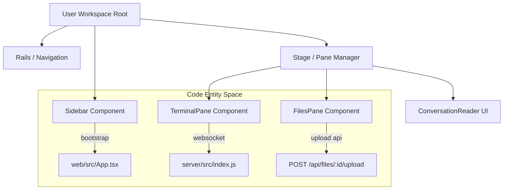
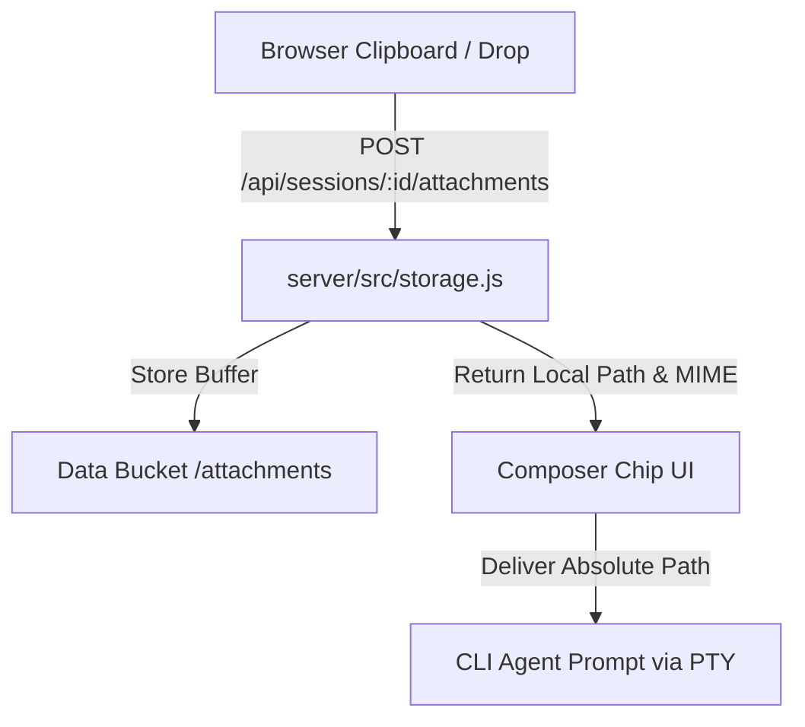

<!-- source: DeepWiki mcp.deepwiki.com · repo huggingface/agent-manager · page 3.2 Workspace, Panes and Terminal UI · fetched 2026-10-26 -->

# Workspace, Panes and Terminal UI

<details>
<summary>Relevant source files</summary>

The following files were used as context for generating this wiki page:

- [docs/file-links.md](docs/file-links.md)
- [docs/screenshot-input.md](docs/screenshot-input.md)
- [docs/workspace-file-uploads.md](docs/workspace-file-uploads.md)
- [server/mobile.test.mjs](server/mobile.test.mjs)
- [server/screenshot-input.test.mjs](server/screenshot-input.test.mjs)

</details>


## Purpose and Scope
This section covers the architecture and implementation of the web frontend workspace (`web/`), focusing on the layout structure (sidebar, rails, and stage panes), `TerminalPane` integration and connection/retry logic, `FilesPane` management, file link previews, attachments/screenshot input subsystems, and workspace file uploads.

---

## 1. Overview, Rails and Layout Structure
The Agent Manager frontend organizes its workspace using a multi-pane stage model. It supports both desktop multi-pane views and responsive mobile layouts where panes are stacked or managed through navigation buttons like `.mback` [server/mobile.test.mjs:41-47](). 

The layout consists of:
- **Sidebar**: Provides quick navigation, session initialization, and prompt quickstarts.
- **Rails**: Secondary controls and pane management.
- **Stage / Panes**: Dynamic tiles (`.tile-terminal`, `.tile-cached`) hosting active terminal runtimes, file viewers, or conversation readers.


*Figure 1: Workspace layout and component binding architecture.*

Sources: `server/mobile.test.mjs:35-47](), [docs/screenshot-input.md:106-119]()`

---

## 2. TerminalPane and Retry Logic
The `TerminalPane` manages interactive PTY sessions via WebSockets. It transmits input through text frames and handles reconnection and retry logic when connections drop or terminals restart.

### Connection & Transport Data Flow
1. The browser connects to the WebSocket endpoint (`/ws?session=:id`) [server/mobile.test.mjs:113]().
2. Terminal transport relies strictly on text frames (e.g., `{t: 'i', d: '...'}` for input) to maintain a decoupled transport layer [docs/screenshot-input.md:48-55]().
3. If a terminal is stopped or connection drops, the pane prevents false insertion successes and exposes explicit transport error recovery states [server/screenshot-input.test.mjs:4-6]().

```mermaid
graph TD
    Client["Browser TerminalPane"] -->|WebSocket {t:'i', d}| Server["server/src/session-runtime.js"]
    Server -->|PTY Spawn / Write| PTY["CLI Agent Process"]
    PTY -->|Stdout / Buffer| Server
    Server -->|Control Frames| Client
    Client -->|Drop Detected| Retry["Retry Manager / Reconnect"]
    Retry -->|Re-attach WS| Server
```
*Figure 2: Terminal PTY transport and retry workflow.*

Sources: `docs/screenshot-input.md:45-55](), [server/mobile.test.mjs:110-126]()`

---

## 3. FilesPane and File Link Previews
The frontend supports read-only inline file previews directly inside originating session panes, alongside dedicated `FilesPane` instances for browsing the workspace [docs/file-links.md:3-17]().

### Supported Reference Patterns
- **Markdown Links**: Resolves paths like `[readme](./README.md)` or source locations with lines like `[source](src/app.ts:42:3)` [docs/file-links.md:26-27]().
- **Inline Code**: Detects file paths enclosed in single backticks (e.g., `` `docs/notes.md` ``) [docs/file-links.md:28-29]().
- **Terminal Output Detection**: Conservative parsing of plain paths, soft-wrapped paths, and OSC 8 `file:///...` hyperlinks [docs/file-links.md:30-32]().
- **Configured Roots (`AM_FILE_LINK_ROOTS`)**: Operators can expose additional read-only directories via JSON maps [docs/file-links.md:57-63](). Lexical and real paths are validated on every resolution to prevent path traversal outside selected roots [docs/file-links.md:71-72]().

Sources: `docs/file-links.md:1-95]()`

---

## 4. Attachments, Screenshot Input and Uploads
Operators can attach local files or screenshots directly to agent prompts via clipboard pastes, drag-and-drop actions, or file pickers [docs/screenshot-input.md:9-13]().

### Constraints and Architecture
- **Clipboard Boundary**: Headless CLI containers cannot access the local browser/OS clipboard. The browser handles local files/screenshots and uploads them to Agent Manager, which stores them outside the user repository and provides a server-local path to the target CLI [docs/screenshot-input.md:15-18, 29-35]().
- **Text PTY Boundary**: Terminal transport remains text-based. Binary data is never pushed through raw xterm escape sequences [docs/screenshot-input.md:18-19, 48-55]().
- **Upload API**: Endpoints like `POST /api/sessions/:id/attachments` handle binary uploads, MIME detection, and sandboxed preview responses [server/screenshot-input.test.mjs:110-122]().


*Figure 3: Attachment upload and injection workflow.*

Sources: `docs/screenshot-input.md:9-75](), [server/screenshot-input.test.mjs:110-139]()`

---

## 5. Workspace File Uploads and Replacement
Workspace file uploads are managed through explicit create-only and collision-resolution paths [docs/workspace-file-uploads.md:3-7]().

### Collision & Replacement Mechanics
- Streaming endpoint: `POST /api/files/:id/upload?path=<folder>&name=<name>` [docs/workspace-file-uploads.md:9-10]().
- If a destination file already exists, the server returns a `409` conflict status along with a `replaceToken` [docs/workspace-file-uploads.md:10-22]().
- **Atomic Publication**: Uploads stream first to an exclusive `.part` temporary file. Following validation, atomic hard links or exclusive copies (`COPYFILE_EXCL`) publish the final file without exposing partial states [docs/workspace-file-uploads.md:37-53]().

Sources: `docs/workspace-file-uploads.md:1-58]()`

---

