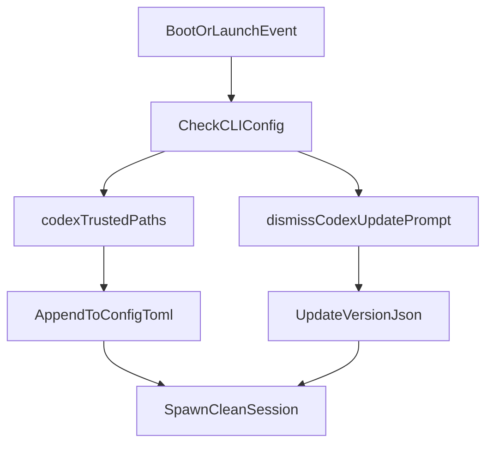
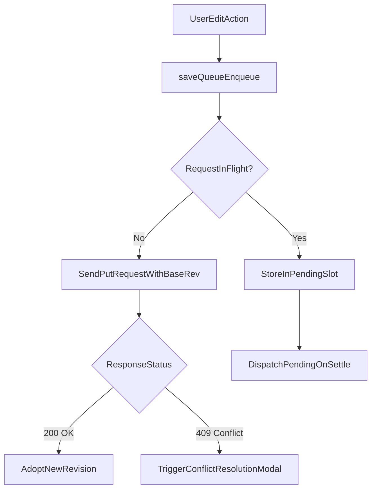
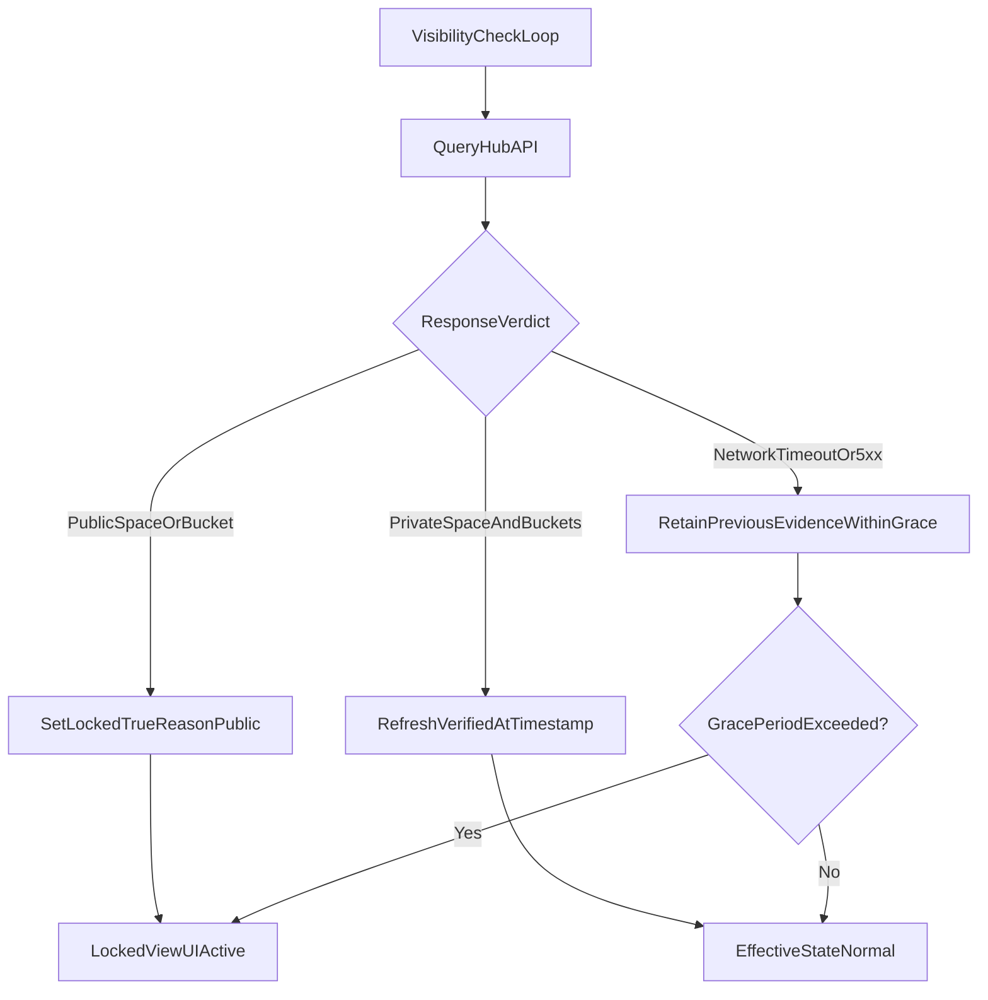
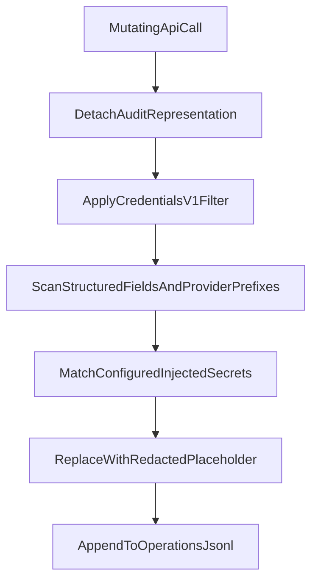

<!-- source: DeepWiki mcp.deepwiki.com · repo huggingface/agent-manager · page 3.3 Settings, Onboarding and Lock States · fetched 2026-10-26 -->

# Settings, Onboarding and Lock States

Relevant source files

The following files were used as context for generating this wiki page:

- [docs/api-audit-log.md](docs/api-audit-log.md)
- [docs/first-run-dialogs.md](docs/first-run-dialogs.md)
- [docs/privacy-lock.md](docs/privacy-lock.md)
- [docs/saving.md](docs/saving.md)

## Purpose and Scope
This page covers the technical architecture and implementation details for first-run onboarding (`WelcomeSetup`/`BucketPrompt`), configuration persistence (`SettingsView`, `saveQueue.ts`, `settingsSaves.ts`), privacy lock enforcement (`visibility.js`), and audit/usage monitoring panels within Agent Manager. 

---

## 1. First-Run Dialogs & Onboarding (`WelcomeSetup` / `BucketPrompt`)

When initializing new CLI agent sessions (Claude Code or Codex), bootstrapping can be blocked by unexpected interactive terminal dialogs (e.g., folder trust prompts, update notifications, and telemetry/managed settings approvals) [docs/first-run-dialogs.md:1-19](). 

### CLI Dialog Triggers and Handling Strategy
* **Folder Trust**: Claude Code inherits trust recursively from the workspace root (`projects[<path>].hasTrustDialogAccepted` in `.claude.json`), whereas Codex requires explicit path entries appended to `config.toml` (`[projects."<path>"] trust_level`) [docs/first-run-dialogs.md:13-27]().
* **Codex Update Screen**: Launched when no initial task prompt is supplied and a newer version exists in the version cache (`dismissed_version` in `version.json`) [docs/first-run-dialogs.md:16-47]().
* **Implementation Mechanics**: To prevent terminal dialogs from eating input or blocking unattended execution, initialization routines parse and update CLI configuration files safely (using append strategies rather than full file rewrites to prevent race conditions with concurrent CLI processes) [docs/first-run-dialogs.md:66-91](). Functions such as `codexTrustedPaths()` decode table headers, while `dismissCodexUpdatePrompt()` updates the version cache [docs/first-run-dialogs.md:107-115]().

*Sources: [docs/first-run-dialogs.md:1-120]*

---

## 2. `SettingsView`, Save Queue, and Revision Semantics

Configuration management across `SettingsView` and file editors utilizes a deterministic, single-writer queue model implemented in `web/src/lib/saveQueue.ts` and managed globally by `web/src/lib/settingsSaves.ts` [docs/saving.md:14-135]().

### Save Queue and Concurrency Rules
* **Settings vs Files**: Settings save *immediately* on change without debouncing. Files save *explicitly* via action or `⌘S` [docs/saving.md:6-10]().
* **Single Writer per Resource**: Each resource maintains exactly one request in flight and one pending slot containing the newest requested value [docs/saving.md:17-22]().
* **Revisions and Concurrency (`rev`)**: Backend endpoints `/api/config` and `/api/secrets` return a cryptographic revision hash (`rev`) [docs/saving.md:48-52](). Mutating requests (`PUT`) require a base revision parameter (`?base=...`) to prevent overwriting concurrent updates, returning a `409` conflict status code (`base-required` or `stale`) if revisions diverge [docs/saving.md:52-70]().

*Sources: [docs/saving.md:1-136]*

---

## 3. Locked View and Lock Status Handling (`visibility.js` & UI)

Because Agent Manager has no built-in user authentication layer, safety relies on the backend verification loop running in `server/src/visibility.js`, which continually validates the Hugging Face Space and mounted storage buckets against the Hub API [docs/privacy-lock.md:1-16]().

### Verification Logic and Effective States
* **Verdicts**: Unauthenticated requests query `/api/spaces/{id}` and `/api/buckets/{id}` to verify privacy statuses [docs/privacy-lock.md:20-32](). 
* **Grace Periods**: Verified private evidence remains valid for `GRACE_MS` (150 seconds, roughly 2.5 cycles of `CHECK_MS` at 60 seconds) [docs/privacy-lock.md:88-95](). If a verification check fails or times out, the application locks before the third consecutive failure completes [docs/privacy-lock.md:71-73]().
* **Warning-Only Exemption**: If token authentication is missing or rejected for space discovery, a warning-only mode surfaces `bucketUnverified: true` under strict consecutive failure bounds (`UNAUTHORIZED_CONFIRMATIONS`) without hard-locking the workspace [docs/privacy-lock.md:61-83]().

*Sources: [docs/privacy-lock.md:1-97]*

---

## 4. API Log, Credentials Auditing, and Usage Panels

Mutating API calls and resolved agent events are appended to `operations.jsonl` under the private data directory, managed by audit logging protocols [docs/api-audit-log.md:1-11]().

### Credential Filtering (`credentials-v1`)
* **Sanitization Pipeline**: Immediately before JSON serialization and file append, the `credentials-v1` policy strips sensitive structured fields (such as `authorization`, `password`, `token`, `api_key`), provider-specific secrets (`hf_...`, `sk-...`, `ghp_...`), private key blocks, and configured Space secrets [docs/api-audit-log.md:13-33]().
* **Redaction Placeholder**: Every filtered secret is replaced with the fixed string `[redacted]`, preserving stored checksums (`sha256`) and filtered byte lengths for diagnostic utility [docs/api-audit-log.md:42-78]().

*Sources: [docs/api-audit-log.md:1-90]*

---

