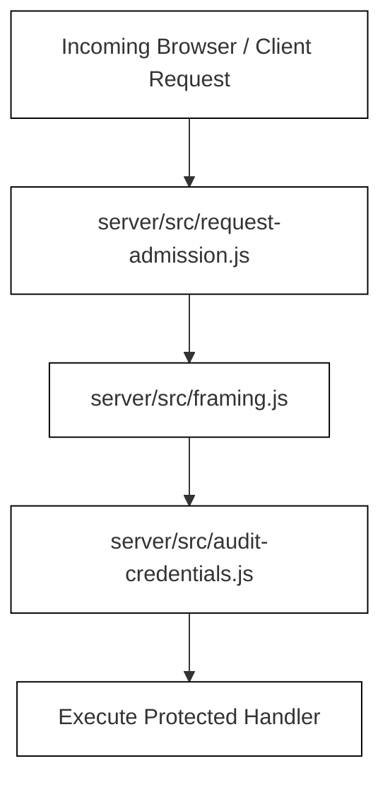

<!-- source: DeepWiki mcp.deepwiki.com · repo huggingface/agent-manager · page 4 Security and Privacy Lock · fetched 2026-10-26 -->

# Security and Privacy Lock

<details>
<summary>Relevant source files</summary>

The following files were used as context for generating this wiki page:

- [SECURITY.md](SECURITY.md)
- [docs/browser-request-protection.md](docs/browser-request-protection.md)
- [docs/privacy-lock.md](docs/privacy-lock.md)

</details>


Agent Manager operates on a trust model with **no built-in application authentication** [SECURITY.md:3-5](). Security relies entirely on the isolation and privacy of the Hugging Face Space hosting the application and the attached storage volume [SECURITY.md:6-7](). To guard against accidental exposure, the server runs an automated privacy verification loop, enforces strict request admission rules, and audits outgoing credentials and secret names.

Sources: [SECURITY.md:1-8]()

## Trust Model and Core Philosophy

The system grants complete terminal and agent control to any client capable of reaching the deployment boundary [SECURITY.md:5-7](). Consequently, security is maintained via three primary guarantees:
- **Private Edge**: The hosting Space and its underlying `/data` bucket must be designated as private [SECURITY.md:9-11]().
- **Active Verification**: The backend continuously monitors Space and bucket visibility status [SECURITY.md:13-17]().
- **Request Hardening**: The API layers enforce strict request markers, origin checking, and frame restrictions [docs/browser-request-protection.md:3-6]() [docs/browser-request-protection.md:73-81]().

Sources: [SECURITY.md:3-28](), [docs/browser-request-protection.md:1-27]()

## Privacy Lock Overview

The privacy lock is a safety net managed by `server/src/visibility.js` [docs/privacy-lock.md:15-16](). It queries the Hugging Face Hub API periodically to confirm that both the Space and its mounted storage buckets remain private [docs/privacy-lock.md:18-32](). If visibility cannot be confirmed or if a resource is detected as public, the application immediately locks down, refusing new requests and forcibly terminating existing live connections, including long-polling streams and remote agent channels [SECURITY.md:13-21]().

For a detailed breakdown of verification cycles, grace periods, public-safe endpoints, and token requirements, see [Privacy Lock Internals](#4.1).

```mermaid
graph TD
    NL_Space[""Hub Space & Bucket Visibility""] --> Code_Visibility[""server/src/visibility.js""]
    Code_Visibility --> Code_Check[""checkVisibility()""]
    Code_Check --> Code_State{""visibilityState""}
    Code_State -->|""Private""| Code_Allow[""Serve Privileged APIs""]
    Code_State -->|""Public or Stale""| Code_Lock[""Lockdown & Revoke Streams""]

    style NL_Space fill:none,stroke:#000
    style Code_Visibility fill:none,stroke:#000
    style Code_Check fill:none,stroke:#000
    style Code_State fill:none,stroke:#000
    style Code_Allow fill:none,stroke:#000
    style Code_Lock fill:none,stroke:#000
```
Sources: [SECURITY.md:13-28](), [docs/privacy-lock.md:1-16]()

## Request Admission and Credential Auditing

Because traditional user login workflows are omitted, request admission policies use explicit protocol markers (`X-AM-Request: 1`), exact Origin matching, and Fetch Metadata headers to block unauthorized cross-site requests [docs/browser-request-protection.md:13-43](). Additionally, response framing is governed by strict Content Security Policies (`server/src/framing.js`), and sensitive environment variables or secrets are masked from client consumption (`server/src/audit-credentials.js`) [docs/browser-request-protection.md:73-81]() [SECURITY.md:23]() [4.2]().

For detailed rules on admission policies, untrusted frame handling, and secret-name hiding, see [Request Admission and Credential Auditing](#4.2).


Sources: [docs/browser-request-protection.md:1-82]()

---

