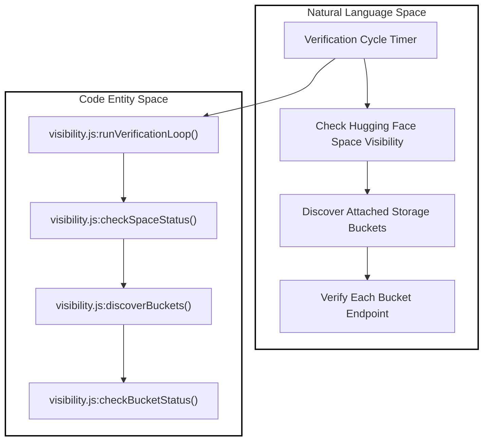
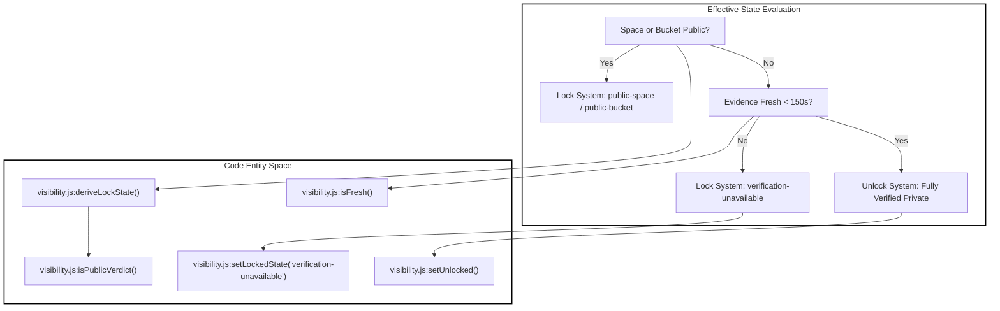

<!-- source: DeepWiki mcp.deepwiki.com · repo huggingface/agent-manager · page 4.1 Privacy Lock Internals · fetched 2026-10-26 -->

# Privacy Lock Internals

Relevant source files

The following files were used as context for generating this wiki page:

- [SECURITY.md](SECURITY.md)
- [docs/privacy-lock.md](docs/privacy-lock.md)
- [server/fixtures/fake-hf.py](server/fixtures/fake-hf.py)

## Purpose and Scope

Agent Manager operates under a trust model with no built-in authentication [SECURITY.md:3-8](). Anyone who can reach the deployment gains a terminal and control over logged-in AI agents. The **privacy lock** acts as a automated safety net designed to prevent accidental exposure [docs/privacy-lock.md:1-8](). 

This page details the implementation of the privacy lock mechanism in `server/src/visibility.js`, explaining how the system periodically verifies the Hugging Face Space and its attached storage buckets against the Hub API, handles timeout and grace periods, revokes active streams and terminals upon state transitions, exposes public-safe endpoints, and manages `HF_TOKEN` requirements and warning-only exemptions.

Sources: [SECURITY.md:1-28](), [docs/privacy-lock.md:1-16]()

---

## Verification Engine and Hub Polling

The verification loop runs continuously in the background, executing periodic checks against the Hugging Face Hub public API [docs/privacy-lock.md:18-38](). The verification engine monitors three classes of resources:
1. **The Space**: Checked via unauthenticated `GET /api/spaces/{id}` [docs/privacy-lock.md:29]().
2. **Bucket Discovery**: Checked via authenticated `GET /api/spaces/{id}` using the provided `HF_TOKEN` secret to discover mounted volumes (`runtime.volumes[]`) [docs/privacy-lock.md:30]().
3. **Mounted Buckets**: Each discovered bucket is checked via unauthenticated `GET /api/buckets/{id}` [docs/privacy-lock.md:31]().

Only exact, well-formed JSON responses matching expected schemas produce a verdict (`private` or `public`) [docs/privacy-lock.md:22-26](). Any redirection, `403`/`429`/`5xx` status, timeout, network error, or malformed body results in **no verdict**, preserving the previous evidence until the next cycle [docs/privacy-lock.md:22-25](). Each tracked resource maintains two distinct timestamps: `attemptedAt` (last completion attempt) and `verifiedAt` (last valid verdict) [docs/privacy-lock.md:33-37]().

Sources: [docs/privacy-lock.md:18-38]()

---

## Lock Triggers, Timeouts, and Effective States

The effective lock state is derived from the collected evidence using a strict evaluation hierarchy: public verdicts win immediately, followed by freshness checks, and finally bucket policies [docs/privacy-lock.md:39-56]().

### Core Constants and Timing Parameters

The timing thresholds defined in `server/src/visibility.js` govern the lifecycle of verification and grace periods:
- `CHECK_MS`: `60000` (60 seconds) — Interval for verification cycles [docs/privacy-lock.md:90-92]().
- `GRACE_MS`: `150000` (150 seconds / 2.5 cycles) — Maximum age of verified-private evidence before triggering a `verification-unavailable` outage lock [docs/privacy-lock.md:90-93]().
- `HF_TIMEOUT_MS`: `8000` (8 seconds) — Per-request timeout to the Hub [docs/privacy-lock.md:90-94]().
- `CYCLE_BUDGET_MS`: `25000` (25 seconds) — Total execution time budget per cycle; overrunning cycles are aborted [docs/privacy-lock.md:90-95]().
- `MAX_BUCKETS`: `8` — Maximum number of mounted storage buckets verified per cycle [docs/privacy-lock.md:90-96]().

Sources: [docs/privacy-lock.md:39-96]()

---

## Connection Revocation and Public-Safe Endpoints

When the privacy lock trips, the server takes immediate defensive action across all active communication channels [SECURITY.md:18-22](). 

### Revocation Semantics
Locking refuses all incoming privileged HTTP requests and terminal attachments [SECURITY.md:18-19](). Crucially, the server **forcibly revokes** already-open connections, including:
- Interactive PTY terminals and WebSocket streams [SECURITY.md:19-20]()
- Long-polling requests and event streams [SECURITY.md:20]()
- Remote agent streams [SECURITY.md:20]()

This disconnection occurs on the server side regardless of whether a browser client is actively listening [SECURITY.md:20-21](). Underlying background CLI agents continue executing, but communication channels are severed until visibility checks succeed again and the app unlocks automatically [SECURITY.md:21-22]().

### Public-Safe Endpoints
While in a locked state, the server restricts its API surface to minimize exposure:
- Health check endpoints
- Public-safe status indicators
- The setup and configuration page [SECURITY.md:22-23]()
- Secret-name hiding mechanisms to prevent leakage of credentials in error responses [SECURITY.md:23]()

Sources: [SECURITY.md:18-28]()

---

## HF_TOKEN Requirements and Warning-Only Exemptions

Storage bucket discovery requires a valid `HF_TOKEN` with sufficient access rights [docs/privacy-lock.md:61-64](). If the token is missing or rejected, the system applies a strict warning-only exemption rather than a hard lock under specific conditions [docs/privacy-lock.md:64-74]().

### Exemption Scenarios
1. **No Token Provided**: If none of `HF_TOKEN`, `HUGGING_FACE_HUB_TOKEN`, or `HF_API_TOKEN` are set, bucket discovery is skipped, `bucketUnverified:true` is flagged, and the UI surfaces a warning while keeping the core Space operational if private [SECURITY.md:23-25](), [docs/privacy-lock.md:65-67]().
2. **Hub Token Refusal**: If the authenticated Space read receives a `401`, `403`, or `404` status with a JSON body for three consecutive cycles (`UNAUTHORIZED_CONFIRMATIONS`), the app treats the bucket as unverified with a warning [docs/privacy-lock.md:67-73](). Intermittent failures (`5xx`, network timeouts) reset this consecutive counter and maintain the locked `checking` state [docs/privacy-lock.md:70-73]().

Refused credentials are periodically retried (`UNAUTHORIZED_RETRY_CYCLES`, approximately every 10 minutes) so that permission fixes on the Hub automatically clear warnings without requiring a container restart [docs/privacy-lock.md:80-84]().

Sources: [docs/privacy-lock.md:61-87]()

---

