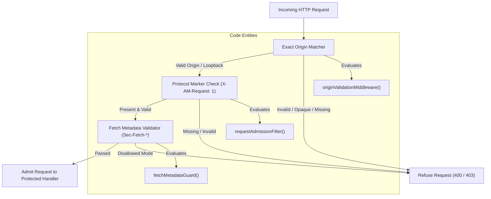
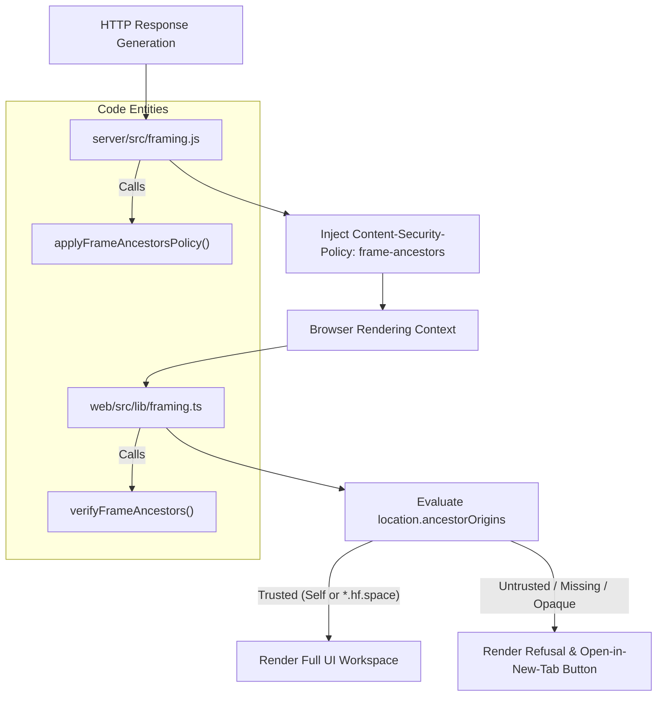

<!-- source: DeepWiki mcp.deepwiki.com · repo huggingface/agent-manager · page 4.2 Request Admission and Credential Auditing · fetched 2026-10-26 -->

# Request Admission and Credential Auditing

Relevant source files

The following files were used as context for generating this wiki page:

- [SECURITY.md](SECURITY.md)
- [docs/api-errors.md](docs/api-errors.md)
- [docs/browser-request-protection.md](docs/browser-request-protection.md)

This page covers the implementation details of request-admission policies, framing restrictions (`frame-ancestors`), untrusted frame mitigation, and credential/secret auditing subsystems within Agent Manager. These mechanisms ensure that state-mutating requests, API tokens, and sensitive workspace resources remain protected under the application's single-owner trust model.

Sources: [docs/browser-request-protection.md:1-97](), [SECURITY.md:1-39]()

---

## 1. Request Admission Policy and Origin Validation

Agent Manager relies on a strict request-admission layer to protect sensitive endpoints from cross-site request forgery (CSRF) and unauthorized browser contexts. Because the application uses no built-in authentication, boundary security depends entirely on explicit origin matching and non-secret protocol markers [docs/browser-request-protection.md:3-34]().

Key enforcement components include:
- **`X-AM-Request: 1` Header**: A non-secret protocol marker that standard cross-origin requests cannot emit without triggering a preflight CORS check [docs/browser-request-protection.md:22-24]().
- **Exact Origin Matching**: Incoming requests must present an `Origin` header matching the configured Space host or allowlisted origins (`AM_ALLOWED_ORIGINS`) exactly [docs/browser-request-protection.md:29-31]() (wildcards and path suffixes are rejected).
- **Fetch Metadata Defense-in-Depth**: Requests are evaluated against `Sec-Fetch-Site` and `Sec-Fetch-Mode` headers to verify that API calls originate from same-origin contexts or approved embedding scenarios [docs/browser-request-protection.md:35-43]().

Diagram 1 bridges the high-level natural language admission policy to its underlying verification logic and request attributes.

### Diagram 1: Request Admission and Origin Verification Flow

Sources: [docs/browser-request-protection.md:9-43](), [docs/api-errors.md:21-36]()

---

## 2. Framing and Frame Ancestors

To prevent clickjacking and control where Agent Manager can be embedded (such as inside the Hugging Face Hub Space viewer), the server injects stringent Content Security Policies (CSP), while the frontend performs secondary validation [docs/browser-request-protection.md:67-97]().

### Server-Side Framing Policy
The server's framing middleware (`server/src/framing.js`) injects a `Content-Security-Policy` header into every response—including HTML, SPA fallbacks, static assets, and API routes [docs/browser-request-protection.md:73-77](). 
- The default policy specifies `frame-ancestors 'self'` combined with `https://huggingface.co` when `SPACE_ID` is active [docs/browser-request-protection.md:75-76]().
- Custom deployment origins can be authorized via the `AM_FRAME_ANCESTORS` environment variable, which validates and merges additional exact origins into the directive [docs/browser-request-protection.md:83-86]().

### Client-Side Ancestor Verification
If headers are stripped or ignored by intermediate proxies, the client-side module (`web/src/lib/framing.ts`) evaluates `location.ancestorOrigins` at runtime [docs/browser-request-protection.md:87-95]() gegen known trusted authorities. If an untrusted ancestor is detected, the UI fails closed, suppresses the workspace render, and displays an **Open Agent Manager** button pointing to the isolated application root [docs/browser-request-protection.md:88-91]().

Diagram 2 illustrates the mapping between the framing requirements and code execution paths across the backend framing module and frontend runtime checks.

### Diagram 2: Framing Protection and Client Ancestor Evaluation

Sources: [docs/browser-request-protection.md:67-97]()

---

## 3. Credential Auditing and Secret-Name Hiding

Agent Manager interacts with powerful CLI agents, local environment variables, and persisted configuration stores that frequently contain sensitive API keys and authorization secrets. The audit and error subsystem incorporates strict filtering rules to prevent credential leakage [SECURITY.md:1-39](), [docs/api-errors.md:1-50]().

### Secret-Name Hiding and Sanitization
When the privacy lock is engaged (due to public visibility or check timeouts) or when returning API errors, the application enforces the following security boundaries:
- **Error Envelope Sanitization**: Expected exceptions use `ApiError` instances containing safe error codes and structured details [docs/api-errors.md:1-18](). Arbitrary internal library errors or raw upstream stack traces are stripped, returning a generic `internal-error` status for 5xx responses [docs/api-errors.md:12-17]().
- **Path and Secret Masking**: Settings files and file-system paths referenced in error payloads are strictly bounded and made relative to the durable data root (`/data`) rather than exposing absolute host paths [docs/api-errors.md:36-41]().
- **Credential Protection**: When the privacy lock transitions to a locked state, secret names and sensitive variables are hidden from public-safe endpoints, and active remote streams or terminal sessions are forcibly revoked [SECURITY.md:13-23]().

Sources: [SECURITY.md:1-39](), [docs/api-errors.md:1-50]()

---

