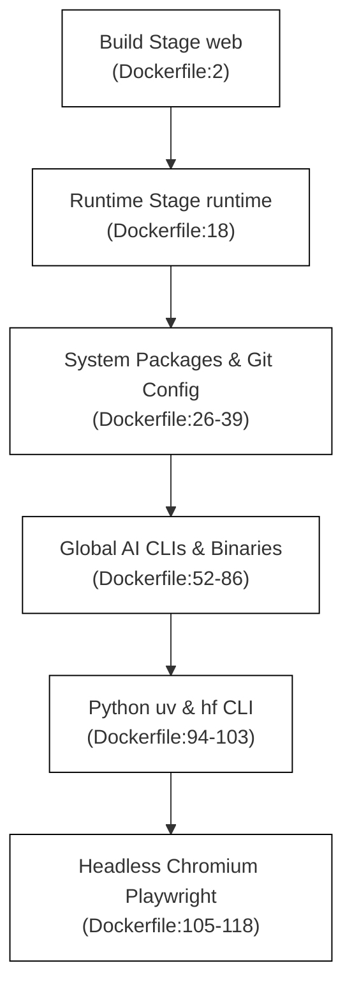
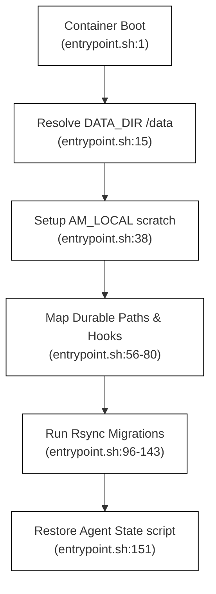

<!-- source: DeepWiki mcp.deepwiki.com · repo huggingface/agent-manager · page 5 Container, Deployment and Tooling · fetched 2026-10-26 -->

# Container, Deployment and Tooling

Relevant source files

The following files were used as context for generating this wiki page:

- [Dockerfile](Dockerfile)
- [entrypoint.sh](entrypoint.sh)

## Purpose and Scope

This page covers the containerization, deployment architecture, and operational tooling for Agent Manager. It details how the container image is built, how the runtime container initializes via its startup sequence, and the utility scripts used for maintenance and deployment. 

As a parent page, this section provides a high-level overview. For deep technical details, refer to the child pages:
- [Docker Image and Entrypoint](#5.1)
- [Scripts and Maintenance Utilities](#5.2)

Sources: [Dockerfile:1-18](), [entrypoint.sh:1-30]()

---

## 5.1 Docker Image and Entrypoint

The container image uses a multi-stage build pattern based on Node 24 (`node:24-bookworm`) to compile the React frontend and provision a production runtime containing AI coding CLIs, Python tooling via `uv`, and headless Chromium for Playwright [Dockerfile:1-118](). 

The runtime entrypoint script (`entrypoint.sh`) executes during container startup to configure writable durable storage (such as a mounted Hugging Face Storage Bucket at `/data`), establish local POSIX-compliant scratch directories (`$AM_LOCAL`), execute safe state migrations, and restore agent states before launching the server [entrypoint.sh:1-152]().

*Figure 5.1: Multi-stage Docker image provisioning pipeline.*

*Figure 5.2: Entrypoint initialization and state restoration sequence.*

For comprehensive details on multi-stage builds, pinned CLI versions, Playwright provisioning, environment variables, `UV_THREADPOOL` tuning, and the `entrypoint.sh` startup sequence, see [Docker Image and Entrypoint](#5.1).

Sources: [Dockerfile:1-118](), [entrypoint.sh:1-152]()

---

## 5.2 Scripts and Maintenance Utilities

The `scripts/` directory houses utility scripts and maintenance tooling used for local development, deployment, schema validation, state management, and test execution. These utilities handle operations such as deploying to development spaces, installing local CLIs, running startup benchmarks, checking mutations, and managing session state checkpoints.

For a full catalog of available scripts, deployment helpers, and test runners inside `scripts/`, see [Scripts and Maintenance Utilities](#5.2).

Sources: [scripts/am-codex-repin-hook.sh:1-1]()

---

