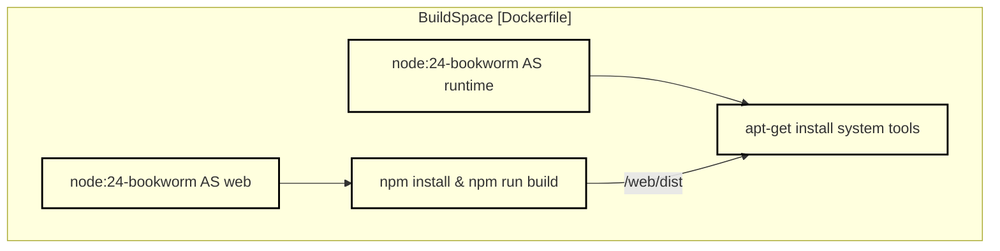
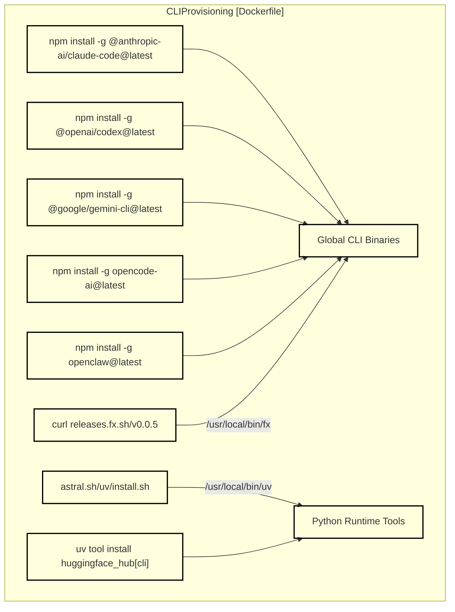
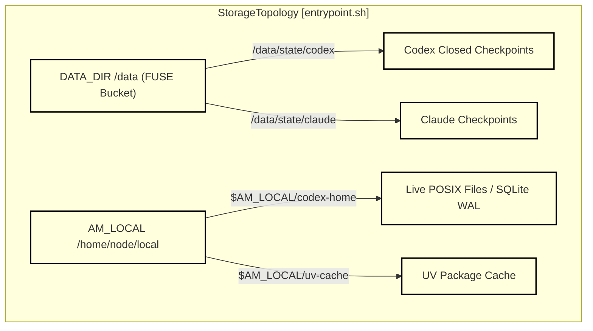
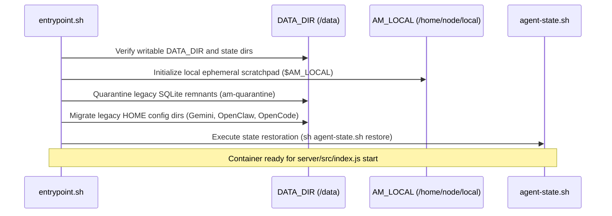

<!-- source: DeepWiki mcp.deepwiki.com · repo huggingface/agent-manager · page 5.1 Docker Image and Entrypoint · fetched 2026-10-26 -->

# Docker Image and Entrypoint

Relevant source files

The following files were used as context for generating this wiki page:

- [.dockerignore](.dockerignore)
- [Dockerfile](Dockerfile)
- [entrypoint.sh](entrypoint.sh)

### Purpose and Scope
This page details the containerization architecture of Agent Manager, covering the multi-stage `Dockerfile`, tool provisioning, Playwright dependency syncing, filesystem segregation between the durable FUSE bucket and ephemeral local storage, and the container startup sequence orchestrated by `entrypoint.sh`.

Sources: `[Dockerfile:1-118](), [entrypoint.sh:1-152]()`

---

## 1. Multi-Stage Dockerfile Architecture

The build process is divided into two discrete stages to isolate frontend build artifacts from the production runtime environment `[Dockerfile:1-18]()`.

*Figure 1: Multi-stage build flow from frontend compilation to the production runtime image.*

Sources: `[Dockerfile:1-18]()`

### Frontend Build Stage (`web`)
* **Base Image**: Uses `node:24-bookworm` `[Dockerfile:2]()`.
* **Process**: Copies `web/package.json` `[Dockerfile:4]()`, installs dependencies via `npm install` `[Dockerfile:5]`, copies the remaining frontend source files `[Dockerfile:6]`, and executes the production build via `npm run build` `[Dockerfile:7]()`.

### Production Runtime Stage (`runtime`)
* **Base Image**: Uses `node:24-bookworm` (Node 24 "Krypton" LTS) `[Dockerfile:18]()`. Debian Bookworm (Debian 12) provides Python 3.11, which underpins the Hermes virtual environment and `/opt/py` toolchains `[Dockerfile:13-14]`.
* **System Packages**: Installs core utilities, build tools for native addons (`node-pty`), tmux, ripgrep, bubblewrap, rsync, utility tools, and fonts (`fonts-liberation`, `fonts-noto-color-emoji`) to support headless Chromium rendering `[Dockerfile:26-30]()`.
* **Git Defaults**: Configures global safe directories to prevent FUSE bucket ownership warnings and sets default commit identities for agent actions `[Dockerfile:36-39]()`.
* **GitHub CLI**: Installs `gh` from official package repositories, enabling authentication via Space secrets (`GH_TOKEN`) `[Dockerfile:41-47]()`.

Sources: `[Dockerfile:1-118]()`

---

## 2. CLI Runtimes, Tooling, and Playwright Provisioning

Agent Manager provisions multiple AI coding CLIs, runtime adapters, and headless browser dependencies globally inside the container image.

*Figure 2: Global provisioning of AI CLI binaries and Python toolchains.*

Sources: `[Dockerfile:55-103]()`

### AI Coding CLIs and Hooks
* **Claude Code & Codex**: Installed globally via npm (`@anthropic-ai/claude-code@latest`, `@openai/codex@latest`) `[Dockerfile:55]()`. Codex is provisioned with a system lifecycle adapter (`am-codex-repin-hook.sh`) and requirements configuration copied to `/etc/codex/` `[Dockerfile:59-61]()`.
* **Gemini CLI, OpenCode, and OpenClaw**: Installed via npm on a best-effort basis (`|| echo ...`) so transient registry hiccups do not break image builds `[Dockerfile:64-70]()`. Gemini is configured with system defaults via `/etc/gemini-cli/system-defaults.json` `[Dockerfile:68]()`.
* **fx Binary**: Vercel Labs' `fx` is fetched as a pinned tarball (`v0.0.5`) to guarantee build reproducibility, extracting the binary, license, and notices to `/usr/local/bin/fx` and `/usr/local/share/doc/fx` `[Dockerfile:71-85]()`.
* **ccusage**: Installed globally and permissions are fixed (`chmod a+rx`) so non-root runtime users can execute cost/token aggregation queries `[Dockerfile:91-93]()`.
* **Python Tooling (`uv` and `hf` CLI)**: Astral's `uv` is installed to `/usr/local/bin` `[Dockerfile:96]()`. The Hugging Face CLI (`huggingface_hub[cli]`) is installed as a uv tool into `/opt/uv-tools` with shims placed on the global `PATH` `[Dockerfile:98-103]()`.

Sources: `[Dockerfile:55-103]()`

---

## 3. Filesystem Topology and Storage Isolation

To prevent performance degradation associated with running active databases, lock files, and build caches directly on FUSE-mounted object storage (`/data`), `entrypoint.sh` splits operations between durable object storage and fast local ephemeral storage (`$AM_LOCAL`) `[entrypoint.sh:13-45]()`.

*Figure 3: Segregation of live runtime state in fast local storage versus closed checkpoints in the durable `/data` bucket.*

Sources: `[entrypoint.sh:13-76]()`

* **Durable Root (`DATA_DIR`)**: Defaults to `/data`. If unmounted or not writable, it falls back to an ephemeral local directory (`$HOME/data`) with a warning `[entrypoint.sh:15-21]()`.
* **Local Workspace (`AM_LOCAL`)**: Set to `/home/node/local` (falling back to `/tmp/agent-manager-local`), hosting package caches (`UV_CACHE_DIR`), tool configurations, and live agent runtimes requiring POSIX close/locking semantics `[entrypoint.sh:35-44]()`.
* **Durable Harness States**: Closed checkpoints for sessions and SQLite database backups are mapped to subdirectories under `$DATA_DIR/state/` (e.g., `CODEX_DURABLE`, `CLAUDE_DURABLE`, `GEMINI_DURABLE`, `OPENCLAW_DURABLE`, `OPENCODE_DURABLE`, `HERMES_DURABLE`, `FX_DURABLE`) `[entrypoint.sh:56-75]()`.

Sources: `[entrypoint.sh:13-80]()`

---

## 4. Startup Sequence in `entrypoint.sh`

When the container launches, `entrypoint.sh` executes a multi-phase boot sequence to prepare storage directories, migrate legacy layouts, and restore agent state.

*Figure 4: Startup sequence and migration flow managed by entrypoint.sh.*

Sources: `[entrypoint.sh:1-152]()`

### Boot Phases
1. **Directory Validation**: Resolves `$DATA_DIR` and ensures durable subdirectories (`/workspaces`, `/state`) exist `[entrypoint.sh:15-22]`.
2. **Local Path Setup**: Configures `$AM_LOCAL`, `$UV_CACHE_DIR`, and live harness home directories (`$CODEX_HOME`, `$CLAUDE_CONFIG_DIR`, etc.) `[entrypoint.sh:38-75]`.
3. **Legacy Quarantining**: Cleans up and quarantines legacy SQLite remnants (`logs_2.sqlite`, `goals_1.sqlite`, `memories_1.sqlite`) from older Codex layouts into `am-quarantine` `[entrypoint.sh:87-92]()`.
4. **State Migration**: Migrates legacy Gemini, OpenClaw, OpenCode, Hermes, and fx configurations using `rsync -a --update`, retaining rollback backups (`.pre-agent-state`) before establishing symlinks to local live paths `[entrypoint.sh:96-143]()`.
5. **State Restoration**: Invokes `agent-state.sh restore` to populate live directories from the durable bucket before handing off control to the main server process `[entrypoint.sh:148-152]()`.

Sources: `[entrypoint.sh:1-152]()`

---

