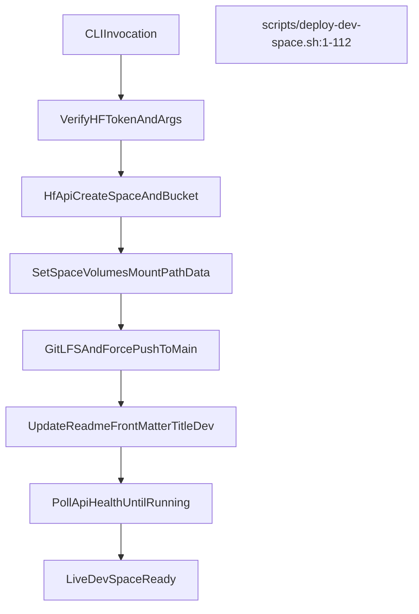
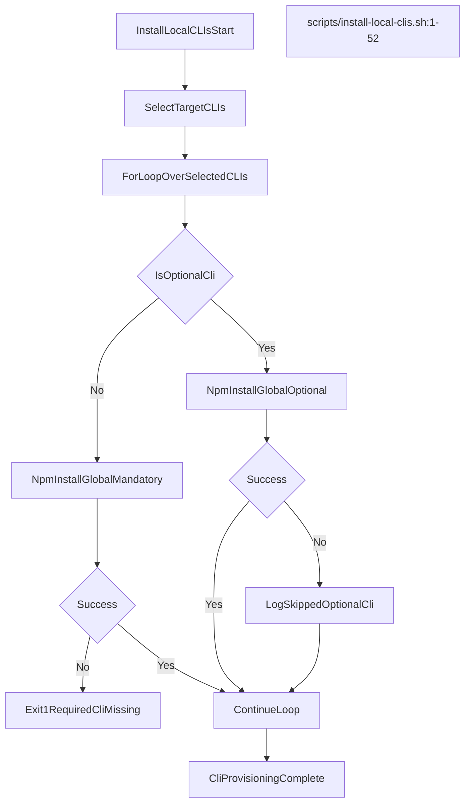
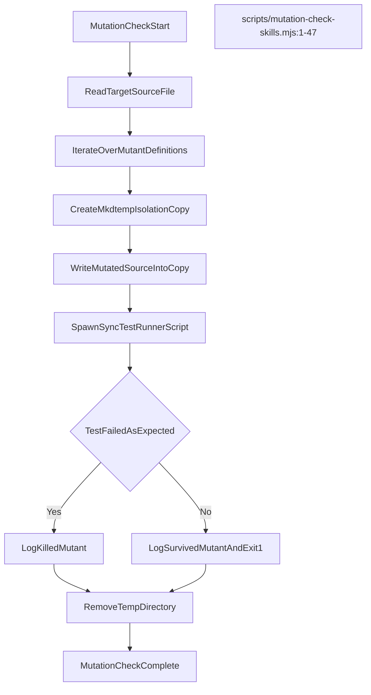

<!-- source: DeepWiki mcp.deepwiki.com · repo huggingface/agent-manager · page 5.2 Scripts and Maintenance Utilities · fetched 2026-10-26 -->

# Scripts and Maintenance Utilities

Relevant source files

The following files were used as context for generating this wiki page:

- [scripts/deploy-dev-space.sh](scripts/deploy-dev-space.sh)
- [scripts/install-local-clis.sh](scripts/install-local-clis.sh)
- [scripts/mutation-check-skills-ui.mjs](scripts/mutation-check-skills-ui.mjs)
- [scripts/mutation-check-skills.mjs](scripts/mutation-check-skills.mjs)
- [scripts/run-suites.mjs](scripts/run-suites.mjs)
- [scripts/startup-bench.mjs](scripts/startup-bench.mjs)

### Purpose and Scope
The `scripts/` directory contains operational tooling, deployment automation, provisioning scripts, test suite orchestrators, benchmark runners, and mutation testing verification tools for Agent Manager. These utilities support local development setup, throwaway Hugging Face Space deployments, robust test discovery, and regression protection.

---

## 1. Deployment and Provisioning Utilities

### Dev Space Deployment (`deploy-dev-space.sh`)
The `scripts/deploy-dev-space.sh` script automates the deployment of a local branch to an isolated, private throwaway Hugging Face Space complete with its own dedicated storage bucket mounted at `/data` [scripts/deploy-dev-space.sh:1-50](). 

Key phases of execution in `deploy-dev-space.sh`:
1. **Validation & Resolution**: Resolves the target branch and checks for `HF_TOKEN` credentials [scripts/deploy-dev-space.sh:11-18](). Determines the owner and names the Space `<owner>/<name>` and bucket `<owner>/<name>-data` [scripts/deploy-dev-space.sh:19-25]().
2. **Infrastructure Provisioning**: Invokes the Hugging Face Hub API via Python to create a private Space using the Docker SDK, creates a private storage bucket, and binds the volume to `/data` so that dev instances never share production sessions or CLI credentials [scripts/deploy-dev-space.sh:39-50]().
3. **Git LFS and Force Push**: Removes temporary git remotes, pushes LFS objects, and force-pushes the target branch to `refs/heads/main` [scripts/deploy-dev-space.sh:52-59]().
4. **Card Metadata Customization**: Rewrites the Space's `README.md` front-matter (`title`, `emoji`, `colorFrom`, `short_description`) via the Hub API to mark the dashboard card as a `(dev)` instance without altering the local repository's production README [scripts/deploy-dev-space.sh:61-91]().
5. **Health Verification**: Polls the Space runtime stage until `RUNNING`, then verifies that `/api/health` responds with JSON containing `ok:true` [scripts/deploy-dev-space.sh:93-112]().

Sources: `scripts/deploy-dev-space.sh:1-112`

### Local CLI Provisioning (`install-local-clis.sh`)
When running Agent Manager outside of Docker, `scripts/install-local-clis.sh` provisions the required npm-distributed agent CLIs (`claude`, `codex`, `gemini`, `opencode`, `openclaw`) [scripts/install-local-clis.sh:1-13](). 

The script differentiates between mandatory dependencies (Claude Code and Codex) and optional tools (Gemini, OpenCode, OpenClaw). Optional tools are allowed to fail installation if specific Node.js engine mismatches occur, ensuring that missing optional binaries do not block local setup [scripts/install-local-clis.sh:14-47]().

Sources: `scripts/install-local-clis.sh:1-52`

---

## 2. Test Orchestration and Suite Discovery (`run-suites.mjs`)

The `scripts/run-suites.mjs` script manages test discovery, execution order, parallel concurrency, and suite timeouts across backend and frontend packages [scripts/run-suites.mjs:1-64]().

### Core Responsibilities
- **Discovery**: Scans `test/` subdirectories and package roots for `*.test.mjs` files up to two directory depths, preventing unintended fixture execution while catching stray test files [scripts/run-suites.mjs:65-114]().
- **Dynamic Scheduling**: Reads historical execution durations from `web/node_modules/.cache/am-suite-times.json` to schedule the longest-running test suites first [scripts/run-suites.mjs:116-123]().
- **Concurrency Control**: Spawns test jobs bounded by available CPU cores. Serial test suites marked with `am-test: serial` in their header are deferred to run sequentially after parallel suites complete [scripts/run-suites.mjs:24-26]().
- **Build Coordinated Testing**: Coordinates a single `vite build` invocation when suites require `AM_TEST_DIST` [scripts/run-suites.mjs:27-33]().
- **Failure Resilience**: Prevents early test run aborts. Every suite executes to completion, and summary reports list failing exit statuses or timed-out processes exceeding `AM_SUITE_TIMEOUT` [scripts/run-suites.mjs:34-45]().

Sources: `scripts/run-suites.mjs:1-124`

---

## 3. Frontend Performance Benchmarking (`startup-bench.mjs`)

The `scripts/startup-bench.mjs` benchmark script measures cold and warm startup costs of production frontend builds using a real headless Chromium browser coupled with a fixture server (`web/test/helpers/fixture-server.mjs`) [scripts/startup-bench.mjs:1-48]().

### Benchmark Metrics and Profiles
- **Scenarios**: Evaluates multiple navigation targets (`overview`, `reader`, `reader-empty`, `files`, `trace`, and `group`) to test distinct component hydration paths [scripts/startup-bench.mjs:53-61]().
- **Device Profiles**: Simulates `desktop` (1280x800, unthrottled) and `mobile` (390x844, 4x CPU slowdown, Slow 4G network conditions) environments via Chrome DevTools Protocol (CDP) [scripts/startup-bench.mjs:19-21, 67-76]().
- **Captured Data**: Records JavaScript bundle payload sizes, request counts, V8 script execution duration (`ScriptDuration`), V8 compilation duration (`V8CompileDuration`), navigation latency, and view usability timestamps determined via DOM `MutationObserver` markers (`window.__marks`) [scripts/startup-bench.mjs:80-107]().

Sources: `scripts/startup-bench.mjs:1-120`

---

## 4. Mutation Testing Suite

Agent Manager employs mutation testing scripts to verify the resilience of core backend logic and frontend UI flows against specific code mutants.

### Skill Backend Mutation Checks (`mutation-check-skills.mjs`)
The `scripts/mutation-check-skills.mjs` script verifies `server/src/skills.js` by generating isolated temporary copies injected with specific semantic mutants (e.g., bypassing collision guards, staleness checks, or unowned installation guards) and executing `server/test/skills.test.mjs` against each mutant [scripts/mutation-check-skills.mjs:1-46](). Mutants whose test suites still pass are reported as `SURVIVED`, while failing suites properly `KILL` the mutant [scripts/mutation-check-skills.mjs:41-43]().

### Skills UI Mutation Checks (`mutation-check-skills-ui.mjs`)
The `scripts/mutation-check-skills-ui.mjs` script performs equivalent mutation verification on frontend React components (`web/src/components/SkillsEditor.tsx`), verifying deletion confirmations, duplicate submission guards, and error discards by running browser test suites [scripts/mutation-check-skills-ui.mjs:1-34]().

Sources: `scripts/mutation-check-skills.mjs:1-47`, `scripts/mutation-check-skills-ui.mjs:1-35`

---

