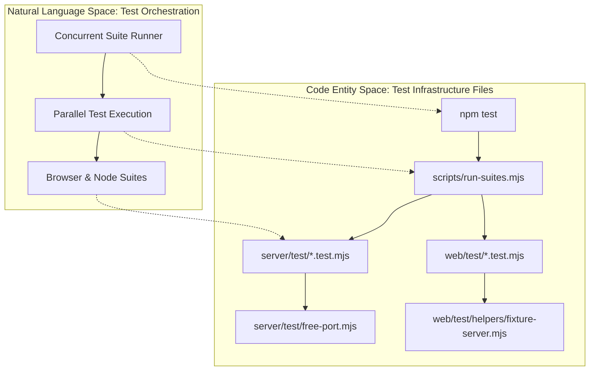
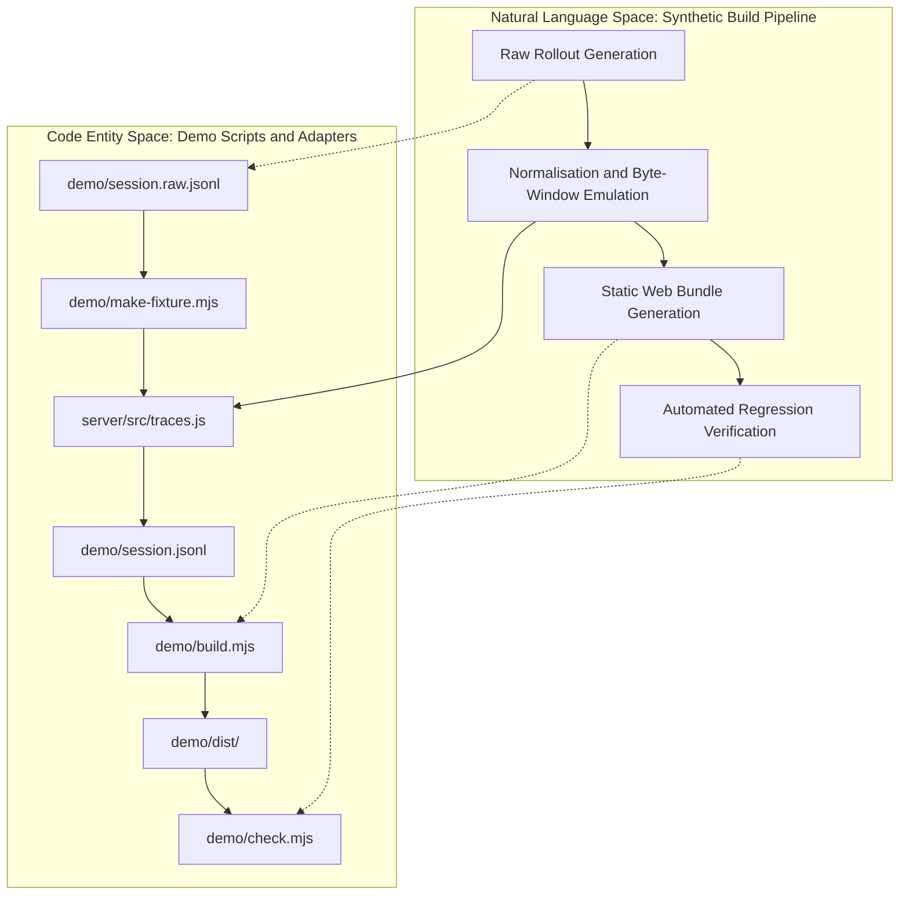

<!-- source: DeepWiki mcp.deepwiki.com · repo huggingface/agent-manager · page 6 Testing and the Reader Demo · fetched 2026-10-26 -->

# Testing and the Reader Demo

Relevant source files

The following files were used as context for generating this wiki page:

- [demo/README.md](demo/README.md)
- [docs/testing.md](docs/testing.md)

## Purpose and Scope

This page provides an overview of the testing strategy and the standalone reader demo application for the Agent Manager codebase. The test infrastructure spans `server/test/` and `web/test/`, using Node's test runner, Playwright for browser automation, and custom suite execution scripts [docs/testing.md:1-10](). The reader demo (`demo/`) is a standalone static Space that runs the production conversation reader over bundled synthetic sessions to prevent regressions [demo/README.md:1-6](). 

As a parent page, this section outlines the high-level architecture of both testing and demo pipelines. For deep technical details, see the child pages:
- [Test Infrastructure](#6.1)
- [Reader Demo Application](#6.2)

---

## 6.1. Test Infrastructure

The test infrastructure executes a comprehensive suite of unit, integration, and UI tests across both backend and frontend packages. Tests are written as plain `*.test.mjs` files and are discovered automatically by the test runner without manual lists [docs/testing.md:1-6](). 

The test runner distributes suites across available CPU cores, running them concurrently while tracking execution times to optimize scheduling [docs/testing.md:20-21, 89-91](). Specialized test suites cover terminal rendering, browser automation via Playwright/Chromium, mobile viewport emulation, and live CLI interactions under isolated temporary directories [docs/testing.md:103-112]().

### Test Suite Execution Architecture

*Diagram 1: Mapping test orchestrator concepts to concrete runner and fixture files.*

Sources: `[docs/testing.md:1-18]`, `[docs/testing.md:71-74]`

For details on Node test suites, Playwright configuration, testing fixtures (`ink-tui`, `repaint-tui`, `fake-hf`), suite runners, and harness conventions, see [Test Infrastructure](#6.1).

---

## 6.2. Reader Demo Application

The reader demo is a standalone static Space located in `demo/` that runs the production conversation reader (`web/src/components/ConversationView.tsx`, `ReaderStore`, `readerModel`) against a bundled synthetic session [demo/README.md:1-19](). It serves as an isolated validation environment that ensures the UI remains fully compatible with trace backend contracts without requiring a live backend server.

The demo relies on a build pipeline that transforms raw rollout records into normalized conversation turns, using the production normalizer found in `server/src/traces.js` [demo/README.md:21-32](). 

### Reader Demo Pipeline Architecture

*Diagram 2: Mapping the demo pipeline concepts to transformation scripts and data files.*

Sources: `[demo/README.md:1-37]`

For details on the `fixtureApi` byte-window emulation, the `make-fixture`/`normalize`/`build`/`check`/`live` script pipeline, and the `session.jsonl` schema, see [Reader Demo Application](#6.2).

---

