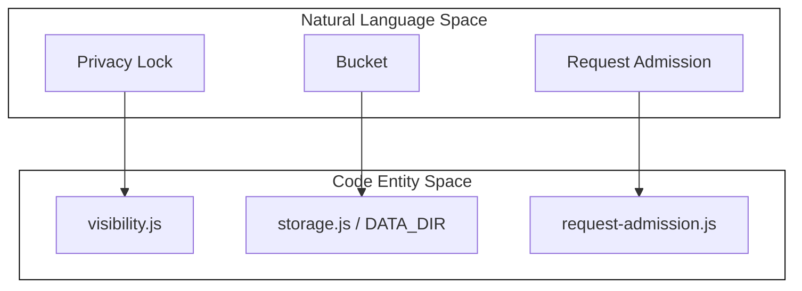
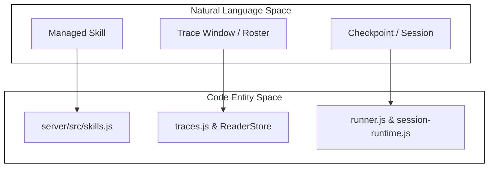

<!-- source: DeepWiki mcp.deepwiki.com · repo huggingface/agent-manager · page 7 Glossary · fetched 2026-10-26 -->

# Glossary

Relevant source files

The following files were used as context for generating this wiki page:

- [README.md](README.md)
- [SECURITY.md](SECURITY.md)
- [docs/codex-shared-bindings.md](docs/codex-shared-bindings.md)
- [docs/managed-skills.md](docs/managed-skills.md)
- [docs/reader-architecture.md](docs/reader-architecture.md)

## Purpose and Scope

This page provides exact technical definitions for codebase-specific terms, architectural concepts, runtime primitives, and feature flags used across the Agent Manager repository. Each entry details the core implementation mechanics, relevant data flows, and code entity pointers to aid developers navigating the backend (`server/src/`), web frontend (`web/`), and documentation (`docs/`).

---

## Term Definitions and Code Pointers

### 1. Admission (Request Admission)
* **Definition**: The security and policy gate that validates incoming HTTP and WebSocket requests to prevent cross-site request forgery (CSRF) and untrusted frame nesting [SECURITY.md:1-28].
* **Implementation**: Request admission is enforced through policies checking custom request headers (such as `X-AM-Request` and `X-AM-Origin`) and validating frame ancestors [docs/codex-shared-bindings.md:32-36].
* **Sources**: `SECURITY.md:1-28`, `docs/codex-shared-bindings.md:32-36`

### 2. Bucket
* **Definition**: A private Hugging Face storage volume mounted at `/data` inside the container [README.md:58-60]. It provides persistent storage for workspace files, user logins, credentials, and conversation history across Space restarts [README.md:127-141].
* **Implementation**: Managed via Hugging Face Hub volume mount configurations. Local storage modules access paths relative to `DATA_DIR`.
* **Sources**: `README.md:55-141`, `SECURITY.md:1-28`

### 3. Checkpoint
* **Definition**: Durably saved workspace files and CLI/session state that survive container reboots and Space rebuilds [README.md:133-141].
* **Implementation**: Managed by session runners (`runner.js` / `session-runtime.js`) which snapshot process metadata and session bindings into storage stores so eligible sessions can resume after reboot.
* **Sources**: `README.md:133-141`

### 4. Dispatch / Delegation
* **Definition**: A feature subsystem enabling agents to discover, message, wait for, and delegate subtasks to other sessions via local APIs [README.md:41-42].
* **Implementation**: Built on top of the backend runtime router, allowing inter-session messaging, status waiting (`GET /api/agents/:id/wait`), and task handoffs [docs/codex-shared-bindings.md:111-114].
* **Sources**: `README.md:41-42`, `docs/codex-shared-bindings.md:111-114`

### 5. Framing
* **Definition**: HTTP security policy restricting how the application UI can be embedded in `<iframe>` elements across origins [SECURITY.md:1-28].
* **Implementation**: Enforced via HTTP response headers (`frame-ancestors`) to defend against clickjacking and untrusted embedding.
* **Sources**: `SECURITY.md:1-28`

### 6. Harness
* **Definition**: Test infrastructure, suite runners, and mock fixtures used across backend (`server/test/`) and frontend (`web/test/`) suites [docs/reader-architecture.md:66-79].
* **Implementation**: Includes Node test suites, browser automation fixtures (Playwright/chromium), and mock terminal environments (`ink-tui`, `fake-hf`) to validate state reconciliation and UI behavior [docs/reader-architecture.md:66-79].
* **Sources**: `docs/reader-architecture.md:66-79`

### 7. Managed Skill
* **Definition**: Reusable prompt skills and instructions owned and managed explicitly by the manager service [docs/managed-skills.md:1-7].
* **Implementation**: Defined in `server/src/skills.js` and tracked via manifest `DATA_DIR/state/skills/skills-v1.json`. Redistributes `SKILL.md` files to configured CLI target directories (`HOME/.agents/skills`, etc.) while ensuring generated skills like `environment.md` remain read-only [docs/managed-skills.md:34-82].
* **Sources**: `docs/managed-skills.md:1-116`

### 8. Passive CLI
* **Definition**: An agent connection or remote agent stream that runs without spawning an active local PTY/terminal writer inside the manager workspace [docs/codex-shared-bindings.md:53-56].
* **Implementation**: Imported or shared tasks (such as Codex shared sessions) that register session views, provide read-only conversation access, and submit turns via API (`turn/start`) without operating a local terminal process [docs/codex-shared-bindings.md:53-100].
* **Sources**: `docs/codex-shared-bindings.md:53-100`

### 9. Privacy Lock
* **Definition**: A core security mechanism that continuously audits the Hugging Face Space and mounted storage bucket visibility [SECURITY.md:1-28].
* **Implementation**: Verified once a minute via `visibility.js`. If a Space or bucket is detected as public, or if verification fails for 2.5 minutes, the app locks down immediately: privileged APIs refuse requests, live terminal and stream connections are revoked on the server, and secret names are hidden [SECURITY.md:1-28].
* **Sources**: `SECURITY.md:1-28`

### 10. Repin Hook
* **Definition**: Specific CLI integration hooks (such as Claude Code statusline/repin hooks) that capture session state, status updates, and thread bindings [README.md:1-51].
* **Implementation**: Configured per CLI to report status and update exact thread associations.
* **Sources**: `README.md:1-51`

### 11. Response Item
* **Definition**: Granular data units representing turns, messages, tool calls, or chunked events in conversation transcripts and trace window parsers.
* **Implementation**: Parsed by byte-window transport contracts in `traces.js` and rendered by `ReaderStore` and `ConversationView` [docs/reader-architecture.md:9-15].
* **Sources**: `docs/reader-architecture.md:9-15`

### 12. Rollout
* **Definition**: Native execution stream or thread log format (such as in Codex shared sessions) containing conversation history and event sequences [docs/codex-shared-bindings.md:76-82].
* **Implementation**: Parsed and validated via exact path checks inside the configured home directory to render live reader streams without duplicating history [docs/codex-shared-bindings.md:76-82].
* **Sources**: `docs/codex-shared-bindings.md:76-82`

### 13. Slow-FS Probe
* **Definition**: Diagnostics and handling routines designed to detect slow filesystems, latency issues, and FUSE phantom directory artifacts under `/data`.
* **Implementation**: Periodic storage probes guard against filesystem lockups and ensure safe write operations.
* **Sources**: `README.md:55-70`

### 14. Subagent Roster
* **Definition**: A dynamic collection of active subagents, child tasks, or background operations tracked by trace parsers and session views [README.md:32-50].
* **Implementation**: Maintained by `traces.js` to reflect active subtask delegations across the conversation lifecycle.
* **Sources**: `README.md:32-50`

### 15. Trace Window
* **Definition**: A bounded, continuous byte-window transport contract used by conversation parsers and readers [docs/reader-architecture.md:9-15].
* **Implementation**: Defined in `traces.js` and managed by `ReaderStore`. Version 2 windows preserve cross-window message identities, lifecycle events, and paging buffers without assuming independent fragments are complete messages [docs/reader-architecture.md:9-15].
* **Sources**: `docs/reader-architecture.md:9-15`, `README.md:32-50`

---

## Mapping Natural Language Space to Code Entity Space

The following diagrams bridge abstract system terms to concrete code entities, classes, and modules within the codebase.

### Diagram 1: Security and Storage Subsystems

*Sources: `SECURITY.md:1-28`, `README.md:55-70`*

### Diagram 2: Runtime, Skills, and Conversation Parsing

*Sources: `docs/managed-skills.md:1-15`, `docs/reader-architecture.md:9-20`, `README.md:133-141`*