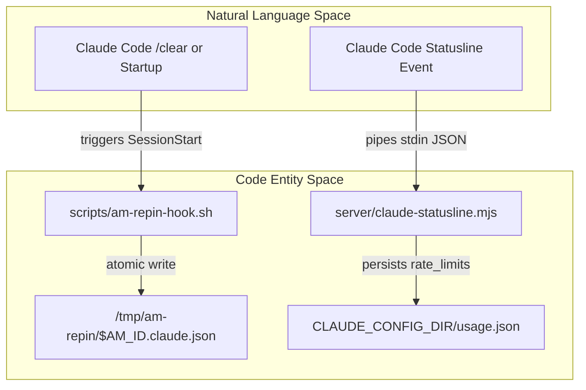
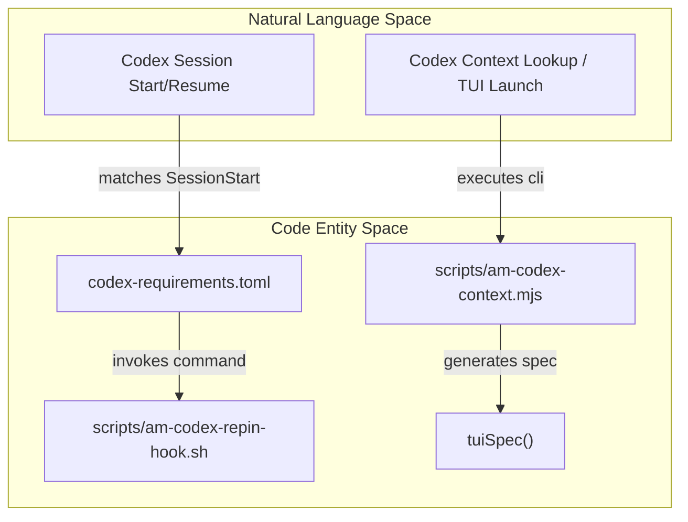

<!-- source: DeepWiki mcp.deepwiki.com · repo huggingface/agent-manager · extra page Agent Integrations and Hooks · fetched 2026-10-26 -->

# Agent Integrations and Hooks

Relevant source files

The following files were used as context for generating this wiki page:

- [codex-requirements.toml](codex-requirements.toml)
- [gemini-system-defaults.json](gemini-system-defaults.json)
- [scripts/am-codex-context.mjs](scripts/am-codex-context.mjs)
- [scripts/am-codex-repin-hook.sh](scripts/am-codex-repin-hook.sh)
- [scripts/am-opencode-repin.js](scripts/am-opencode-repin.js)
- [scripts/am-repin-hook.sh](scripts/am-repin-hook.sh)
- [server/claude-statusline.mjs](server/claude-statusline.mjs)

## Purpose and Scope
This page details the per-CLI integration mechanisms, hooks, and plugins used by Agent Manager to bridge external command-line AI coding tools with its containerized session runtime. It covers process-tree attribution, session re-pinning (`/clear` and `/resume` tracking), status line telemetry, context lookup utilities, and input-required event signaling for Claude Code, Codex, OpenCode, Gemini, Hermes, and associated helper processes.

Sources:
- `codex-requirements.toml:1-17` 
- `gemini-system-defaults.json:1-47` 
- `scripts/am-codex-context.mjs:1-80` 
- `scripts/am-codex-repin-hook.sh:1-69` 
- `scripts/am-opencode-repin.js:1-140` 
- `scripts/am-repin-hook.sh:1-42` 
- `server/claude-statusline.mjs:1-27` 

---

## Claude Code Integration: Statusline and Re-pin Hooks
Claude Code integrates with Agent Manager via two primary scripting mechanisms executed within the terminal pane's environment: a statusline consumer and a SessionStart re-pin hook.

### Statusline Telemetry
The statusline script `server/claude-statusline.mjs` consumes a JSON blob piped on `process.stdin` by Claude Code [server/claude-statusline.mjs:1-9](). It extracts official `rate_limits` (Pro/Max tiers) and cost metrics, persisting them to `usage.json` inside the configured `CLAUDE_CONFIG_DIR` [server/claude-statusline.mjs:13-19](). It then outputs a compact string containing model names and percentage usages for 5-hour and 7-day windows to `process.stdout` [server/claude-statusline.mjs:20-27]().

### SessionStart Re-pin Hook
The script `scripts/am-repin-hook.sh` handles conversation re-pinning when Claude Code starts or resets via `/clear` [scripts/am-repin-hook.sh:1-10](). 
1. It validates environment variables including `AM_ID`, `AM_RUN_ID`, `AM_CLI="claude"`, and `CLAUDE_CODE_ENTRYPOINT="cli"` [scripts/am-repin-hook.sh:19-24]().
2. It inspects `/proc` to verify that `CLAUDE_PID` matches either the pane root PID (`AM_PANE_PID`) or is its direct child, preventing nested tool-spawned Claude processes from hijacking the top-level session crumb [scripts/am-repin-hook.sh:25-33]().
3. It writes a JSON breadcrumb payload to the local directory `$AM_REPIN_DIR` (defaulting to `/tmp/am-repin`) using atomic write patterns (`.tmp` + `mv -f`) [scripts/am-repin-hook.sh:34-41]().

*Figure 1: Claude Code hook integration bridging execution events to disk breadcrumbs and usage stores.*

Sources:
- `scripts/am-repin-hook.sh:1-42` 
- `server/claude-statusline.mjs:1-27` 

---

## Codex Launch Policy and Context Re-pin
Codex instances are governed by container-level policies and hook requirements defined under `/etc/codex/hooks` and managed via helper CLI tools.

### Container Launch Policy
The container configuration file `codex-requirements.toml` enforces managed hook policies without requiring per-pane interactive trust prompts [codex-requirements.toml:1-5](). It registers a `SessionStart` hook matching `startup`, `resume`, or `clear` actions to execute `/etc/codex/hooks/am-codex-repin-hook.sh` with a 5-second timeout [codex-requirements.toml:7-16]().

### Repin Hook Implementation
The script `scripts/am-codex-repin-hook.sh` validates incoming environment parameters (`AM_CLI="codex"`, `AM_ID`, `AM_RUN_ID`, `AM_PANE_PID`) [scripts/am-codex-repin-hook.sh:4-9](). It walks `/proc/[pid]/stat` up to 64 hops to verify process ancestry and ensure the Codex process executing the hook matches expected process bounds relative to `AM_PANE_PID` and the server's Node executable (`AM_NODE_EXE`) [scripts/am-codex-repin-hook.sh:15-59](). Validated events are written atomically to `$AM_REPIN_DIR/$AM_ID.codex.json` [scripts/am-codex-repin-hook.sh:61-68]().

### Context and TUI Utilities
The module `scripts/am-codex-context.mjs` provides context resolution, thread importing, and TUI launching utilities for native Codex tools [scripts/am-codex-context.mjs:1-79](). 
- `readConfig()` and `localOrigin()` validate that communication routes through a local loopback HTTP endpoint [scripts/am-codex-context.mjs:11-24]().
- `tuiSpec()` constructs safe child process launch parameters (`--remote unix://...`) while stripping inherited `AM_` or `CODEX_THREAD_ID` environment variables to prevent spoofing [scripts/am-codex-context.mjs:25-35]().
- `run()` executes subcommands (`resolve`, `import`, `tui`) with strict argument validation and timeout controls [scripts/am-codex-context.mjs:36-79]().

*Figure 2: Codex policy configuration and context resolution flow.*

Sources:
- `codex-requirements.toml:1-17` 
- `scripts/am-codex-context.mjs:1-80` 
- `scripts/am-codex-repin-hook.sh:1-69` 

---

## OpenCode Plugin Integration
OpenCode integrations are managed via a plugin model exported by `scripts/am-opencode-repin.js` [scripts/am-opencode-repin.js:1-139]().

### Key Functions and Data Flow
- `paneIdentity()`: Validates that `AM_CLI === 'opencode'`, `AM_ID` and `AM_RUN_ID` match safe alphanumeric patterns, and that `process.pid` matches `AM_PANE_PID` [scripts/am-opencode-repin.js:7-13]().
- `report(sessionID, cwd, source)`: Synchronously writes session creation and message event data to `$AM_REPIN_DIR/$amId.opencode.json` via atomic file renames [scripts/am-opencode-repin.js:15-37]().
- `syncInputRequired(pending)`: Tracks pending permission or question requests (`permission.asked`, `question.asked`), synchronizing input-required states to disk so that the manager UI can alert users without interfering with the TUI event loop [scripts/am-opencode-repin.js:39-67]().
- `AgentManagerRepin`: An asynchronous plugin factory returning handlers for OpenCode events (`event`), chat messages (`chat.message`), and environment sanitization (`shell.env` which clears `AM_*` keys for nested tool shells) [scripts/am-opencode-repin.js:72-139]().

Sources:
- `scripts/am-opencode-repin.js:1-140` 

---

## Gemini System Defaults and Input Hooks
Gemini CLI environments are initialized using system-level default configuration files.

The configuration file `gemini-system-defaults.json` establishes general options (such as enabling notifications via `osc9`) and registers hook bindings for notification events [gemini-system-defaults.json:1-6](). Specifically, `Notification` (matching `ToolPermission`), `AfterAgent`, and `SessionEnd` hooks are configured to execute `/app/scripts/am-input-required-hook.sh` with a 5000ms timeout [gemini-system-defaults.json:6-46](). This relays attention signals back to the container runtime whenever agent interaction or authorization is blocked.

Sources:
- `gemini-system-defaults.json:1-47` 

---

