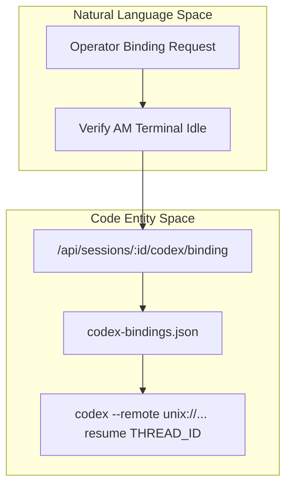
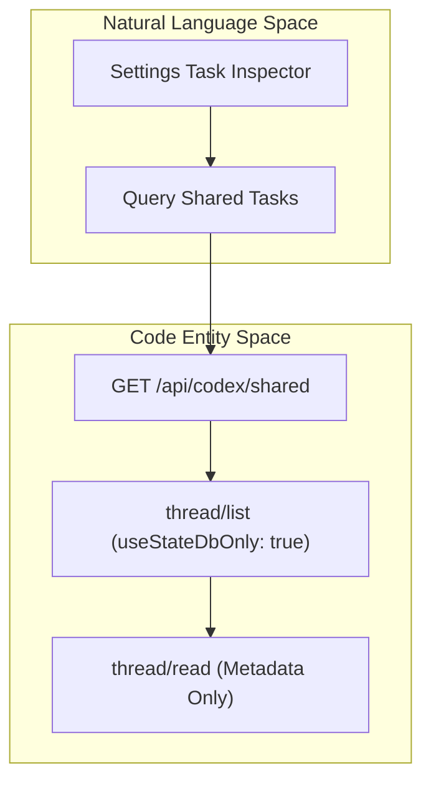
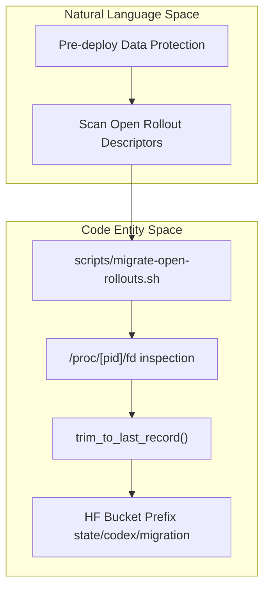

<!-- source: DeepWiki mcp.deepwiki.com · repo huggingface/agent-manager · extra page Codex Shared Sessions · fetched 2026-10-26 -->

# Codex Shared Sessions

<details>
<summary>Relevant source files</summary>

The following files were used as context for generating this wiki page:

- [docs/codex-agent-reconnect.md](docs/codex-agent-reconnect.md)
- [docs/codex-shared-bindings.md](docs/codex-shared-bindings.md)
- [docs/codex-shared-preview.md](docs/codex-shared-preview.md)
- [docs/proposals/codex-shared-next-steps.md](docs/proposals/codex-shared-next-steps.md)
- [docs/proposals/codex-shared-sessions.md](docs/proposals/codex-shared-sessions.md)
- [scripts/am-codex-migrate.mjs](scripts/am-codex-migrate.mjs)
- [scripts/migrate-open-rollouts.sh](scripts/migrate-open-rollouts.sh)
- [scripts/probe-codex-shared.mjs](scripts/probe-codex-shared.mjs)

</details>


## Purpose and Scope

This page documents the Codex-specific shared session architecture in Agent Manager (AM). It details how AM decouples execution from standalone PTY processes by integrating with an independently managed Codex app-server via Unix sockets. Topics covered include exact thread bindings, the read-only observation client, rollout migration for FUSE-backed object storage, automatic thread reconnect and prompt delivery, compatibility probes, and design proposals.

Sources: `docs/proposals/codex-shared-sessions.md:1-126`, `docs/codex-shared-bindings.md:1-121`

---

## 1. Codex Thread Bindings and Pilot Architecture

Agent Manager allows existing sessions to be associated with exact Codex thread UUIDs handed off to a configured Codex server. To prevent regressions in production, binding writes are restricted and require an explicit opt-in pilot flag (`AM_CODEX_BINDINGS_PILOT=1`). 

### Binding Mechanics and API

The binding route binds an existing AM session ID to a live Codex thread ID. It requires the old AM terminal to be stopped with no queued prompts, and the target thread must already be loaded and idle on the verified server within the correct workspace.

```sh
curl --fail-with-body "http://127.0.0.1:7861/api/sessions/AM_SESSION_ID/codex/binding" \
  -H 'X-AM-Request: 1' -H 'X-AM-Origin: operator' \
  -H 'Content-Type: application/json' \
  --data '{"threadId":"EXACT_CODEX_UUID","expectedRevision":0}'
```

The underlying persistence maps sessions to runtime configurations using versioned bindings (`codexRuntime.mode`, `codexRuntime.endpointId`, `codexRuntime.threadId`, `codexRuntime.revision`), ensuring that local file existence does not dictate whether a shared thread is valid.



Sources: `docs/codex-shared-bindings.md:1-121`, `docs/proposals/codex-shared-sessions.md:67-111`

---

## 2. Observation Client and Preview API

The shared server preview provides a read-only task inspector in the web interface, implemented via the `GET /api/codex/shared` route. It communicates with the Codex app-server using a restricted transport protocol.

### Transport Limitations and Safety
To safeguard shared instances, the observer restricts its RPC capabilities:
- Uses metadata-only `thread/read` calls.
- Restricts `thread/list` queries with `useStateDbOnly: true` to avoid heavy rollout scan/repair operations.
- Never resumes, subscribes, or answers approval requests through the preview route.



Sources: `docs/codex-shared-preview.md:1-132`, `docs/proposals/codex-shared-sessions.md:102-111`

---

## 3. Rollout Migration and Storage Safeguards

Codex appends output to rollout files (`rollout-<ts>-<uuid>.jsonl`) mounted over a Hugging Face Space `/data` bucket via FUSE. Because streaming writers can hold entire epochs in memory, container deployments risk losing active session data unless flushed or migrated safely.

### Migration Script Architecture
The migration utility inspects active processes via `/proc`, snapshots open write FZF descriptors, trims trailing partial lines, and uploads safe closed copies to a dedicated bucket prefix (`state/codex/migration`) before container replacement.

```sh
scripts/migrate-open-rollouts.sh                # snapshot, upload, verify
scripts/migrate-open-rollouts.sh --dry-run      # report, touch nothing
scripts/migrate-open-rollouts.sh --restore      # boot side: reconcile
```



Sources: `scripts/migrate-open-rollouts.sh:1-169`, `docs/proposals/codex-shared-next-steps.md:41-44`

---

## 4. Automatic Reconnect and Prompt Delivery

Agent Manager can recover existing shared Codex threads that are saved but currently unloaded when a message is dispatched via `POST /api/agents/:id/prompt?from=SOURCE`.

### Reconnect Protocol
- Recovers the original thread ID, model, current working directory, approval settings, and permission profile.
- Bypasses standalone TUI bootups, preventing interruption of active work or replay of old inputs.
- Verifies input receipts durably (`DATA_DIR/delegations/<UUID>.json`) to prevent duplicate queue submissions after transport timeouts or AM restarts.

Sources: `docs/codex-agent-reconnect.md:1-117`, `docs/proposals/codex-shared-next-steps.md:10-22`

---

## 5. Compatibility Probes and Validation

To verify the app-server interface and test regression behaviors across versions, AM includes a standalone compatibility script.

### Probe Execution
The probe provisions a temporary Codex home with a deterministic stub provider, launches an app-server instance over stdio, tests identity preservation through `thread/shellCommand`, restarts the server, and validates warm-resume behaviors.

```sh
node scripts/probe-codex-shared.mjs
```

Exit codes:
- `0`: Tested invariants held successfully.
- `2`: Context or configuration loss observed after restart.
- `1`: Probe execution failure.

Sources: `docs/codex-shared-preview.md:45-70`, `scripts/probe-codex-shared.mjs:1-145`

---

## Summary of Configuration Variables

| Environment Variable | Scope | Purpose |
|----------------------|-------|---------|
| `AM_CODEX_SHARED_SOCKET` | Administrator | Absolute path to the shared control Unix socket |
| `AM_CODEX_SHARED_HOME` | Administrator | Absolute path to the verified Codex home directory |
| `AM_CODEX_BINDINGS_PILOT` | Administrator | Opt-in flag required to permit shared binding writes |
| `AM_BUCKET` | Deployment | Custom bucket name for rollout migration syncing |

Sources: `docs/codex-shared-bindings.md:17-23`, `docs/codex-shared-preview.md:14-19`, `scripts/migrate-open-rollouts.sh:59-64`

---

