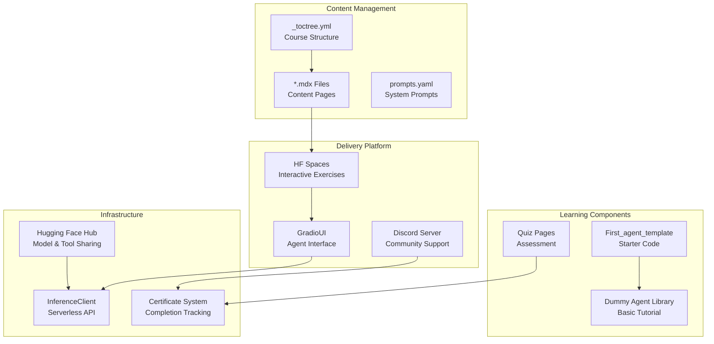

<!-- source: DeepWiki mcp.deepwiki.com · repo huggingface/agents-course · page 1 Overview · fetched 2026-10-26 -->

# Overview

<details>
<summary>Relevant source files</summary>

The following files were used as context for generating this wiki page:

- [README.md](README.md)
- [units/en/_toctree.yml](units/en/_toctree.yml)
- [units/en/bonus-unit3/building_your_pokemon_agent.mdx](units/en/bonus-unit3/building_your_pokemon_agent.mdx)
- [units/en/bonus-unit3/conclusion.mdx](units/en/bonus-unit3/conclusion.mdx)
- [units/en/bonus-unit3/from-llm-to-agents.mdx](units/en/bonus-unit3/from-llm-to-agents.mdx)
- [units/en/bonus-unit3/introduction.mdx](units/en/bonus-unit3/introduction.mdx)
- [units/en/bonus-unit3/launching_agent_battle.mdx](units/en/bonus-unit3/launching_agent_battle.mdx)
- [units/en/bonus-unit3/state-of-art.mdx](units/en/bonus-unit3/state-of-art.mdx)
- [units/en/unit0/discord101.mdx](units/en/unit0/discord101.mdx)
- [units/en/unit0/introduction.mdx](units/en/unit0/introduction.mdx)
- [units/en/unit0/onboarding.mdx](units/en/unit0/onboarding.mdx)
- [units/en/unit1/tutorial.mdx](units/en/unit1/tutorial.mdx)

</details>


This document provides a comprehensive technical overview of the Hugging Face AI Agents Course repository, which serves as an educational platform for teaching AI agent development from fundamentals to advanced applications. The repository contains a complete curriculum covering agent theory, practical frameworks, and real-world implementations.

For specific information about individual agent frameworks, see [smolagents Framework](#3.1), [LlamaIndex Framework](#3.2), and [LangGraph Framework](#3.3). For details about practical applications, see [Use Cases and Applications](#5). For information about the course delivery infrastructure, see [Course Platform and Infrastructure](#6).

## Course Structure and Educational Framework

The course is organized as a progressive learning journey, structured through a hierarchical table of contents system that guides students from basic concepts to advanced implementations.

### Course Platform Architecture



The course follows a four-unit progression with additional bonus content. Each unit builds upon previous concepts while introducing new frameworks and applications.

Sources: [units/en/_toctree.yml:1-173](), [units/en/unit0/introduction.mdx:56-72](), [README.md:8-28]()

### Educational Progression Model

```mermaid
graph LR
    subgraph "Unit0[\"Unit 0: Onboarding\"]"
        intro_mdx["introduction.mdx<br/>Course Overview"]
        onboard_mdx["onboarding.mdx<br/>Setup Process"]
        discord_mdx["discord101.mdx<br/>Community Guide"]
    end
    
    subgraph "Unit1[\"Unit 1: Fundamentals\"]"
        what_agents["what-are-agents<br/>Core Concepts"]
        tao_cycle["agent-steps-and-structure<br/>TAO Implementation"]
        dummy_lib["dummy-agent-library<br/>Basic Agent"]
        tutorial_mdx["tutorial.mdx<br/>smolagents Intro"]
    end
    
    subgraph "Unit2[\"Unit 2: Frameworks\"]"
        smolagents_intro["smolagents/introduction<br/>CodeAgent System"]
        llama_intro["llama-index/introduction<br/>RAG Agents"]
        langgraph_intro["langgraph/introduction<br/>State Management"]
    end
    
    subgraph "Unit3[\"Unit 3: Applications\"]"
        agentic_rag["agentic-rag/introduction<br/>Alfred Assistant"]
        rag_impl["agentic-rag/agent<br/>Multi-framework"]
    end
    
    subgraph "Unit4[\"Unit 4: Certification\"]"
        gaia_eval["what-is-gaia<br/>Benchmark System"]
        final_project["hands-on<br/>Agent Testing"]
        certificate["get-your-certificate<br/>Completion"]
    end
    
    Unit0 --> Unit1
    Unit1 --> Unit2
    Unit2 --> Unit3
    Unit3 --> Unit4
```

Sources: [units/en/_toctree.yml:1-173](), [units/en/unit0/introduction.mdx:43-66](), [README.md:15-27]()

## Core Agent Architecture

The course teaches agent development through three fundamental components: Large Language Models as reasoning engines, Tools for external capabilities, and the Thought-Action-Observation (TAO) cycle for decision-making.

### Agent Component Mapping

```mermaid
graph TD
    subgraph "LLM_Layer[\"LLM Integration Layer\"]"
        inference_client["InferenceClientModel<br/>API Wrapper"]
        chat_templates["Chat Templates<br/>Message Formatting"]
        model_config["Model Configuration<br/>Parameters"]
    end
    
    subgraph "Tool_System[\"Tool System\"]"
        tool_decorator["@tool Decorator<br/>Function Wrapper"]
        final_answer["FinalAnswerTool<br/>Response Handler"]
        custom_tools["Custom Tools<br/>User Functions"]
        hub_tools["load_tool()<br/>Hub Integration"]
    end
    
    subgraph "Agent_Core[\"Agent Core Classes\"]"
        code_agent["CodeAgent<br/>Python Execution"]
        tool_calling_agent["ToolCallingAgent<br/>JSON Functions"]
        agent_workflow["AgentWorkflow<br/>LlamaIndex"]
        state_graph["StateGraph<br/>LangGraph"]
    end
    
    subgraph "Execution_Runtime[\"Execution Runtime\"]"
        gradio_ui["GradioUI<br/>Interface"]
        battle_env["LLMAgentBase<br/>Game Environment"]
        space_deployment["HF Spaces<br/>Deployment"]
    end
    
    inference_client --> code_agent
    inference_client --> tool_calling_agent
    tool_decorator --> custom_tools
    hub_tools --> custom_tools
    code_agent --> gradio_ui
    tool_calling_agent --> gradio_ui
    agent_workflow --> gradio_ui
    state_graph --> gradio_ui
    battle_env --> space_deployment
```

Sources: [units/en/unit1/tutorial.mdx:58-146](), [units/en/bonus-unit3/building_your_pokemon_agent.mdx:39-213]()

## Framework Implementation Details

The course covers three distinct agent frameworks, each with different architectural approaches and use cases.

### Framework Architecture Comparison

| Framework | Core Classes | Execution Model | Primary Use Case |
|-----------|-------------|-----------------|------------------|
| `smolagents` | `CodeAgent`, `ToolCallingAgent` | Code/JSON generation | General-purpose, HF integration |
| `LlamaIndex` | `AgentWorkflow`, `QueryEngine` | RAG-focused workflows | Document processing, knowledge retrieval |
| `LangGraph` | `StateGraph`, Processing nodes | State management | Complex workflows, conditional logic |

### smolagents Implementation

The `smolagents` framework provides a code-first approach to agent development with two primary agent types:

```mermaid
graph TB
    subgraph "smolagents_Core[\"smolagents Core\"]"
        code_agent_class["CodeAgent<br/>Python Code Generation"]
        tool_calling_class["ToolCallingAgent<br/>JSON Tool Calls"]
        inference_model["InferenceClientModel<br/>LLM Wrapper"]
    end
    
    subgraph "Tool_Integration[\"Tool Integration\"]"
        tool_dec["@tool<br/>Function Decorator"]
        duck_search["DuckDuckGoSearchTool<br/>Web Search"]
        image_gen["load_tool('text-to-image')<br/>Hub Tool"]
        final_ans["FinalAnswerTool<br/>Response"]
    end
    
    subgraph "Runtime_Components[\"Runtime Components\"]"
        gradio_interface["GradioUI.launch()<br/>Web Interface"]
        yaml_prompts["prompts.yaml<br/>System Messages"]
        app_py["app.py<br/>Main Application"]
    end
    
    inference_model --> code_agent_class
    inference_model --> tool_calling_class
    tool_dec --> duck_search
    tool_dec --> image_gen
    code_agent_class --> gradio_interface
    yaml_prompts --> code_agent_class
    app_py --> gradio_interface
```

Sources: [units/en/unit1/tutorial.mdx:114-144](), [units/en/unit1/tutorial.mdx:72-109]()

## Practical Applications and Use Cases

The course includes several hands-on applications that demonstrate agent capabilities across different domains.

### Application Architecture

```mermaid
graph TD
    subgraph "Educational_Apps[\"Educational Applications\"]"
        first_agent["First_agent_template<br/>Starter Space"]
        tutorial_space["Tutorial Implementation<br/>Basic Agent"]
    end
    
    subgraph "RAG_Applications[\"Agentic RAG\"]"
        alfred_assistant["Alfred Assistant<br/>Multi-framework RAG"]
        rag_tools["RAG Tool Integration<br/>Knowledge Base"]
    end
    
    subgraph "Game_Applications[\"Game Agents\"]"
        pokemon_base["LLMAgentBase<br/>Battle Framework"]
        poke_env["poke-env Integration<br/>Battle Simulator"]
        showdown_server["Pokemon Showdown<br/>Battle Platform"]
        template_agent["TemplateAgent<br/>Battle Logic"]
    end
    
    subgraph "Evaluation_System[\"Evaluation & Certification\"]"
        gaia_benchmark["GAIA Benchmark<br/>Performance Testing"]
        leaderboard["Students_leaderboard<br/>Ranking System"]
        cert_system["Certificate Generation<br/>Completion Tracking"]
    end
    
    first_agent --> alfred_assistant
    alfred_assistant --> pokemon_base
    pokemon_base --> gaia_benchmark
    poke_env --> template_agent
    template_agent --> leaderboard
    gaia_benchmark --> cert_system
```

Sources: [units/en/unit1/tutorial.mdx:35-42](), [units/en/bonus-unit3/building_your_pokemon_agent.mdx:41-63](), [units/en/bonus-unit3/building_your_pokemon_agent.mdx:224-258]()

## Infrastructure and Technical Integration

The course platform integrates multiple services and APIs to provide a comprehensive learning environment.

### Integration Ecosystem

```mermaid
graph TB
    subgraph "HuggingFace_Platform[\"Hugging Face Platform\"]"
        hf_hub_api["Hub API<br/>Model Access"]
        hf_spaces_runtime["Spaces Runtime<br/>Deployment"]
        hf_inference["Inference API<br/>Serverless LLMs"]
        hf_token["HF_TOKEN<br/>Authentication"]
    end
    
    subgraph "Development_Environment[\"Development Environment\"]"
        colab_notebooks["Google Colab<br/>Development"]
        local_ollama["Ollama Integration<br/>Local Models"]
        litellm_model["LiteLLMModel<br/>Local Wrapper"]
    end
    
    subgraph "Community_Platform[\"Community Platform\"]"
        discord_server["Discord Server<br/>Community Support"]
        discord_channels["Course Channels<br/>Communication"]
        showcase_channel["agents-course-showcase<br/>Agent Sharing"]
    end
    
    subgraph "External_APIs[\"External APIs\"]"
        openai_api["OpenAI API<br/>GPT Models"]
        mistral_api["Mistral API<br/>Alternative LLMs"]
        weather_apis["External APIs<br/>Tool Integration"]
    end
    
    hf_token --> hf_inference
    hf_inference --> hf_spaces_runtime
    local_ollama --> litellm_model
    litellm_model --> hf_spaces_runtime
    discord_server --> discord_channels
    openai_api --> hf_spaces_runtime
    weather_apis --> hf_spaces_runtime
```

Sources: [units/en/unit0/onboarding.mdx:56-96](), [units/en/unit1/tutorial.mdx:43-50](), [units/en/unit0/onboarding.mdx:17-31]()

## Course Content Management

The course content is managed through a structured system of MDX files, YAML configuration, and automated deployment processes.

### Content Structure

| Component | File Pattern | Purpose |
|-----------|-------------|---------|
| Course Structure | `_toctree.yml` | Hierarchical navigation |
| Content Pages | `unit*/**.mdx` | Educational content |
| Interactive Exercises | `app.py` files in Spaces | Hands-on practice |
| System Prompts | `prompts.yaml` | Agent configuration |
| Bonus Content | `bonus-unit*/**.mdx` | Advanced topics |

The platform supports multilingual content and maintains community infrastructure for student interaction and support.

Sources: [units/en/_toctree.yml:1-173](), [units/en/unit0/introduction.mdx:173-185](), [README.md:34-45]()

---

