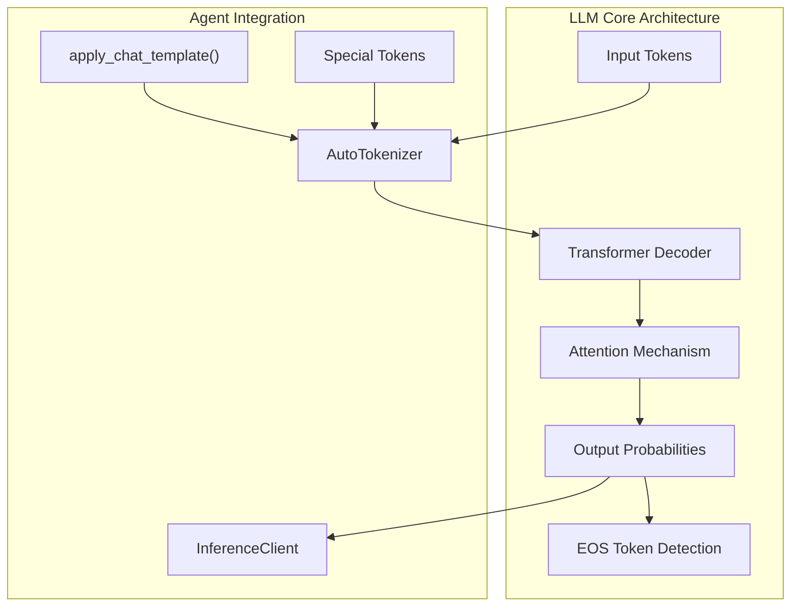
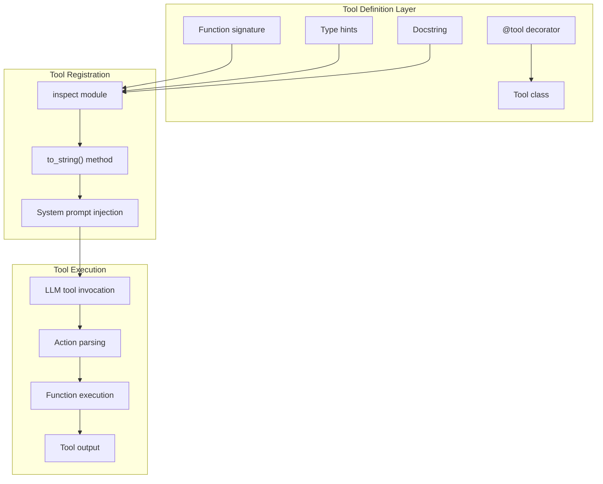
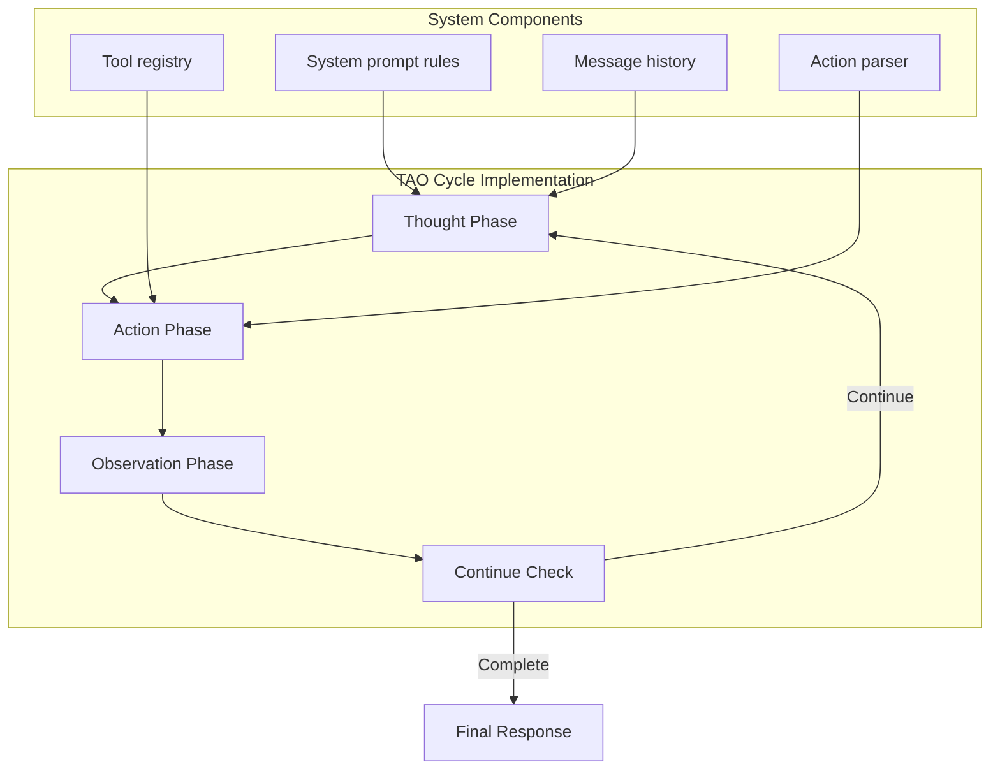
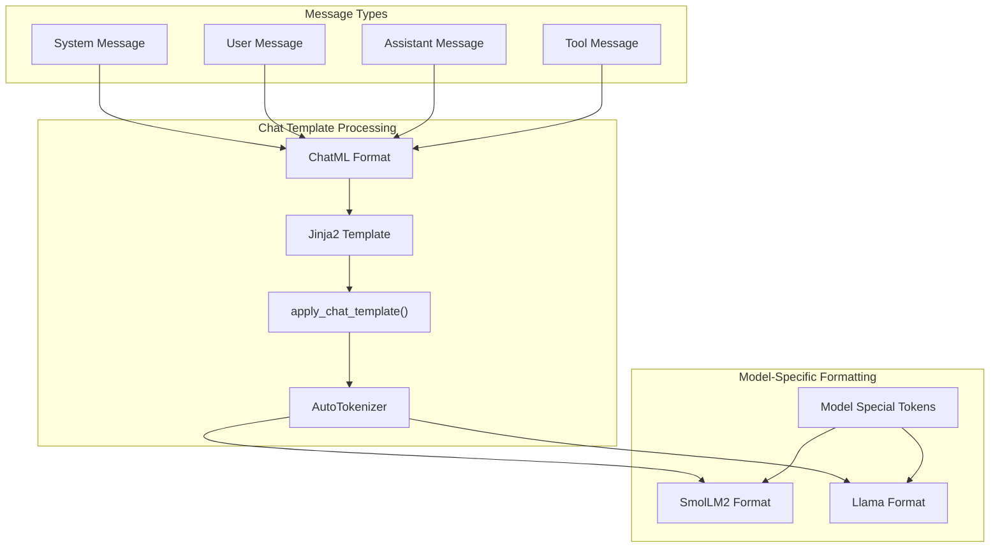
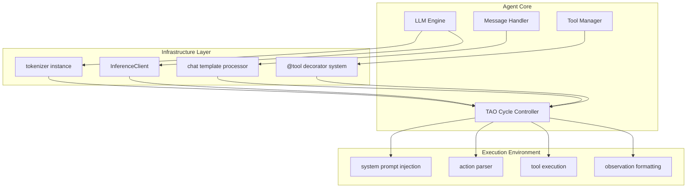

<!-- source: DeepWiki mcp.deepwiki.com · repo huggingface/agents-course · page 2 AI Agent Fundamentals · fetched 2026-10-26 -->

# AI Agent Fundamentals

Relevant source files

The following files were used as context for generating this wiki page:

- [units/en/unit1/README.md](units/en/unit1/README.md)
- [units/en/unit1/agent-steps-and-structure.mdx](units/en/unit1/agent-steps-and-structure.mdx)
- [units/en/unit1/conclusion.mdx](units/en/unit1/conclusion.mdx)
- [units/en/unit1/introduction.mdx](units/en/unit1/introduction.mdx)
- [units/en/unit1/messages-and-special-tokens.mdx](units/en/unit1/messages-and-special-tokens.mdx)
- [units/en/unit1/quiz1.mdx](units/en/unit1/quiz1.mdx)
- [units/en/unit1/quiz2.mdx](units/en/unit1/quiz2.mdx)
- [units/en/unit1/tools.mdx](units/en/unit1/tools.mdx)
- [units/en/unit1/what-are-agents.mdx](units/en/unit1/what-are-agents.mdx)
- [units/en/unit1/what-are-llms.mdx](units/en/unit1/what-are-llms.mdx)
- [units/zh-CN/unit1/messages-and-special-tokens.mdx](units/zh-CN/unit1/messages-and-special-tokens.mdx)

This document covers the core foundational concepts that underpin AI agents within the Hugging Face Agents Course framework. It explains how Large Language Models (LLMs) serve as the reasoning engine, how tools extend agent capabilities, the Thought-Action-Observation operational cycle, and message handling systems that enable structured communication.

For comprehensive framework implementations, see [Agent Frameworks](#3). For practical applications and use cases, see [Use Cases and Applications](#5).

## LLMs as the Agent Brain

Large Language Models serve as the central reasoning engine for AI agents. These are decoder-based transformer models trained on vast text corpora to predict the next token in a sequence.

### Token Processing and Special Tokens

LLMs operate on tokens rather than whole words, with vocabularies typically containing around 32,000 tokens. Each model uses specific special tokens for control flow:

| Model | Provider | EOS Token | Function |
|-------|----------|-----------|-----------|
| GPT4 | OpenAI | `<|endoftext|>` | End of message text |
| Llama 3 | Meta | `<|eot_id|>` | End of sequence |
| SmolLM2 | Hugging Face | `<|im_end|>` | End of instruction |

The autoregressive generation process continues until the model predicts an EOS token, enabling controlled text generation suitable for agent workflows.

**Sources:** [units/en/unit1/what-are-llms.mdx:1-224]()

## Tools and External Capabilities

Tools extend LLM capabilities beyond text generation by providing callable functions that agents can invoke. The tool system bridges the gap between natural language reasoning and executable code.

### Tool Implementation Architecture

The `Tool` class provides a standardized interface for agent capabilities:

- **`name`**: Function identifier
- **`description`**: Purpose and behavior description  
- **`func`**: Callable implementation
- **`arguments`**: Expected input parameters with types
- **`outputs`**: Return type specification
- **`to_string()`**: Generates LLM-readable tool descriptions
- **`__call__()`**: Executes the underlying function

The `@tool` decorator automates tool creation by leveraging Python's `inspect` module to extract function metadata, creating consistent tool descriptions for LLM consumption.

**Sources:** [units/en/unit1/tools.mdx:1-322]()

## The Thought-Action-Observation Cycle

The core operational loop of AI agents follows a structured cycle that enables iterative problem-solving and environmental interaction.

### Cycle Phases

**Thought Phase**: The LLM analyzes the current context, reviews available tools, and determines the next course of action. This involves internal reasoning about the problem state and strategy selection.

**Action Phase**: Based on the thought process, the agent generates structured tool invocations. These follow specific formats (JSON or code) that can be parsed and executed by the agent framework.

**Observation Phase**: Tool execution results are captured and formatted as observations, providing environmental feedback that informs subsequent reasoning cycles.

The cycle continues until the agent determines the objective has been fulfilled or a termination condition is met.

**Sources:** [units/en/unit1/agent-steps-and-structure.mdx:1-151]()

## Message Systems and Chat Templates

Agent communication relies on structured message systems that format conversations between users, systems, and assistants into LLM-compatible prompts.

### Message Processing Pipeline

The `transformers.AutoTokenizer.apply_chat_template()` method converts structured message lists into model-specific prompt formats. Each message contains:

- **`role`**: Message type (`system`, `user`, `assistant`)
- **`content`**: Message text content

Chat templates use Jinja2 templating to handle model-specific formatting requirements, ensuring proper delimiter usage and special token placement.

### System Message Integration

System messages define agent behavior and provide critical context including:
- Agent personality and response guidelines
- Available tool descriptions and usage instructions
- Thought-Action-Observation cycle formatting rules
- Task-specific constraints and objectives

**Sources:** [units/en/unit1/messages-and-special-tokens.mdx:1-229]()

## Agent Integration Architecture

The complete agent system integrates LLMs, tools, and message processing into a cohesive framework that enables autonomous task completion.

### Component Interactions

The agent architecture coordinates multiple subsystems:

**LLM Engine** manages model inference through `InferenceClient` and handles tokenization via `AutoTokenizer` instances.

**Message Handler** processes conversation history using model-specific chat templates, ensuring proper formatting for each LLM variant.

**Tool Manager** maintains the tool registry populated by `@tool` decorated functions, providing runtime access to external capabilities.

**TAO Cycle Controller** orchestrates the complete reasoning loop, managing prompt construction, action parsing, tool execution, and observation integration.

This architecture enables flexible agent implementations across different frameworks while maintaining consistent core functionality.

**Sources:** [units/en/unit1/what-are-agents.mdx:1-162](), [units/en/unit1/introduction.mdx:1-39]()

---

