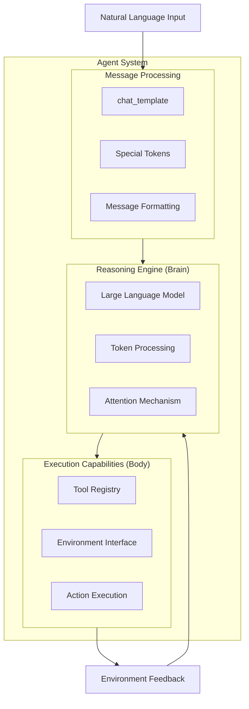
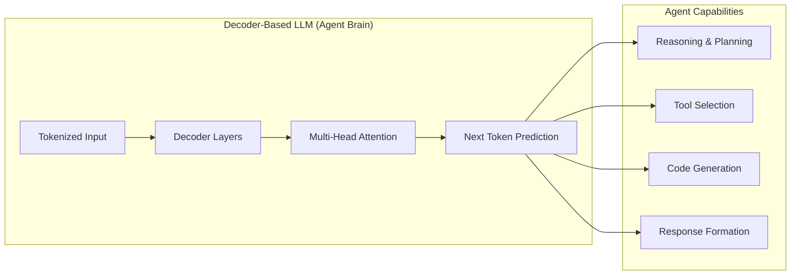
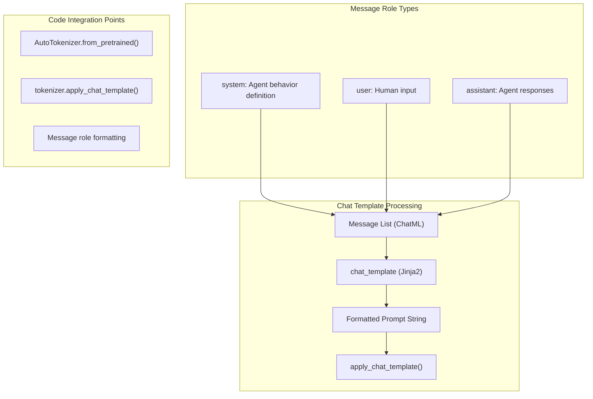
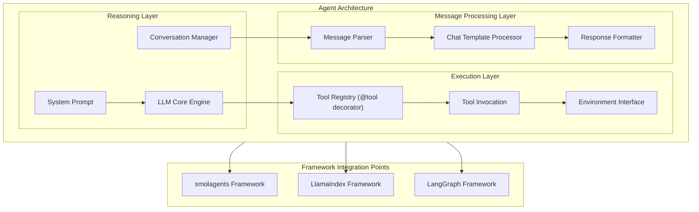
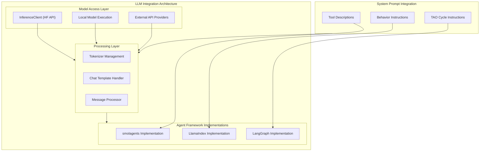
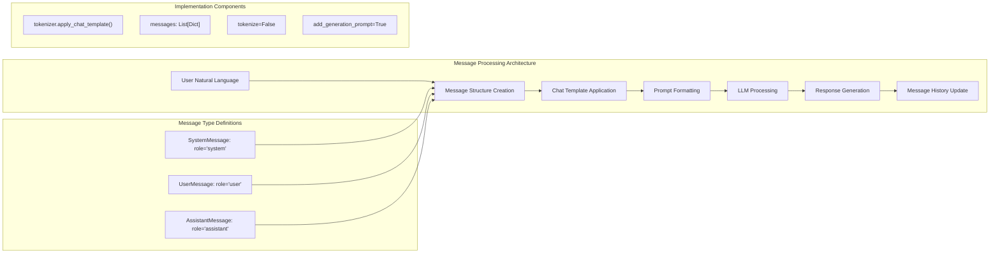

<!-- source: DeepWiki mcp.deepwiki.com · repo huggingface/agents-course · page 2.1 LLMs and Agent Architecture · fetched 2026-10-26 -->

# LLMs and Agent Architecture

Relevant source files

The following files were used as context for generating this wiki page:

- [units/en/unit1/README.md](units/en/unit1/README.md)
- [units/en/unit1/agent-steps-and-structure.mdx](units/en/unit1/agent-steps-and-structure.mdx)
- [units/en/unit1/conclusion.mdx](units/en/unit1/conclusion.mdx)
- [units/en/unit1/introduction.mdx](units/en/unit1/introduction.mdx)
- [units/en/unit1/messages-and-special-tokens.mdx](units/en/unit1/messages-and-special-tokens.mdx)
- [units/en/unit1/quiz1.mdx](units/en/unit1/quiz1.mdx)
- [units/en/unit1/quiz2.mdx](units/en/unit1/quiz2.mdx)
- [units/en/unit1/tools.mdx](units/en/unit1/tools.mdx)
- [units/en/unit1/what-are-agents.mdx](units/en/unit1/what-are-agents.mdx)
- [units/en/unit1/what-are-llms.mdx](units/en/unit1/what-are-llms.mdx)
- [units/zh-CN/unit1/messages-and-special-tokens.mdx](units/zh-CN/unit1/messages-and-special-tokens.mdx)

This document explains how Large Language Models (LLMs) function as the core reasoning engine in AI agents and describes the fundamental architecture that enables agents to understand, reason, and interact with their environment. It covers the technical foundations of LLMs, their integration into agent systems, and the architectural patterns that make agent-based AI systems possible.

For information about the specific thought-action-observation operational cycle, see [Thought-Action-Observation Cycle](#2.2). For details about tools and message handling systems, see [Tools and Message Systems](#2.3).

## LLMs as Agent Reasoning Engines

LLMs serve as the "brain" of AI agents, providing the core reasoning capabilities that enable agents to understand natural language instructions, plan sequences of actions, and make decisions about tool usage. The agent architecture separates the reasoning engine (LLM) from the execution capabilities (tools and environment interaction).

Sources: [units/en/unit1/what-are-llms.mdx:5-13](), [units/en/unit1/what-are-agents.mdx:52-64]()

## Transformer Architecture Types

Different transformer architectures serve different purposes in agent systems. Decoder-based transformers are predominantly used for agent reasoning due to their text generation capabilities.

| Architecture Type | Description | Agent Usage | Typical Models |
|------------------|-------------|-------------|----------------|
| **Encoder** | Dense representation generation | Rare - semantic search only | BERT |
| **Decoder** | Autoregressive text generation | **Primary choice** - reasoning and planning | Llama, GPT-4, SmolLM2 |
| **Seq2Seq** | Combined encoder-decoder | Limited - translation tasks | T5, BART |

Sources: [units/en/unit1/what-are-llms.mdx:23-46](), [units/en/unit1/what-are-llms.mdx:82-84]()

## Token Processing and Autoregressive Generation

LLMs process text through tokenization and generate responses through autoregressive decoding. This process is fundamental to how agents formulate reasoning and generate tool calls.

### Tokenization Process

The tokenizer converts natural language into sub-word units that the LLM processes. Agent frameworks rely on this tokenization for both input processing and output parsing.

```mermaid
graph TD
    subgraph TokenizationFlow["Tokenization and Generation Flow"]
        NaturalLang["Natural Language Input"]
        Tokenizer["tokenizer.encode()"]
        TokenSequence["Token Sequence"]
        LLMProcessing["LLM Processing"]
        ScoreGeneration["Token Score Generation"]
        DecodingStrategy["Decoding Strategy"]
        OutputTokens["Generated Tokens"]
        Detokenization["tokenizer.decode()"]
        FinalResponse["Final Response"]
    end
    
    NaturalLang --> Tokenizer
    Tokenizer --> TokenSequence
    TokenSequence --> LLMProcessing
    LLMProcessing --> ScoreGeneration
    ScoreGeneration --> DecodingStrategy
    DecodingStrategy --> OutputTokens
    OutputTokens --> Detokenization
    Detokenization --> FinalResponse
```

The autoregressive nature means each generated token becomes input for the next generation step, continuing until an End of Sequence (EOS) token is generated.

Sources: [units/en/unit1/what-are-llms.mdx:57-62](), [units/en/unit1/what-are-llms.mdx:129-133](), [units/en/unit1/what-are-llms.mdx:137-142]()

## Special Tokens and Message Systems

Special tokens structure the communication between agents and LLMs, particularly for multi-turn conversations and tool integration. Each model family uses different special token conventions.

### Special Token Examples

| Model | Provider | EOS Token | Usage |
|-------|----------|-----------|--------|
| GPT-4 | OpenAI | `<|endoftext|>` | End of message text |
| Llama 3 | Meta | `<|eot_id|>` | End of sequence |
| SmolLM2 | Hugging Face | `<|im_end|>` | End of instruction/message |
| Gemma | Google | `<end_of_turn>` | End of conversation turn |

### Chat Template System

Chat templates convert message lists into formatted prompts that LLMs can process. This system is critical for agent frameworks that manage multi-turn conversations.

Sources: [units/en/unit1/what-are-llms.mdx:72-119](), [units/en/unit1/messages-and-special-tokens.mdx:24-56](), [units/en/unit1/messages-and-special-tokens.mdx:196-217]()

## Agent Architecture Overview

The agent architecture consists of two primary components: the reasoning engine (LLM brain) and the execution capabilities (tool body). This separation enables flexible agent design across different domains.

### Core Agent Components

Sources: [units/en/unit1/what-are-agents.mdx:52-64](), [units/en/unit1/tools.mdx:14-27](), [units/en/unit1/tools.mdx:137-191]()

## LLM Integration in Agent Frameworks

Agent frameworks integrate LLMs through standardized interfaces that handle tokenization, message formatting, and response processing. The integration varies across frameworks but follows common patterns.

### Framework Integration Patterns

The system prompt serves as the primary integration point, containing tool descriptions, behavioral guidelines, and cycle instructions that guide the LLM's reasoning process within the agent framework.

Sources: [units/en/unit1/what-are-llms.mdx:203-209](), [units/en/unit1/tools.mdx:56-98](), [units/en/unit1/agent-steps-and-structure.mdx:33-44]()

## Message System Architecture

The message system bridges natural language interactions with LLM processing requirements through structured message formatting and chat template application.

### Message Processing Flow

This architecture ensures consistent message formatting across different LLM providers while maintaining conversation context and enabling proper tool integration through system message configuration.

Sources: [units/en/unit1/messages-and-special-tokens.mdx:59-117](), [units/en/unit1/messages-and-special-tokens.mdx:137-184](), [units/en/unit1/messages-and-special-tokens.mdx:196-217]()

---

