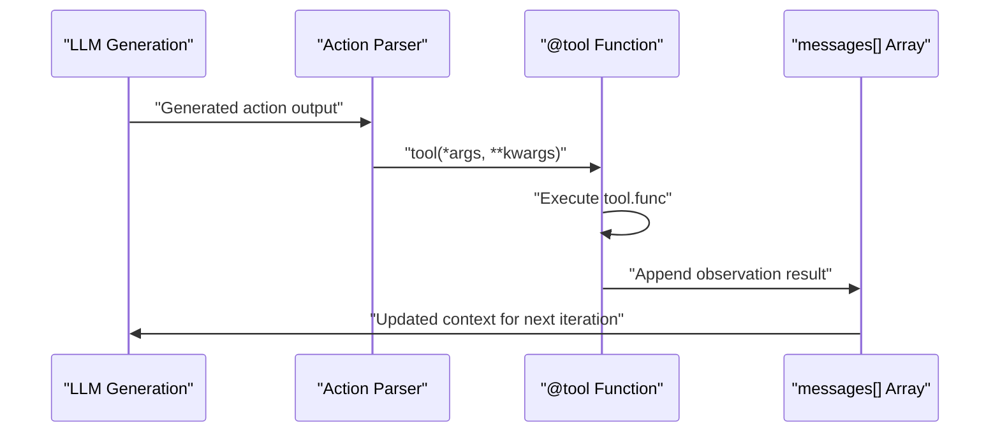
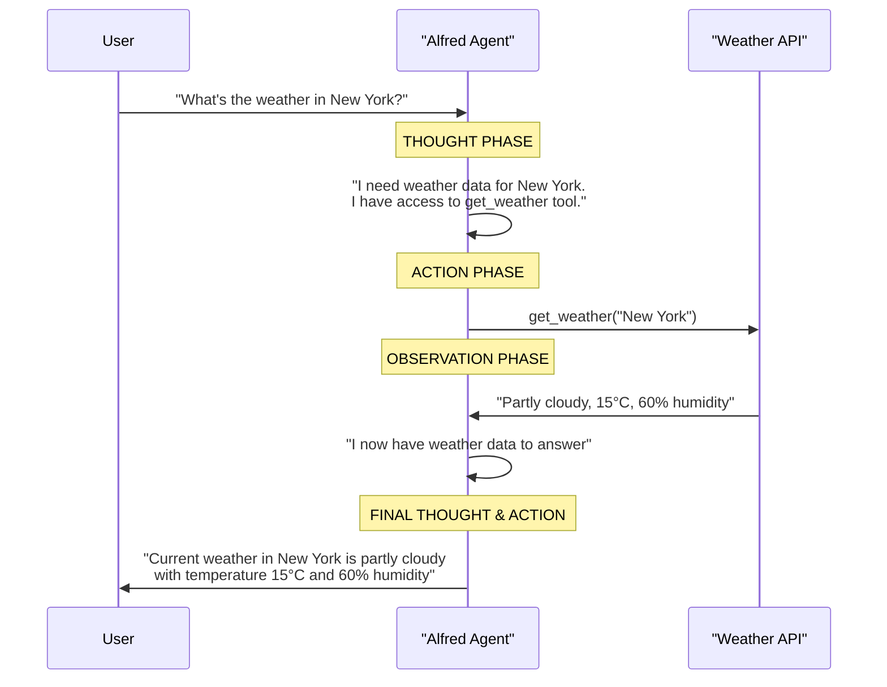

<!-- source: DeepWiki mcp.deepwiki.com · repo huggingface/agents-course · page 2.2 Thought-Action-Observation Cycle · fetched 2026-10-26 -->

# Thought-Action-Observation Cycle

<details>
<summary>Relevant source files</summary>

The following files were used as context for generating this wiki page:

- [units/en/unit1/README.md](units/en/unit1/README.md)
- [units/en/unit1/agent-steps-and-structure.mdx](units/en/unit1/agent-steps-and-structure.mdx)
- [units/en/unit1/conclusion.mdx](units/en/unit1/conclusion.mdx)
- [units/en/unit1/introduction.mdx](units/en/unit1/introduction.mdx)
- [units/en/unit1/messages-and-special-tokens.mdx](units/en/unit1/messages-and-special-tokens.mdx)
- [units/en/unit1/quiz1.mdx](units/en/unit1/quiz1.mdx)
- [units/en/unit1/quiz2.mdx](units/en/unit1/quiz2.mdx)
- [units/en/unit1/tools.mdx](units/en/unit1/tools.mdx)
- [units/en/unit1/what-are-agents.mdx](units/en/unit1/what-are-agents.mdx)
- [units/en/unit1/what-are-llms.mdx](units/en/unit1/what-are-llms.mdx)
- [units/zh-CN/unit1/messages-and-special-tokens.mdx](units/zh-CN/unit1/messages-and-special-tokens.mdx)

</details>


The Thought-Action-Observation cycle is the core operational loop implemented in AI agent frameworks. This cycle consists of three phases: Thought (LLM reasoning), Action (tool execution), and Observation (result integration). The cycle continues until the agent completes its objective or reaches `max_steps`.

This cycle is implemented through system prompts and structured message handling across agent frameworks like `smolagents`, `LlamaIndex`, and `LangGraph`.

## Core Implementation Architecture

The cycle operates as a `while` loop controlled by system prompt instructions and implemented through message parsing and tool execution.

### Agent Cycle Implementation Flow

```mermaid
flowchart TD
    UserQuery["`apply_chat_template(messages)`"] --> SystemPrompt["`system_message` with TAO instructions"]
    SystemPrompt --> LLMGeneration["`InferenceClientModel.generate()`"]
    LLMGeneration --> ParseOutput["`stop_and_parse()` or code execution"]
    ParseOutput --> ToolExecution["`@tool` decorated functions"]
    ToolExecution --> UpdateMessages["`messages.append(observation)`"]
    UpdateMessages --> CheckComplete{"Check EOS or `max_steps`"}
    CheckComplete -->|Continue| LLMGeneration
    CheckComplete -->|Complete| FinalAnswer["`final_answer`"]
```

Sources: [units/en/unit1/agent-steps-and-structure.mdx:25-45](), [units/en/unit1/tools.mdx:119-127](), [units/en/unit1/messages-and-special-tokens.mdx:200-218]()

The cycle is embedded in the system prompt through structured instructions that define the agent's reasoning pattern and tool usage format.

## Thought Phase: LLM Reasoning Engine

The Thought phase utilizes the LLM's autoregressive token generation to analyze context and plan actions. The LLM processes the current message history and generates reasoning text before action decisions.

### ReAct Implementation in System Prompts

ReAct prompting is implemented through system message instructions that structure the LLM's output format:

```mermaid
graph TD
    ChatTemplate["`tokenizer.apply_chat_template()`"] --> SystemMessage["`system_message` with ReAct format"]
    SystemMessage --> LLMContext["`attention` mechanism processes context"]
    LLMContext --> TokenGeneration["`next_token_prediction` with reasoning"]
    TokenGeneration --> ThoughtOutput["Structured thought output"]
    ThoughtOutput --> ActionDecision["Tool call or code generation"]
```

Sources: [units/en/unit1/what-are-llms.mdx:127-135](), [units/en/unit1/messages-and-special-tokens.mdx:25-56](), [units/en/unit1/agent-steps-and-structure.mdx:59-68]()

### Thought Output Structures

| Implementation | Thought Format | Code Location |
|----------------|----------------|---------------|
| `CodeAgent` | Python comments and reasoning | Code blocks with `# Thought:` |
| `ToolCallingAgent` | JSON structure with thought key | `{"thought": "reasoning text"}` |
| System Prompt | Explicit reasoning instructions | `system_message` content |

Sources: [units/en/unit1/agent-steps-and-structure.mdx:36-44]()

## Action Phase: Tool Execution Engine

The Action phase executes tool calls through framework-specific parsing and execution mechanisms. Actions are structured through `@tool` decorated functions and parsed from LLM output.

### Tool Definition and Execution Architecture

```mermaid
graph TD
    ToolDefinition["`@tool` decorator"] --> ToolClass["`Tool` class instance"]
    ToolClass --> ToolString["`tool.to_string()` method"]
    ToolString --> SystemPrompt["`system_message` tools description"]
    
    LLMOutput["LLM generates action"] --> ActionParser["`stop_and_parse()` or code execution"]
    ActionParser --> ToolCall["`tool(*args, **kwargs)`"]
    ToolCall --> ToolFunc["`tool.func` execution"]
    ToolFunc --> ToolResult["Tool output/result"]
```

Sources: [units/en/unit1/tools.mdx:116-127](), [units/en/unit1/tools.mdx:143-191](), [units/en/unit1/tools.mdx:273-286]()

### Agent Implementation Types

| Agent Type | Action Format | Parsing Method | Framework |
|------------|---------------|----------------|-----------|
| `CodeAgent` | Python code blocks | Code execution | `smolagents` |
| `ToolCallingAgent` | JSON tool calls | `stop_and_parse` | `smolagents` |
| `AgentWorkflow` | Function calls | Workflow nodes | `LlamaIndex` |
| `StateGraph` | State transitions | Conditional edges | `LangGraph` |

### Tool Registration Pattern

Tools are registered through the `@tool` decorator which creates `Tool` instances:

```python
# Pattern from units/en/unit1/tools.mdx:119-127
@tool
def calculator(a: int, b: int) -> int:
    """Multiply two integers."""
    return a * b

# Auto-generates tool description via Tool.to_string()
```

Sources: [units/en/unit1/tools.mdx:273-286](), [units/en/unit1/tools.mdx:143-191]()

### Action Execution Flow

The execution follows a structured pattern controlled by the agent framework:

1. **LLM Generation**: Model generates action in expected format
2. **Output Parsing**: Framework parses action using `stop_and_parse` or code execution  
3. **Tool Invocation**: Framework calls `tool.func` with parsed arguments
4. **Result Capture**: Tool output is captured for observation phase

Sources: [units/en/unit1/tools.mdx:46-54]()

## Observation Phase: Context Update Mechanism

The Observation phase appends tool execution results to the message history, updating the LLM's context for subsequent iterations.

### Message History Update Flow



Sources: [units/en/unit1/tools.mdx:46-54](), [units/en/unit1/messages-and-special-tokens.mdx:67-76]()

### Context Management Implementation

| Component | Function | Implementation |
|-----------|----------|----------------|
| `messages` | Context storage | List of `{"role": "...", "content": "..."}` |
| `apply_chat_template` | Context formatting | `tokenizer.apply_chat_template(messages)` |
| Tool result | Observation content | Raw tool output or formatted result |
| System prompt | Cycle instructions | Embedded TAO pattern in `system_message` |

Sources: [units/en/unit1/messages-and-special-tokens.mdx:200-218](), [units/en/unit1/agent-steps-and-structure.mdx:36-44]()

### Observation Integration Pattern

Tool results are integrated into the conversation flow:

1. **Tool Execution**: `@tool` function returns result
2. **Result Formatting**: Framework formats tool output  
3. **Message Append**: Result added to `messages` array
4. **Context Update**: `apply_chat_template` reformats entire conversation
5. **Next Iteration**: Updated context fed to LLM for next thought

Sources: [units/en/unit1/messages-and-special-tokens.mdx:67-117]()

## System Prompt Architecture

The TAO cycle is embedded in the `system_message` through structured prompt templates that define tool descriptions and reasoning patterns.

### System Message Component Assembly

```mermaid
graph TD
    SystemMessage["`system_message` construction"] --> AgentBehavior["Agent role definition"]
    SystemMessage --> ToolsSection["`tool.to_string()` descriptions"]
    SystemMessage --> CycleInstructions["TAO pattern instructions"]
    
    ToolsSection --> ToolDecorator["`@tool` decorated functions"]
    ToolDecorator --> ToolClass["`Tool` class attributes"]
    ToolClass --> ToolString["`Tool.to_string()` output"]
    
    CycleInstructions --> ThoughtFormat["Thought: instruction"]
    CycleInstructions --> ActionFormat["Action: format specification"]
    CycleInstructions --> ObservationFormat["Observation: result handling"]
```

Sources: [units/en/unit1/agent-steps-and-structure.mdx:36-44](), [units/en/unit1/tools.mdx:170-184](), [units/en/unit1/tools.mdx:287-291]()

### Framework Implementation Components

| Framework Component | Function | Implementation Detail |
|---------------------|----------|----------------------|
| `@tool` decorator | Tool registration | Creates Tool instances with metadata |
| `Tool.to_string()` | Tool description | Formats tool for system prompt |
| `system_message` | Prompt template | Contains behavior and tool descriptions |
| `apply_chat_template` | Message formatting | Converts messages to model input |
| `max_steps` | Cycle control | Limits iteration count |

Sources: [units/en/unit1/tools.mdx:143-191](), [units/en/unit1/messages-and-special-tokens.mdx:200-218]()

### Tool Description Integration

Tools are automatically integrated into system prompts through the `Tool` class:

```python
# Pattern from units/en/unit1/tools.mdx:170-184
Tool(
    name="function_name",
    description="docstring_content", 
    func=callable,
    arguments=[(param_name, param_type)],
    outputs="return_type"
)
```

The `Tool.to_string()` method generates descriptions embedded in the system prompt, enabling the LLM to understand available tools and their usage patterns.

Sources: [units/en/unit1/tools.mdx:273-286]()

## Practical Example: Weather Agent

Here's how the cycle works in practice with Alfred, a weather agent:

### Complete Cycle Execution



Sources: [units/en/unit1/agent-steps-and-structure.mdx:47-127]()

The agent demonstrates key cycle characteristics:
- **Iterative processing**: Multiple thought-action-observation loops if needed
- **Tool integration**: Seamless external API interaction
- **Dynamic adaptation**: Context updates based on observations
- **Structured termination**: Clear final answer delivery

This cycle forms the foundation for all agent frameworks covered in this course, including smolagents, LlamaIndex, and LangGraph implementations.

Sources: [units/en/unit1/agent-steps-and-structure.mdx:130-147]()

---

