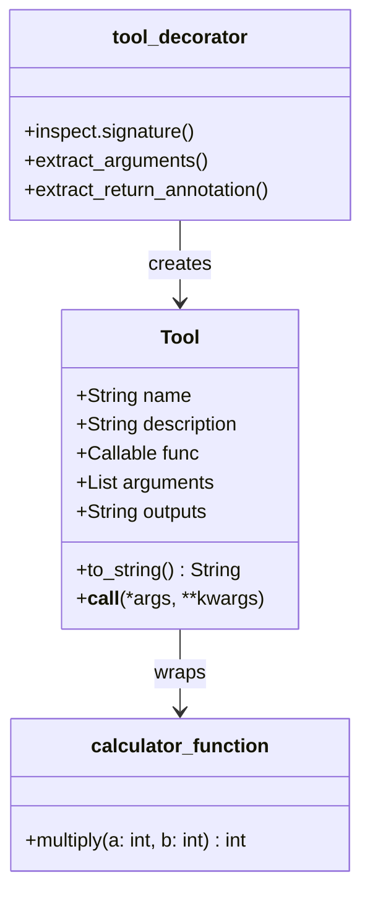
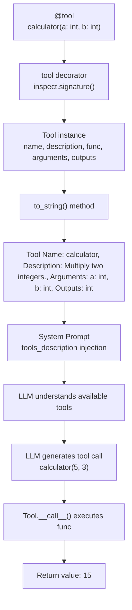
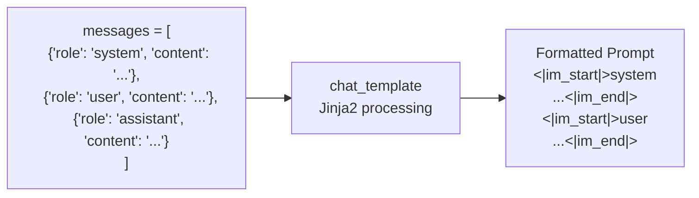
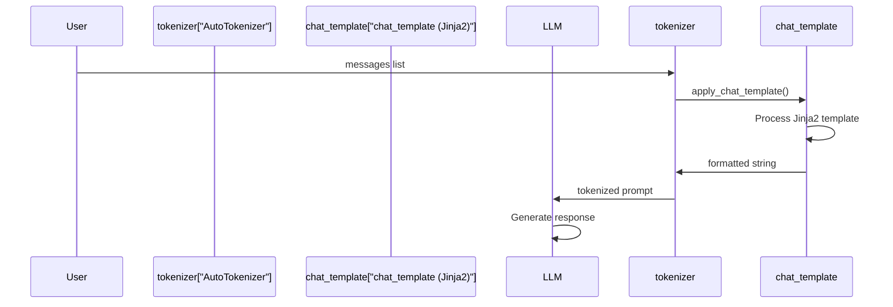
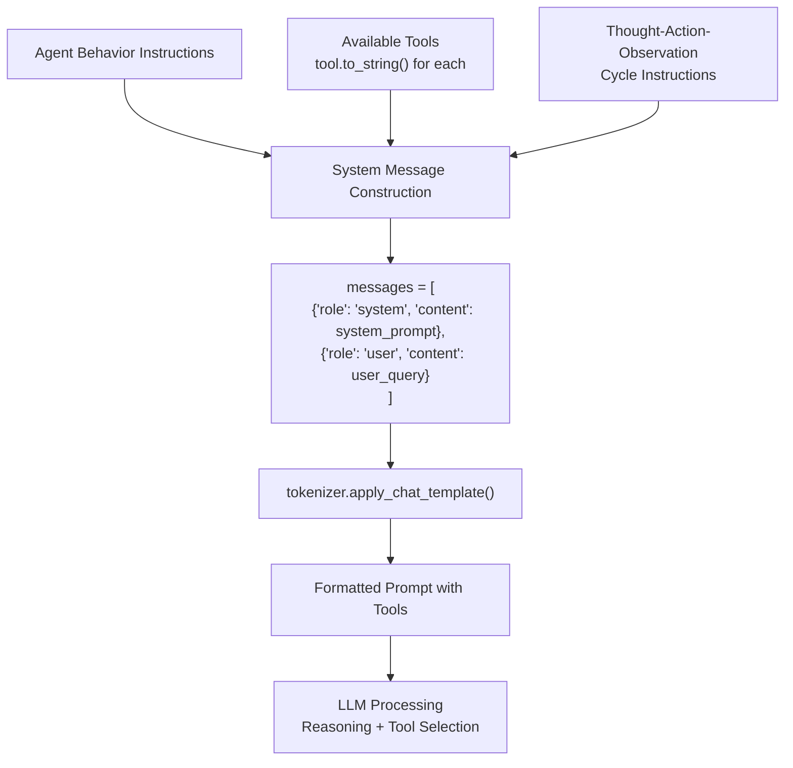
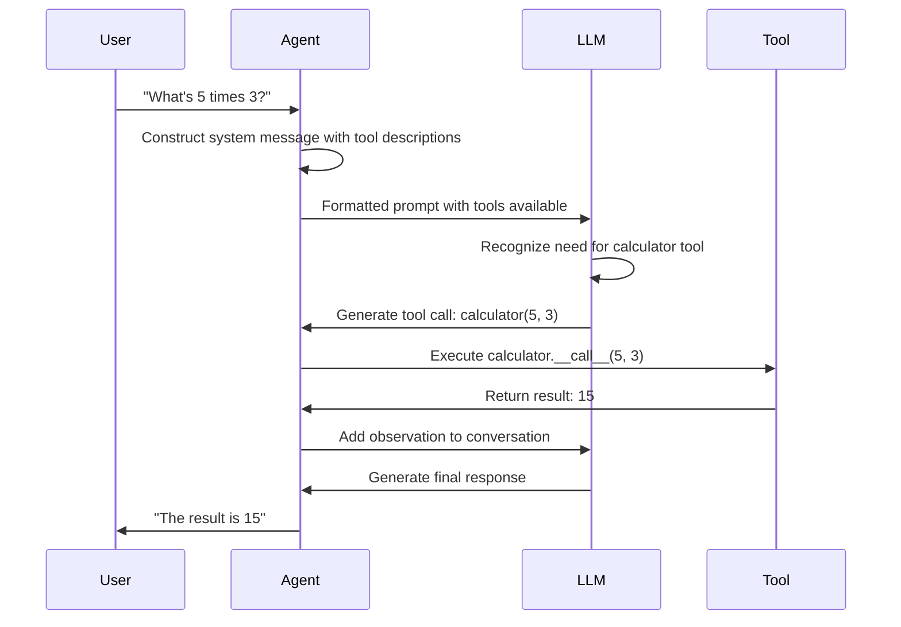

<!-- source: DeepWiki mcp.deepwiki.com · repo huggingface/agents-course · page 2.3 Tools and Message Systems · fetched 2026-10-26 -->

# Tools and Message Systems

<details>
<summary>Relevant source files</summary>

The following files were used as context for generating this wiki page:

- [units/en/unit1/README.md](units/en/unit1/README.md)
- [units/en/unit1/agent-steps-and-structure.mdx](units/en/unit1/agent-steps-and-structure.mdx)
- [units/en/unit1/conclusion.mdx](units/en/unit1/conclusion.mdx)
- [units/en/unit1/introduction.mdx](units/en/unit1/introduction.mdx)
- [units/en/unit1/messages-and-special-tokens.mdx](units/en/unit1/messages-and-special-tokens.mdx)
- [units/en/unit1/quiz1.mdx](units/en/unit1/quiz1.mdx)
- [units/en/unit1/quiz2.mdx](units/en/unit1/quiz2.mdx)
- [units/en/unit1/tools.mdx](units/en/unit1/tools.mdx)
- [units/en/unit1/what-are-agents.mdx](units/en/unit1/what-are-agents.mdx)
- [units/en/unit1/what-are-llms.mdx](units/en/unit1/what-are-llms.mdx)
- [units/zh-CN/unit1/messages-and-special-tokens.mdx](units/zh-CN/unit1/messages-and-special-tokens.mdx)

</details>


This document covers the two fundamental communication interfaces in AI agent systems: the tool system that enables agents to execute external functions, and the message system that structures conversations between users and language models. These systems work together to enable agents to understand user requests through structured conversations and act on them through tool invocations.

For information about the broader agent workflow cycle, see [Thought-Action-Observation Cycle](#2.2). For implementation details of specific agent frameworks, see [smolagents Framework](#3.1).

## Tool System Architecture

The tool system provides the mechanism for language models to execute external functions and interact with their environment. Tools extend an LLM's capabilities beyond text generation by providing access to external APIs, calculations, data retrieval, and other programmatic operations.

### Tool Class Structure

The core `Tool` class defines the interface for all agent tools:



**Tool Definition and Registration**

Sources: [units/en/unit1/tools.mdx:143-191](), [units/en/unit1/tools.mdx:222-267]()

### Tool-to-LLM Communication Flow

The following diagram shows how tools are described to language models and invoked:



**Tool Registration and Execution Pipeline**

Sources: [units/en/unit1/tools.mdx:117-133](), [units/en/unit1/tools.mdx:272-286]()

### Tool Implementation Patterns

| Component | Description | Code Reference |
|-----------|-------------|----------------|
| `@tool` decorator | Automatically extracts function metadata using `inspect.signature()` | Function name becomes tool name |
| `Tool.to_string()` | Generates textual description for LLM consumption | Returns formatted "Tool Name: X, Description: Y..." |
| `Tool.__call__()` | Executes the underlying function with provided arguments | Invokes `self.func(*args, **kwargs)` |
| Tool arguments | List of `(param_name, param_annotation)` pairs | Extracted from function signature |

Sources: [units/en/unit1/tools.mdx:222-267](), [units/en/unit1/tools.mdx:143-191]()

## Message System Architecture  

The message system structures conversations between users and language models using chat templates and special tokens. This system transforms conversational exchanges into formatted prompts that LLMs can process.

### Message Role Structure



**Message to Prompt Transformation**

Sources: [units/en/unit1/messages-and-special-tokens.mdx:198-218](), [units/en/unit1/messages-and-special-tokens.mdx:24-76]()

### Special Token Variations Across Models

Different language models use distinct special token formats for message delimiting:

| Model | EOS Token | Message Delimiters | Template Format |
|-------|-----------|-------------------|-----------------|
| SmolLM2 | `<\|im_end\|>` | `<\|im_start\|>role` | ChatML-style |
| Llama 3 | `<\|eot_id\|>` | `<\|start_header_id\|>role<\|end_header_id\|>` | Header-based |
| GPT4 | `<\|endoftext\|>` | OpenAI format | Proprietary |
| Gemma | `<end_of_turn>` | Google format | Turn-based |

Sources: [units/en/unit1/what-are-llms.mdx:78-119](), [units/en/unit1/messages-and-special-tokens.mdx:77-106]()

### Chat Template Processing



**Chat Template Application Process**

Sources: [units/en/unit1/messages-and-special-tokens.mdx:145-183](), [units/en/unit1/messages-and-special-tokens.mdx:208-218]()

## Tools and Messages Integration

The integration of tools and messages occurs primarily through the system message, where tool descriptions are injected to inform the LLM about available capabilities.

### System Prompt Construction



**System Message Assembly with Tool Descriptions**

Sources: [units/en/unit1/tools.mdx:56-95](), [units/en/unit1/messages-and-special-tokens.mdx:25-57]()

### Tool Invocation Flow

The complete flow from user message to tool execution:



**End-to-End Tool Usage Pipeline**

Sources: [units/en/unit1/tools.mdx:44-54](), [units/en/unit1/agent-steps-and-structure.mdx:75-124]()

## Implementation Details

### Message Template Application

The `apply_chat_template()` function converts message lists to model-specific prompts:

```python
# From transformers library
tokenizer.apply_chat_template(messages, tokenize=False, add_generation_prompt=True)
```

Key parameters:
- `tokenize=False`: Return string instead of token IDs
- `add_generation_prompt=True`: Add prompt for model to continue generation

Sources: [units/en/unit1/messages-and-special-tokens.mdx:208-218]()

### Tool Description Format

Tools are described to LLMs using a consistent format generated by `Tool.to_string()`:

```
Tool Name: {name}, Description: {description}, Arguments: {args}, Outputs: {outputs}
```

This format enables LLMs to understand:
- What the tool does (name and description)
- What inputs it expects (arguments with types)
- What it returns (output types)

Sources: [units/en/unit1/tools.mdx:170-184](), [units/en/unit1/tools.mdx:88-96]()

### Model Context Protocol (MCP)

MCP provides a standardized interface for tool integration across different agent frameworks, allowing tools defined in the protocol to work with any MCP-compatible framework without reimplementation.

Sources: [units/en/unit1/tools.mdx:294-305]()

---

