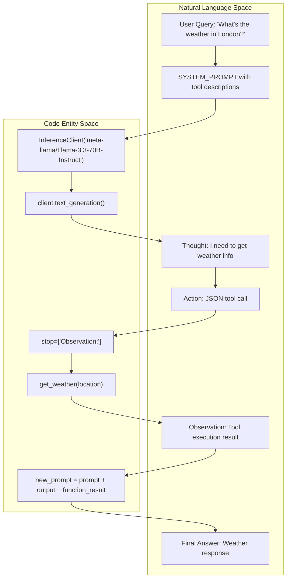
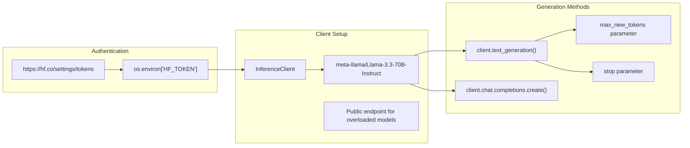
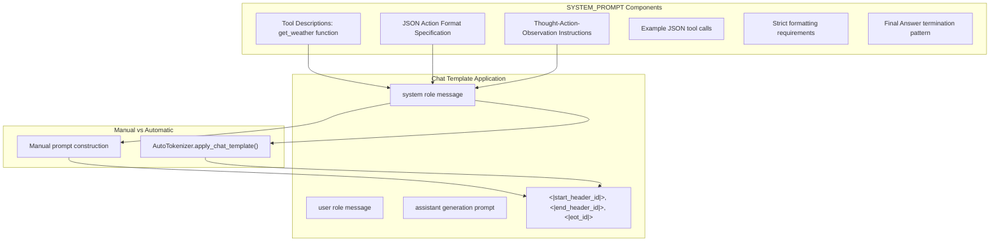
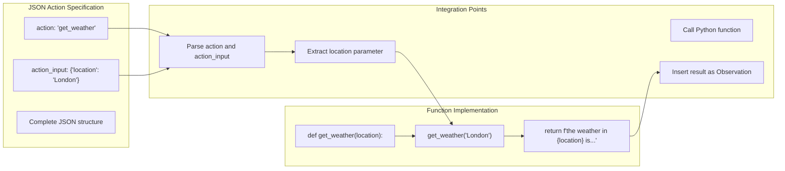
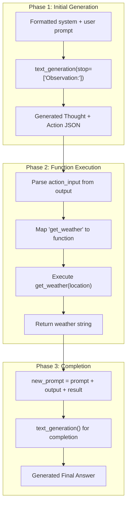

<!-- source: DeepWiki mcp.deepwiki.com · repo huggingface/agents-course · page 2.4 Dummy Agent Tutorial · fetched 2026-10-26 -->

# Dummy Agent Tutorial

Relevant source files

The following files were used as context for generating this wiki page:

- [units/en/unit1/actions.mdx](units/en/unit1/actions.mdx)
- [units/en/unit1/dummy-agent-library.mdx](units/en/unit1/dummy-agent-library.mdx)
- [units/en/unit1/final-quiz.mdx](units/en/unit1/final-quiz.mdx)
- [units/en/unit1/observations.mdx](units/en/unit1/observations.mdx)
- [units/en/unit1/thoughts.mdx](units/en/unit1/thoughts.mdx)

This document covers the framework-agnostic educational implementation for understanding AI agent mechanics through manual prompt construction and execution. The Dummy Agent system demonstrates core agent concepts including the Thought-Action-Observation cycle, tool integration, and generation control without relying on specific agent frameworks.

For information about the theoretical foundations of agent reasoning, see [Thought-Action-Observation Cycle](#2.2). For production-ready agent implementations, see [smolagents Framework](#3.1).

## Purpose and Educational Value

The Dummy Agent serves as a pedagogical tool that exposes the underlying mechanics of agent systems by requiring manual implementation of all components. This approach helps learners understand how agent frameworks operate internally before using abstracted libraries.

### Core Learning Objectives

| Component | Manual Implementation | Learning Value |
|-----------|----------------------|----------------|
| Prompt Construction | Manual chat template application | Understanding LLM input formatting |
| Generation Control | Stop tokens and parsing | Preventing hallucination in tool calls |
| Tool Execution | Manual function calls | Tool integration mechanics |
| State Management | Prompt concatenation | Conversation memory handling |

The system uses simple Python functions and built-in packages (`datetime`, `os`) to ensure compatibility across environments.

Sources: [units/en/unit1/dummy-agent-library.mdx:5-21]()

## Architecture Overview

Sources: [units/en/unit1/dummy-agent-library.mdx:87-144]()

## Serverless API Integration

The system uses Hugging Face's serverless inference infrastructure to access LLM capabilities without local model deployment.

### Client Configuration

### Text Generation vs Chat Methods

The tutorial demonstrates both approaches:

| Method | Implementation | Use Case |
|--------|---------------|----------|
| `text_generation()` | Manual chat template application | Educational understanding of formatting |
| `chat.completions.create()` | Automatic template handling | Production recommendations |

The educational value comes from using `text_generation()` to expose the underlying prompt formatting mechanics.

Sources: [units/en/unit1/dummy-agent-library.mdx:23-86]()

## System Prompt Architecture

The core system prompt contains structured instructions for tool usage and conversation flow:

### Key Prompt Components

The `SYSTEM_PROMPT` includes:
- Tool descriptions with argument specifications
- JSON format requirements for actions
- Thought-Action-Observation cycle instructions
- Mandatory "Final Answer:" termination pattern

Sources: [units/en/unit1/dummy-agent-library.mdx:96-144]()

## Generation Control and Hallucination Prevention

The critical aspect of the dummy agent is demonstrating how to prevent LLM hallucination in tool execution:

```mermaid
graph TB
    subgraph "Problem: Hallucination"
        FullGeneration["client.text_generation() without stop"]
        HallucinatedObs["Model generates fake Observation"]
        FakeResult["Fabricated weather data"]
    end
    
    subgraph "Solution: Stop and Parse"
        StoppedGeneration["client.text_generation(stop=['Observation:'])"]
        ParsedAction["Extract JSON action from output"]
        RealFunction["Execute actual get_weather() function"]
        RealResult["Genuine function output"]
    end
    
    subgraph "Prompt Reconstruction"
        BasePrompt["Original prompt"]
        StoppedOutput["Partial generation up to 'Observation:'"]
        FunctionResult["Actual function return value"]
        NewPrompt["Concatenated prompt for continuation"]
        FinalGeneration["Final answer generation"]
    end
    
    FullGeneration --> HallucinatedObs
    HallucinatedObs --> FakeResult
    
    StoppedGeneration --> ParsedAction
    ParsedAction --> RealFunction
    RealFunction --> RealResult
    
    BasePrompt --> NewPrompt
    StoppedOutput --> NewPrompt
    FunctionResult --> NewPrompt
    NewPrompt --> FinalGeneration
```

### Stop Token Implementation

The system uses `stop=["Observation:"]` to halt generation at the exact point where function execution should occur, preventing the model from fabricating results.

Sources: [units/en/unit1/dummy-agent-library.mdx:224-276]()

## Tool Implementation Pattern

The dummy weather function demonstrates the basic tool interface:

### Dummy Function Pattern

The educational implementation uses a simple dummy function that returns formatted strings rather than making actual API calls. This pattern demonstrates:
- Function signature requirements
- Parameter extraction from JSON
- String formatting for observations
- Integration with the agent loop

Sources: [units/en/unit1/dummy-agent-library.mdx:255-265]()

## Conversation Flow Implementation

The complete agent execution follows this technical pattern:

### Implementation Steps

1. **Prompt Construction**: Apply chat template manually or via tokenizer
2. **Controlled Generation**: Use stop tokens to halt before observations
3. **Action Parsing**: Extract JSON from model output
4. **Function Execution**: Call actual Python functions
5. **State Continuation**: Concatenate results and resume generation
6. **Answer Extraction**: Generate final response

Sources: [units/en/unit1/dummy-agent-library.mdx:269-335]()

## Educational Transition Path

The dummy agent serves as preparation for production frameworks:

| Concept | Dummy Implementation | Production Framework |
|---------|---------------------|---------------------|
| Prompt Management | Manual string concatenation | Automated template systems |
| Tool Registration | Single hardcoded function | Dynamic tool discovery |
| Generation Control | Manual stop tokens | Framework-managed parsing |
| Error Handling | Basic string operations | Robust exception management |
| Multi-turn Conversations | Prompt concatenation | Conversation memory systems |

After completing the dummy agent tutorial, learners transition to `smolagents` for production implementations that automate these manual processes.

Sources: [units/en/unit1/dummy-agent-library.mdx:337-341]()

---

