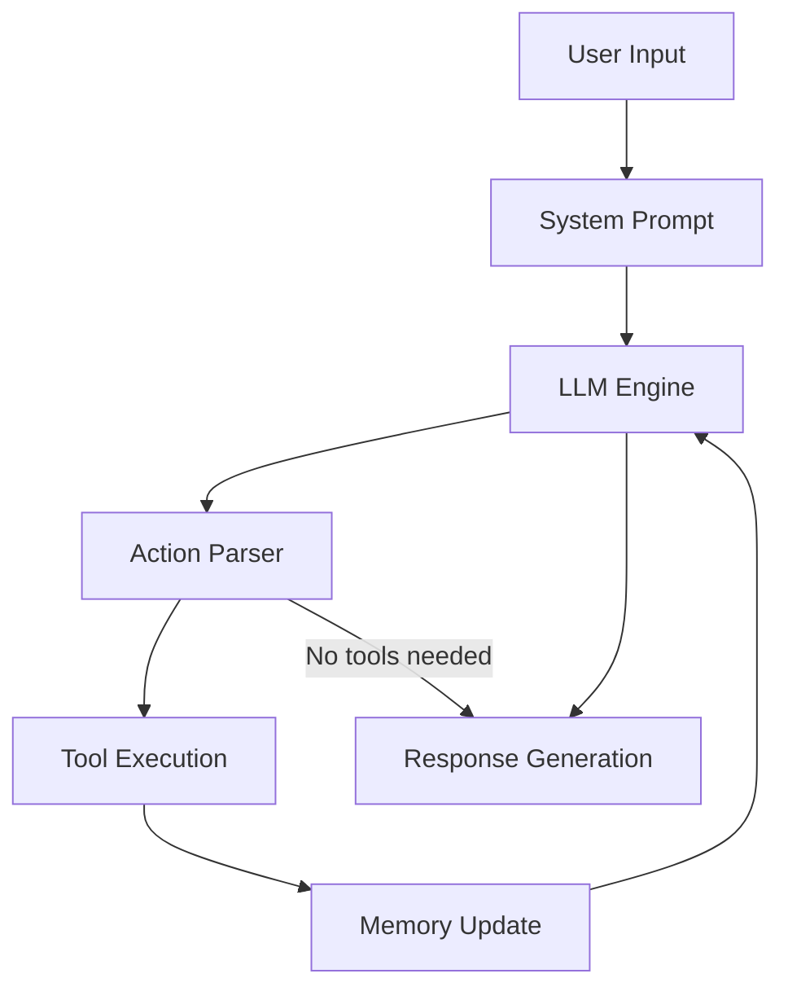
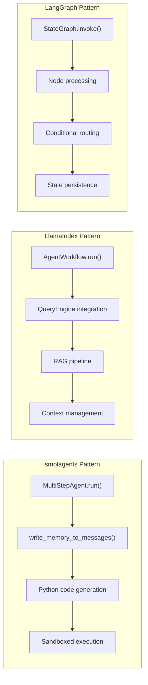
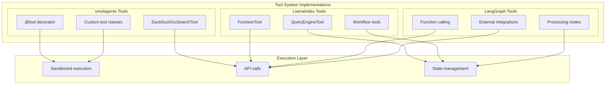

<!-- source: DeepWiki mcp.deepwiki.com · repo huggingface/agents-course · page 3 Agent Frameworks · fetched 2026-10-26 -->

# Agent Frameworks

Relevant source files

The following files were used as context for generating this wiki page:

- [units/en/unit2/introduction.mdx](units/en/unit2/introduction.mdx)
- [units/zh-CN/unit2/introduction.mdx](units/zh-CN/unit2/introduction.mdx)
- [units/zh-CN/unit2/smolagents/code_agents.mdx](units/zh-CN/unit2/smolagents/code_agents.mdx)
- [units/zh-CN/unit2/smolagents/conclusion.mdx](units/zh-CN/unit2/smolagents/conclusion.mdx)
- [units/zh-CN/unit2/smolagents/final_quiz.mdx](units/zh-CN/unit2/smolagents/final_quiz.mdx)
- [units/zh-CN/unit2/smolagents/quiz1.mdx](units/zh-CN/unit2/smolagents/quiz1.mdx)

This document provides an overview of the three major agent frameworks covered in the course: smolagents, LlamaIndex, and LangGraph. It explains when to use agent frameworks versus simpler approaches, compares their architectural differences, and details the common components required for building effective AI agents.

For detailed implementation guides for each framework, see [smolagents Framework](#3.1), [LlamaIndex Framework](#3.2), and [LangGraph Framework](#3.3). For practical applications using these frameworks, see [Use Cases and Applications](#5).

## When to Use Agent Frameworks

Agent frameworks are not always necessary when building LLM-powered applications. They provide workflow flexibility to efficiently solve specific tasks, but simpler approaches may suffice for straightforward use cases.

**Predefined workflows are sufficient** when user requests follow predictable patterns. For simple approaches like chained prompts, plain code may be adequate, giving developers **full control and understanding of their system without abstractions**.

However, when workflows become complex—such as allowing LLMs to call functions or coordinating multiple agents—these abstractions become helpful. The complexity threshold typically emerges when you need dynamic tool selection, multi-step reasoning, or state management across interactions.

Sources: [units/en/unit2/introduction.mdx:15-32]()

## Common Framework Requirements

All agent frameworks must address several core architectural needs:

| Component | Purpose | Implementation Considerations |
|-----------|---------|------------------------------|
| **LLM Engine** | Powers the reasoning system | Model selection, API integration, local vs. remote |
| **Tools List** | External capabilities the agent can access | Tool discovery, registration, execution safety |
| **Parser** | Extracts tool calls from LLM output | Format handling (JSON vs. code), error recovery |
| **System Prompt** | Synchronized with parser format | Template management, context injection |
| **Memory System** | Maintains conversation state and context | Storage backend, retrieval strategies |
| **Error Handling** | Controls LLM mistakes and retry logic | Timeout management, fallback strategies |

Sources: [units/en/unit2/introduction.mdx:23-31]()

## Framework Architecture Comparison

### Core Design Philosophy Differences

```mermaid
graph TD
    subgraph "smolagents_approach" ["smolagents Approach"]
        SA_LLM["InferenceClientModel"]
        SA_AGENT["CodeAgent / ToolCallingAgent"]
        SA_TOOLS["@tool decorator"]
        SA_EXEC["Python code execution"]
    end
    
    subgraph "llamaindex_approach" ["LlamaIndex Approach"]
        LI_LLM["LLM abstraction"]
        LI_AGENT["AgentWorkflow"]
        LI_TOOLS["FunctionTool / QueryEngineTool"]
        LI_EXEC["RAG-focused execution"]
    end
    
    subgraph "langgraph_approach" ["LangGraph Approach"]
        LG_LLM["LLM integration"]
        LG_AGENT["StateGraph"]
        LG_TOOLS["Processing nodes"]
        LG_EXEC["State-based execution"]
    end
    
    SA_LLM --> SA_AGENT
    SA_AGENT --> SA_TOOLS
    SA_TOOLS --> SA_EXEC
    
    LI_LLM --> LI_AGENT
    LI_AGENT --> LI_TOOLS
    LI_TOOLS --> LI_EXEC
    
    LG_LLM --> LG_AGENT
    LG_AGENT --> LG_TOOLS
    LG_TOOLS --> LG_EXEC
```

### Framework Comparison Matrix

| Framework | Primary Focus | Agent Types | Tool Integration | Best For |
|-----------|---------------|-------------|------------------|----------|
| **smolagents** | Code-first simplicity | `CodeAgent`, `ToolCallingAgent` | `@tool` decorator | Rapid prototyping, HF ecosystem |
| **LlamaIndex** | RAG and context augmentation | `AgentWorkflow` | `FunctionTool`, `QueryEngineTool` | Knowledge-intensive applications |
| **LangGraph** | Stateful orchestration | `StateGraph` nodes | Custom processing nodes | Complex multi-step workflows |

Sources: [units/en/unit2/introduction.mdx:36-40]()

## Agent Execution Patterns

### Common Execution Flow

### Framework-Specific Implementation Patterns

Sources: [units/zh-CN/unit2/smolagents/code_agents.mdx:34-55]()

## Integration Ecosystem

### Model Integration Approaches

Each framework provides different strategies for LLM integration:

**smolagents** uses model abstraction classes:
- `InferenceClientModel` for Hugging Face Serverless Inference API
- `TransformersModel` for local model execution
- `LiteLLMModel` for multiple provider support

**LlamaIndex** provides comprehensive LLM abstraction with focus on RAG integration and context management.

**LangGraph** integrates with LangChain's model ecosystem, supporting various LLM providers through standardized interfaces.

### Tool System Architecture

Sources: [units/en/unit2/introduction.mdx:25-30](), [units/zh-CN/unit2/smolagents/code_agents.mdx:119-137]()

## Framework Selection Guidelines

### Decision Matrix

Choose **smolagents** when:
- Rapid prototyping is priority
- Hugging Face ecosystem integration desired
- Code-first approach preferred
- Minimal configuration overhead needed

Choose **LlamaIndex** when:
- RAG and knowledge retrieval central to application
- Comprehensive tooling ecosystem required
- Production-ready context management needed
- End-to-end development pipeline desired

Choose **LangGraph** when:
- Complex stateful workflows required
- Fine-grained control over execution flow needed
- Multi-agent orchestration planned
- Advanced conditional logic necessary

### Multi-Framework Approach

The course demonstrates implementing the same use case (Agentic RAG) across all three frameworks, enabling framework-agnostic understanding and informed selection based on specific requirements.

Sources: [units/en/unit2/introduction.mdx:36-40]()

---

