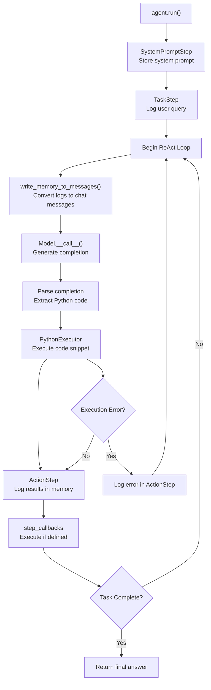
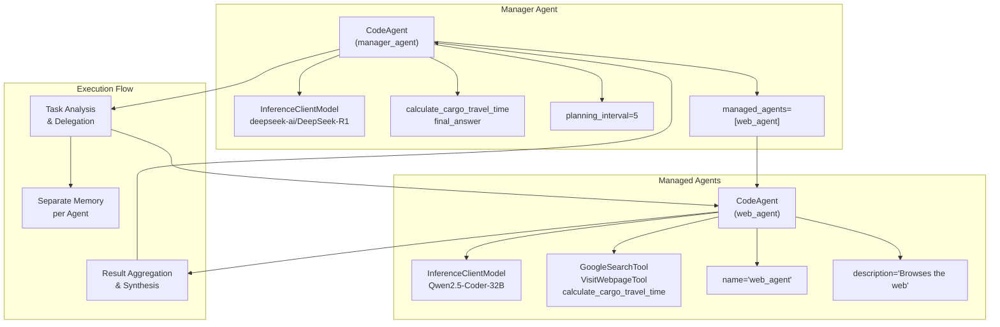

<!-- source: DeepWiki mcp.deepwiki.com · repo huggingface/agents-course · page 3.1 smolagents Framework · fetched 2026-10-26 -->

# smolagents Framework

<details>
<summary>Relevant source files</summary>

The following files were used as context for generating this wiki page:

- [README.md](README.md)
- [units/en/unit0/discord101.mdx](units/en/unit0/discord101.mdx)
- [units/en/unit0/introduction.mdx](units/en/unit0/introduction.mdx)
- [units/en/unit0/onboarding.mdx](units/en/unit0/onboarding.mdx)
- [units/en/unit1/tutorial.mdx](units/en/unit1/tutorial.mdx)
- [units/en/unit2/smolagents/code_agents.mdx](units/en/unit2/smolagents/code_agents.mdx)
- [units/en/unit2/smolagents/final_quiz.mdx](units/en/unit2/smolagents/final_quiz.mdx)
- [units/en/unit2/smolagents/introduction.mdx](units/en/unit2/smolagents/introduction.mdx)
- [units/en/unit2/smolagents/multi_agent_systems.mdx](units/en/unit2/smolagents/multi_agent_systems.mdx)
- [units/en/unit2/smolagents/quiz1.mdx](units/en/unit2/smolagents/quiz1.mdx)
- [units/en/unit2/smolagents/quiz2.mdx](units/en/unit2/smolagents/quiz2.mdx)
- [units/en/unit2/smolagents/retrieval_agents.mdx](units/en/unit2/smolagents/retrieval_agents.mdx)
- [units/en/unit2/smolagents/tool_calling_agents.mdx](units/en/unit2/smolagents/tool_calling_agents.mdx)
- [units/en/unit2/smolagents/tools.mdx](units/en/unit2/smolagents/tools.mdx)
- [units/en/unit2/smolagents/vision_agents.mdx](units/en/unit2/smolagents/vision_agents.mdx)
- [units/en/unit2/smolagents/why_use_smolagents.mdx](units/en/unit2/smolagents/why_use_smolagents.mdx)

</details>


The `smolagents` framework is a lightweight Python library designed for building AI agents with minimal code complexity and abstractions. The framework implements the ReAct (Reason-Act-Observe) cycle through its `MultiStepAgent` base class, with primary support for `CodeAgent` instances that generate executable Python code rather than JSON tool calls. Key features include seamless Hugging Face Hub integration, flexible LLM provider support through classes like `InferenceClientModel` and `OpenAIServerModel`, and a comprehensive tool system using the `@tool` decorator and `Tool` class hierarchy.

## Core Architecture

The smolagents framework is built around the `MultiStepAgent` abstraction, which implements the ReAct (Reason-Act-Observe) cycle. The architecture consists of several key components that work together to enable autonomous agent behavior.

### Framework Structure

```mermaid
graph TB
    subgraph "Core Agent Classes"
        MultiStepAgent["MultiStepAgent<br/>(Base Class)"]
        CodeAgent["CodeAgent<br/>(Python Code Generation)"]
        ToolCallingAgent["ToolCallingAgent<br/>(JSON Tool Calls)"]
    end
    
    subgraph "Execution Components"
        SystemPromptStep["SystemPromptStep"]
        TaskStep["TaskStep"] 
        ActionStep["ActionStep"]
        PythonExecutor["PythonExecutor"]
        WriteMemoryToMessages["write_memory_to_messages()"]
    end
    
    subgraph "Model Integration"
        InferenceClientModel["InferenceClientModel"]
        TransformersModel["TransformersModel"]
        OpenAIServerModel["OpenAIServerModel"]
        LiteLLMModel["LiteLLMModel"]
        AzureOpenAIServerModel["AzureOpenAIServerModel"]
    end
    
    subgraph "Tool System"
        ToolDecorator["@tool decorator"]
        ToolClass["Tool class"]
        DuckDuckGoSearchTool["DuckDuckGoSearchTool"]
        FinalAnswerTool["FinalAnswerTool"]
        PythonInterpreterTool["PythonInterpreterTool"]
    end
    
    MultiStepAgent --> CodeAgent
    MultiStepAgent --> ToolCallingAgent
    
    CodeAgent --> SystemPromptStep
    CodeAgent --> TaskStep
    CodeAgent --> ActionStep
    CodeAgent --> WriteMemoryToMessages
    CodeAgent --> PythonExecutor
    
    CodeAgent --> InferenceClientModel
    CodeAgent --> TransformersModel
    CodeAgent --> OpenAIServerModel
    CodeAgent --> LiteLLMModel
    CodeAgent --> AzureOpenAIServerModel
    
    CodeAgent --> ToolDecorator
    CodeAgent --> ToolClass
    CodeAgent --> DuckDuckGoSearchTool
    CodeAgent --> FinalAnswerTool
    CodeAgent --> PythonInterpreterTool
```



Sources: [units/en/unit2/smolagents/code_agents.mdx:37-55](), [units/en/unit2/smolagents/why_use_smolagents.mdx:40-46]()

### Agent Execution Flow

The smolagents framework implements the ReAct pattern through a structured execution cycle. The `CodeAgent.run()` method orchestrates the multi-step reasoning process using specific step classes and methods.

**CodeAgent.run() Execution Cycle**


Sources: [units/en/unit2/smolagents/code_agents.mdx:37-55](), [units/en/unit2/smolagents/code_agents.mdx:45-56]()

## Agent Types

The smolagents framework provides two primary agent implementations that differ in how they structure and execute actions.

### CodeAgent

The `CodeAgent` is the primary agent type that generates Python code snippets to perform actions. This approach eliminates the need for JSON parsing and enables direct code execution.

**Key Features:**
- Generates executable Python code for tool calls
- Supports variable management and code composition
- Provides sandboxed execution environment
- Enables complex multi-step operations

**Code Generation Example:**
```python
# Instead of JSON like {"name": "web_search", "arguments": {"query": "..."}}
# CodeAgent generates executable Python:
results = web_search(query="best music for a Batman party")
print(results)
```

**Security Features:**
- Restricted import system with `additional_authorized_imports`
- Sandboxed execution environment
- Secure code execution policies

Sources: [units/en/unit2/smolagents/code_agents.mdx:9-11](), [units/en/unit2/smolagents/code_agents.mdx:159-162]()

### ToolCallingAgent

The `ToolCallingAgent` uses structured JSON output to specify tool calls, leveraging LLM providers' built-in tool-calling capabilities.

**Key Features:**
- JSON-based tool call specification
- Compatible with OpenAI/Anthropic tool calling APIs
- Simpler for basic tool interactions
- No variable management across calls

**JSON Structure Example:**
```json
[
    {"name": "web_search", "arguments": "Best catering services in Gotham City"},
    {"name": "web_search", "arguments": "Party theme ideas for superheroes"}
]
```

Sources: [units/en/unit2/smolagents/tool_calling_agents.mdx:13-35]()

## Tool System

The smolagents framework provides a flexible tool system that allows agents to interact with external capabilities through well-defined interfaces.

### Tool Definition Architecture

```mermaid
graph TB
    subgraph "Tool Creation Methods"
        FunctionBased["Python Function<br/>+ @tool decorator"]
        ClassBased["Tool Class<br/>Subclass of Tool"]
    end
    
    subgraph "Tool Components"
        ToolName["name: str"]
        ToolDescription["description: str"]
        ToolInputs["inputs: dict"]
        ToolOutput["output_type: str"]
        ToolForward["forward() method"]
    end
    
    subgraph "Tool Sources"
        CustomTools["Custom Tools"]
        HubTools["Hugging Face Hub Tools"]
        LangChainTools["LangChain Tools"]
        MCPTools["MCP Protocol Tools"]
        SpaceTools["HF Spaces as Tools"]
    end
    
    subgraph "Default Toolbox"
        PythonInterpreterTool["PythonInterpreterTool"]
        FinalAnswerTool["FinalAnswerTool"]
        DuckDuckGoSearchTool["DuckDuckGoSearchTool"]
        GoogleSearchTool["GoogleSearchTool"]
        VisitWebpageTool["VisitWebpageTool"]
        UserInputTool["UserInputTool"]
    end
    
    FunctionBased --> ToolName
    ClassBased --> ToolName
    ClassBased --> ToolDescription
    ClassBased --> ToolInputs
    ClassBased --> ToolOutput
    ClassBased --> ToolForward
    
    CustomTools --> CodeAgent
    HubTools --> CodeAgent
    LangChainTools --> CodeAgent
    MCPTools --> CodeAgent
    SpaceTools --> CodeAgent
    
    PythonInterpreterTool --> CodeAgent
    FinalAnswerTool --> CodeAgent
    DuckDuckGoSearchTool --> CodeAgent
```



Sources: [units/en/unit2/smolagents/tools.mdx:31-36](), [units/en/unit2/smolagents/tools.mdx:94-103](), [units/en/unit2/smolagents/tools.mdx:153-163]()

### Tool Definition Methods

**Function-based with `@tool` decorator:**
```python
@tool
def catering_service_tool(query: str) -> str:
    """
    This tool returns the highest-rated catering service in Gotham City.
    
    Args:
        query: A search term for finding catering services.
    """
    # Implementation logic
    return best_service
```

**Class-based with `Tool` inheritance:**
```python
class SuperheroPartyThemeTool(Tool):
    name = "superhero_party_theme_generator"
    description = "Suggests creative superhero-themed party ideas"
    
    inputs = {
        "category": {
            "type": "string",
            "description": "The type of superhero party"
        }
    }
    
    output_type = "string"
    
    def forward(self, category: str):
        # Implementation logic
        return theme_idea
```

Sources: [units/en/unit2/smolagents/tools.mdx:59-82](), [units/en/unit2/smolagents/tools.mdx:115-137]()

## Model Integration

The smolagents framework supports flexible LLM integration through multiple model provider classes, enabling compatibility with various inference services and local models.

### Model Provider Classes

| Model Class | Purpose | Integration |
|-------------|---------|-------------|
| `InferenceClientModel` | Hugging Face Serverless Inference API | Default model with `Qwen/Qwen2.5-Coder-32B-Instruct` |
| `TransformersModel` | Local transformers pipeline | Local model execution |
| `OpenAIServerModel` | OpenAI API compatible services | OpenAI, Azure OpenAI, compatible APIs |
| `LiteLLMModel` | LiteLLM integration | Multiple provider support |
| `AzureOpenAIServerModel` | Azure OpenAI deployments | Azure-specific integration |

**Usage Example:**
```python
# Using different model providers
model_hf = InferenceClientModel(model_id="Qwen/Qwen2.5-Coder-32B-Instruct")
model_openai = OpenAIServerModel(model_id="gpt-4o")
model_local = TransformersModel(model_id="microsoft/DialoGPT-medium")

# Default model configuration
agent = CodeAgent(tools=[DuckDuckGoSearchTool()], model=InferenceClientModel())
```

Sources: [units/en/unit2/smolagents/why_use_smolagents.mdx:52-62](), [units/en/unit2/smolagents/code_agents.mdx:87-94]()

## Multi-Agent Systems

The smolagents framework supports orchestrating multiple specialized agents through the `managed_agents` parameter, enabling complex task distribution and collaboration.

**Multi-Agent System Architecture**


Sources: [units/en/unit2/smolagents/multi_agent_systems.mdx:227-315]()

### Multi-Agent Benefits

**Memory Separation:**
- Each agent maintains independent conversation history
- Reduces token count and computational overhead
- Enables focused task execution

**Specialized Capabilities:**
- Manager agents for task orchestration
- Web agents for information retrieval
- Code agents for computation
- Vision agents for image processing

**Implementation Example:**
```python
# Create specialized web agent
web_agent = CodeAgent(
    model=InferenceClientModel("Qwen/Qwen2.5-Coder-32B-Instruct"),
    tools=[GoogleSearchTool(provider="serper"), VisitWebpageTool(), calculate_cargo_travel_time],
    name="web_agent",
    description="Browses the web to find information",
    verbosity_level=0,
    max_steps=10,
)

# Create manager agent with managed_agents parameter
manager_agent = CodeAgent(
    model=InferenceClientModel("deepseek-ai/DeepSeek-R1", provider="together"),
    tools=[calculate_cargo_travel_time],
    managed_agents=[web_agent],
    planning_interval=5,
    verbosity_level=2,
    max_steps=15,
)
```

Sources: [units/en/unit2/smolagents/multi_agent_systems.mdx:241-252](), [units/en/unit2/smolagents/multi_agent_systems.mdx:298-314]()

## Advanced Capabilities

### Vision Agents

The smolagents framework supports Vision-Language Models (VLMs) for processing visual content alongside text. Vision capabilities enable agents to analyze images, take screenshots, and perform multimodal reasoning.

**Image Processing Methods:**
- Static images provided at task initialization via `images` parameter
- Dynamic image capture through `step_callbacks` and `observation_images`
- Screenshot capture for web browsing agents

**Vision Agent Example:**
```python
# Vision-enabled CodeAgent with OpenAI model
model = OpenAIServerModel(model_id="gpt-4o")

agent = CodeAgent(
    tools=[DuckDuckGoSearchTool(), go_back, close_popups, search_item_ctrl_f],
    model=model,
    additional_authorized_imports=["helium"],
    step_callbacks=[save_screenshot],  # Dynamic image capture via step_callbacks
    max_steps=20,
    verbosity_level=2
)

# Static image processing
response = agent.run(
    "Describe the costume and makeup that the comic character in these photos is wearing",
    images=images  # Static image input via images parameter
)
```

Sources: [units/en/unit2/smolagents/vision_agents.mdx:14-16](), [units/en/unit2/smolagents/vision_agents.mdx:56-75](), [units/en/unit2/smolagents/vision_agents.mdx:158-169](), [units/en/unit2/smolagents/vision_agents.mdx:181-192]()

### Agentic RAG Systems

The framework supports Retrieval-Augmented Generation (RAG) through custom retrieval tools and multi-step query processing. Agentic RAG extends traditional RAG by enabling autonomous query reformulation and iterative retrieval.

**RAG Capabilities:**
- Custom knowledge base integration with `BM25Retriever`
- Multi-step retrieval with query reformulation
- Web search integration with `DuckDuckGoSearchTool`
- Document processing with `RecursiveCharacterTextSplitter`

**RAG Tool Implementation:**
```python
class PartyPlanningRetrieverTool(Tool):
    name = "party_planning_retriever"
    description = "Uses semantic search to retrieve relevant party planning ideas"
    
    def __init__(self, docs, **kwargs):
        super().__init__(**kwargs)
        self.retriever = BM25Retriever.from_documents(docs, k=5)
    
    def forward(self, query: str) -> str:
        docs = self.retriever.invoke(query)
        return format_retrieved_docs(docs)
```

Sources: [units/en/unit2/smolagents/retrieval_agents.mdx:15-22](), [units/en/unit2/smolagents/retrieval_agents.mdx:78-106]()

## Hub Integration

The smolagents framework provides seamless integration with the Hugging Face Hub for sharing and discovering agents and tools.

### Hub Operations

**Agent Sharing:**
```python
# Push agent to Hub using push_to_hub method
agent.push_to_hub('sergiopaniego/AlfredAgent')

# Load agent from Hub using from_hub class method
alfred_agent = CodeAgent.from_hub('sergiopaniego/AlfredAgent', trust_remote_code=True)
```

**Tool Integration Sources:**
- Hub tools via `load_tool()` function
- Hugging Face Spaces via `Tool.from_space()` class method
- LangChain tools via `Tool.from_langchain()` class method  
- MCP servers via `ToolCollection.from_mcp()` class method

**Space Integration Example:**
```python
# Load Hugging Face Space as tool using Tool.from_space()
image_generation_tool = Tool.from_space(
    "black-forest-labs/FLUX.1-schnell",
    name="image_generator", 
    description="Generate an image from a prompt"
)

# Load tool from Hub using load_tool()
hub_tool = load_tool("agents-course/text-to-image", trust_remote_code=True)

agent = CodeAgent(tools=[image_generation_tool, hub_tool], model=InferenceClientModel())
```

Sources: [units/en/unit2/smolagents/code_agents.mdx:194-210](), [units/en/unit2/smolagents/tools.mdx:224-238](), [units/en/unit2/smolagents/tools.mdx:277-298]()

### Security and Code Execution

The framework implements security measures for safe code execution:

**Import Restrictions:**
- Whitelist-based import system
- `additional_authorized_imports` parameter for safe modules
- Sandboxed execution environment

**Code Execution Safety:**
```python
# Secure code execution with additional_authorized_imports
agent = CodeAgent(
    tools=[],
    model=InferenceClientModel(),
    additional_authorized_imports=['datetime', 'pandas', 'numpy']
)

# Step callbacks and final answer checks for validation
agent = CodeAgent(
    tools=[calculate_cargo_travel_time],
    model=model,
    step_callbacks=[save_screenshot],
    final_answer_checks=[check_reasoning_and_plot],
    max_steps=15
)
```

**Step Callbacks:**
- `step_callbacks` for custom post-step processing
- `final_answer_checks` for output validation
- Error handling and retry mechanisms

Sources: [units/en/unit2/smolagents/code_agents.mdx:159-162](), [units/en/unit2/smolagents/multi_agent_systems.mdx:297-313]()

---

