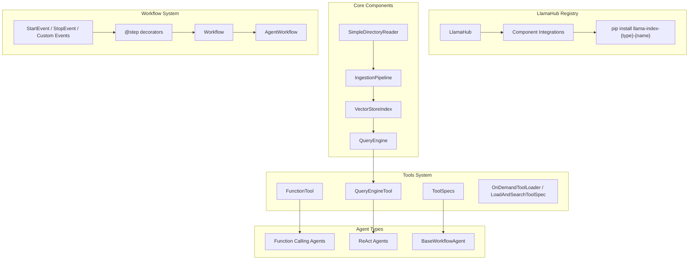
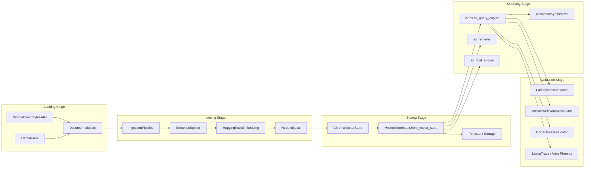
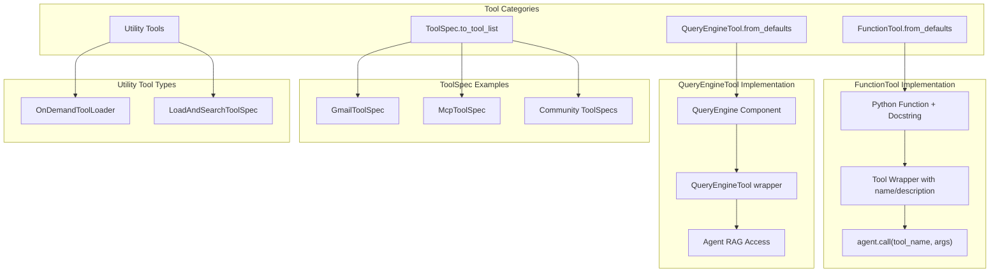
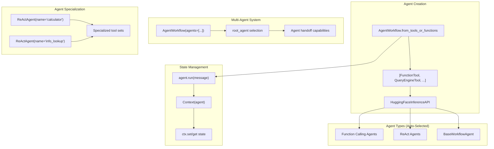
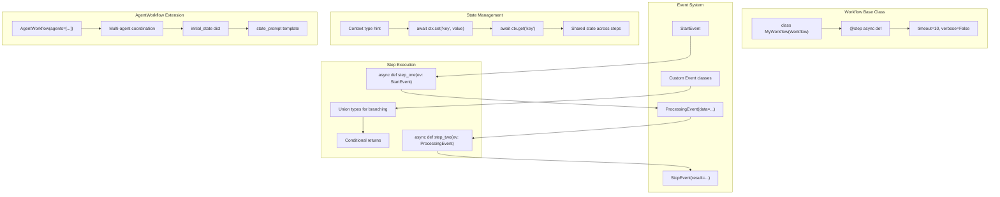

<!-- source: DeepWiki mcp.deepwiki.com · repo huggingface/agents-course · page 3.2 LlamaIndex Framework · fetched 2026-10-26 -->

# LlamaIndex Framework

<details>
<summary>Relevant source files</summary>

The following files were used as context for generating this wiki page:

- [units/en/unit2/llama-index/agents.mdx](units/en/unit2/llama-index/agents.mdx)
- [units/en/unit2/llama-index/components.mdx](units/en/unit2/llama-index/components.mdx)
- [units/en/unit2/llama-index/conclusion.mdx](units/en/unit2/llama-index/conclusion.mdx)
- [units/en/unit2/llama-index/introduction.mdx](units/en/unit2/llama-index/introduction.mdx)
- [units/en/unit2/llama-index/llama-hub.mdx](units/en/unit2/llama-index/llama-hub.mdx)
- [units/en/unit2/llama-index/quiz1.mdx](units/en/unit2/llama-index/quiz1.mdx)
- [units/en/unit2/llama-index/tools.mdx](units/en/unit2/llama-index/tools.mdx)
- [units/en/unit2/llama-index/workflows.mdx](units/en/unit2/llama-index/workflows.mdx)

</details>


This document covers the LlamaIndex framework implementation within the AI Agents course, focusing on its RAG-centered approach to building AI agents. LlamaIndex provides a comprehensive toolkit for creating LLM-powered agents through components, tools, agents, and workflows. For information about other agent frameworks, see smolagents Framework ([3.1](#3.1)) and LangGraph Framework ([3.3](#3.3)). For applied use cases using LlamaIndex, see Agentic RAG with Alfred ([5.1](#5.1)).

## Framework Architecture Overview

LlamaIndex follows a component-based architecture where different modules work together to enable RAG-focused agent capabilities. The framework emphasizes data indexing, querying, and workflow orchestration.

### LlamaIndex System Architecture



Sources: [units/en/unit2/llama-index/introduction.mdx:1-30](), [units/en/unit2/llama-index/llama-hub.mdx:1-56]()

## Core Components System

LlamaIndex's component system centers around the RAG pipeline, with `QueryEngine` as the primary interface for agent interactions. The components follow a clear data flow from loading through querying.

### RAG Pipeline Components



### Component Integration Pattern

| Component Type | Class Name | Integration Package | Purpose |
|---|---|---|---|
| Document Loading | `SimpleDirectoryReader` | Core | Load various file types from directories |
| Text Splitting | `SentenceSplitter` | Core | Break documents into manageable chunks |
| Embeddings | `HuggingFaceEmbedding` | `llama-index-embeddings-huggingface` | Convert text to vector representations |
| Vector Storage | `ChromaVectorStore` | `llama-index-vector-stores-chroma` | Persist and search vector embeddings |
| LLM Integration | `HuggingFaceInferenceAPI` | `llama-index-llms-huggingface-api` | Connect to Hugging Face models |

Sources: [units/en/unit2/llama-index/components.mdx:1-244]()

## Tools System

LlamaIndex provides four main categories of tools that agents can use, each serving different purposes in the agent workflow.

### Tool Type Hierarchy



### Tool Creation Patterns

The framework uses consistent patterns for tool creation:

- **FunctionTool**: Wraps Python functions with automatic schema parsing from type annotations and docstrings
- **QueryEngineTool**: Converts `QueryEngine` components into agent-accessible tools  
- **ToolSpecs**: Community-maintained tool collections that implement `to_tool_list()`
- **Utility Tools**: Handle data overflow and on-demand processing scenarios

Sources: [units/en/unit2/llama-index/tools.mdx:1-142]()

## Agent System

LlamaIndex supports multiple agent architectures, with automatic selection between function calling and ReAct approaches based on LLM capabilities.

### Agent Architecture Types



### Agent Implementation Classes

| Agent Type | Class | Use Case | LLM Requirements |
|---|---|---|---|
| Function Calling | Auto-selected | Tool calling via structured API | Function calling support |
| ReAct | Auto-selected | Complex reasoning with verbose output | Any chat/completion LLM |
| Multi-Agent | `AgentWorkflow` | Collaborative agent systems | Any supported LLM |
| Custom | `BaseWorkflowAgent` | Advanced custom workflows | Depends on implementation |

Sources: [units/en/unit2/llama-index/agents.mdx:1-161]()

## Workflow System

LlamaIndex workflows provide event-driven architecture for structuring agent behavior through discrete steps and custom events.

### Workflow Event Architecture



### Workflow Control Patterns

The workflow system supports complex control flow through type hinting:

- **Linear Flow**: `StartEvent → ProcessingEvent → StopEvent`
- **Branching**: `StartEvent → ProcessingEvent | LoopEvent`
- **Loops**: Self-referencing event types with conditional logic
- **State Persistence**: Context-based state management across steps

Sources: [units/en/unit2/llama-index/workflows.mdx:1-281]()

## Integration Ecosystem

LlamaIndex integrates with external systems through LlamaHub, providing standardized installation and usage patterns.

### LlamaHub Integration Pattern

The framework follows consistent naming conventions for integrations:

```bash
pip install llama-index-{component-type}-{framework-name}
```

### Key Integration Categories

| Integration Type | Package Pattern | Example |
|---|---|---|
| LLMs | `llama-index-llms-*` | `llama-index-llms-huggingface-api` |
| Embeddings | `llama-index-embeddings-*` | `llama-index-embeddings-huggingface` |
| Vector Stores | `llama-index-vector-stores-*` | `llama-index-vector-stores-chroma` |
| Tools | `llama-index-tools-*` | `llama-index-tools-google` |
| Utilities | `llama-index-utils-*` | `llama-index-utils-workflow` |
| Callbacks | `llama-index-callbacks-*` | `llama-index-callbacks-arize-phoenix` |

### MCP Integration

LlamaIndex supports Model Context Protocol (MCP) through dedicated toolspecs, enabling connection to MCP servers:

- **Package**: `llama-index-tools-mcp`
- **Classes**: `BasicMCPClient`, `McpToolSpec`
- **Usage**: Connect to MCP servers running on specified endpoints

Sources: [units/en/unit2/llama-index/llama-hub.mdx:1-56](), [units/en/unit2/llama-index/tools.mdx:101-129]()

---

