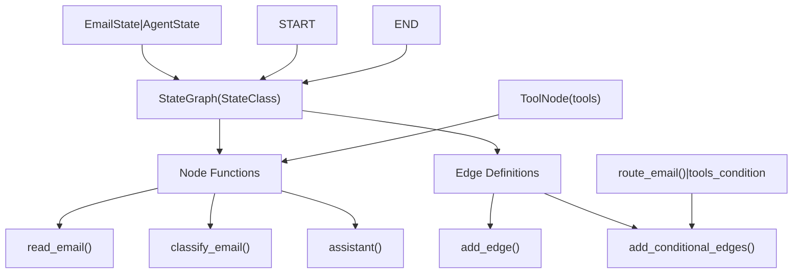
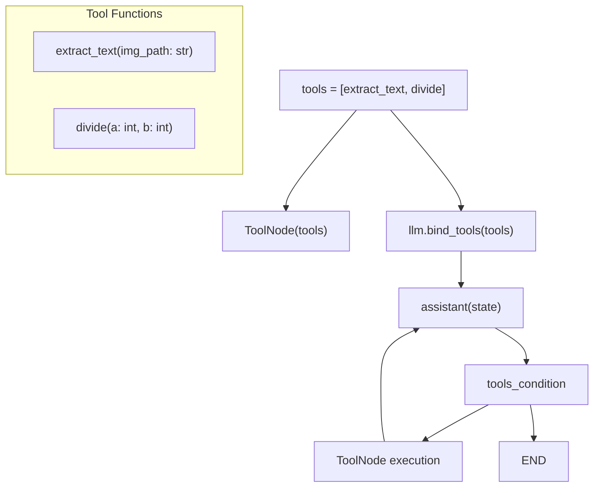
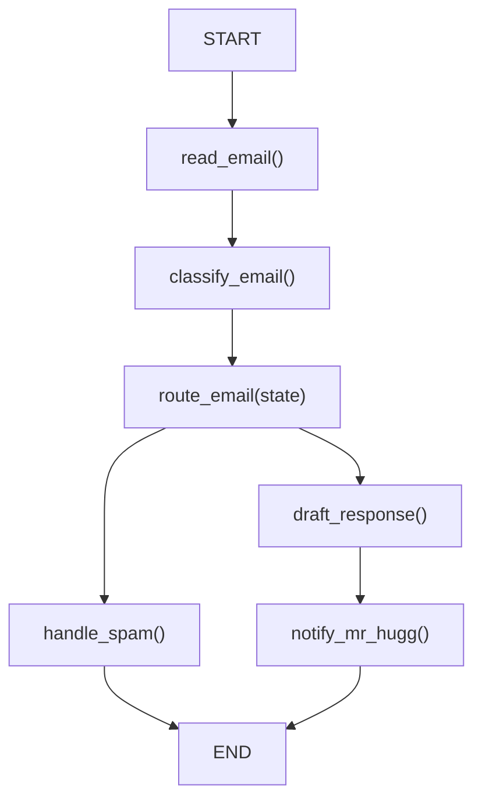
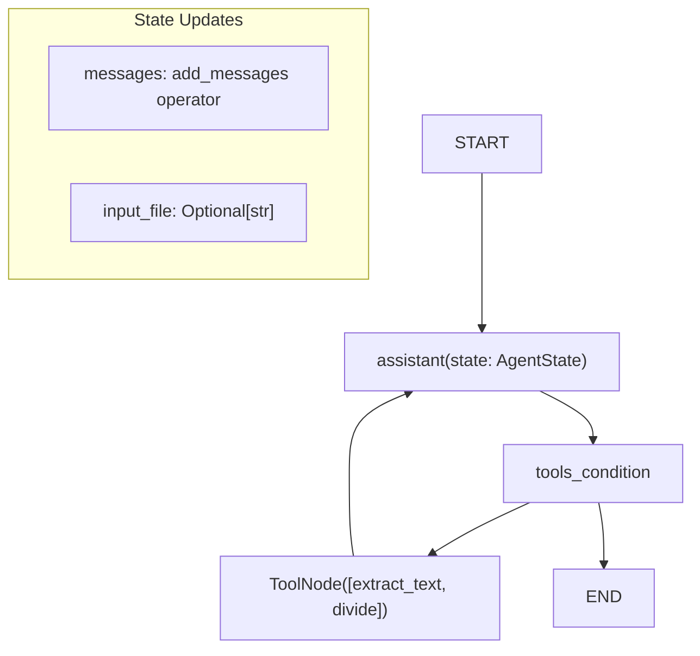

<!-- source: DeepWiki mcp.deepwiki.com · repo huggingface/agents-course · page 3.3 LangGraph Framework · fetched 2026-10-26 -->

# LangGraph Framework

<details>
<summary>Relevant source files</summary>

The following files were used as context for generating this wiki page:

- [units/en/unit2/langgraph/building_blocks.mdx](units/en/unit2/langgraph/building_blocks.mdx)
- [units/en/unit2/langgraph/conclusion.mdx](units/en/unit2/langgraph/conclusion.mdx)
- [units/en/unit2/langgraph/document_analysis_agent.mdx](units/en/unit2/langgraph/document_analysis_agent.mdx)
- [units/en/unit2/langgraph/first_graph.mdx](units/en/unit2/langgraph/first_graph.mdx)
- [units/en/unit2/langgraph/introduction.mdx](units/en/unit2/langgraph/introduction.mdx)
- [units/en/unit2/langgraph/quiz1.mdx](units/en/unit2/langgraph/quiz1.mdx)
- [units/en/unit2/langgraph/when_to_use_langgraph.mdx](units/en/unit2/langgraph/when_to_use_langgraph.mdx)

</details>


LangGraph is a framework developed by LangChain for building control flows in LLM applications using directed graphs. This framework provides state management, conditional routing, and tool integration capabilities for creating production-ready AI agent workflows.

For basic agent fundamentals, see [AI Agent Fundamentals](#2), and for other frameworks covered in this course, see [smolagents Framework](#3.1) and [LlamaIndex Framework](#3.2).

## LangGraph Architecture

LangGraph structures applications as directed graphs with user-defined state flowing between processing nodes. The framework emphasizes control and predictability over freedom, making it suitable for production environments requiring deterministic behavior.

**LangGraph Core Components**


LangGraph operates separately from LangChain but commonly uses LangChain classes like `ChatOpenAI` and `HumanMessage` for LLM interactions.

Sources: [units/en/unit2/langgraph/when_to_use_langgraph.mdx:1-11](), [units/en/unit2/langgraph/building_blocks.mdx:1-9]()

### Framework Positioning

LangGraph prioritizes control over freedom in the agent design spectrum, providing structured workflows with predictable execution paths compared to more open-ended frameworks like smolagents.

**Use Cases for LangGraph:**
- Multi-step reasoning processes requiring explicit flow control
- State persistence between processing steps  
- Deterministic logic combined with LLM capabilities
- Human-in-the-loop workflow integration
- Complex multi-agent system orchestration

Sources: [units/en/unit2/langgraph/when_to_use_langgraph.mdx:12-51]()

## State Management System

LangGraph uses `TypedDict` classes to define application state that flows between nodes during execution. State objects contain all data required for decision-making and processing.

**State Class Examples**
```mermaid
flowchart TD
    subgraph EmailWorkflow["Email Processing Workflow"]
        EmailState["EmailState"] --> email["email: Dict[str, Any]"]
        EmailState --> is_spam["is_spam: Optional[bool]"]
        EmailState --> spam_reason["spam_reason: Optional[str]"]
        EmailState --> email_category["email_category: Optional[str]"]
        EmailState --> email_draft["email_draft: Optional[str]"]
        EmailState --> messages["messages: List[Dict[str, Any]]"]
    end
    
    subgraph AgentWorkflow["Document Analysis Workflow"]  
        AgentState["AgentState"] --> input_file["input_file: Optional[str]"]
        AgentState --> agent_messages["messages: Annotated[list[AnyMessage], add_messages]"]
    end
```

The `add_messages` operator in `AgentState` demonstrates LangGraph's state operators that define how state fields interact during updates rather than simple overwrites.

Sources: [units/en/unit2/langgraph/building_blocks.mdx:11-25](), [units/en/unit2/langgraph/first_graph.mdx:40-64](), [units/en/unit2/langgraph/document_analysis_agent.mdx:42-54]()

## Node Functions

Nodes are Python functions that process state and return state updates. Each node function receives the current state and returns a dictionary containing fields to update.

**Node Function Pattern:**
| Function Signature | Purpose | Return Type |
|-------------------|---------|-------------|
| `read_email(state: EmailState)` | Email intake processing | `Dict[str, Any]` |
| `classify_email(state: EmailState)` | LLM-based email classification | `Dict[str, Any]` |
| `assistant(state: AgentState)` | LLM processing with tool binding | `Dict[str, Any]` |
| `extract_text(img_path: str)` | Tool function for OCR | `str` |

Node functions commonly perform LLM calls using `ChatOpenAI.invoke()`, tool execution, or state transformation logic.

Sources: [units/en/unit2/langgraph/building_blocks.mdx:26-54](), [units/en/unit2/langgraph/first_graph.mdx:70-195]()

## Graph Construction and Routing

The `StateGraph` class manages node registration and edge definitions. Conditional routing uses functions that evaluate state and return node names for execution flow control.

**Routing Function Examples:**
```python
def route_email(state: EmailState) -> str:
    if state["is_spam"]:
        return "handle_spam"
    else:
        return "draft_response"

def tools_condition(state: AgentState):
    # Built-in function that routes based on tool calls
    # Returns "tools" or END based on message content
```

The `tools_condition` function is a pre-built routing function that examines the last message for tool calls and routes to either a `ToolNode` or workflow termination.

Sources: [units/en/unit2/langgraph/building_blocks.mdx:56-82](), [units/en/unit2/langgraph/first_graph.mdx:202-208](), [units/en/unit2/langgraph/document_analysis_agent.mdx:170-177]()

## Graph Compilation Process

StateGraph compilation transforms the node and edge definitions into an executable workflow:

```python
from langgraph.graph import StateGraph, START, END

builder = StateGraph(EmailState)
builder.add_node("read_email", read_email)
builder.add_node("classify_email", classify_email)
builder.add_edge(START, "read_email")
builder.add_conditional_edges("classify_email", route_email, {
    "spam": "handle_spam",
    "legitimate": "draft_response"
})
compiled_graph = builder.compile()
```

The compiled graph provides `invoke()` method for execution and `get_graph()` for visualization.

Sources: [units/en/unit2/langgraph/building_blocks.mdx:84-124](), [units/en/unit2/langgraph/first_graph.mdx:217-248]()

## Tool Integration Pattern

LangGraph provides `ToolNode` class and `tools_condition` function for implementing the ReAct pattern (Reason-Act-Observe) with tool usage in agent workflows.

**Tool Integration Architecture**


The `assistant` function uses `llm_with_tools.invoke()` to generate responses that may include tool calls. The `tools_condition` examines the response and routes to either tool execution or workflow termination.

Sources: [units/en/unit2/langgraph/document_analysis_agent.mdx:57-118](), [units/en/unit2/langgraph/document_analysis_agent.mdx:170-177]()

## Workflow Implementation Examples

### Email Processing Workflow

The email processing system demonstrates conditional routing based on LLM classification results:

**Email Workflow Execution Flow**


Key functions:
- `classify_email()` uses `ChatOpenAI.invoke()` with email content for spam detection
- `route_email()` evaluates `state["is_spam"]` to determine next node
- `draft_response()` generates email replies using LLM
- `notify_mr_hugg()` outputs the draft for review

Sources: [units/en/unit2/langgraph/first_graph.mdx:1-195]()

### Document Analysis Agent Workflow  

The document analysis workflow implements ReAct pattern with tool integration for OCR and calculations:



The `assistant` function creates system messages with tool descriptions and uses `llm_with_tools.invoke()` for processing. Tool functions like `extract_text()` use vision models for OCR operations.

Sources: [units/en/unit2/langgraph/document_analysis_agent.mdx:127-197]()

## Graph Execution and Invocation

Compiled graphs provide `invoke()` method for execution with initial state. The method processes the workflow and returns the final state after all nodes complete execution.

**Execution Example:**
```python
result = compiled_graph.invoke({
    "email": {
        "sender": "john.smith@example.com",
        "subject": "Question about services",
        "body": "Dear Mr. Hugg, I'm interested in your consulting..."
    },
    "is_spam": None,
    "spam_reason": None,
    "email_category": None,
    "email_draft": None,
    "messages": []
})
```

The execution follows the defined edge paths, with conditional edges using routing functions to determine the next node based on current state values.

Sources: [units/en/unit2/langgraph/first_graph.mdx:257-293]()

## Observability Integration

LangGraph supports observability through callback handlers that trace workflow execution. The `CallbackHandler` from Langfuse provides monitoring for node execution, state transitions, and LLM interactions.

**Tracing Configuration:**
```python
from langfuse.callback import CallbackHandler

langfuse_handler = CallbackHandler()
result = compiled_graph.invoke(
    input=state_dict,
    config={"callbacks": [langfuse_handler]}
)
```

**Traced Operations:**
- Node function execution sequence
- State field updates between nodes  
- LLM `invoke()` calls and responses
- Tool execution results
- Routing decisions from conditional edges

The tracing integration helps debug workflow execution and monitor agent performance in production environments.

Sources: [units/en/unit2/langgraph/first_graph.mdx:295-340]()

## When to Use LangGraph

LangGraph is particularly well-suited for:

1. **Multi-step reasoning processes** that need explicit control flow
2. **Applications requiring persistence of state** between steps
3. **Systems combining deterministic logic with AI capabilities**
4. **Workflows with human-in-the-loop interventions**
5. **Complex agent architectures** with multiple coordinated components

It excels when you need control and predictability while still leveraging LLM capabilities for decision-making.

Sources: [units/en/unit2/langgraph/when_to_use_langgraph.mdx:38-51]()

## Summary

LangGraph provides a structured framework for building controlled, predictable workflows that leverage LLMs for decision-making. By defining state, creating processing nodes, and connecting them with edges (both direct and conditional), developers can create sophisticated agent applications that maintain predictable behavior while still benefiting from the capabilities of LLMs.

The framework is particularly valuable for production applications where reliability and control are essential, positioning it as one of the most production-ready agent frameworks available.

For more advanced topics, refer to the [LangChain Academy's Introduction to LangGraph course](https://academy.langchain.com/courses/intro-to-langgraph) or explore the [official LangGraph documentation](https://github.com/langchain-ai/langgraph).

Sources: [units/en/unit2/langgraph/conclusion.mdx:1-13]()

---

