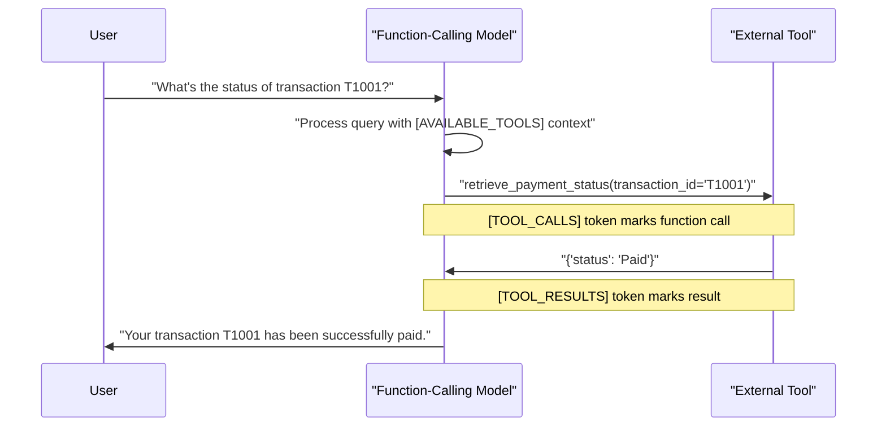
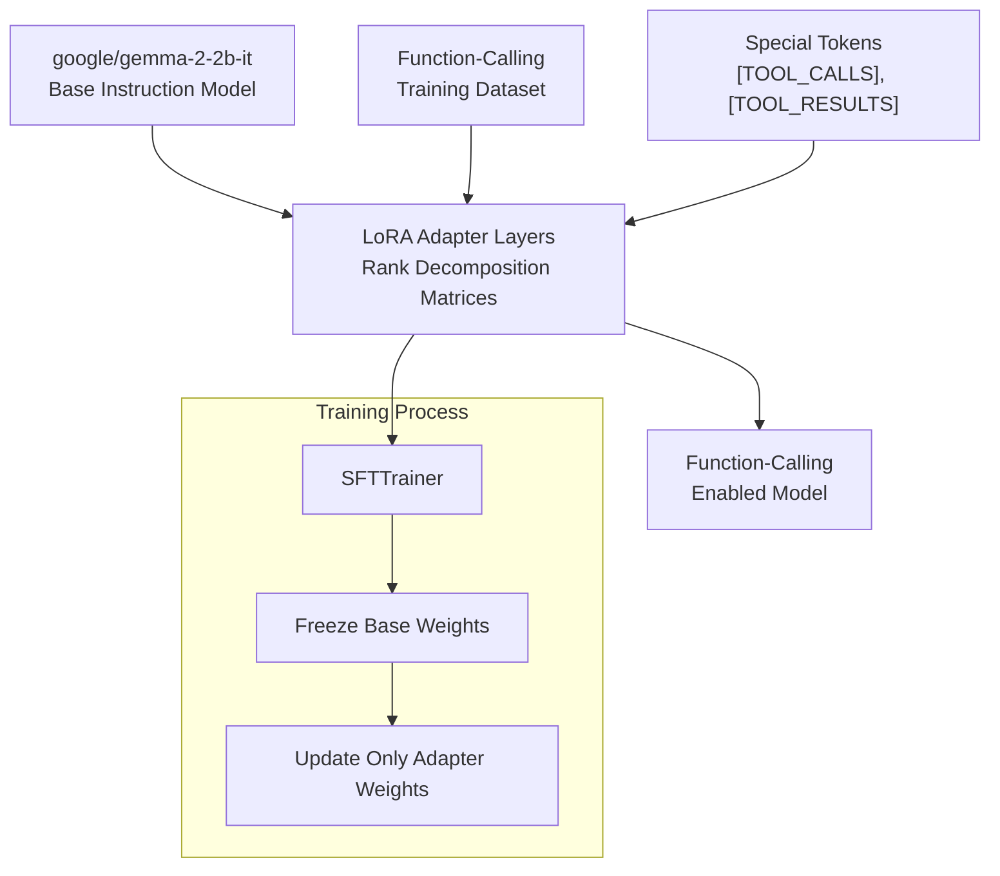
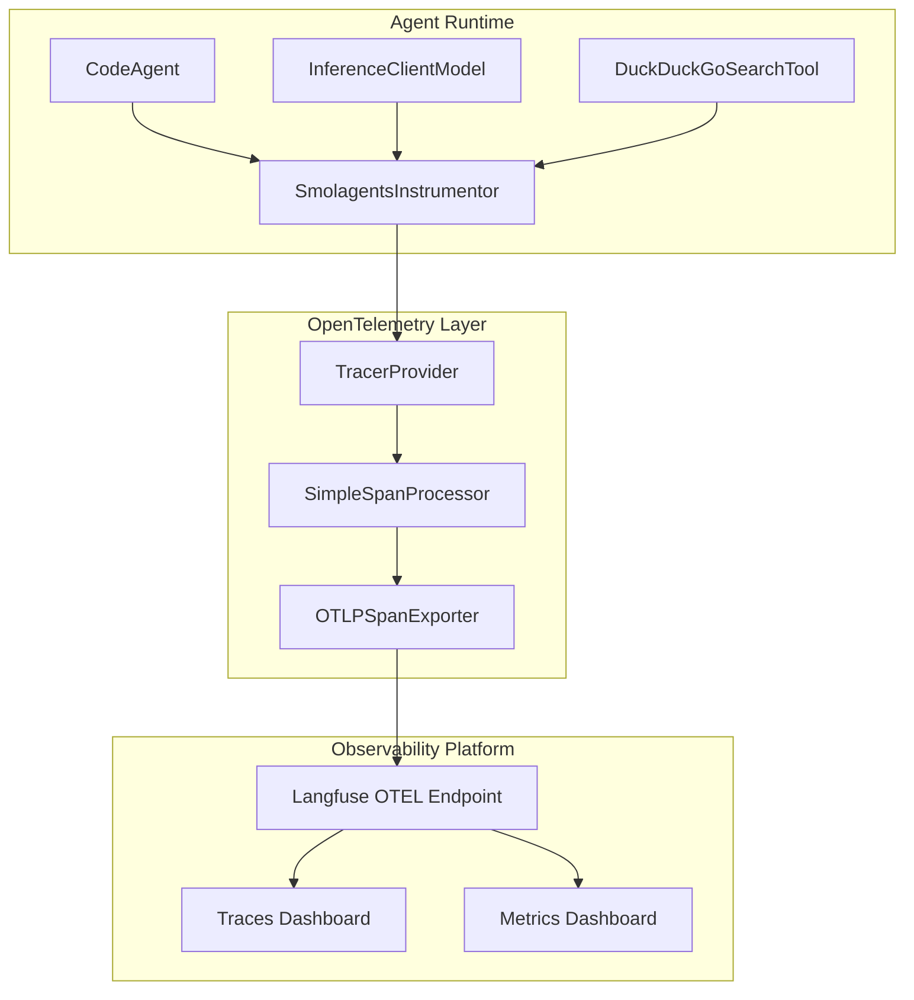
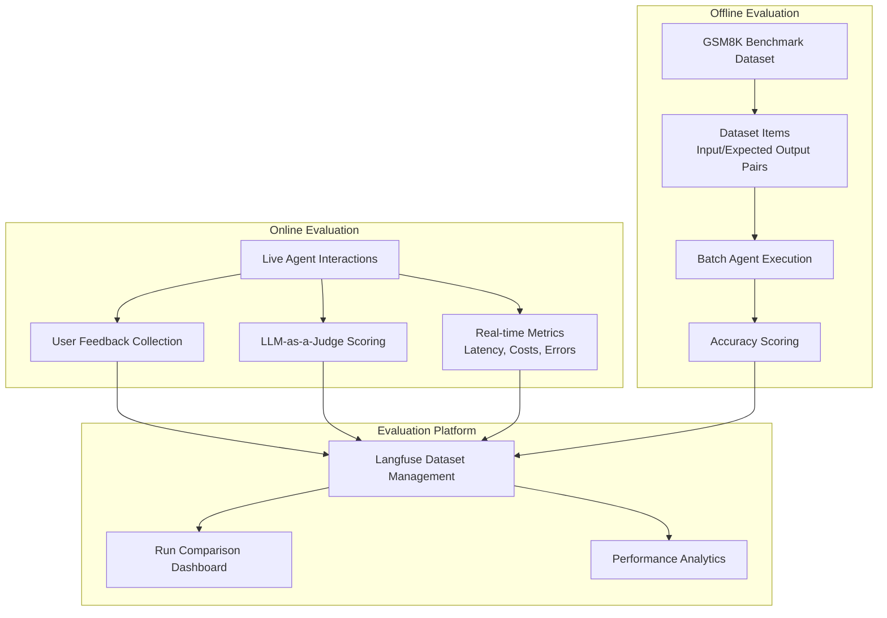

<!-- source: DeepWiki mcp.deepwiki.com · repo huggingface/agents-course · page 4 Advanced Topics · fetched 2026-10-26 -->

# Advanced Topics

Relevant source files

The following files were used as context for generating this wiki page:

- [units/en/bonus-unit1/conclusion.mdx](units/en/bonus-unit1/conclusion.mdx)
- [units/en/bonus-unit1/fine-tuning.mdx](units/en/bonus-unit1/fine-tuning.mdx)
- [units/en/bonus-unit1/introduction.mdx](units/en/bonus-unit1/introduction.mdx)
- [units/en/bonus-unit1/what-is-function-calling.mdx](units/en/bonus-unit1/what-is-function-calling.mdx)
- [units/en/bonus-unit2/introduction.mdx](units/en/bonus-unit2/introduction.mdx)
- [units/en/bonus-unit2/monitoring-and-evaluating-agents-notebook.mdx](units/en/bonus-unit2/monitoring-and-evaluating-agents-notebook.mdx)
- [units/en/bonus-unit2/what-is-agent-observability-and-evaluation.mdx](units/en/bonus-unit2/what-is-agent-observability-and-evaluation.mdx)

This document covers advanced techniques for optimizing and monitoring AI agents beyond basic framework usage. The content focuses on two critical areas: fine-tuning language models for enhanced function calling capabilities and implementing comprehensive observability and evaluation systems for production agent deployments.

For basic agent framework usage, see [Agent Frameworks](#3). For practical implementations and applications, see [Use Cases and Applications](#5).

## Function Calling Fine-Tuning

Function calling represents a significant advancement over prompt-based agent approaches by training models to understand and execute tool interactions during the training phase rather than relying solely on generalization from prompts.

### Function Calling Architecture

Traditional agents rely on the model's ability to generalize tool usage from prompts, while function-calling models learn tool interaction patterns through specialized training data and token structures.

**Function Calling Conversation Flow**

Sources: [units/en/bonus-unit1/what-is-function-calling.mdx:34-60]()

### LoRA Training Pipeline

The training process uses Low-Rank Adaptation (LoRA) to efficiently add function-calling capabilities to instruction-tuned models without full model retraining.

**LoRA Fine-tuning Architecture**

Sources: [units/en/bonus-unit1/fine-tuning.mdx:25-41](), [units/en/bonus-unit1/fine-tuning.mdx:43-49]()

### Special Token System

Function-calling models use specialized tokens to structure the conversation flow and distinguish between different phases of tool interaction.

| Token | Purpose | Usage Context |
|-------|---------|---------------|
| `[AVAILABLE_TOOLS]` | Start tool list | Defines available functions |
| `[/AVAILABLE_TOOLS]` | End tool list | Closes function definitions |
| `[TOOL_CALLS]` | Begin function call | Marks action execution |
| `[TOOL_RESULTS]` | Begin tool output | Marks observation phase |
| `[/TOOL_RESULTS]` | End tool output | Returns to model generation |

Sources: [units/en/bonus-unit1/what-is-function-calling.mdx:64-71]()

## Agent Observability and Evaluation

Production agent deployments require comprehensive monitoring and evaluation systems to ensure reliability, performance, and continuous improvement.

### OpenTelemetry Integration Architecture

The observability system uses OpenTelemetry standards to instrument agent frameworks and export telemetry data to monitoring platforms.

**Observability System Architecture**

Sources: [units/en/bonus-unit2/monitoring-and-evaluating-agents-notebook.mdx:74-93]()

### Evaluation Workflow System

The evaluation system combines online monitoring of live interactions with offline testing against benchmark datasets to provide comprehensive performance assessment.

**Evaluation Workflow Architecture**

Sources: [units/en/bonus-unit2/what-is-agent-observability-and-evaluation.mdx:65-87](), [units/en/bonus-unit2/monitoring-and-evaluating-agents-notebook.mdx:305-442]()

### Key Monitoring Metrics

Production agent monitoring focuses on several critical performance indicators that directly impact user experience and system reliability.

| Metric Category | Specific Metrics | Implementation |
|-----------------|------------------|----------------|
| **Performance** | Latency, Token throughput | OpenTelemetry span timing |
| **Costs** | Token usage, API call frequency | Token counting in traces |
| **Reliability** | Request errors, Tool failures | Error span attributes |
| **Quality** | User ratings, LLM-judge scores | Custom scoring integration |
| **Usage** | Session patterns, Retry behavior | User interaction tracking |

Sources: [units/en/bonus-unit2/what-is-agent-observability-and-evaluation.mdx:40-54]()

### Instrumentation Implementation

The instrumentation setup requires configuring the OpenTelemetry tracer provider and connecting it to the observability platform through environment variables and API authentication.

Key implementation components:
- `TracerProvider` configuration with `SimpleSpanProcessor`
- `OTLPSpanExporter` setup with authentication headers
- `SmolagentsInstrumentor` initialization for automatic span creation
- Custom span attributes for user IDs, session tracking, and metadata

Sources: [units/en/bonus-unit2/monitoring-and-evaluating-agents-notebook.mdx:47-93]()

### Dataset-Based Evaluation

Offline evaluation uses structured datasets like GSM8K to systematically test agent performance against known correct answers, enabling reproducible performance measurement across different model configurations.

The evaluation process involves:
1. Dataset creation in the observability platform using `langfuse.create_dataset()`
2. Individual dataset item creation with `langfuse.create_dataset_item()`
3. Batch agent execution with trace linking via `item.link()`
4. Performance comparison across different runs and configurations

Sources: [units/en/bonus-unit2/monitoring-and-evaluating-agents-notebook.mdx:332-442]()

### User Feedback Integration

Real-time user feedback collection integrates with agent interfaces through frameworks like Gradio, capturing user satisfaction scores and linking them to specific agent interactions via trace IDs.

The feedback implementation uses:
- `format_trace_id()` to correlate UI interactions with telemetry traces
- `langfuse.score()` to attach user ratings to specific agent runs
- Custom span attributes for session and user identification

Sources: [units/en/bonus-unit2/monitoring-and-evaluating-agents-notebook.mdx:200-268]()

---

