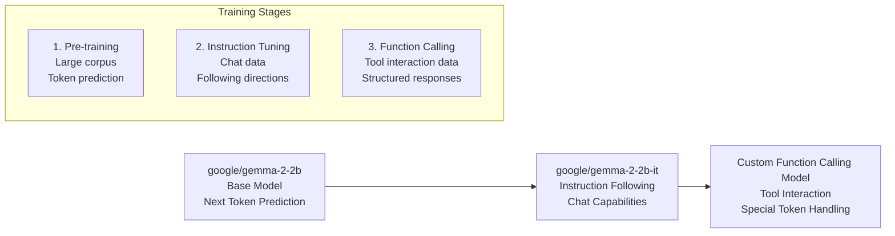
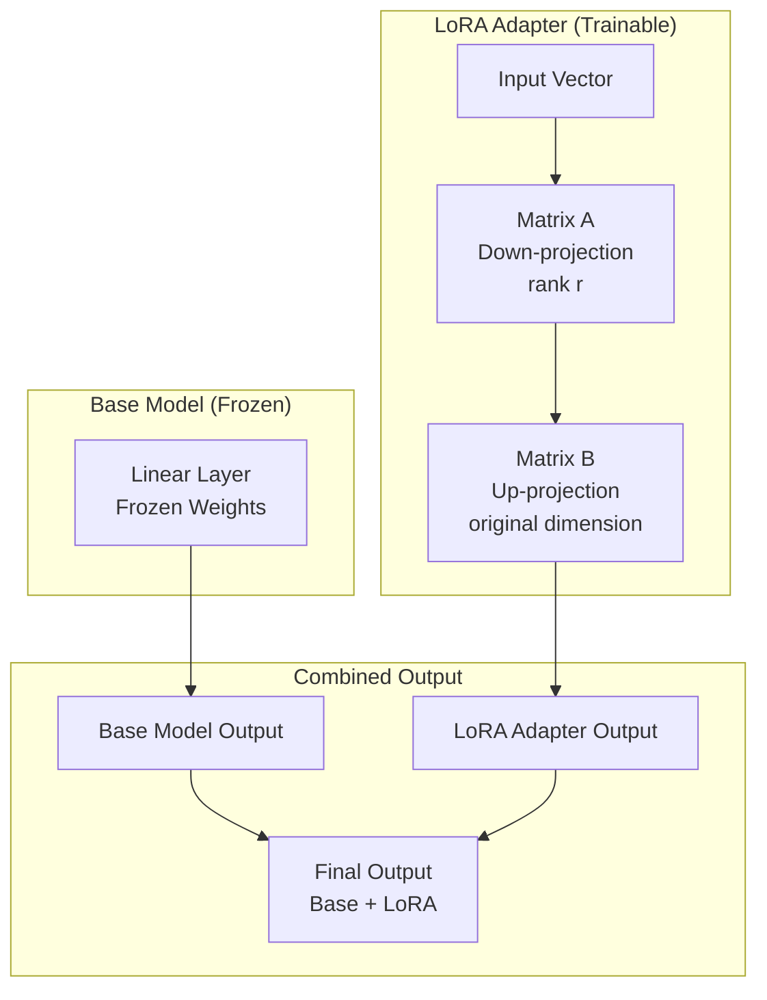
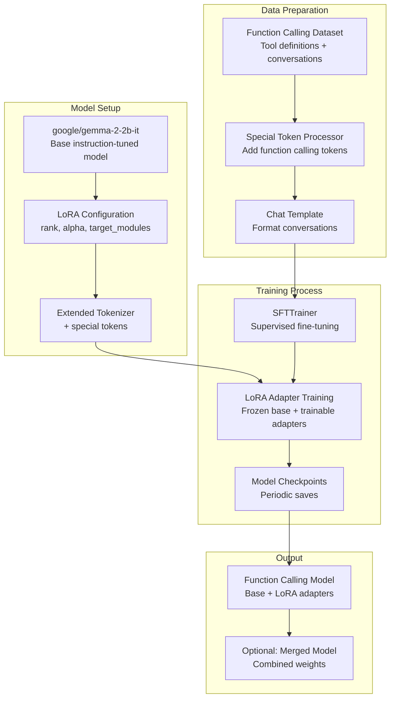

<!-- source: DeepWiki mcp.deepwiki.com · repo huggingface/agents-course · page 4.1 Fine-tuning LLMs for Function Calling · fetched 2026-10-26 -->

# Fine-tuning LLMs for Function Calling

Relevant source files

The following files were used as context for generating this wiki page:

- [units/en/bonus-unit1/conclusion.mdx](units/en/bonus-unit1/conclusion.mdx)
- [units/en/bonus-unit1/fine-tuning.mdx](units/en/bonus-unit1/fine-tuning.mdx)
- [units/en/bonus-unit1/introduction.mdx](units/en/bonus-unit1/introduction.mdx)
- [units/en/bonus-unit1/what-is-function-calling.mdx](units/en/bonus-unit1/what-is-function-calling.mdx)

This document covers advanced techniques for training Large Language Models to perform structured function calling, enabling more reliable tool interaction compared to prompt-based approaches. This material focuses on LoRA fine-tuning methodology and the specialized conversation formats required for function calling capabilities.

For basic agent concepts and tool usage patterns, see [AI Agent Fundamentals](#2). For observability and evaluation of fine-tuned models, see [Agent Observability and Evaluation](#4.2).

## Purpose and Scope

Function calling represents a paradigm shift from prompt-based agent architectures to learned tool interaction patterns. Unlike the general agent frameworks covered in [Agent Frameworks](#3), this approach trains the model to recognize and generate specific conversation structures that include tool invocation and result processing.

The fine-tuning process transforms instruction-tuned base models like `google/gemma-2-2b-it` into specialized function-calling models through LoRA adaptation, introducing new special tokens and conversation roles specifically designed for tool interaction workflows.

Sources: [units/en/bonus-unit1/introduction.mdx:5-16](), [units/en/bonus-unit1/what-is-function-calling.mdx:1-11]()

## Function Calling Architecture

Function calling extends standard chat conversations by introducing specialized roles and formatting conventions that enable structured tool interaction.

### Conversation Structure

Function calling conversations differ from standard chat by incorporating additional roles beyond `user` and `assistant`:

```mermaid
graph TB
    subgraph "Standard Chat"
        User1["user: I need help with my order"]
        Assistant1["assistant: I'd be happy to help..."]
        User2["user: It's ORDER-123"]
    end
    
    subgraph "Function Calling Chat"
        UserFC["user: What's the status of my transaction T1001?"]
        AssistantFC["assistant: (empty content)"]
        FunctionCall["function_call: retrieve_payment_status"]
        ToolRole["tool: {'status': 'Paid'}"]
        AssistantResponse["assistant: Your transaction T1001 has been successfully paid."]
    end
    
    User1 --> Assistant1
    Assistant1 --> User2
    
    UserFC --> AssistantFC
    AssistantFC --> FunctionCall
    FunctionCall --> ToolRole
    ToolRole --> AssistantResponse
```

Sources: [units/en/bonus-unit1/what-is-function-calling.mdx:19-59]()

### Special Token System

The model learns to use specific tokens that demarcate different phases of the function calling process:

| Token | Purpose |
|-------|---------|
| `[AVAILABLE_TOOLS]` | Start tool definitions |
| `[/AVAILABLE_TOOLS]` | End tool definitions |
| `[TOOL_CALLS]` | Begin tool invocation |
| `[TOOL_RESULTS]` | Begin tool output processing |
| `[/TOOL_RESULTS]` | End tool output processing |

These tokens enable the model to distinguish between internal reasoning, tool invocation, and result interpretation phases during generation.

Sources: [units/en/bonus-unit1/what-is-function-calling.mdx:64-71]()

## Training Methodology

The fine-tuning process builds upon existing instruction-tuned models rather than starting from base models, minimizing the learning required for function calling capabilities.

### Three-Stage Training Pipeline

Starting from `google/gemma-2-2b-it` rather than the base model `google/gemma-2-2b` reduces training requirements since instruction following and chat capabilities are already established.

Sources: [units/en/bonus-unit1/fine-tuning.mdx:9-24]()

### Training Data Requirements

Function calling models require specialized datasets that demonstrate the complete thought-action-observation cycle:

1. **Thought**: Internal reasoning about which tools to use
2. **Action**: Properly formatted tool calls with correct parameters  
3. **Observation**: Processing and interpreting tool results

This differs from standard chat data by including structured tool invocation examples and multi-turn conversations that demonstrate tool result integration.

Sources: [units/en/bonus-unit1/what-is-function-calling.mdx:13-18](), [units/en/bonus-unit1/introduction.mdx:33-34]()

## LoRA Implementation

Low-Rank Adaptation (LoRA) enables efficient fine-tuning by adding trainable adapter layers while freezing the base model parameters.

### LoRA Architecture

LoRA reduces trainable parameters significantly by decomposing weight updates into low-rank matrices, typically focusing on linear layers in Transformer blocks. This approach produces smaller model files (hundreds of MBs vs. full model size) while maintaining training effectiveness.

Sources: [units/en/bonus-unit1/fine-tuning.mdx:25-41]()

### Resource Efficiency

LoRA offers several advantages for function calling fine-tuning:

- **Memory Efficiency**: Only adapter weights require gradient computation
- **Storage Efficiency**: Adapter weights are much smaller than full model parameters
- **Training Speed**: Reduced parameter count accelerates training iterations
- **Deployment Flexibility**: Adapters can be merged with base models or swapped dynamically

The technique is particularly valuable for adapting large models to specific function calling patterns without prohibitive resource requirements.

Sources: [units/en/bonus-unit1/fine-tuning.mdx:27-39]()

## Implementation Workflow

The practical fine-tuning process involves several key components working together to transform an instruction-tuned model into a function-calling capable system.

### Complete Training Pipeline

The workflow integrates dataset preparation, model configuration, and LoRA training through the `SFTTrainer` framework, which handles the supervised fine-tuning process for function calling capabilities.

Sources: [units/en/bonus-unit1/fine-tuning.mdx:43-49](), [units/en/bonus-unit1/introduction.mdx:19-22]()

### Notebook Implementation

The complete implementation is available in the tutorial notebook at `agents-course/notebooks/blob/main/bonus-unit1/bonus-unit1.ipynb`, which provides step-by-step code for:

- Dataset loading and preprocessing
- LoRA configuration setup
- Training loop execution
- Model evaluation and saving

The notebook can be executed in Google Colab for hands-on experimentation with the fine-tuning process.

Sources: [units/en/bonus-unit1/fine-tuning.mdx:45-48]()

## Integration with Agent Frameworks

Function calling models trained through this process can be integrated with the agent frameworks covered in [Agent Frameworks](#3), providing more reliable tool interaction than prompt-based approaches. The specialized conversation handling and token processing learned during fine-tuning enables more consistent tool invocation across different agent architectures.

The evaluation and monitoring techniques discussed in [Agent Observability and Evaluation](#4.2) can be applied to assess the performance of fine-tuned function calling models in production agent systems.

Sources: [units/en/bonus-unit1/introduction.mdx:8-10](), [units/en/bonus-unit1/conclusion.mdx:9]()

---

