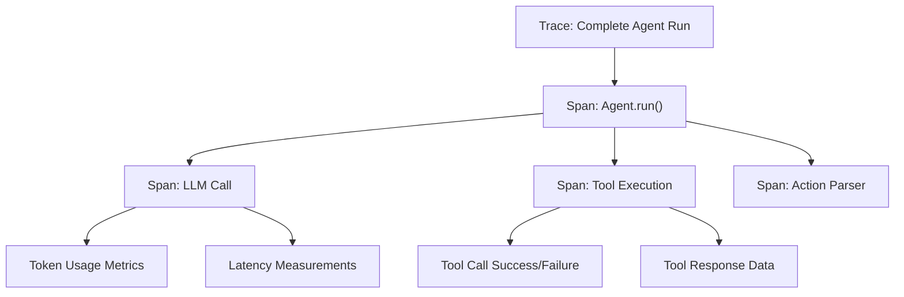
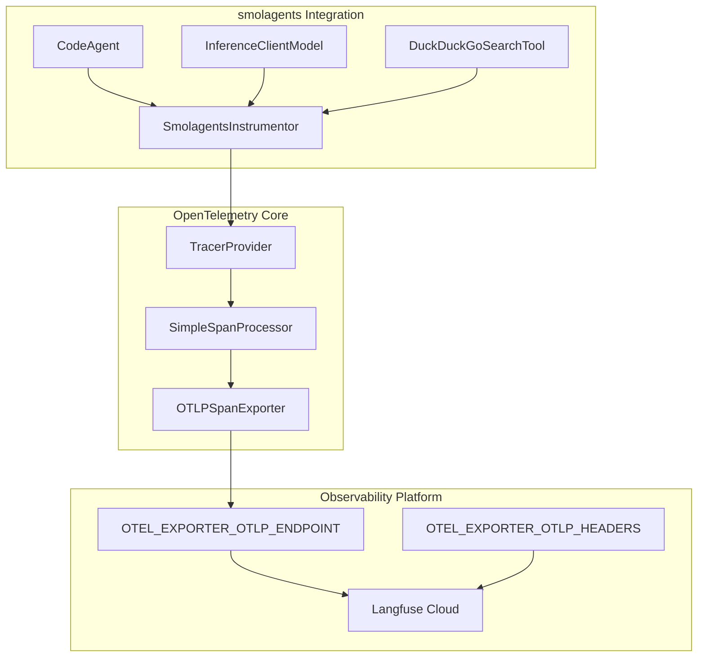
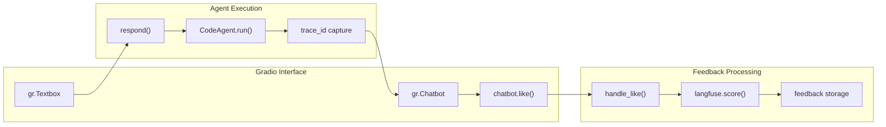
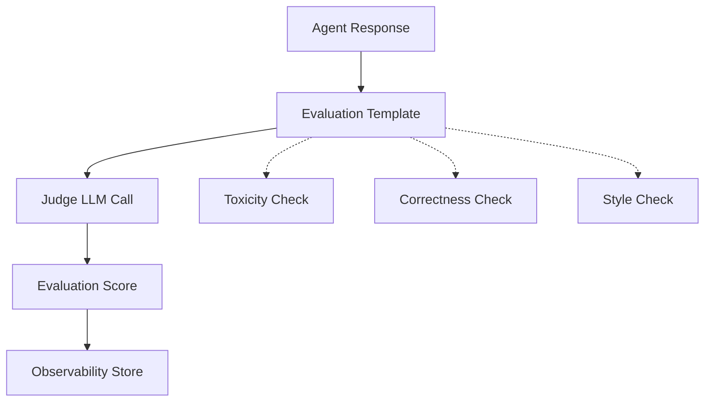
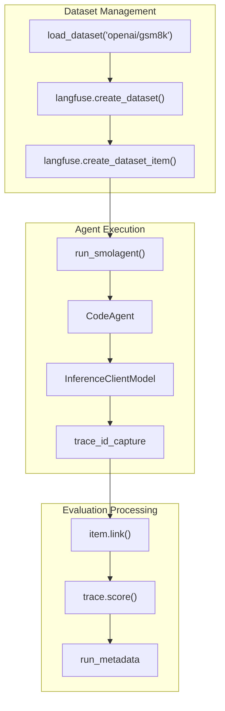
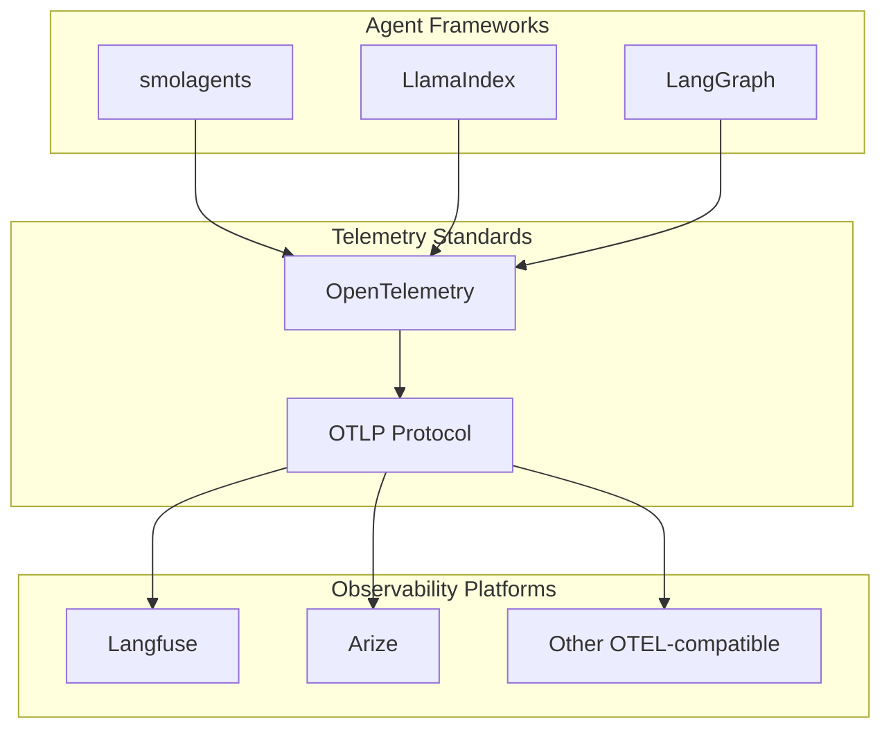
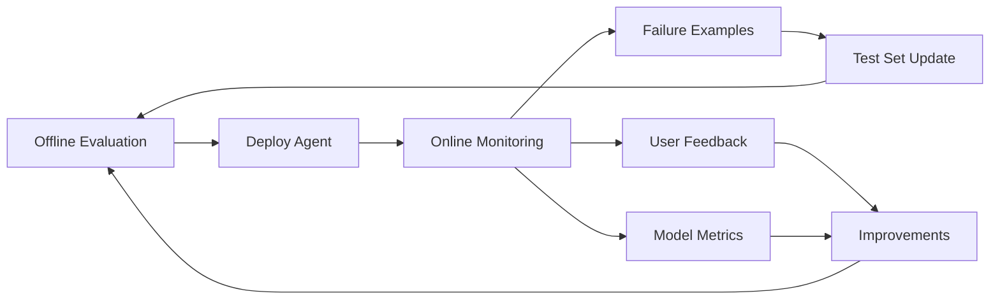

<!-- source: DeepWiki mcp.deepwiki.com · repo huggingface/agents-course · page 4.2 Agent Observability and Evaluation · fetched 2026-10-26 -->

# Agent Observability and Evaluation

<details>
<summary>Relevant source files</summary>

The following files were used as context for generating this wiki page:

- [units/en/bonus-unit2/introduction.mdx](units/en/bonus-unit2/introduction.mdx)
- [units/en/bonus-unit2/monitoring-and-evaluating-agents-notebook.mdx](units/en/bonus-unit2/monitoring-and-evaluating-agents-notebook.mdx)
- [units/en/bonus-unit2/what-is-agent-observability-and-evaluation.mdx](units/en/bonus-unit2/what-is-agent-observability-and-evaluation.mdx)

</details>


This document covers the implementation of observability and evaluation systems for AI agents, focusing on the smolagents framework integration with OpenTelemetry and platforms like Langfuse. It explains how to instrument agents for monitoring, collect performance metrics, and perform both online and offline evaluation.

For information about fine-tuning LLMs for function calling, see [Fine-tuning LLMs for Function Calling](#4.1). For practical agent applications and benchmarks, see [GAIA Benchmark Evaluation](#5.3).

## Core Observability Concepts

Agent observability transforms AI agents from "black boxes" into transparent systems by exposing internal execution details through standardized telemetry. The foundation relies on **traces** and **spans** that capture the complete execution flow.

### Trace and Span Architecture



**Sources:** [units/en/bonus-unit2/what-is-agent-observability-and-evaluation.mdx:28-36](), [units/en/bonus-unit2/monitoring-and-evaluating-agents-notebook.mdx:134-144]()

### Key Metrics Framework

| Metric Category | Purpose | Implementation |
|----------------|---------|----------------|
| **Latency** | Response time optimization | OpenTelemetry span timing |
| **Costs** | Token usage and API expenses | Model call instrumentation |
| **Request Errors** | Failure rate monitoring | Exception tracking in spans |
| **User Feedback** | Direct satisfaction measurement | Custom span attributes |
| **Accuracy** | Output quality assessment | Automated evaluation scores |

**Sources:** [units/en/bonus-unit2/what-is-agent-observability-and-evaluation.mdx:37-54]()

## OpenTelemetry Instrumentation

The observability system integrates with smolagents through OpenTelemetry, using the `SmolagentsInstrumentor` to automatically capture execution details.

### Instrumentation Setup Architecture



**Sources:** [units/en/bonus-unit2/monitoring-and-evaluating-agents-notebook.mdx:74-93]()

The instrumentation configuration involves several key components:

```python
# Environment setup for Langfuse integration
os.environ["OTEL_EXPORTER_OTLP_ENDPOINT"] = os.environ.get("LANGFUSE_HOST") + "/api/public/otel"
os.environ["OTEL_EXPORTER_OTLP_HEADERS"] = f"Authorization=Basic {LANGFUSE_AUTH}"
```

**Sources:** [units/en/bonus-unit2/monitoring-and-evaluating-agents-notebook.mdx:63-64]()

### Core Integration Classes

The `SmolagentsInstrumentor` automatically instruments agent operations:

```python
from openinference.instrumentation.smolagents import SmolagentsInstrumentor
SmolagentsInstrumentor().instrument(tracer_provider=trace_provider)
```

**Sources:** [units/en/bonus-unit2/monitoring-and-evaluating-agents-notebook.mdx:76](), [units/en/bonus-unit2/monitoring-and-evaluating-agents-notebook.mdx:92]()

## Online Evaluation Systems

Online evaluation monitors agent performance during live user interactions, capturing real-world usage patterns and feedback.

### User Feedback Integration



**Sources:** [units/en/bonus-unit2/monitoring-and-evaluating-agents-notebook.mdx:207-264]()

The feedback system captures trace IDs during agent execution:

```python
current_span = trace.get_current_span()
span_context = current_span.get_span_context()
trace_id = span_context.trace_id
formatted_trace_id = str(format_trace_id(trace_id))
```

**Sources:** [units/en/bonus-unit2/monitoring-and-evaluating-agents-notebook.mdx:223-227]()

### LLM-as-a-Judge Evaluation

Automated evaluation uses separate LLM calls to assess agent outputs:



**Sources:** [units/en/bonus-unit2/monitoring-and-evaluating-agents-notebook.mdx:270-298]()

### Custom Span Attributes

Enhanced observability through custom attributes:

```python
span.set_attribute("langfuse.user.id", "smolagent-user-123")
span.set_attribute("langfuse.session.id", "smolagent-session-123456789")
span.set_attribute("langfuse.tags", ["city-question", "testing-agents"])
```

**Sources:** [units/en/bonus-unit2/monitoring-and-evaluating-agents-notebook.mdx:191-193]()

## Offline Evaluation Framework

Offline evaluation uses benchmark datasets to systematically test agent performance in controlled environments.

### Dataset Evaluation Pipeline



**Sources:** [units/en/bonus-unit2/monitoring-and-evaluating-agents-notebook.mdx:319-430]()

### Dataset Integration Process

The evaluation framework creates datasets in Langfuse:

```python
langfuse.create_dataset(
    name=langfuse_dataset_name,
    description="GSM8K benchmark dataset uploaded from Huggingface",
    metadata={"date": "2025-03-10", "type": "benchmark"}
)
```

**Sources:** [units/en/bonus-unit2/monitoring-and-evaluating-agents-notebook.mdx:340-347]()

### Batch Evaluation Execution

The `run_smolagent()` function handles traced execution:

```python
def run_smolagent(question):
    with tracer.start_as_current_span("Smolagent-Trace") as span:
        span.set_attribute("langfuse.tag", "dataset-run")
        output = agent.run(question)
        # ... trace ID capture and linking
    return langfuse_trace, output
```

**Sources:** [units/en/bonus-unit2/monitoring-and-evaluating-agents-notebook.mdx:388-403]()

## Platform Integration Architecture

The observability system integrates with external platforms through standardized protocols and APIs.

### Multi-Platform Support



**Sources:** [units/en/bonus-unit2/what-is-agent-observability-and-evaluation.mdx:20-26](), [units/en/bonus-unit2/monitoring-and-evaluating-agents-notebook.mdx:42-43]()

### Required Dependencies

The observability stack requires specific package installations:

```bash
pip install 'smolagents[telemetry]'
pip install opentelemetry-sdk opentelemetry-exporter-otlp
pip install openinference-instrumentation-smolagents
pip install langfuse datasets 'smolagents[gradio]'
```

**Sources:** [units/en/bonus-unit2/monitoring-and-evaluating-agents-notebook.mdx:34-36]()

## Evaluation Methodology Comparison

The system supports two complementary evaluation approaches:

| Evaluation Type | Environment | Data Source | Metrics | Use Cases |
|----------------|-------------|-------------|---------|-----------|
| **Offline** | Controlled | Benchmark datasets (GSM8K) | Accuracy, consistency | Development, CI/CD |
| **Online** | Production | Live user interactions | Satisfaction, latency | Production monitoring |

### Combined Evaluation Loop

The evaluation methodology follows an iterative improvement cycle:



**Sources:** [units/en/bonus-unit2/what-is-agent-observability-and-evaluation.mdx:83-87]()

This integrated approach ensures continuous agent improvement through systematic evaluation and real-world feedback collection.

**Sources:** [units/en/bonus-unit2/what-is-agent-observability-and-evaluation.mdx:57-87](), [units/en/bonus-unit2/monitoring-and-evaluating-agents-notebook.mdx:445-452]()

---

