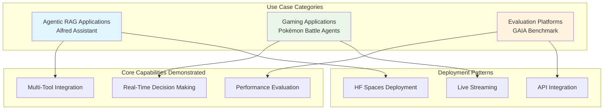
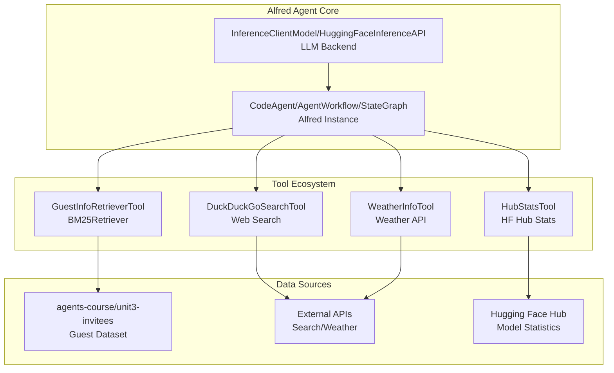
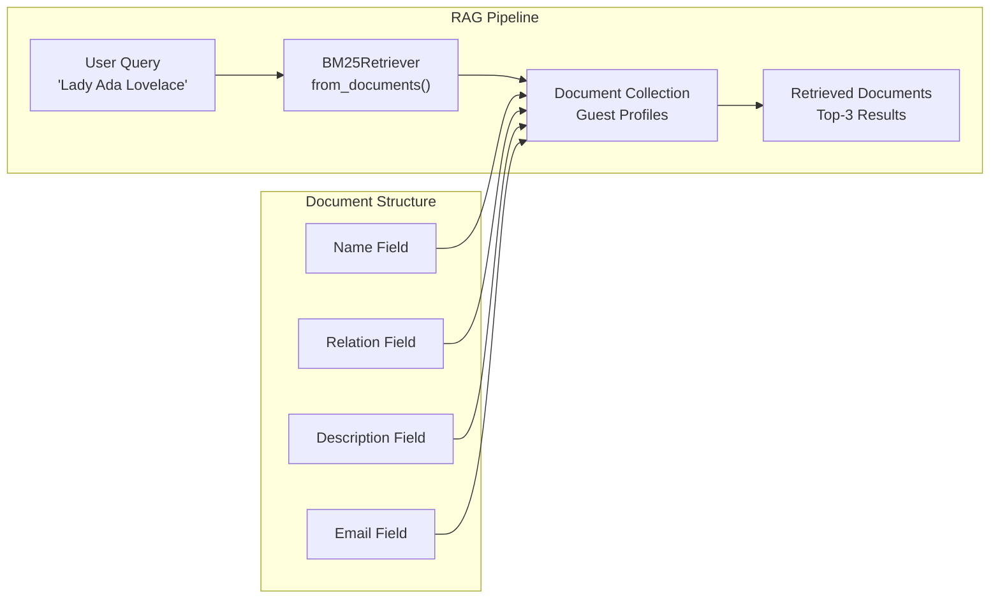
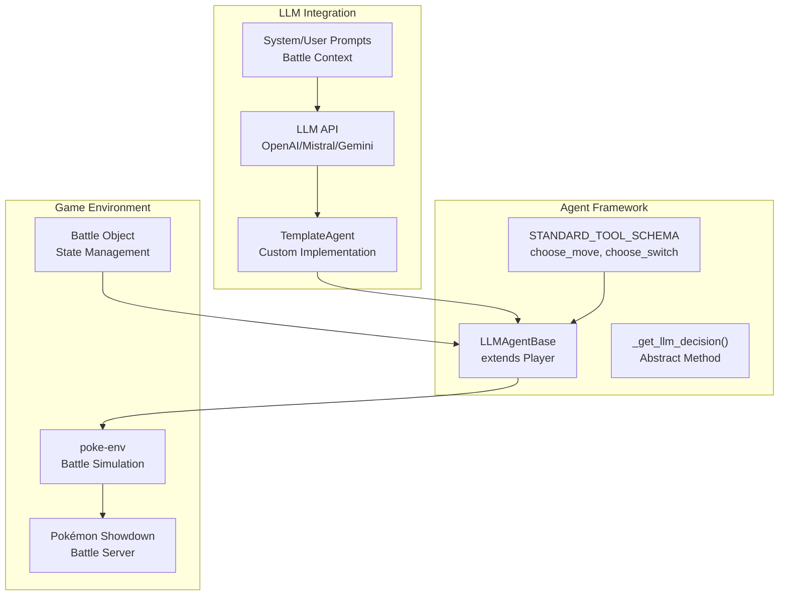
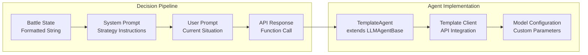
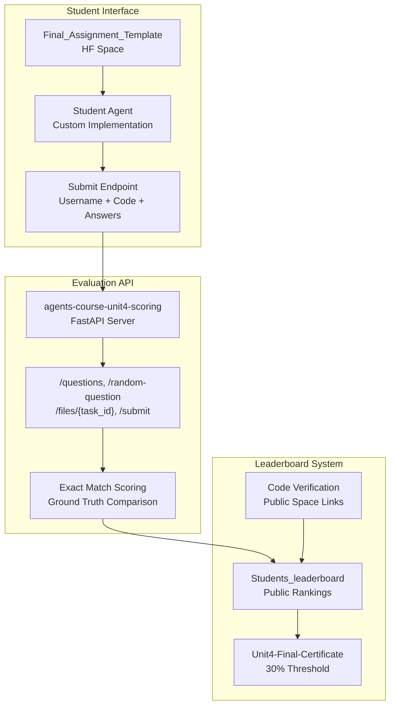
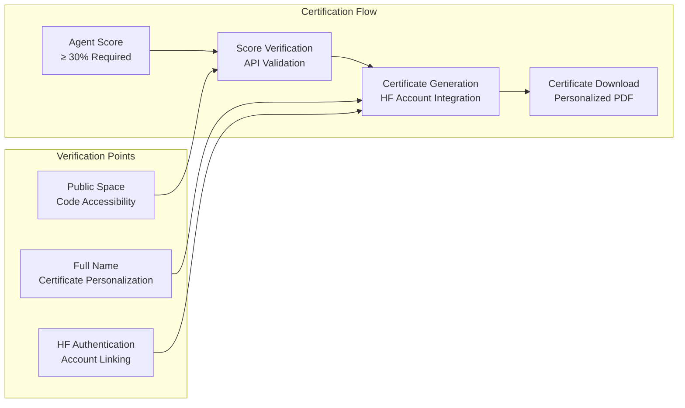

<!-- source: DeepWiki mcp.deepwiki.com · repo huggingface/agents-course · page 5 Use Cases and Applications · fetched 2026-10-26 -->

# Use Cases and Applications

Relevant source files

The following files were used as context for generating this wiki page:

- [units/en/_toctree.yml](units/en/_toctree.yml)
- [units/en/bonus-unit3/building_your_pokemon_agent.mdx](units/en/bonus-unit3/building_your_pokemon_agent.mdx)
- [units/en/bonus-unit3/conclusion.mdx](units/en/bonus-unit3/conclusion.mdx)
- [units/en/bonus-unit3/from-llm-to-agents.mdx](units/en/bonus-unit3/from-llm-to-agents.mdx)
- [units/en/bonus-unit3/introduction.mdx](units/en/bonus-unit3/introduction.mdx)
- [units/en/bonus-unit3/launching_agent_battle.mdx](units/en/bonus-unit3/launching_agent_battle.mdx)
- [units/en/bonus-unit3/state-of-art.mdx](units/en/bonus-unit3/state-of-art.mdx)
- [units/en/unit3/agentic-rag/agent.mdx](units/en/unit3/agentic-rag/agent.mdx)
- [units/en/unit3/agentic-rag/agentic-rag.mdx](units/en/unit3/agentic-rag/agentic-rag.mdx)
- [units/en/unit3/agentic-rag/conclusion.mdx](units/en/unit3/agentic-rag/conclusion.mdx)
- [units/en/unit3/agentic-rag/introduction.mdx](units/en/unit3/agentic-rag/introduction.mdx)
- [units/en/unit3/agentic-rag/invitees.mdx](units/en/unit3/agentic-rag/invitees.mdx)
- [units/en/unit3/agentic-rag/tools.mdx](units/en/unit3/agentic-rag/tools.mdx)
- [units/en/unit4/additional-readings.mdx](units/en/unit4/additional-readings.mdx)
- [units/en/unit4/conclusion.mdx](units/en/unit4/conclusion.mdx)
- [units/en/unit4/get-your-certificate.mdx](units/en/unit4/get-your-certificate.mdx)
- [units/en/unit4/hands-on.mdx](units/en/unit4/hands-on.mdx)
- [units/en/unit4/introduction.mdx](units/en/unit4/introduction.mdx)
- [units/en/unit4/what-is-gaia.mdx](units/en/unit4/what-is-gaia.mdx)

This document covers the practical implementations and real-world applications of AI agents demonstrated throughout the course. It focuses on three major use case categories: Agentic RAG systems, gaming applications, and benchmark evaluation platforms. Each use case showcases different agent capabilities and deployment patterns across multiple frameworks.

For foundational agent concepts and architecture, see [AI Agent Fundamentals](#2). For framework-specific implementations, see [Agent Frameworks](#3). For advanced optimization techniques, see [Advanced Topics](#4).

## Overview of Use Case Categories

The course demonstrates agent capabilities through three distinct application domains, each highlighting different aspects of agent design and deployment:

**Use Case Implementation Matrix**

| Use Case | Primary Framework | Tools Used | Deployment | Evaluation Method |
|----------|------------------|------------|------------|-------------------|
| Alfred Assistant | Multi-framework | `DuckDuckGoSearchTool`, `WeatherInfoTool`, `HubStatsTool`, `GuestInfoRetrieverTool` | HF Spaces | Interactive demo |
| Pokémon Battles | Custom (`LLMAgentBase`) | `choose_move`, `choose_switch` | Pokémon Showdown | Live battles |
| GAIA Evaluation | Multi-framework | Custom per task | API submission | Exact match scoring |

Sources: [units/en/_toctree.yml:111-172](), [units/en/unit3/agentic-rag/introduction.mdx:1-42](), [units/en/bonus-unit3/introduction.mdx:1-27](), [units/en/unit4/introduction.mdx:1-23]()

## Agentic RAG Implementation: Alfred Assistant

The Alfred Assistant represents a comprehensive agentic RAG system that combines multiple information sources and tools to assist with event management. The implementation demonstrates multi-framework compatibility and real-world applicability.

### System Architecture

**Alfred Tool Integration Flow**

The system integrates four distinct tool types through a unified interface. The `GuestInfoRetrieverTool` implements RAG functionality using `BM25Retriever` for document retrieval, while other tools provide real-time external data access.

Sources: [units/en/unit3/agentic-rag/agent.mdx:1-502](), [units/en/unit3/agentic-rag/invitees.mdx:174-291](), [units/en/unit3/agentic-rag/tools.mdx:1-434]()

### Multi-Framework Implementation

Alfred demonstrates implementation consistency across three major agent frameworks:

**smolagents Implementation**
- Uses `CodeAgent` with `InferenceClientModel`
- Tools inherit from `Tool` base class
- Implements `forward()` method for tool execution
- Example: [units/en/unit3/agentic-rag/agent.mdx:49-54]()

**LlamaIndex Implementation**
- Uses `AgentWorkflow.from_tools_or_functions()`
- Tools use `FunctionTool.from_defaults()`
- Integrates with `HuggingFaceInferenceAPI`
- Example: [units/en/unit3/agentic-rag/agent.mdx:76-79]()

**LangGraph Implementation**
- Uses `StateGraph` with typed state management
- Tools integrated via `ToolNode` and `tools_condition`
- Implements conditional edge routing
- Example: [units/en/unit3/agentic-rag/agent.mdx:114-139]()

### RAG Tool Implementation

The guest information retrieval system demonstrates advanced RAG capabilities:

The `GuestInfoRetrieverTool` loads the dataset from `agents-course/unit3-invitees` and converts entries into `Document` objects with structured metadata. The `BM25Retriever` provides keyword-based search without requiring embeddings.

Sources: [units/en/unit3/agentic-rag/invitees.mdx:64-291]()

### Deployment and Integration

Alfred is deployed as a structured HF Space with modular organization:

- **`tools.py`** - Auxiliary tool implementations
- **`retriever.py`** - RAG functionality
- **`app.py`** - Full agent integration

Live demo available at: [agents-course/Unit_3_Agentic_RAG](https://huggingface.co/spaces/agents-course/Unit_3_Agentic_RAG)

Sources: [units/en/unit3/agentic-rag/invitees.mdx:22-41]()

## Gaming Applications: Pokémon Battle Agents

The Pokémon battle system demonstrates real-time agent decision-making in a competitive gaming environment. The implementation bridges LLM reasoning with game simulation through structured tool interfaces.

### Battle Agent Architecture

**Battle Decision Flow**

The agent receives battle state through `choose_move(battle: Battle)` and must return an action string. The `_format_battle_state()` method converts game state into LLM-readable format, while tool functions handle move selection and Pokémon switching.

Sources: [units/en/bonus-unit3/building_your_pokemon_agent.mdx:39-258]()

### Tool Schema and State Management

The battle agent uses a standardized tool schema for game interactions:

**Standard Tool Schema**
- `choose_move`: Selects attack moves with parameters like type, base power, accuracy
- `choose_switch`: Changes active Pokémon based on HP and status conditions

**Battle State Formatting**
The `_format_battle_state()` method provides comprehensive game context:
- Active Pokémon stats (HP, type, status, boosts)
- Opponent information (when available)
- Available moves with detailed statistics
- Available switches with health status
- Environmental conditions (weather, terrain, side conditions)

Example from [units/en/bonus-unit3/building_your_pokemon_agent.mdx:84-128]()

### Real-Time Battle Integration

The system connects to live Pokémon Showdown servers through multiple deployment options:

**Live Streaming Integration**
- Twitch streaming at `twitch.tv/jofthomas`
- Automated battle agent running continuously
- Interactive battle invitations through HF Spaces

**Custom Agent Deployment**
- Duplicate HF Space: `PShowdown/pokemon_agents`
- Add custom agent to `agent.py`
- Register in `app.py` dropdown menu
- Connect to Pokémon Showdown server

Sources: [units/en/bonus-unit3/launching_agent_battle.mdx:1-70]()

### Agent Template Implementation

The `TemplateAgent` class provides a foundation for custom implementations:

Implementation requires overriding `_get_llm_decision()` with custom LLM client integration and strategy prompts.

Sources: [units/en/bonus-unit3/building_your_pokemon_agent.mdx:216-258]()

## Evaluation Platform: GAIA Benchmark Integration

The GAIA benchmark integration demonstrates agent evaluation in real-world task scenarios. The system provides API-based submission and automated scoring for agent certification.

### GAIA Evaluation Architecture

**GAIA Task Categories**

The evaluation uses 20 filtered Level 1 questions from GAIA validation set, organized by complexity:

| Level | Steps Required | Tools Needed | Success Rate Target |
|-------|---------------|--------------|-------------------|
| Level 1 | < 5 steps | Minimal | 30% (Course requirement) |
| Level 2 | 5-10 steps | Multiple tools | Advanced |
| Level 3 | 10+ steps | Complex coordination | Expert |

Sources: [units/en/unit4/hands-on.mdx:1-52](), [units/en/unit4/what-is-gaia.mdx:1-70]()

### API Integration Workflow

The evaluation system provides RESTful endpoints for agent interaction:

**Question Retrieval**
- `GET /questions`: Full question list
- `GET /random-question`: Single random question
- `GET /files/{task_id}`: Associated task files

**Submission Process**
- `POST /submit`: Agent answers with exact match scoring
- Required fields: `username`, `agent_code` (HF Space URL), `answers`
- Response format: `{"task_id": "...", "submitted_answer": "..."}`

The system requires public HF Space links for code verification and maintains leaderboard transparency.

Sources: [units/en/unit4/hands-on.mdx:15-46]()

### Certification System

The certification process integrates with Hugging Face authentication and requires public space deployment for verification. Students achieving 30% or higher on the GAIA subset receive official course certificates.

Sources: [units/en/unit4/get-your-certificate.mdx:1-25]()

### Template and Extension Points

The `Final_Assignment_Template` provides a starting framework that students customize:

**Required Components**
- Username extraction via Gradio login
- Agent code URL (HF Space `.../tree/main`)
- Answer generation list with task IDs
- API submission integration

**Extension Opportunities**
- Custom tool integration
- Multi-framework implementation
- Advanced prompting strategies
- Error handling and retry mechanisms

The template encourages complete restructuring and customization while maintaining API compatibility requirements.

Sources: [units/en/unit4/hands-on.mdx:29-41]()

---

