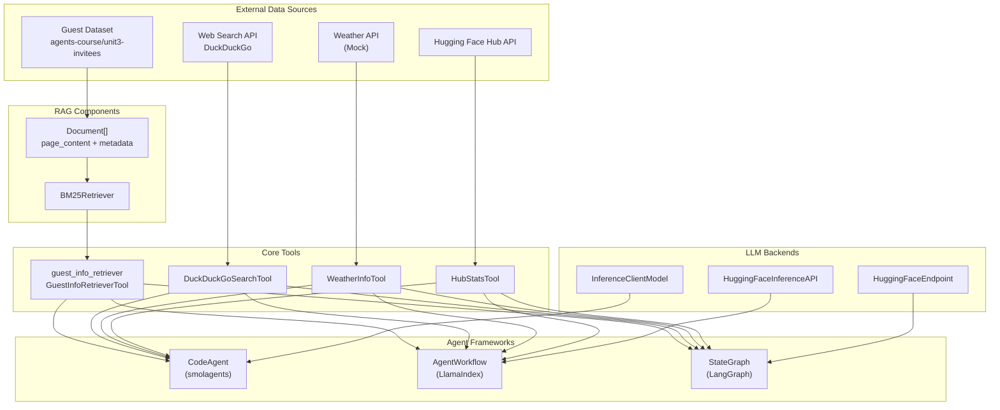
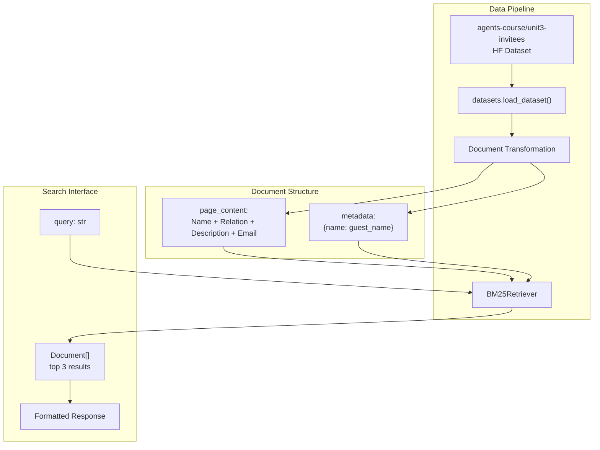
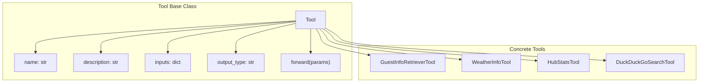
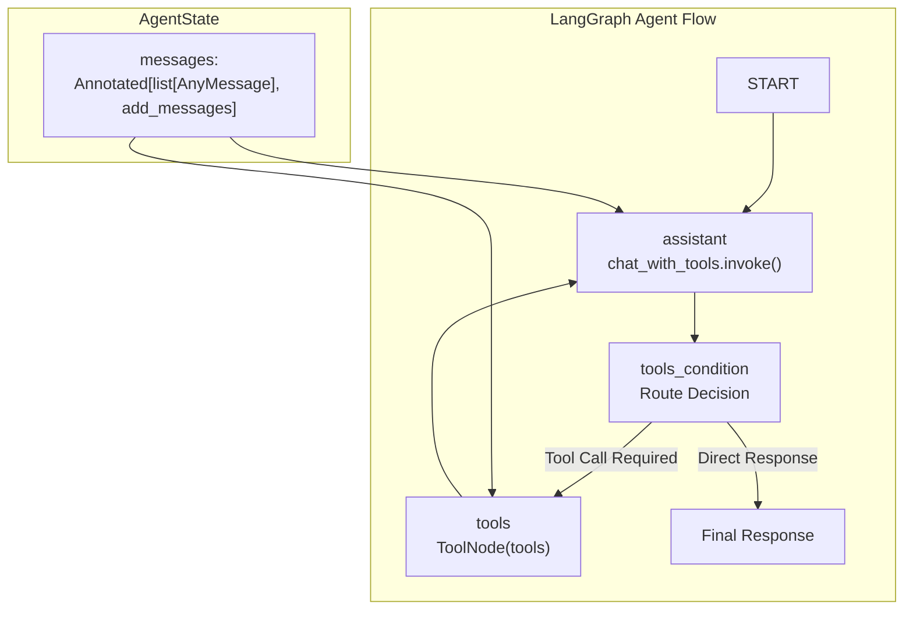
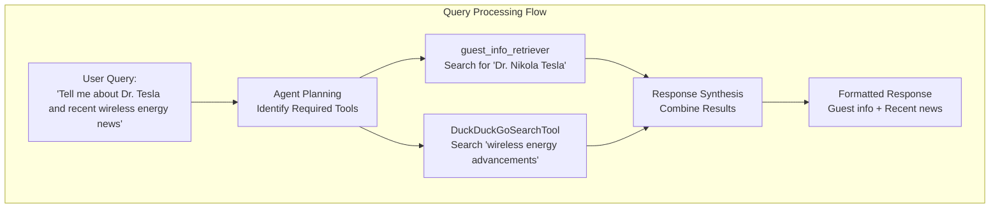
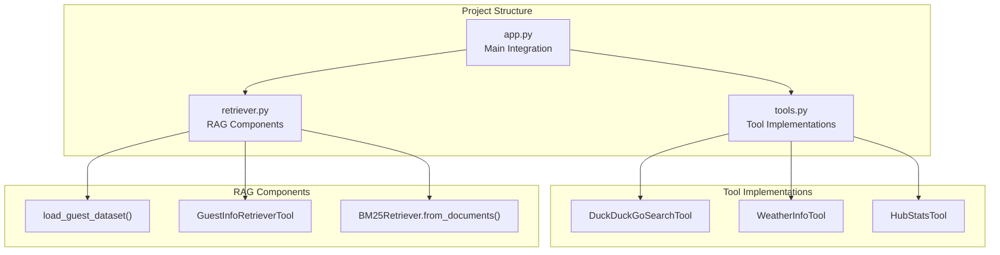

<!-- source: DeepWiki mcp.deepwiki.com · repo huggingface/agents-course · page 5.1 Agentic RAG with Alfred · fetched 2026-10-26 -->

# Agentic RAG with Alfred

<details>
<summary>Relevant source files</summary>

The following files were used as context for generating this wiki page:

- [units/en/unit3/agentic-rag/agent.mdx](units/en/unit3/agentic-rag/agent.mdx)
- [units/en/unit3/agentic-rag/agentic-rag.mdx](units/en/unit3/agentic-rag/agentic-rag.mdx)
- [units/en/unit3/agentic-rag/conclusion.mdx](units/en/unit3/agentic-rag/conclusion.mdx)
- [units/en/unit3/agentic-rag/introduction.mdx](units/en/unit3/agentic-rag/introduction.mdx)
- [units/en/unit3/agentic-rag/invitees.mdx](units/en/unit3/agentic-rag/invitees.mdx)
- [units/en/unit3/agentic-rag/tools.mdx](units/en/unit3/agentic-rag/tools.mdx)

</details>


## Purpose and Scope

This document covers the implementation of Alfred, a sophisticated AI agent that demonstrates agentic Retrieval-Augmented Generation (RAG) capabilities. Alfred serves as a comprehensive example of how to combine multiple information sources, custom tools, and agent frameworks to create a practical assistant for event management scenarios.

The system integrates guest information retrieval through RAG, real-time web search, weather data, and Hugging Face Hub statistics into a unified agent architecture. For general RAG concepts and theory, see [3.2](#3.2). For framework-specific implementations without the agentic components, see [3.1](#3.1), [3.2](#3.2), and [3.3](#3.3).

## System Architecture Overview

The Alfred system demonstrates a modular agentic RAG architecture that can be implemented across three different frameworks while maintaining consistent functionality.

### Alfred System Architecture



Sources: [units/en/unit3/agentic-rag/agent.mdx:17-142](), [units/en/unit3/agentic-rag/tools.mdx:14-424](), [units/en/unit3/agentic-rag/invitees.mdx:64-431]()

## Core Components

### Document Processing and Retrieval System

The RAG foundation uses a document-based retrieval system that processes guest information into searchable formats:



The guest information is processed into `Document` objects with structured content and metadata for efficient retrieval. The `BM25Retriever` provides keyword-based search without requiring embeddings.

Sources: [units/en/unit3/agentic-rag/invitees.mdx:74-169]()

### Tool Implementation Patterns

#### smolagents Tool Pattern



Sources: [units/en/unit3/agentic-rag/invitees.mdx:184-218](), [units/en/unit3/agentic-rag/tools.mdx:94-118](), [units/en/unit3/agentic-rag/tools.mdx:184-209]()

#### LlamaIndex Tool Pattern

The LlamaIndex implementation uses `FunctionTool.from_defaults()` to wrap functions with docstring-based descriptions:

- `get_guest_info_retriever()` - Guest information retrieval
- `get_weather_info()` - Weather data fetching  
- `get_hub_stats()` - Hugging Face Hub statistics

Sources: [units/en/unit3/agentic-rag/invitees.mdx:234-244](), [units/en/unit3/agentic-rag/tools.mdx:127-140](), [units/en/unit3/agentic-rag/tools.mdx:229-244]()

#### LangGraph Tool Pattern

LangGraph uses the `Tool` class with `name`, `func`, and `description` parameters to define tools that integrate with the `StateGraph` workflow.

Sources: [units/en/unit3/agentic-rag/invitees.mdx:267-279](), [units/en/unit3/agentic-rag/tools.mdx:163-167](), [units/en/unit3/agentic-rag/tools.mdx:278-282]()

## Multi-Framework Agent Implementation

### Agent Initialization Patterns

The system supports three different agent frameworks with consistent tool integration:

| Framework | Agent Class | Model Class | Tool Integration |
|-----------|-------------|-------------|------------------|
| smolagents | `CodeAgent` | `InferenceClientModel` | `tools` parameter |
| LlamaIndex | `AgentWorkflow` | `HuggingFaceInferenceAPI` | `from_tools_or_functions()` |
| LangGraph | `StateGraph` | `HuggingFaceEndpoint` + `ChatHuggingFace` | `bind_tools()` + `ToolNode` |

### LangGraph State Management



Sources: [units/en/unit3/agentic-rag/agent.mdx:114-140](), [units/en/unit3/agentic-rag/invitees.mdx:384-409]()

## Tool Integration and Usage

### Multi-Tool Query Processing

Alfred can handle complex queries that require multiple tools:



Sources: [units/en/unit3/agentic-rag/agent.mdx:334-410]()

### Memory and Context Management

Each framework handles conversation memory differently:

- **smolagents**: Uses `reset=False` parameter to maintain state across runs
- **LlamaIndex**: Requires explicit `Context` object for memory management
- **LangGraph**: Maintains state through message history in `AgentState`

Sources: [units/en/unit3/agentic-rag/agent.mdx:412-489]()

## Project Structure and Deployment

### Modular File Organization



The system is designed for deployment as a Hugging Face Space with a structured Python project organization that separates concerns between tool implementations, retrieval components, and agent integration.

Sources: [units/en/unit3/agentic-rag/invitees.mdx:22-32](), [units/en/unit3/agentic-rag/agent.mdx:9-13]()

## Example Usage Patterns

### Guest Information Retrieval

All frameworks support querying guest information with consistent interfaces:

```python
# Query example
query = "Tell me about 'Lady Ada Lovelace'"
response = alfred.run(query)  # smolagents
response = await alfred.run(query)  # LlamaIndex  
response = alfred.invoke({"messages": [HumanMessage(content=query)]})  # LangGraph
```

### Multi-Tool Coordination

The agent can coordinate multiple tools for complex requests like weather checking, guest lookup, and web search within a single query execution cycle.

Sources: [units/en/unit3/agentic-rag/agent.mdx:150-410]()

---

