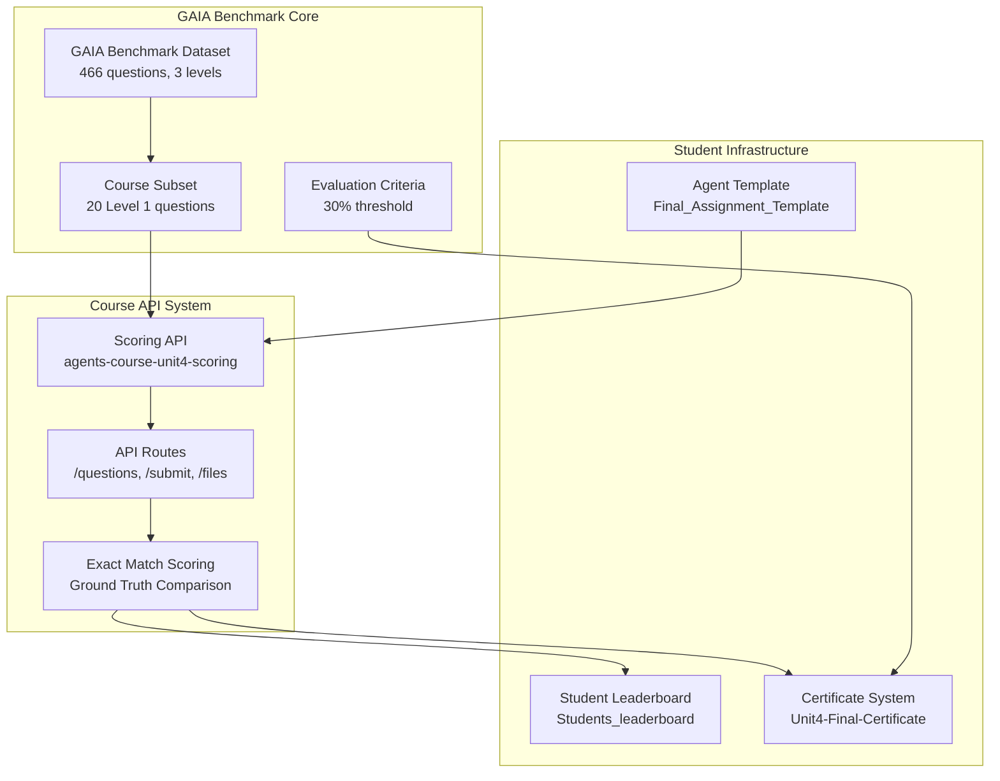
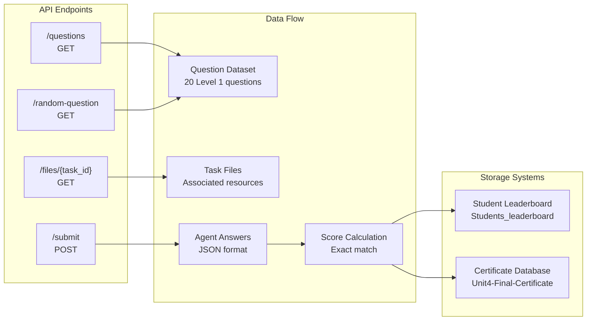
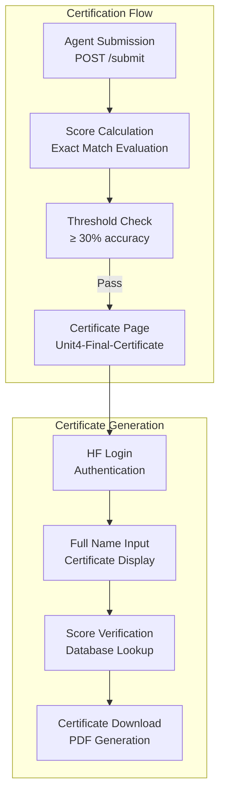

<!-- source: DeepWiki mcp.deepwiki.com · repo huggingface/agents-course · page 5.3 GAIA Benchmark Evaluation · fetched 2026-10-26 -->

# GAIA Benchmark Evaluation

Relevant source files

The following files were used as context for generating this wiki page:

- [units/en/unit4/additional-readings.mdx](units/en/unit4/additional-readings.mdx)
- [units/en/unit4/conclusion.mdx](units/en/unit4/conclusion.mdx)
- [units/en/unit4/get-your-certificate.mdx](units/en/unit4/get-your-certificate.mdx)
- [units/en/unit4/hands-on.mdx](units/en/unit4/hands-on.mdx)
- [units/en/unit4/introduction.mdx](units/en/unit4/introduction.mdx)
- [units/en/unit4/what-is-gaia.mdx](units/en/unit4/what-is-gaia.mdx)
- [units/zh-CN/_toctree.yml](units/zh-CN/_toctree.yml)
- [units/zh-CN/unit4/additional-readings.mdx](units/zh-CN/unit4/additional-readings.mdx)
- [units/zh-CN/unit4/conclusion.mdx](units/zh-CN/unit4/conclusion.mdx)
- [units/zh-CN/unit4/get-your-certificate.mdx](units/zh-CN/unit4/get-your-certificate.mdx)
- [units/zh-CN/unit4/hands-on.mdx](units/zh-CN/unit4/hands-on.mdx)
- [units/zh-CN/unit4/introduction.mdx](units/zh-CN/unit4/introduction.mdx)
- [units/zh-CN/unit4/what-is-gaia.mdx](units/zh-CN/unit4/what-is-gaia.mdx)

This document covers the GAIA benchmark evaluation system used in Unit 4 of the Hugging Face AI Agents Course. The system enables students to evaluate their agents against a subset of the GAIA benchmark, submit scores, and earn certification. For information about general agent evaluation and observability, see [Agent Observability and Evaluation](#4.2).

## System Overview

The GAIA benchmark evaluation system is a complete pipeline for testing agent capabilities on real-world tasks. It consists of a curated question dataset, a scoring API, a student leaderboard, and an automated certification system. The benchmark tests agents on tasks requiring multi-step reasoning, tool usage, and multimodal understanding.

Sources: [units/en/unit4/what-is-gaia.mdx:1-70](), [units/en/unit4/hands-on.mdx:1-53](), [units/en/unit4/introduction.mdx:1-23]()

## GAIA Benchmark Structure

The GAIA (General AI Assistants) benchmark consists of 466 carefully curated questions designed to test AI assistants on real-world tasks. The benchmark is organized into three difficulty levels, each requiring different combinations of reasoning, multimodal understanding, and tool usage capabilities.

### Difficulty Levels and Capabilities

| Level | Steps Required | Tool Usage | Complexity |
|-------|---------------|------------|------------|
| Level 1 | < 5 steps | Minimal | Basic reasoning |
| Level 2 | 5-10 steps | Multiple tools | Complex coordination |
| Level 3 | > 10 steps | Advanced integration | Long-term planning |

### Performance Baselines

The benchmark highlights the gap between human and AI performance:

- **Humans**: ~92% success rate
- **GPT-4 with plugins**: ~15% success rate  
- **Deep Research (OpenAI)**: 67.36% on validation set

### Course Subset Selection

The course uses a filtered subset of 20 questions from Level 1 of the GAIA validation set. Questions are selected based on the number of tools and steps required, targeting a 30% accuracy threshold as a reasonable completion benchmark for students.

Sources: [units/en/unit4/what-is-gaia.mdx:1-70](), [units/en/unit4/hands-on.mdx:7-12]()

## Course API System

The evaluation system provides a REST API for retrieving questions, submitting answers, and calculating scores. The API is hosted at `agents-course-unit4-scoring.hf.space` and includes comprehensive documentation.

### API Routes

- **`GET /questions`**: Retrieves the complete list of filtered evaluation questions
- **`GET /random-question`**: Fetches a single random question from the dataset
- **`GET /files/{task_id}`**: Downloads specific files associated with a given task ID
- **`POST /submit`**: Submits agent answers, calculates scores, and updates the leaderboard

### Submission Format

The `/submit` endpoint requires three key parameters:

- **`username`**: Hugging Face username for identification
- **`agent_code`**: URL to the agent's Hugging Face Space code repository
- **`answers`**: List of responses in format `{"task_id": ..., "submitted_answer": ...}`

### Scoring Mechanism

The system uses **exact match** comparison between submitted answers and ground truth. Answers must match precisely, requiring careful prompt engineering to ensure clean, direct responses without additional formatting.

Sources: [units/en/unit4/hands-on.mdx:16-40]()

## Student Infrastructure

The evaluation system includes several components to support student learning and assessment.

### Agent Template System

The `Final_Assignment_Template` provides a starting point for students to build their evaluation agents. The template includes:

- Basic agent structure using smolagents framework
- API integration for question retrieval and submission
- Gradio interface for user interaction
- Example implementation patterns

Students are encouraged to duplicate and modify this template extensively to implement their own agent architectures.

### Leaderboard System

The `Students_leaderboard` space provides a competitive environment where students can:

- Submit their scores for community comparison
- View their ranking against peers
- Access links to other students' agent implementations
- Track community progress on the benchmark

### Verification Requirements

To maintain leaderboard integrity, submissions must include:

- Public Hugging Face Space with agent code
- Verifiable score through the API system
- Valid link to agent implementation

The system may review or remove entries that lack proper verification to maintain leaderboard usefulness.

Sources: [units/en/unit4/hands-on.mdx:29-46]()

## Certification System

Students achieving 30% or higher on the benchmark are eligible for course certification through the `Unit4-Final-Certificate` system.

### Certification Process

1. **Score Verification**: The system validates that the user achieved 30%+ accuracy
2. **Authentication**: Users must sign in with their Hugging Face account
3. **Name Entry**: Students provide their full name for certificate display
4. **Certificate Generation**: The system generates and provides a downloadable certificate

### Certificate Validation

The certificate system cross-references submissions with the scoring API to ensure only eligible students receive certification. This prevents unauthorized certificate generation and maintains the credential's integrity.

Sources: [units/en/unit4/get-your-certificate.mdx:1-25]()

## Integration with Course Platform

The GAIA evaluation system integrates with the broader course infrastructure through several touchpoints:

- **Course Progression**: Unit 4 serves as the capstone project requiring knowledge from previous units
- **Framework Integration**: Students can use any of the taught frameworks (smolagents, LlamaIndex, LangGraph) for their agents
- **Community Support**: Discord integration provides help and discussion channels for students
- **Multilingual Support**: The system supports both English and Chinese course variants

The evaluation represents the culmination of the course learning journey, requiring students to synthesize knowledge of agent architectures, tool integration, and real-world problem solving.

Sources: [units/en/unit4/introduction.mdx:1-23](), [units/zh-CN/_toctree.yml:125-138]()

---

