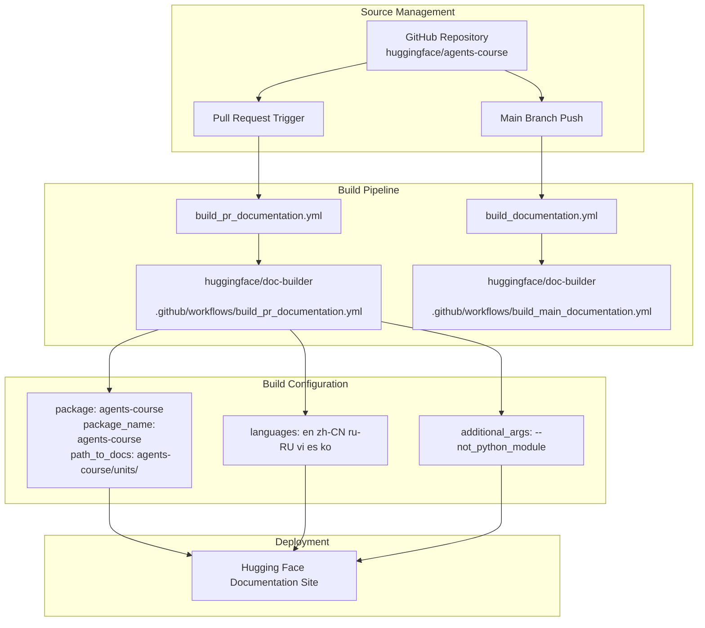

<!-- source: DeepWiki mcp.deepwiki.com · repo huggingface/agents-course · page 6 Course Platform and Infrastructure · fetched 2026-10-26 -->

# Course Platform and Infrastructure

<details>
<summary>Relevant source files</summary>

The following files were used as context for generating this wiki page:

- [.github/workflows/build_documentation.yml](.github/workflows/build_documentation.yml)
- [.github/workflows/build_pr_documentation.yml](.github/workflows/build_pr_documentation.yml)
- [README.md](README.md)
- [units/en/communication/live1.mdx](units/en/communication/live1.mdx)
- [units/en/unit0/discord101.mdx](units/en/unit0/discord101.mdx)
- [units/en/unit0/introduction.mdx](units/en/unit0/introduction.mdx)
- [units/en/unit0/onboarding.mdx](units/en/unit0/onboarding.mdx)
- [units/en/unit1/tutorial.mdx](units/en/unit1/tutorial.mdx)
- [units/es/bonus-unit1/conclusion.mdx](units/es/bonus-unit1/conclusion.mdx)
- [units/es/bonus-unit1/fine-tuning.mdx](units/es/bonus-unit1/fine-tuning.mdx)
- [units/es/bonus-unit1/introduction.mdx](units/es/bonus-unit1/introduction.mdx)
- [units/es/bonus-unit1/what-is-function-calling.mdx](units/es/bonus-unit1/what-is-function-calling.mdx)
- [units/es/communication/live1.mdx](units/es/communication/live1.mdx)
- [units/es/unit0/discord101.mdx](units/es/unit0/discord101.mdx)
- [units/es/unit0/introduction.mdx](units/es/unit0/introduction.mdx)

</details>


This document provides a comprehensive overview of the technical platform and infrastructure that powers the Hugging Face Agents Course. The course delivery system encompasses documentation building, UI deployment, community infrastructure, and multilingual content management.

For information about Agent fundamentals, see [AI Agent Fundamentals](#2).
For details on the frameworks covered, see [Agent Frameworks](#3).
For use cases and applications, see [Use Cases](#5).

## Documentation Build Pipeline

The course uses an automated documentation build system powered by GitHub Actions and Hugging Face's doc-builder:

### Documentation Build Architecture



### Build Workflow Configuration

The documentation system supports multiple languages and uses specific build parameters:

| Parameter | Value | Purpose |
|-----------|-------|---------|
| `package` | `agents-course` | Package identifier |
| `package_name` | `agents-course` | Display name |
| `path_to_docs` | `agents-course/units/` | Source directory |
| `additional_args` | `--not_python_module` | Non-Python module flag |
| `languages` | `en zh-CN ru-RU vi es ko` | Supported languages |

Sources:
- [.github/workflows/build_pr_documentation.yml:10-20]()
- [.github/workflows/build_documentation.yml:9-19]()

## Interactive Course Platform

The course platform integrates multiple technical components to deliver hands-on learning experiences:

### Platform Architecture

```mermaid
flowchart TD
    subgraph "Content Delivery"
        MDXFiles["MDX Content Files
        units/en/unit*/**.mdx"] → DocBuilder["doc-builder Pipeline"]
        DocBuilder → HFLearn["hf.co/learn/agents-course"]
    end
    
    subgraph "Interactive Environments"
        HFSpaces["Hugging Face Spaces"] → GradioUI["GradioUI(agent).launch()"]
        GradioUI → FirstAgentTemplate["agents-course/First_agent_template"]
        GradioUI → StudentSpaces["Student Duplicated Spaces"]
    end
    
    subgraph "Code Integration"
        CodeAgentClass["CodeAgent"] → InferenceClientModel["InferenceClientModel"]
        CodeAgentClass → ToolSystem["@tool decorator functions"]
        CodeAgentClass → PromptTemplates["prompts.yaml"]
        
        InferenceClientModel → QwenModel["Qwen/Qwen2.5-Coder-32B-Instruct"]
        ToolSystem → FinalAnswerTool["FinalAnswerTool()"]
        ToolSystem → CustomTools["get_current_time_in_timezone()"]
    end
    
    subgraph "Hub Integration"
        HFHub["Hugging Face Hub"] → LoadTool["load_tool('agents-course/text-to-image')"]
        LoadTool → AgentSharing["Student Agent Sharing"]
    end
    
    StudentSpaces → CodeAgentClass
    FirstAgentTemplate → CodeAgentClass
```

### Technical Implementation Stack

| Component | Implementation | Purpose |
|-----------|----------------|---------|
| **UI Framework** | `GradioUI(agent).launch()` | Interactive agent interface |
| **Agent Engine** | `CodeAgent` class | Core agent orchestration |
| **Model Backend** | `InferenceClientModel` | LLM inference via HF API |
| **Tool System** | `@tool` decorator | Function registration |
| **Prompt Management** | `prompts.yaml` | System prompt templates |
| **Deployment** | Hugging Face Spaces | Managed hosting environment |

Sources:
- [units/en/unit1/tutorial.mdx:36-51]()
- [units/en/unit1/tutorial.mdx:114-139]()
- [units/en/unit1/tutorial.mdx:196-227]()

## Community Infrastructure

The course platform includes comprehensive community support infrastructure:

### Community Platform Architecture

```mermaid
flowchart TD
    subgraph "Discord Community Server"
        DiscordServer["Hugging Face Community Discord
        100,000+ members"] → DiscordChannels["Agent Course Channels"]
        
        DiscordChannels → Announcements["agents-course-announcements"]
        DiscordChannels → General["🎓-agents-course-general"]
        DiscordChannels → Questions["agents-course-questions"]
        DiscordChannels → Showcase["agents-course-showcase"]
        DiscordChannels → SmolagentsSupport["smolagents"]
    end
    
    subgraph "GitHub Integration"
        GitHubRepo["github.com/huggingface/agents-course"] → Issues["Issue Tracking"]
        GitHubRepo → PRs["Pull Requests"]
        GitHubRepo → Contributions["Community Contributions"]
    end
    
    subgraph "Hugging Face Hub"
        HFHub["Hugging Face Hub"] → AgentsCourseOrg["agents-course Organization"]
        AgentsCourseOrg → StudentLeaderboard["Students_leaderboard Space"]
        AgentsCourseOrg → CourseImages["course-images Dataset"]
        AgentsCourseOrg → SharedAgents["Community Agent Sharing"]
    end
    
    subgraph "Learning Support"
        LiveSessions["Live Sessions (YouTube)"] → QASupport["Q&A Support"]
        EmailNotifications["Email Notifications"] → CourseUpdates["Course Updates"]
        StudyGroups["Discord Study Groups"] → PeerLearning["Peer Learning"]
    end
    
    DiscordServer ← → GitHubRepo
    GitHubRepo ← → HFHub
    LiveSessions → DiscordServer
```

### Community Channel Structure

| Channel | Purpose | Target Audience |
|---------|---------|----------------|
| `agents-course-announcements` | Latest course information | All students |
| `🎓-agents-course-general` | General discussions and chitchat | Active participants |
| `agents-course-questions` | Q&A and peer help | Students needing support |
| `agents-course-showcase` | Share best agents | Advanced students |
| `smolagents` | Library-specific support | Technical users |

Sources:
- [units/en/unit0/discord101.mdx:6-28]()
- [units/en/unit0/onboarding.mdx:16-31]()
- [units/en/communication/live1.mdx:1-7]()

## Multilingual Content Delivery

The platform supports multiple languages through automated build processes:

### Multilingual Infrastructure

```mermaid
flowchart TD
    subgraph "Source Content Organization"
        EnglishContent["units/en/"] → EnglishFiles["unit0/introduction.mdx
        unit1/tutorial.mdx
        bonus-unit1/introduction.mdx"]
        
        ChineseContent["units/zh-CN/"] → ChineseFiles["Translated Content"]
        SpanishContent["units/es/"] → SpanishFiles["unit0/introduction.mdx
        bonus-unit1/introduction.mdx"]
        
        OtherLanguages["units/ru-RU/, units/vi/, units/ko/"] → OtherContent["Additional Language Content"]
    end
    
    subgraph "Build Configuration"
        BuildWorkflow["build_documentation.yml"] → LanguageConfig["languages: en zh-CN ru-RU vi es ko"]
        LanguageConfig → DocBuilderProcess["doc-builder processes all languages"]
    end
    
    subgraph "Deployment"
        DocBuilderProcess → MultilingualSite["hf.co/learn/agents-course"]
        MultilingualSite → LanguageSelector["Language Selection UI"]
        LanguageSelector → LocalizedContent["Localized Course Content"]
    end
    
    subgraph "Translation Team"
        XiaXiao["XiaXiao (ShawnSiao)"] → ChineseTranslation["Chinese Translation"]
        JiamingHuang["Jiaming Huang"] → ChineseTranslation
        CommunityContributors["Community Contributors"] → OtherTranslations["Other Language Translations"]
    end
    
    ChineseTranslation → ChineseContent
    OtherTranslations → OtherLanguages
```

### Language Support Matrix

| Language | Code | Content Status | Translator |
|----------|------|----------------|------------|
| English | `en` | Complete | Core team |
| Chinese (Simplified) | `zh-CN` | Partial | XiaXiao, Jiaming Huang |
| Spanish | `es` | Partial | Community |
| Russian | `ru-RU` | Limited | Community |
| Vietnamese | `vi` | Limited | Community |
| Korean | `ko` | Limited | Community |

Sources:
- [.github/workflows/build_documentation.yml:17-17]()
- [units/en/unit0/introduction.mdx:170-171]()
- [units/es/unit0/introduction.mdx:1-1]()

## Space Template System

The course uses a template-based approach for student projects through Hugging Face Spaces:

### Space Template Architecture

```mermaid
flowchart TD
    subgraph "Template Space"
        FirstAgentTemplate["agents-course/First_agent_template"] → AppPy["app.py"]
        FirstAgentTemplate → PromptsYaml["prompts.yaml"]
        FirstAgentTemplate → GradioUI["Gradio_UI.py"]
        FirstAgentTemplate → ToolsDir["tools/final_answer.py"]
    end
    
    subgraph "Student Duplication Process"
        StudentDuplication["Student duplicates Space"] → PersonalSpace["Student's Personal Space"]
        PersonalSpace → HFTokenConfig["HF_TOKEN secret configuration"]
        HFTokenConfig → ModelAccess["Model API access"]
    end
    
    subgraph "Code Structure"
        AppPy → SmolagentsImports["from smolagents import CodeAgent, DuckDuckGoSearchTool, InferenceClientModel, load_tool, tool"]
        AppPy → ToolDefinitions["@tool decorator functions"]
        AppPy → AgentInitialization["CodeAgent initialization"]
        AppPy → GradioLaunch["GradioUI(agent).launch()"]
        
        PromptsYaml → SystemPrompts["Agent system prompts"]
        ToolsDir → FinalAnswerTool["FinalAnswerTool class"]
    end
    
    subgraph "Hub Integration"
        LoadToolFunction["load_tool('agents-course/text-to-image', trust_remote_code=True)"] → ImageGenerationTool["image_generation_tool"]
        HFHub["Hugging Face Hub"] → ToolSharing["Community tool sharing"]
    end
    
    ModelAccess → QwenModel["Qwen/Qwen2.5-Coder-32B-Instruct"]
    AgentInitialization → ModelAccess
    ToolDefinitions → AgentInitialization
    ImageGenerationTool → AgentInitialization
```

### Template Configuration

| File | Purpose | Key Components |
|------|---------|----------------|
| `app.py` | Main application | `CodeAgent`, `InferenceClientModel`, `@tool` functions |
| `prompts.yaml` | System prompts | Agent behavior templates |
| `Gradio_UI.py` | User interface | `GradioUI` class implementation |
| `tools/final_answer.py` | Core tool | `FinalAnswerTool` class |

Sources:
- [units/en/unit1/tutorial.mdx:36-51]()
- [units/en/unit1/tutorial.mdx:151-156]()
- [units/en/unit1/tutorial.mdx:160-227]()

## Student Leaderboard System

The course includes a competitive evaluation system through the student leaderboard:

### Leaderboard Infrastructure

```mermaid
flowchart TD
    subgraph "Student Submission"
        StudentAgent["Student Agent Implementation"] → GAIABenchmark["GAIA Benchmark Evaluation"]
        GAIABenchmark → AgentPerformance["Agent Performance Metrics"]
    end
    
    subgraph "Leaderboard Platform"
        StudentsLeaderboard["agents-course/Students_leaderboard"] → HFSpace["Hugging Face Space"]
        HFSpace → PerformanceComparison["Performance Comparison UI"]
        PerformanceComparison → Rankings["Student Rankings"]
    end
    
    subgraph "Evaluation System"
        AgentPerformance → BenchmarkScores["Benchmark Scores"]
        BenchmarkScores → LeaderboardUpdate["Leaderboard Updates"]
        LeaderboardUpdate → CertificationProcess["Certification Validation"]
    end
    
    subgraph "Community Recognition"
        Rankings → ShowcaseChannel["agents-course-showcase Discord"]
        Rankings → CommunityRecognition["Community Recognition"]
        CertificationProcess → CertificateGeneration["Certificate Generation"]
    end
    
    StudentsLeaderboard ← LeaderboardUpdate
    ShowcaseChannel ← Rankings
```

### Evaluation Components

| Component | Purpose | Implementation |
|-----------|---------|----------------|
| **GAIA Benchmark** | Agent evaluation standard | Real-world task performance |
| **Students Leaderboard** | Performance comparison | `agents-course/Students_leaderboard` Space |
| **Showcase Channel** | Community sharing | `agents-course-showcase` Discord |
| **Certification System** | Achievement validation | Automated certificate generation |

Sources:
- [units/en/unit0/introduction.mdx:50-50]()
- [units/en/unit0/introduction.mdx:95-102]()
- [units/en/unit0/onboarding.mdx:23-26]()

## Alternative Deployment Options

The platform supports multiple deployment configurations for different user needs:

### Local Development Setup

```mermaid
flowchart TD
    subgraph "Credit Limit Alternative"
        CreditLimits["HF API Credit Limits"] → OllamaSetup["Ollama Local Setup"]
        OllamaSetup → OllamaInstall["ollama pull qwen2:7b"]
        OllamaSetup → OllamaServe["ollama serve"]
    end
    
    subgraph "Model Integration"
        LiteLLMModel["LiteLLMModel"] → OllamaAPI["ollama_chat/qwen2:7b"]
        LiteLLMModel → LocalServer["api_base='http://127.0.0.1:11434'"]
        LiteLLMModel → ContextWindow["num_ctx=8192"]
    end
    
    subgraph "Code Compatibility"
        InferenceClientModel["InferenceClientModel"] → DropInReplacement["Seamless Replacement"]
        DropInReplacement → LiteLLMModel
        CodeAgent["CodeAgent"] → ModelParameter["model=LiteLLMModel(...)"]
    end
    
    subgraph "Installation Requirements"
        PipInstall["pip install 'smolagents[litellm]'"] → LiteLLMSupport["LiteLLM Support"]
        LiteLLMSupport → OpenAICompatible["OpenAI-Compatible API"]
        OpenAICompatible → LocalServer
    end
    
    OllamaAPI → ModelParameter
    LocalServer → ModelParameter
    ContextWindow → ModelParameter
```

### Deployment Configuration Options

| Configuration | Model Backend | API Endpoint | Use Case |
|---------------|---------------|--------------|----------|
| **Default** | `InferenceClientModel` | Hugging Face Serverless API | Standard course usage |
| **Local** | `LiteLLMModel` | `http://127.0.0.1:11434` | Credit limit alternative |
| **Custom** | `LiteLLMModel` | Custom endpoint | Enterprise/private deployments |

### Setup Commands

```bash
# Ollama installation and model pull
ollama pull qwen2:7b
ollama serve

# smolagents with LiteLLM support
pip install 'smolagents[litellm]'
```

Sources:
- [units/en/unit0/onboarding.mdx:56-95]()
- [units/en/unit0/introduction.mdx:85-90]()

## Content Management System

The course uses a structured content management approach with community contribution support:

### Content Organization Structure

```mermaid
flowchart TD
    subgraph "Content Structure"
        UnitsDir["units/"] → LanguageDirs["en/, zh-CN/, es/, ru-RU/, vi/, ko/"]
        LanguageDirs → UnitDirs["unit0/, unit1/, unit2/, unit3/, unit4/"]
        UnitDirs → BonusUnits["bonus-unit1/, bonus-unit2/, bonus-unit3/"]
        UnitDirs → CommunicationDir["communication/"]
        
        UnitDirs → MDXFiles["introduction.mdx, tutorial.mdx, etc."]
        CommunicationDir → LiveSessions["live1.mdx"]
    end
    
    subgraph "Asset Management"
        CourseImages["agents-course/course-images"] → ImageAssets["course image assets"]
        ImageAssets → UnitThumbnails["unit thumbnails"]
        ImageAssets → CommunicationAssets["communication assets"]
    end
    
    subgraph "Contribution Workflow"
        CommunityContribution["Community Contribution"] → GitHubIssue["GitHub Issue"]
        GitHubIssue → DiscussionProcess["Discussion Process"]
        DiscussionProcess → PullRequest["Pull Request"]
        PullRequest → ReviewProcess["Review Process"]
        ReviewProcess → ContentIntegration["Content Integration"]
    end
    
    subgraph "Quality Control"
        SmallFixes["Small typo/grammar fixes"] → DirectPR["Direct Pull Request"]
        NewContent["New unit/content"] → IssueFirst["Issue First Approach"]
        BugReports["Bug reports"] → IssueTracker["Issue Tracker"]
    end
    
    ContentIntegration → MDXFiles
    DirectPR → ReviewProcess
    IssueFirst → DiscussionProcess
```

### Contribution Guidelines

| Contribution Type | Process | Requirements |
|------------------|---------|--------------|
| **Small Fixes** | Direct PR | Typos, grammar corrections |
| **New Content** | Issue → Discussion → PR | Describe content before writing |
| **Bug Reports** | GitHub Issue | Problem description |
| **Translations** | Community effort | Language-specific directories |

Sources:
- [README.md:33-43]()
- [units/en/unit0/introduction.mdx:173-183]()
- [units/en/unit0/introduction.mdx:170-171]()

## Live Learning Support Infrastructure

The course platform includes comprehensive live learning support through multiple channels:

### Live Session Infrastructure

```mermaid
flowchart TD
    subgraph "Live Session Delivery"
        YouTubeLive["YouTube Live Streaming"] → RecordedSessions["Recorded Sessions"]
        RecordedSessions → YouTubeArchive["YouTube Archive"]
        YouTubeArchive → OnDemandAccess["On-Demand Access"]
    end
    
    subgraph "Community Coordination"
        DiscordAnnouncements["Discord Announcements"] → ScheduleNotifications["Schedule Notifications"]
        EmailNotifications["Email Notifications"] → CourseUpdates["Course Updates"]
        ScheduleNotifications → LiveParticipation["Live Participation"]
    end
    
    subgraph "Session Content"
        QASessions["Q&A Sessions"] → CourseMechanics["Course Mechanics Explained"]
        CourseMechanics → StudentQuestions["Student Questions"]
        StudentQuestions → CommunitySupport["Community Support"]
    end
    
    subgraph "Feedback Loop"
        LiveFeedback["Live Session Feedback"] → CourseImprovement["Course Improvement"]
        StudentSurveys["Student Surveys"] → ContentUpdates["Content Updates"]
        CommunitySupport → StudyGroups["Discord Study Groups"]
    end
    
    LiveParticipation → QASessions
    OnDemandAccess → QASessions
    CommunitySupport → DiscordAnnouncements
```

### Support Channel Integration

| Channel | Purpose | Integration |
|---------|---------|-------------|
| **YouTube** | Live streaming and archive | `youtube.com/embed/iLVyYDbdSmM` |
| **Discord** | Real-time community | Schedule announcements, Q&A |
| **Email** | Course updates | New unit releases, deadlines |
| **GitHub** | Technical support | Issue tracking, bug reports |

Sources:
- [units/en/communication/live1.mdx:1-7]()
- [units/en/unit0/introduction.mdx:41-41]()
- [units/en/unit0/onboarding.mdx:23-26]()

## Platform Maintenance and Governance

The course platform is maintained by a distributed team of contributors:

### Maintenance Team Structure

```mermaid
flowchart TD
    subgraph "Core Team"
        JoffreyThomas["Joffrey Thomas
        Main Instructor"] → ProductionExperience["AI Agents in Production"]
        BenBurtenshaw["Ben Burtenshaw
        Accessibility Focus"] → MultiPlatformCourses["Multiple Course Platforms"]
        ThomasSimonini["Thomas Simonini
        Course Design"] → DeepRLMLGames["Deep RL & ML Games Courses"]
        SergioPaniego["Sergio Paniego
        Technical Contributor"] → UnitsContribution["Units 2, 3, 4, Bonus Units"]
    end
    
    subgraph "Technical Contributors"
        PedroCuenca["Pedro Cuenca"] → MaterialReview["Material Review"]
        AymericRoucher["Aymeric Roucher"] → DemoSpaces["Demo Spaces & smolagents"]
        JoshuaLochner["Joshua Lochner"] → TokenizationDemo["Tokenization Demo Space"]
        QuentinGallouedec["Quentin Gallouédec"] → CourseContent["Course Content"]
        DavidBerenstein["David Berenstein"] → ContentModeration["Content & Moderation"]
    end
    
    subgraph "Internationalization Team"
        XiaXiao["XiaXiao (ShawnSiao)"] → ChineseTranslation["Chinese Translation"]
        JiamingHuang["Jiaming Huang"] → ChineseTranslation
        CommunityTranslators["Community Translators"] → MultilingualSupport["Multilingual Support"]
    end
    
    subgraph "Platform Operations"
        GitHubMaintenance["GitHub Repository Maintenance"] → IssueManagement["Issue Management"]
        DocBuilderOps["Documentation Builder Operations"] → ContinuousDeployment["Continuous Deployment"]
        HFSpacesManagement["HF Spaces Management"] → TemplateUpdates["Template Updates"]
    end
    
    MaterialReview → DocBuilderOps
    DemoSpaces → HFSpacesManagement
    ContentModeration → GitHubMaintenance
    MultilingualSupport → DocBuilderOps
```

### Governance Structure

| Role | Responsibility | Key Personnel |
|------|----------------|---------------|
| **Main Instructor** | Course direction and content | Joffrey Thomas |
| **Accessibility Lead** | Platform accessibility | Ben Burtenshaw |
| **Course Design** | Structure and pedagogy | Thomas Simonini |
| **Technical Lead** | Framework implementation | Sergio Paniego |
| **Community Moderators** | Discord and content moderation | David Berenstein |
| **Translation Coordinators** | Multilingual content | XiaXiao, Jiaming Huang |

Sources:
- [units/en/unit0/introduction.mdx:128-175]()

## Update Schedule and Timeline

New units are published according to a set schedule. To receive updates when new content is released:

- Follow the Hugging Face Agents Course organization
- Sign up for the email notification list
- Join the Discord server

The deadline for completing all certification requirements is July 1st, 2025.

Sources:
- [units/en/communication/next-units.mdx:1-9]()
- [units/en/unit0/introduction.mdx:101-101]()

---

