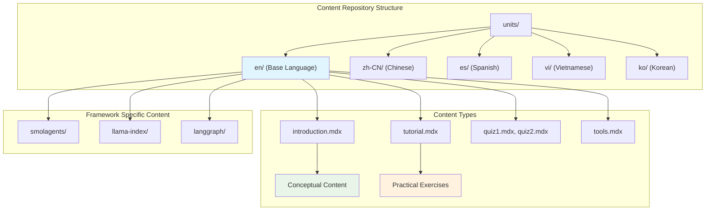
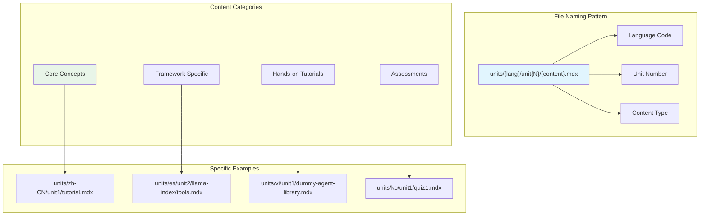
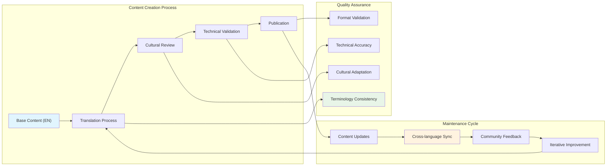
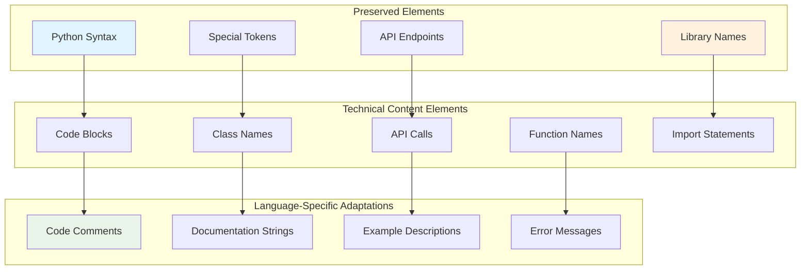
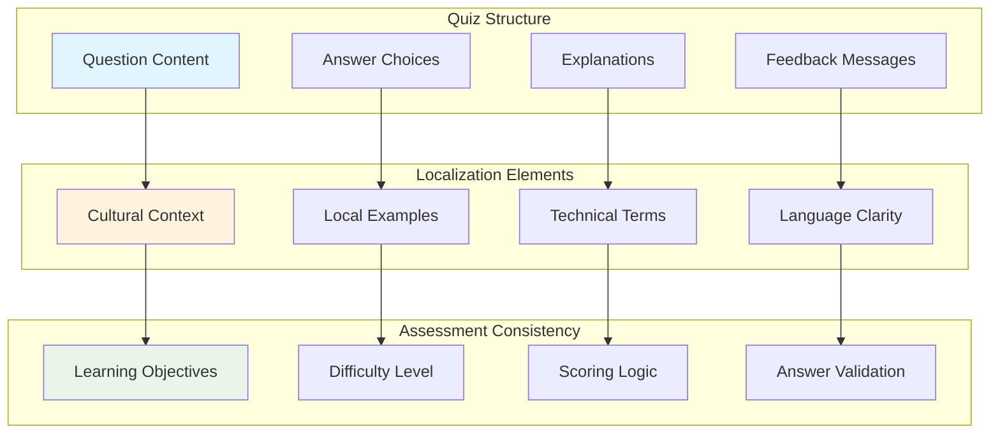
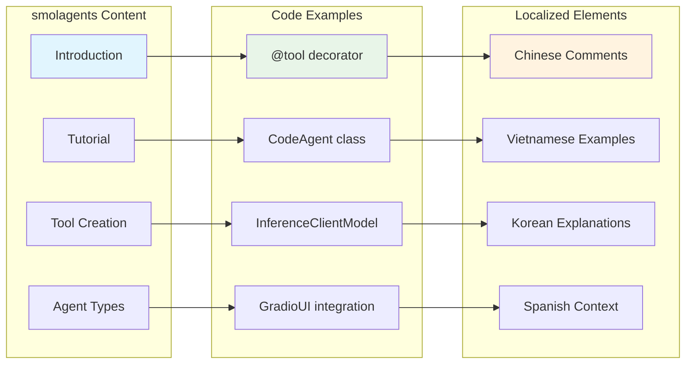
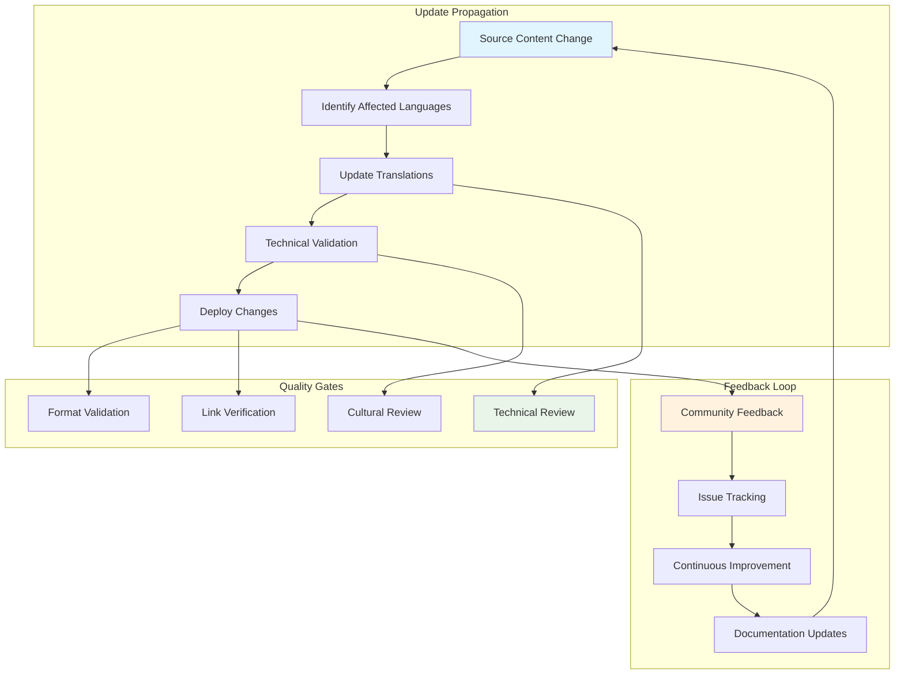

<!-- source: DeepWiki mcp.deepwiki.com · repo huggingface/agents-course · page 7 Multilingual Content · fetched 2026-10-26 -->

# Multilingual Content

Relevant source files

The following files were used as context for generating this wiki page:

- [units/en/unit2/llama-index/quiz2.mdx](units/en/unit2/llama-index/quiz2.mdx)
- [units/es/unit2/llama-index/README.md](units/es/unit2/llama-index/README.md)
- [units/es/unit2/llama-index/agents.mdx](units/es/unit2/llama-index/agents.mdx)
- [units/es/unit2/llama-index/components.mdx](units/es/unit2/llama-index/components.mdx)
- [units/es/unit2/llama-index/conclusion.mdx](units/es/unit2/llama-index/conclusion.mdx)
- [units/es/unit2/llama-index/introduction.mdx](units/es/unit2/llama-index/introduction.mdx)
- [units/es/unit2/llama-index/llama-hub.mdx](units/es/unit2/llama-index/llama-hub.mdx)
- [units/es/unit2/llama-index/quiz1.mdx](units/es/unit2/llama-index/quiz1.mdx)
- [units/es/unit2/llama-index/quiz2.mdx](units/es/unit2/llama-index/quiz2.mdx)
- [units/es/unit2/llama-index/tools.mdx](units/es/unit2/llama-index/tools.mdx)
- [units/es/unit2/llama-index/workflows.mdx](units/es/unit2/llama-index/workflows.mdx)
- [units/ko/unit1/introduction.mdx](units/ko/unit1/introduction.mdx)
- [units/ko/unit1/messages-and-special-tokens.mdx](units/ko/unit1/messages-and-special-tokens.mdx)
- [units/ko/unit1/quiz1.mdx](units/ko/unit1/quiz1.mdx)
- [units/ko/unit1/quiz2.mdx](units/ko/unit1/quiz2.mdx)
- [units/ko/unit1/tools.mdx](units/ko/unit1/tools.mdx)
- [units/ko/unit1/what-are-agents.mdx](units/ko/unit1/what-are-agents.mdx)
- [units/ko/unit1/what-are-llms.mdx](units/ko/unit1/what-are-llms.mdx)
- [units/vi/unit0/introduction.mdx](units/vi/unit0/introduction.mdx)
- [units/vi/unit1/actions.mdx](units/vi/unit1/actions.mdx)
- [units/vi/unit1/agent-steps-and-structure.mdx](units/vi/unit1/agent-steps-and-structure.mdx)
- [units/vi/unit1/conclusion.mdx](units/vi/unit1/conclusion.mdx)
- [units/vi/unit1/dummy-agent-library.mdx](units/vi/unit1/dummy-agent-library.mdx)
- [units/vi/unit1/introduction.mdx](units/vi/unit1/introduction.mdx)
- [units/vi/unit1/observations.mdx](units/vi/unit1/observations.mdx)
- [units/vi/unit1/quiz1.mdx](units/vi/unit1/quiz1.mdx)
- [units/vi/unit1/thoughts.mdx](units/vi/unit1/thoughts.mdx)
- [units/vi/unit1/tutorial.mdx](units/vi/unit1/tutorial.mdx)
- [units/vi/unit1/what-are-llms.mdx](units/vi/unit1/what-are-llms.mdx)
- [units/zh-CN/unit0/onboarding.mdx](units/zh-CN/unit0/onboarding.mdx)
- [units/zh-CN/unit1/tools.mdx](units/zh-CN/unit1/tools.mdx)
- [units/zh-CN/unit1/tutorial.mdx](units/zh-CN/unit1/tutorial.mdx)
- [units/zh-CN/unit1/what-are-agents.mdx](units/zh-CN/unit1/what-are-agents.mdx)

This document describes the multilingual content system of the AI Agents Course, covering the internationalization architecture, content organization, translation workflows, and maintenance processes for delivering course materials in multiple languages.

For information about the overall course structure and learning paths, see [Overview](#1). For details about specific framework implementations, see [Agent Frameworks](#3).

## Purpose and Scope

The multilingual content system enables the AI Agents Course to reach a global audience by providing comprehensive translations of educational materials across multiple languages. The system maintains content consistency while adapting cultural and linguistic nuances for different regions.

Currently supported languages include:
- English (en) - Base language
- Chinese Simplified (zh-CN) 
- Spanish (es)
- Vietnamese (vi)
- Korean (ko)

## Multilingual Architecture Overview

**File Organization Structure**

Sources: [units/zh-CN/unit1/tutorial.mdx:1-236](), [units/es/unit2/llama-index/tools.mdx:1-110](), [units/vi/unit1/dummy-agent-library.mdx:1-524](), [units/ko/unit1/quiz1.mdx:1-167]()

## Content Hierarchy and Naming Conventions

**Directory Structure Mapping**

| Language | Code | Example Path | Content Focus |
|----------|------|-------------|---------------|
| English | `en` | `units/en/unit1/introduction.mdx` | Base content |
| Chinese (Simplified) | `zh-CN` | `units/zh-CN/unit1/tutorial.mdx` | smolagents tutorial |
| Spanish | `es` | `units/es/unit2/llama-index/tools.mdx` | LlamaIndex tools |
| Vietnamese | `vi` | `units/vi/unit1/dummy-agent-library.mdx` | Basic agent concepts |
| Korean | `ko` | `units/ko/unit1/quiz1.mdx` | Assessment content |

Sources: [units/zh-CN/unit1/tutorial.mdx:1-10](), [units/es/unit2/llama-index/tools.mdx:1-15](), [units/vi/unit1/dummy-agent-library.mdx:1-20](), [units/ko/unit1/quiz1.mdx:1-10]()

## Translation and Localization Workflow

**Translation Quality Standards**

Sources: [units/zh-CN/unit1/tutorial.mdx:12-33](), [units/es/unit2/llama-index/tools.mdx:3-14](), [units/vi/unit1/dummy-agent-library.mdx:5-15]()

## Content Synchronization System

The multilingual content system maintains consistency across languages through structured content mapping and cross-referencing:

### Code Integration and Technical Consistency

**Technical Element Preservation**

Technical elements remain consistent across all language versions:
- Python code syntax in `@tool` decorators
- `smolagents` class names like `CodeAgent` and `InferenceClientModel`
- API endpoints and authentication tokens
- Framework-specific terminology (`LlamaIndex`, `AgentWorkflow`, `QueryEngine`)

Sources: [units/zh-CN/unit1/tutorial.mdx:57-63](), [units/es/unit2/llama-index/tools.mdx:28-44](), [units/vi/unit1/dummy-agent-library.mdx:30-39]()

### Assessment and Quiz Localization

The quiz system maintains educational objectives while adapting cultural context:

**Quiz Component Mapping**

| Component | English | Chinese | Korean | Vietnamese |
|-----------|---------|---------|--------|------------|
| Question Prefix | `Q1:` | `Q1:` | `Q1:` | `Q1:` |
| Choice Format | `choices={[` | `choices={[` | `choices={[` | `choices={[` |
| Correct Indicator | `correct: true` | `correct: true` | `correct: true` | `correct: true` |
| Explanation Field | `explain:` | `explain:` | `explain:` | `explain:` |

Sources: [units/ko/unit1/quiz1.mdx:2-25](), [units/vi/unit1/quiz1.mdx:2-29](), [units/zh-CN/unit1/tools.mdx:36-44]()

## Framework-Specific Multilingual Support

### smolagents Framework Content

The `smolagents` framework content demonstrates comprehensive multilingual coverage:

**Framework Integration Consistency**

Sources: [units/zh-CN/unit1/tutorial.mdx:114-140](), [units/vi/unit1/dummy-agent-library.mdx:370-380](), [units/ko/unit1/tools.mdx:114-130]()

### LlamaIndex Multilingual Coverage

LlamaIndex framework content shows structured multilingual implementation:

| Content Type | Spanish Files | Coverage |
|--------------|---------------|----------|
| Introduction | `units/es/unit2/llama-index/introduction.mdx` | Framework overview |
| Tools | `units/es/unit2/llama-index/tools.mdx` | `FunctionTool`, `QueryEngineTool` |
| Workflows | `units/es/unit2/llama-index/workflows.mdx` | `AgentWorkflow`, state management |
| Components | `units/es/unit2/llama-index/components.mdx` | Core building blocks |
| Hub Integration | `units/es/unit2/llama-index/llama-hub.mdx` | External integrations |

Sources: [units/es/unit2/llama-index/tools.mdx:1-110](), [units/es/unit2/llama-index/workflows.mdx:1-281](), [units/es/unit2/llama-index/introduction.mdx:1-28]()

## Content Maintenance and Updates

### Version Control and Synchronization

The multilingual content system requires coordinated updates across all language versions:

**Maintenance Workflow Components**

Sources: [units/zh-CN/unit0/onboarding.mdx:1-100](), [units/vi/unit0/introduction.mdx:1-170](), [units/ko/unit1/introduction.mdx:1-40]()

## Internationalization Best Practices

### Cultural Adaptation Strategies

The course content adapts to different cultural contexts while maintaining technical accuracy:

1. **Technical Terminology**: Consistent across all languages
2. **Cultural Examples**: Adapted to local contexts
3. **Learning Progressions**: Maintained universal structure
4. **Code Comments**: Translated for better understanding

### Accessibility and Inclusivity

The multilingual system ensures broad accessibility:

- Language-specific character encoding support
- Right-to-left text consideration for future expansions
- Cultural sensitivity in examples and metaphors
- Technical complexity appropriate for different educational systems

Sources: [units/zh-CN/unit1/what-are-agents.mdx:1-161](), [units/vi/unit1/what-are-llms.mdx:1-219](), [units/ko/unit1/messages-and-special-tokens.mdx:1-232]()