# Page: Overview

# Overview

<details>
<summary>Relevant source files</summary>

The following files were used as context for generating this wiki page:

- [README.md](README.md)
- [units/en/_toctree.yml](units/en/_toctree.yml)
- [units/en/bonus-unit3/building_your_pokemon_agent.mdx](units/en/bonus-unit3/building_your_pokemon_agent.mdx)
- [units/en/bonus-unit3/conclusion.mdx](units/en/bonus-unit3/conclusion.mdx)
- [units/en/bonus-unit3/from-llm-to-agents.mdx](units/en/bonus-unit3/from-llm-to-agents.mdx)
- [units/en/bonus-unit3/introduction.mdx](units/en/bonus-unit3/introduction.mdx)
- [units/en/bonus-unit3/launching_agent_battle.mdx](units/en/bonus-unit3/launching_agent_battle.mdx)
- [units/en/bonus-unit3/state-of-art.mdx](units/en/bonus-unit3/state-of-art.mdx)
- [units/en/unit0/discord101.mdx](units/en/unit0/discord101.mdx)
- [units/en/unit0/introduction.mdx](units/en/unit0/introduction.mdx)
- [units/en/unit0/onboarding.mdx](units/en/unit0/onboarding.mdx)
- [units/en/unit1/tutorial.mdx](units/en/unit1/tutorial.mdx)

</details>


This document provides a comprehensive technical overview of the Hugging Face AI Agents Course repository, which serves as an educational platform for teaching AI agent development from fundamentals to advanced applications. The repository contains a complete curriculum covering agent theory, practical frameworks, and real-world implementations.

For specific information about individual agent frameworks, see [smolagents Framework](#3.1), [LlamaIndex Framework](#3.2), and [LangGraph Framework](#3.3). For details about practical applications, see [Use Cases and Applications](#5). For information about the course delivery infrastructure, see [Course Platform and Infrastructure](#6).

## Course Structure and Educational Framework

The course is organized as a progressive learning journey, structured through a hierarchical table of contents system that guides students from basic concepts to advanced implementations.

### Course Platform Architecture

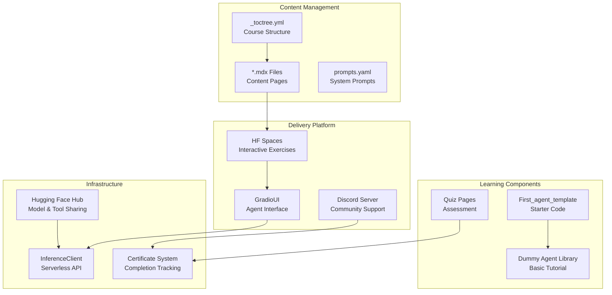

The course follows a four-unit progression with additional bonus content. Each unit builds upon previous concepts while introducing new frameworks and applications.

Sources: [units/en/_toctree.yml:1-173](), [units/en/unit0/introduction.mdx:56-72](), [README.md:8-28]()

### Educational Progression Model

```mermaid
graph LR
    subgraph "Unit0[\"Unit 0: Onboarding\"]"
        intro_mdx["introduction.mdx<br/>Course Overview"]
        onboard_mdx["onboarding.mdx<br/>Setup Process"]
        discord_mdx["discord101.mdx<br/>Community Guide"]
    end
    
    subgraph "Unit1[\"Unit 1: Fundamentals\"]"
        what_agents["what-are-agents<br/>Core Concepts"]
        tao_cycle["agent-steps-and-structure<br/>TAO Implementation"]
        dummy_lib["dummy-agent-library<br/>Basic Agent"]
        tutorial_mdx["tutorial.mdx<br/>smolagents Intro"]
    end
    
    subgraph "Unit2[\"Unit 2: Frameworks\"]"
        smolagents_intro["smolagents/introduction<br/>CodeAgent System"]
        llama_intro["llama-index/introduction<br/>RAG Agents"]
        langgraph_intro["langgraph/introduction<br/>State Management"]
    end
    
    subgraph "Unit3[\"Unit 3: Applications\"]"
        agentic_rag["agentic-rag/introduction<br/>Alfred Assistant"]
        rag_impl["agentic-rag/agent<br/>Multi-framework"]
    end
    
    subgraph "Unit4[\"Unit 4: Certification\"]"
        gaia_eval["what-is-gaia<br/>Benchmark System"]
        final_project["hands-on<br/>Agent Testing"]
        certificate["get-your-certificate<br/>Completion"]
    end
    
    Unit0 --> Unit1
    Unit1 --> Unit2
    Unit2 --> Unit3
    Unit3 --> Unit4
```

Sources: [units/en/_toctree.yml:1-173](), [units/en/unit0/introduction.mdx:43-66](), [README.md:15-27]()

## Core Agent Architecture

The course teaches agent development through three fundamental components: Large Language Models as reasoning engines, Tools for external capabilities, and the Thought-Action-Observation (TAO) cycle for decision-making.

### Agent Component Mapping

```mermaid
graph TD
    subgraph "LLM_Layer[\"LLM Integration Layer\"]"
        inference_client["InferenceClientModel<br/>API Wrapper"]
        chat_templates["Chat Templates<br/>Message Formatting"]
        model_config["Model Configuration<br/>Parameters"]
    end
    
    subgraph "Tool_System[\"Tool System\"]"
        tool_decorator["@tool Decorator<br/>Function Wrapper"]
        final_answer["FinalAnswerTool<br/>Response Handler"]
        custom_tools["Custom Tools<br/>User Functions"]
        hub_tools["load_tool()<br/>Hub Integration"]
    end
    
    subgraph "Agent_Core[\"Agent Core Classes\"]"
        code_agent["CodeAgent<br/>Python Execution"]
        tool_calling_agent["ToolCallingAgent<br/>JSON Functions"]
        agent_workflow["AgentWorkflow<br/>LlamaIndex"]
        state_graph["StateGraph<br/>LangGraph"]
    end
    
    subgraph "Execution_Runtime[\"Execution Runtime\"]"
        gradio_ui["GradioUI<br/>Interface"]
        battle_env["LLMAgentBase<br/>Game Environment"]
        space_deployment["HF Spaces<br/>Deployment"]
    end
    
    inference_client --> code_agent
    inference_client --> tool_calling_agent
    tool_decorator --> custom_tools
    hub_tools --> custom_tools
    code_agent --> gradio_ui
    tool_calling_agent --> gradio_ui
    agent_workflow --> gradio_ui
    state_graph --> gradio_ui
    battle_env --> space_deployment
```

Sources: [units/en/unit1/tutorial.mdx:58-146](), [units/en/bonus-unit3/building_your_pokemon_agent.mdx:39-213]()

## Framework Implementation Details

The course covers three distinct agent frameworks, each with different architectural approaches and use cases.

### Framework Architecture Comparison

| Framework | Core Classes | Execution Model | Primary Use Case |
|-----------|-------------|-----------------|------------------|
| `smolagents` | `CodeAgent`, `ToolCallingAgent` | Code/JSON generation | General-purpose, HF integration |
| `LlamaIndex` | `AgentWorkflow`, `QueryEngine` | RAG-focused workflows | Document processing, knowledge retrieval |
| `LangGraph` | `StateGraph`, Processing nodes | State management | Complex workflows, conditional logic |

### smolagents Implementation

The `smolagents` framework provides a code-first approach to agent development with two primary agent types:

```mermaid
graph TB
    subgraph "smolagents_Core[\"smolagents Core\"]"
        code_agent_class["CodeAgent<br/>Python Code Generation"]
        tool_calling_class["ToolCallingAgent<br/>JSON Tool Calls"]
        inference_model["InferenceClientModel<br/>LLM Wrapper"]
    end
    
    subgraph "Tool_Integration[\"Tool Integration\"]"
        tool_dec["@tool<br/>Function Decorator"]
        duck_search["DuckDuckGoSearchTool<br/>Web Search"]
        image_gen["load_tool('text-to-image')<br/>Hub Tool"]
        final_ans["FinalAnswerTool<br/>Response"]
    end
    
    subgraph "Runtime_Components[\"Runtime Components\"]"
        gradio_interface["GradioUI.launch()<br/>Web Interface"]
        yaml_prompts["prompts.yaml<br/>System Messages"]
        app_py["app.py<br/>Main Application"]
    end
    
    inference_model --> code_agent_class
    inference_model --> tool_calling_class
    tool_dec --> duck_search
    tool_dec --> image_gen
    code_agent_class --> gradio_interface
    yaml_prompts --> code_agent_class
    app_py --> gradio_interface
```

Sources: [units/en/unit1/tutorial.mdx:114-144](), [units/en/unit1/tutorial.mdx:72-109]()

## Practical Applications and Use Cases

The course includes several hands-on applications that demonstrate agent capabilities across different domains.

### Application Architecture

```mermaid
graph TD
    subgraph "Educational_Apps[\"Educational Applications\"]"
        first_agent["First_agent_template<br/>Starter Space"]
        tutorial_space["Tutorial Implementation<br/>Basic Agent"]
    end
    
    subgraph "RAG_Applications[\"Agentic RAG\"]"
        alfred_assistant["Alfred Assistant<br/>Multi-framework RAG"]
        rag_tools["RAG Tool Integration<br/>Knowledge Base"]
    end
    
    subgraph "Game_Applications[\"Game Agents\"]"
        pokemon_base["LLMAgentBase<br/>Battle Framework"]
        poke_env["poke-env Integration<br/>Battle Simulator"]
        showdown_server["Pokemon Showdown<br/>Battle Platform"]
        template_agent["TemplateAgent<br/>Battle Logic"]
    end
    
    subgraph "Evaluation_System[\"Evaluation & Certification\"]"
        gaia_benchmark["GAIA Benchmark<br/>Performance Testing"]
        leaderboard["Students_leaderboard<br/>Ranking System"]
        cert_system["Certificate Generation<br/>Completion Tracking"]
    end
    
    first_agent --> alfred_assistant
    alfred_assistant --> pokemon_base
    pokemon_base --> gaia_benchmark
    poke_env --> template_agent
    template_agent --> leaderboard
    gaia_benchmark --> cert_system
```

Sources: [units/en/unit1/tutorial.mdx:35-42](), [units/en/bonus-unit3/building_your_pokemon_agent.mdx:41-63](), [units/en/bonus-unit3/building_your_pokemon_agent.mdx:224-258]()

## Infrastructure and Technical Integration

The course platform integrates multiple services and APIs to provide a comprehensive learning environment.

### Integration Ecosystem

```mermaid
graph TB
    subgraph "HuggingFace_Platform[\"Hugging Face Platform\"]"
        hf_hub_api["Hub API<br/>Model Access"]
        hf_spaces_runtime["Spaces Runtime<br/>Deployment"]
        hf_inference["Inference API<br/>Serverless LLMs"]
        hf_token["HF_TOKEN<br/>Authentication"]
    end
    
    subgraph "Development_Environment[\"Development Environment\"]"
        colab_notebooks["Google Colab<br/>Development"]
        local_ollama["Ollama Integration<br/>Local Models"]
        litellm_model["LiteLLMModel<br/>Local Wrapper"]
    end
    
    subgraph "Community_Platform[\"Community Platform\"]"
        discord_server["Discord Server<br/>Community Support"]
        discord_channels["Course Channels<br/>Communication"]
        showcase_channel["agents-course-showcase<br/>Agent Sharing"]
    end
    
    subgraph "External_APIs[\"External APIs\"]"
        openai_api["OpenAI API<br/>GPT Models"]
        mistral_api["Mistral API<br/>Alternative LLMs"]
        weather_apis["External APIs<br/>Tool Integration"]
    end
    
    hf_token --> hf_inference
    hf_inference --> hf_spaces_runtime
    local_ollama --> litellm_model
    litellm_model --> hf_spaces_runtime
    discord_server --> discord_channels
    openai_api --> hf_spaces_runtime
    weather_apis --> hf_spaces_runtime
```

Sources: [units/en/unit0/onboarding.mdx:56-96](), [units/en/unit1/tutorial.mdx:43-50](), [units/en/unit0/onboarding.mdx:17-31]()

## Course Content Management

The course content is managed through a structured system of MDX files, YAML configuration, and automated deployment processes.

### Content Structure

| Component | File Pattern | Purpose |
|-----------|-------------|---------|
| Course Structure | `_toctree.yml` | Hierarchical navigation |
| Content Pages | `unit*/**.mdx` | Educational content |
| Interactive Exercises | `app.py` files in Spaces | Hands-on practice |
| System Prompts | `prompts.yaml` | Agent configuration |
| Bonus Content | `bonus-unit*/**.mdx` | Advanced topics |

The platform supports multilingual content and maintains community infrastructure for student interaction and support.

Sources: [units/en/_toctree.yml:1-173](), [units/en/unit0/introduction.mdx:173-185](), [README.md:34-45]()

---

# Page: AI Agent Fundamentals

# AI Agent Fundamentals

<details>
<summary>Relevant source files</summary>

The following files were used as context for generating this wiki page:

- [units/en/unit1/README.md](units/en/unit1/README.md)
- [units/en/unit1/agent-steps-and-structure.mdx](units/en/unit1/agent-steps-and-structure.mdx)
- [units/en/unit1/conclusion.mdx](units/en/unit1/conclusion.mdx)
- [units/en/unit1/introduction.mdx](units/en/unit1/introduction.mdx)
- [units/en/unit1/messages-and-special-tokens.mdx](units/en/unit1/messages-and-special-tokens.mdx)
- [units/en/unit1/quiz1.mdx](units/en/unit1/quiz1.mdx)
- [units/en/unit1/quiz2.mdx](units/en/unit1/quiz2.mdx)
- [units/en/unit1/tools.mdx](units/en/unit1/tools.mdx)
- [units/en/unit1/what-are-agents.mdx](units/en/unit1/what-are-agents.mdx)
- [units/en/unit1/what-are-llms.mdx](units/en/unit1/what-are-llms.mdx)
- [units/zh-CN/unit1/messages-and-special-tokens.mdx](units/zh-CN/unit1/messages-and-special-tokens.mdx)

</details>


This document covers the core foundational concepts that underpin AI agents within the Hugging Face Agents Course framework. It explains how Large Language Models (LLMs) serve as the reasoning engine, how tools extend agent capabilities, the Thought-Action-Observation operational cycle, and message handling systems that enable structured communication.

For comprehensive framework implementations, see [Agent Frameworks](#3). For practical applications and use cases, see [Use Cases and Applications](#5).

## LLMs as the Agent Brain

Large Language Models serve as the central reasoning engine for AI agents. These are decoder-based transformer models trained on vast text corpora to predict the next token in a sequence.

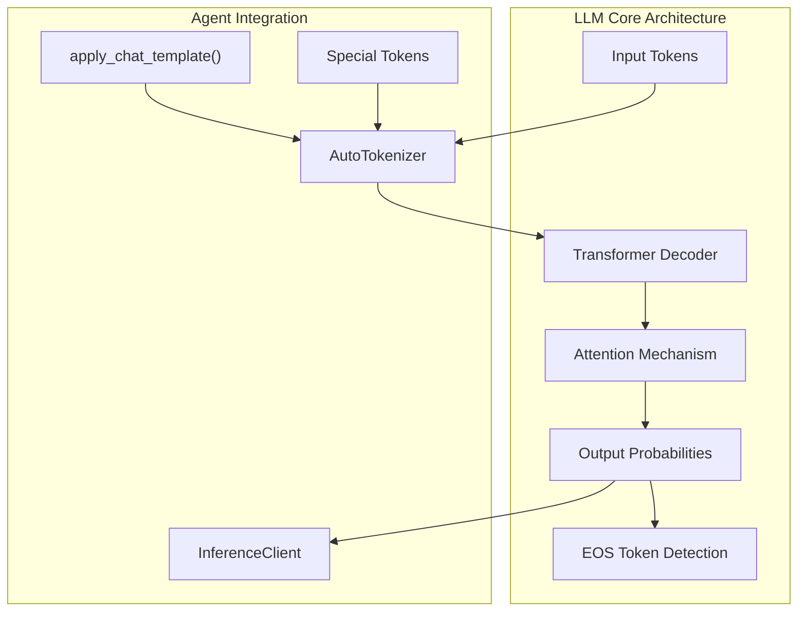

### Token Processing and Special Tokens

LLMs operate on tokens rather than whole words, with vocabularies typically containing around 32,000 tokens. Each model uses specific special tokens for control flow:

| Model | Provider | EOS Token | Function |
|-------|----------|-----------|-----------|
| GPT4 | OpenAI | `<|endoftext|>` | End of message text |
| Llama 3 | Meta | `<|eot_id|>` | End of sequence |
| SmolLM2 | Hugging Face | `<|im_end|>` | End of instruction |

The autoregressive generation process continues until the model predicts an EOS token, enabling controlled text generation suitable for agent workflows.

**Sources:** [units/en/unit1/what-are-llms.mdx:1-224]()

## Tools and External Capabilities

Tools extend LLM capabilities beyond text generation by providing callable functions that agents can invoke. The tool system bridges the gap between natural language reasoning and executable code.

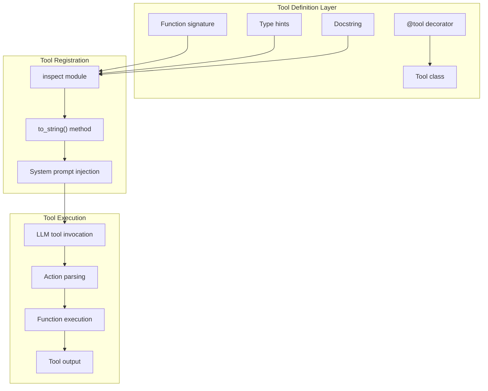

### Tool Implementation Architecture

The `Tool` class provides a standardized interface for agent capabilities:

- **`name`**: Function identifier
- **`description`**: Purpose and behavior description  
- **`func`**: Callable implementation
- **`arguments`**: Expected input parameters with types
- **`outputs`**: Return type specification
- **`to_string()`**: Generates LLM-readable tool descriptions
- **`__call__()`**: Executes the underlying function

The `@tool` decorator automates tool creation by leveraging Python's `inspect` module to extract function metadata, creating consistent tool descriptions for LLM consumption.

**Sources:** [units/en/unit1/tools.mdx:1-322]()

## The Thought-Action-Observation Cycle

The core operational loop of AI agents follows a structured cycle that enables iterative problem-solving and environmental interaction.

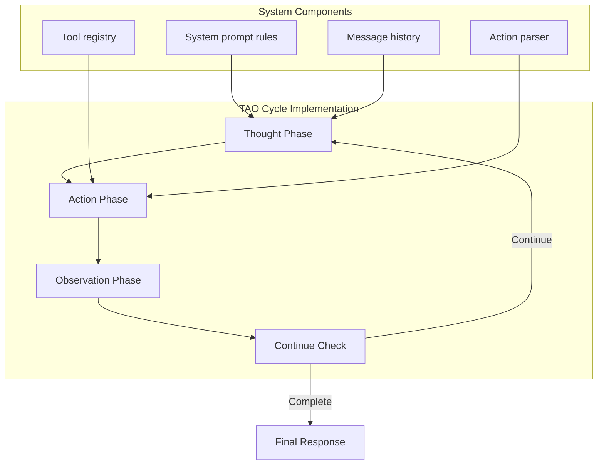

### Cycle Phases

**Thought Phase**: The LLM analyzes the current context, reviews available tools, and determines the next course of action. This involves internal reasoning about the problem state and strategy selection.

**Action Phase**: Based on the thought process, the agent generates structured tool invocations. These follow specific formats (JSON or code) that can be parsed and executed by the agent framework.

**Observation Phase**: Tool execution results are captured and formatted as observations, providing environmental feedback that informs subsequent reasoning cycles.

The cycle continues until the agent determines the objective has been fulfilled or a termination condition is met.

**Sources:** [units/en/unit1/agent-steps-and-structure.mdx:1-151]()

## Message Systems and Chat Templates

Agent communication relies on structured message systems that format conversations between users, systems, and assistants into LLM-compatible prompts.

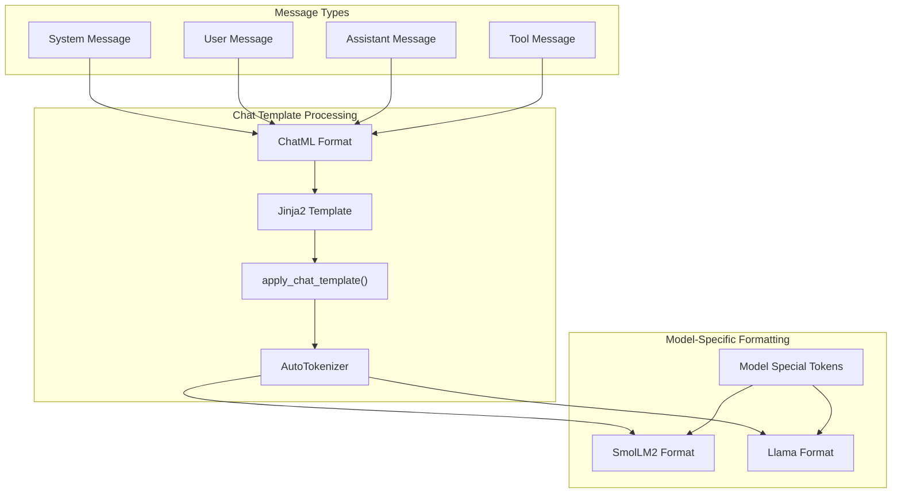

### Message Processing Pipeline

The `transformers.AutoTokenizer.apply_chat_template()` method converts structured message lists into model-specific prompt formats. Each message contains:

- **`role`**: Message type (`system`, `user`, `assistant`)
- **`content`**: Message text content

Chat templates use Jinja2 templating to handle model-specific formatting requirements, ensuring proper delimiter usage and special token placement.

### System Message Integration

System messages define agent behavior and provide critical context including:
- Agent personality and response guidelines
- Available tool descriptions and usage instructions
- Thought-Action-Observation cycle formatting rules
- Task-specific constraints and objectives

**Sources:** [units/en/unit1/messages-and-special-tokens.mdx:1-229]()

## Agent Integration Architecture

The complete agent system integrates LLMs, tools, and message processing into a cohesive framework that enables autonomous task completion.

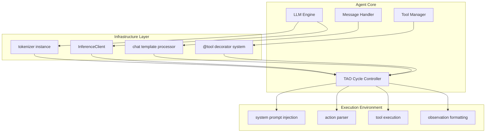

### Component Interactions

The agent architecture coordinates multiple subsystems:

**LLM Engine** manages model inference through `InferenceClient` and handles tokenization via `AutoTokenizer` instances.

**Message Handler** processes conversation history using model-specific chat templates, ensuring proper formatting for each LLM variant.

**Tool Manager** maintains the tool registry populated by `@tool` decorated functions, providing runtime access to external capabilities.

**TAO Cycle Controller** orchestrates the complete reasoning loop, managing prompt construction, action parsing, tool execution, and observation integration.

This architecture enables flexible agent implementations across different frameworks while maintaining consistent core functionality.

**Sources:** [units/en/unit1/what-are-agents.mdx:1-162](), [units/en/unit1/introduction.mdx:1-39]()

---

# Page: LLMs and Agent Architecture

# LLMs and Agent Architecture

<details>
<summary>Relevant source files</summary>

The following files were used as context for generating this wiki page:

- [units/en/unit1/README.md](units/en/unit1/README.md)
- [units/en/unit1/agent-steps-and-structure.mdx](units/en/unit1/agent-steps-and-structure.mdx)
- [units/en/unit1/conclusion.mdx](units/en/unit1/conclusion.mdx)
- [units/en/unit1/introduction.mdx](units/en/unit1/introduction.mdx)
- [units/en/unit1/messages-and-special-tokens.mdx](units/en/unit1/messages-and-special-tokens.mdx)
- [units/en/unit1/quiz1.mdx](units/en/unit1/quiz1.mdx)
- [units/en/unit1/quiz2.mdx](units/en/unit1/quiz2.mdx)
- [units/en/unit1/tools.mdx](units/en/unit1/tools.mdx)
- [units/en/unit1/what-are-agents.mdx](units/en/unit1/what-are-agents.mdx)
- [units/en/unit1/what-are-llms.mdx](units/en/unit1/what-are-llms.mdx)
- [units/zh-CN/unit1/messages-and-special-tokens.mdx](units/zh-CN/unit1/messages-and-special-tokens.mdx)

</details>


This document explains how Large Language Models (LLMs) function as the core reasoning engine in AI agents and describes the fundamental architecture that enables agents to understand, reason, and interact with their environment. It covers the technical foundations of LLMs, their integration into agent systems, and the architectural patterns that make agent-based AI systems possible.

For information about the specific thought-action-observation operational cycle, see [Thought-Action-Observation Cycle](#2.2). For details about tools and message handling systems, see [Tools and Message Systems](#2.3).

## LLMs as Agent Reasoning Engines

LLMs serve as the "brain" of AI agents, providing the core reasoning capabilities that enable agents to understand natural language instructions, plan sequences of actions, and make decisions about tool usage. The agent architecture separates the reasoning engine (LLM) from the execution capabilities (tools and environment interaction).

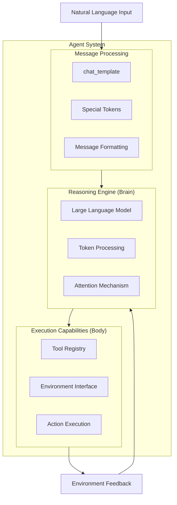

Sources: [units/en/unit1/what-are-llms.mdx:5-13](), [units/en/unit1/what-are-agents.mdx:52-64]()

## Transformer Architecture Types

Different transformer architectures serve different purposes in agent systems. Decoder-based transformers are predominantly used for agent reasoning due to their text generation capabilities.

| Architecture Type | Description | Agent Usage | Typical Models |
|------------------|-------------|-------------|----------------|
| **Encoder** | Dense representation generation | Rare - semantic search only | BERT |
| **Decoder** | Autoregressive text generation | **Primary choice** - reasoning and planning | Llama, GPT-4, SmolLM2 |
| **Seq2Seq** | Combined encoder-decoder | Limited - translation tasks | T5, BART |

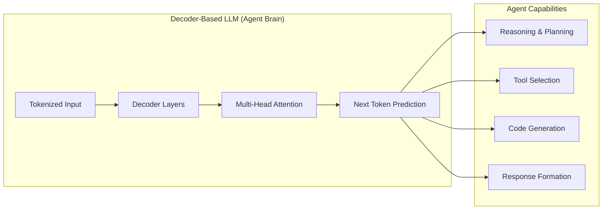

Sources: [units/en/unit1/what-are-llms.mdx:23-46](), [units/en/unit1/what-are-llms.mdx:82-84]()

## Token Processing and Autoregressive Generation

LLMs process text through tokenization and generate responses through autoregressive decoding. This process is fundamental to how agents formulate reasoning and generate tool calls.

### Tokenization Process

The tokenizer converts natural language into sub-word units that the LLM processes. Agent frameworks rely on this tokenization for both input processing and output parsing.

```mermaid
graph TD
    subgraph TokenizationFlow["Tokenization and Generation Flow"]
        NaturalLang["Natural Language Input"]
        Tokenizer["tokenizer.encode()"]
        TokenSequence["Token Sequence"]
        LLMProcessing["LLM Processing"]
        ScoreGeneration["Token Score Generation"]
        DecodingStrategy["Decoding Strategy"]
        OutputTokens["Generated Tokens"]
        Detokenization["tokenizer.decode()"]
        FinalResponse["Final Response"]
    end
    
    NaturalLang --> Tokenizer
    Tokenizer --> TokenSequence
    TokenSequence --> LLMProcessing
    LLMProcessing --> ScoreGeneration
    ScoreGeneration --> DecodingStrategy
    DecodingStrategy --> OutputTokens
    OutputTokens --> Detokenization
    Detokenization --> FinalResponse
```

The autoregressive nature means each generated token becomes input for the next generation step, continuing until an End of Sequence (EOS) token is generated.

Sources: [units/en/unit1/what-are-llms.mdx:57-62](), [units/en/unit1/what-are-llms.mdx:129-133](), [units/en/unit1/what-are-llms.mdx:137-142]()

## Special Tokens and Message Systems

Special tokens structure the communication between agents and LLMs, particularly for multi-turn conversations and tool integration. Each model family uses different special token conventions.

### Special Token Examples

| Model | Provider | EOS Token | Usage |
|-------|----------|-----------|--------|
| GPT-4 | OpenAI | `<|endoftext|>` | End of message text |
| Llama 3 | Meta | `<|eot_id|>` | End of sequence |
| SmolLM2 | Hugging Face | `<|im_end|>` | End of instruction/message |
| Gemma | Google | `<end_of_turn>` | End of conversation turn |

### Chat Template System

Chat templates convert message lists into formatted prompts that LLMs can process. This system is critical for agent frameworks that manage multi-turn conversations.

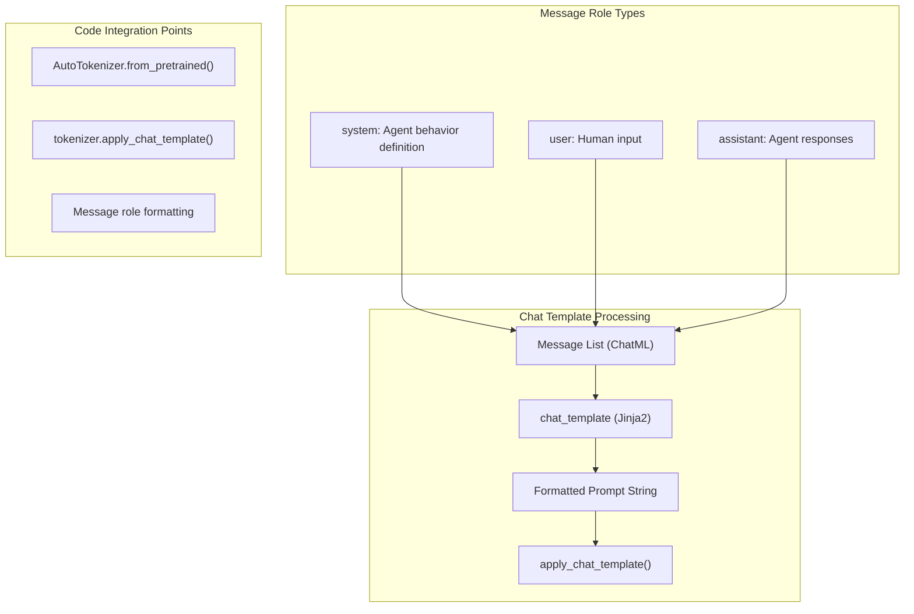

Sources: [units/en/unit1/what-are-llms.mdx:72-119](), [units/en/unit1/messages-and-special-tokens.mdx:24-56](), [units/en/unit1/messages-and-special-tokens.mdx:196-217]()

## Agent Architecture Overview

The agent architecture consists of two primary components: the reasoning engine (LLM brain) and the execution capabilities (tool body). This separation enables flexible agent design across different domains.

### Core Agent Components

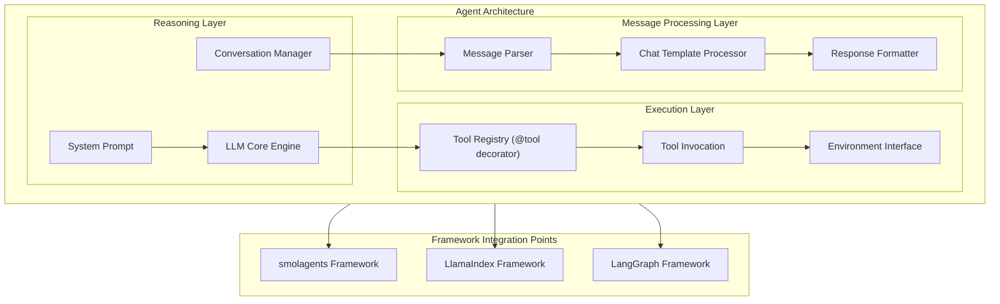

Sources: [units/en/unit1/what-are-agents.mdx:52-64](), [units/en/unit1/tools.mdx:14-27](), [units/en/unit1/tools.mdx:137-191]()

## LLM Integration in Agent Frameworks

Agent frameworks integrate LLMs through standardized interfaces that handle tokenization, message formatting, and response processing. The integration varies across frameworks but follows common patterns.

### Framework Integration Patterns

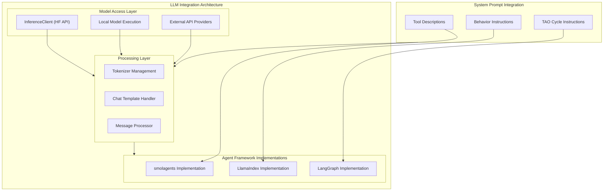

The system prompt serves as the primary integration point, containing tool descriptions, behavioral guidelines, and cycle instructions that guide the LLM's reasoning process within the agent framework.

Sources: [units/en/unit1/what-are-llms.mdx:203-209](), [units/en/unit1/tools.mdx:56-98](), [units/en/unit1/agent-steps-and-structure.mdx:33-44]()

## Message System Architecture

The message system bridges natural language interactions with LLM processing requirements through structured message formatting and chat template application.

### Message Processing Flow

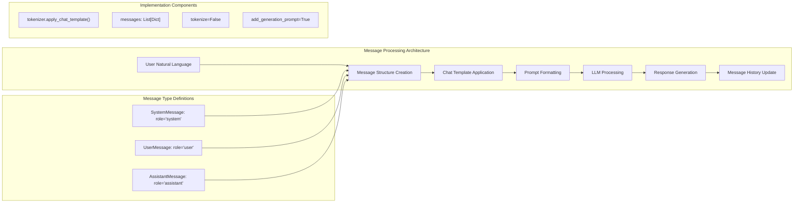

This architecture ensures consistent message formatting across different LLM providers while maintaining conversation context and enabling proper tool integration through system message configuration.

Sources: [units/en/unit1/messages-and-special-tokens.mdx:59-117](), [units/en/unit1/messages-and-special-tokens.mdx:137-184](), [units/en/unit1/messages-and-special-tokens.mdx:196-217]()

---

# Page: Thought-Action-Observation Cycle

# Thought-Action-Observation Cycle

<details>
<summary>Relevant source files</summary>

The following files were used as context for generating this wiki page:

- [units/en/unit1/README.md](units/en/unit1/README.md)
- [units/en/unit1/agent-steps-and-structure.mdx](units/en/unit1/agent-steps-and-structure.mdx)
- [units/en/unit1/conclusion.mdx](units/en/unit1/conclusion.mdx)
- [units/en/unit1/introduction.mdx](units/en/unit1/introduction.mdx)
- [units/en/unit1/messages-and-special-tokens.mdx](units/en/unit1/messages-and-special-tokens.mdx)
- [units/en/unit1/quiz1.mdx](units/en/unit1/quiz1.mdx)
- [units/en/unit1/quiz2.mdx](units/en/unit1/quiz2.mdx)
- [units/en/unit1/tools.mdx](units/en/unit1/tools.mdx)
- [units/en/unit1/what-are-agents.mdx](units/en/unit1/what-are-agents.mdx)
- [units/en/unit1/what-are-llms.mdx](units/en/unit1/what-are-llms.mdx)
- [units/zh-CN/unit1/messages-and-special-tokens.mdx](units/zh-CN/unit1/messages-and-special-tokens.mdx)

</details>


The Thought-Action-Observation cycle is the core operational loop implemented in AI agent frameworks. This cycle consists of three phases: Thought (LLM reasoning), Action (tool execution), and Observation (result integration). The cycle continues until the agent completes its objective or reaches `max_steps`.

This cycle is implemented through system prompts and structured message handling across agent frameworks like `smolagents`, `LlamaIndex`, and `LangGraph`.

## Core Implementation Architecture

The cycle operates as a `while` loop controlled by system prompt instructions and implemented through message parsing and tool execution.

### Agent Cycle Implementation Flow

```mermaid
flowchart TD
    UserQuery["`apply_chat_template(messages)`"] --> SystemPrompt["`system_message` with TAO instructions"]
    SystemPrompt --> LLMGeneration["`InferenceClientModel.generate()`"]
    LLMGeneration --> ParseOutput["`stop_and_parse()` or code execution"]
    ParseOutput --> ToolExecution["`@tool` decorated functions"]
    ToolExecution --> UpdateMessages["`messages.append(observation)`"]
    UpdateMessages --> CheckComplete{"Check EOS or `max_steps`"}
    CheckComplete -->|Continue| LLMGeneration
    CheckComplete -->|Complete| FinalAnswer["`final_answer`"]
```

Sources: [units/en/unit1/agent-steps-and-structure.mdx:25-45](), [units/en/unit1/tools.mdx:119-127](), [units/en/unit1/messages-and-special-tokens.mdx:200-218]()

The cycle is embedded in the system prompt through structured instructions that define the agent's reasoning pattern and tool usage format.

## Thought Phase: LLM Reasoning Engine

The Thought phase utilizes the LLM's autoregressive token generation to analyze context and plan actions. The LLM processes the current message history and generates reasoning text before action decisions.

### ReAct Implementation in System Prompts

ReAct prompting is implemented through system message instructions that structure the LLM's output format:

```mermaid
graph TD
    ChatTemplate["`tokenizer.apply_chat_template()`"] --> SystemMessage["`system_message` with ReAct format"]
    SystemMessage --> LLMContext["`attention` mechanism processes context"]
    LLMContext --> TokenGeneration["`next_token_prediction` with reasoning"]
    TokenGeneration --> ThoughtOutput["Structured thought output"]
    ThoughtOutput --> ActionDecision["Tool call or code generation"]
```

Sources: [units/en/unit1/what-are-llms.mdx:127-135](), [units/en/unit1/messages-and-special-tokens.mdx:25-56](), [units/en/unit1/agent-steps-and-structure.mdx:59-68]()

### Thought Output Structures

| Implementation | Thought Format | Code Location |
|----------------|----------------|---------------|
| `CodeAgent` | Python comments and reasoning | Code blocks with `# Thought:` |
| `ToolCallingAgent` | JSON structure with thought key | `{"thought": "reasoning text"}` |
| System Prompt | Explicit reasoning instructions | `system_message` content |

Sources: [units/en/unit1/agent-steps-and-structure.mdx:36-44]()

## Action Phase: Tool Execution Engine

The Action phase executes tool calls through framework-specific parsing and execution mechanisms. Actions are structured through `@tool` decorated functions and parsed from LLM output.

### Tool Definition and Execution Architecture

```mermaid
graph TD
    ToolDefinition["`@tool` decorator"] --> ToolClass["`Tool` class instance"]
    ToolClass --> ToolString["`tool.to_string()` method"]
    ToolString --> SystemPrompt["`system_message` tools description"]
    
    LLMOutput["LLM generates action"] --> ActionParser["`stop_and_parse()` or code execution"]
    ActionParser --> ToolCall["`tool(*args, **kwargs)`"]
    ToolCall --> ToolFunc["`tool.func` execution"]
    ToolFunc --> ToolResult["Tool output/result"]
```

Sources: [units/en/unit1/tools.mdx:116-127](), [units/en/unit1/tools.mdx:143-191](), [units/en/unit1/tools.mdx:273-286]()

### Agent Implementation Types

| Agent Type | Action Format | Parsing Method | Framework |
|------------|---------------|----------------|-----------|
| `CodeAgent` | Python code blocks | Code execution | `smolagents` |
| `ToolCallingAgent` | JSON tool calls | `stop_and_parse` | `smolagents` |
| `AgentWorkflow` | Function calls | Workflow nodes | `LlamaIndex` |
| `StateGraph` | State transitions | Conditional edges | `LangGraph` |

### Tool Registration Pattern

Tools are registered through the `@tool` decorator which creates `Tool` instances:

```python
# Pattern from units/en/unit1/tools.mdx:119-127
@tool
def calculator(a: int, b: int) -> int:
    """Multiply two integers."""
    return a * b

# Auto-generates tool description via Tool.to_string()
```

Sources: [units/en/unit1/tools.mdx:273-286](), [units/en/unit1/tools.mdx:143-191]()

### Action Execution Flow

The execution follows a structured pattern controlled by the agent framework:

1. **LLM Generation**: Model generates action in expected format
2. **Output Parsing**: Framework parses action using `stop_and_parse` or code execution  
3. **Tool Invocation**: Framework calls `tool.func` with parsed arguments
4. **Result Capture**: Tool output is captured for observation phase

Sources: [units/en/unit1/tools.mdx:46-54]()

## Observation Phase: Context Update Mechanism

The Observation phase appends tool execution results to the message history, updating the LLM's context for subsequent iterations.

### Message History Update Flow

```mermaid
sequenceDiagram
    participant LLM as "LLM Generation"
    participant Parser as "Action Parser"
    participant Tool as "@tool Function"
    participant Messages as "messages[] Array"
    
    LLM->>Parser: "Generated action output"
    Parser->>Tool: "tool(*args, **kwargs)"
    Tool->>Tool: "Execute tool.func"
    Tool->>Messages: "Append observation result"
    Messages->>LLM: "Updated context for next iteration"
```

Sources: [units/en/unit1/tools.mdx:46-54](), [units/en/unit1/messages-and-special-tokens.mdx:67-76]()

### Context Management Implementation

| Component | Function | Implementation |
|-----------|----------|----------------|
| `messages` | Context storage | List of `{"role": "...", "content": "..."}` |
| `apply_chat_template` | Context formatting | `tokenizer.apply_chat_template(messages)` |
| Tool result | Observation content | Raw tool output or formatted result |
| System prompt | Cycle instructions | Embedded TAO pattern in `system_message` |

Sources: [units/en/unit1/messages-and-special-tokens.mdx:200-218](), [units/en/unit1/agent-steps-and-structure.mdx:36-44]()

### Observation Integration Pattern

Tool results are integrated into the conversation flow:

1. **Tool Execution**: `@tool` function returns result
2. **Result Formatting**: Framework formats tool output  
3. **Message Append**: Result added to `messages` array
4. **Context Update**: `apply_chat_template` reformats entire conversation
5. **Next Iteration**: Updated context fed to LLM for next thought

Sources: [units/en/unit1/messages-and-special-tokens.mdx:67-117]()

## System Prompt Architecture

The TAO cycle is embedded in the `system_message` through structured prompt templates that define tool descriptions and reasoning patterns.

### System Message Component Assembly

```mermaid
graph TD
    SystemMessage["`system_message` construction"] --> AgentBehavior["Agent role definition"]
    SystemMessage --> ToolsSection["`tool.to_string()` descriptions"]
    SystemMessage --> CycleInstructions["TAO pattern instructions"]
    
    ToolsSection --> ToolDecorator["`@tool` decorated functions"]
    ToolDecorator --> ToolClass["`Tool` class attributes"]
    ToolClass --> ToolString["`Tool.to_string()` output"]
    
    CycleInstructions --> ThoughtFormat["Thought: instruction"]
    CycleInstructions --> ActionFormat["Action: format specification"]
    CycleInstructions --> ObservationFormat["Observation: result handling"]
```

Sources: [units/en/unit1/agent-steps-and-structure.mdx:36-44](), [units/en/unit1/tools.mdx:170-184](), [units/en/unit1/tools.mdx:287-291]()

### Framework Implementation Components

| Framework Component | Function | Implementation Detail |
|---------------------|----------|----------------------|
| `@tool` decorator | Tool registration | Creates Tool instances with metadata |
| `Tool.to_string()` | Tool description | Formats tool for system prompt |
| `system_message` | Prompt template | Contains behavior and tool descriptions |
| `apply_chat_template` | Message formatting | Converts messages to model input |
| `max_steps` | Cycle control | Limits iteration count |

Sources: [units/en/unit1/tools.mdx:143-191](), [units/en/unit1/messages-and-special-tokens.mdx:200-218]()

### Tool Description Integration

Tools are automatically integrated into system prompts through the `Tool` class:

```python
# Pattern from units/en/unit1/tools.mdx:170-184
Tool(
    name="function_name",
    description="docstring_content", 
    func=callable,
    arguments=[(param_name, param_type)],
    outputs="return_type"
)
```

The `Tool.to_string()` method generates descriptions embedded in the system prompt, enabling the LLM to understand available tools and their usage patterns.

Sources: [units/en/unit1/tools.mdx:273-286]()

## Practical Example: Weather Agent

Here's how the cycle works in practice with Alfred, a weather agent:

### Complete Cycle Execution

```mermaid
sequenceDiagram
    participant User
    participant Alfred as "Alfred Agent"
    participant API as "Weather API"
    
    User->>Alfred: "What's the weather in New York?"
    
    Note over Alfred: THOUGHT PHASE
    Alfred->>Alfred: "I need weather data for New York.<br/>I have access to get_weather tool."
    
    Note over Alfred: ACTION PHASE  
    Alfred->>API: get_weather("New York")
    
    Note over Alfred: OBSERVATION PHASE
    API->>Alfred: "Partly cloudy, 15°C, 60% humidity"
    Alfred->>Alfred: "I now have weather data to answer"
    
    Note over Alfred: FINAL THOUGHT & ACTION
    Alfred->>User: "Current weather in New York is partly cloudy<br/>with temperature 15°C and 60% humidity"
```

Sources: [units/en/unit1/agent-steps-and-structure.mdx:47-127]()

The agent demonstrates key cycle characteristics:
- **Iterative processing**: Multiple thought-action-observation loops if needed
- **Tool integration**: Seamless external API interaction
- **Dynamic adaptation**: Context updates based on observations
- **Structured termination**: Clear final answer delivery

This cycle forms the foundation for all agent frameworks covered in this course, including smolagents, LlamaIndex, and LangGraph implementations.

Sources: [units/en/unit1/agent-steps-and-structure.mdx:130-147]()

---

# Page: Tools and Message Systems

# Tools and Message Systems

<details>
<summary>Relevant source files</summary>

The following files were used as context for generating this wiki page:

- [units/en/unit1/README.md](units/en/unit1/README.md)
- [units/en/unit1/agent-steps-and-structure.mdx](units/en/unit1/agent-steps-and-structure.mdx)
- [units/en/unit1/conclusion.mdx](units/en/unit1/conclusion.mdx)
- [units/en/unit1/introduction.mdx](units/en/unit1/introduction.mdx)
- [units/en/unit1/messages-and-special-tokens.mdx](units/en/unit1/messages-and-special-tokens.mdx)
- [units/en/unit1/quiz1.mdx](units/en/unit1/quiz1.mdx)
- [units/en/unit1/quiz2.mdx](units/en/unit1/quiz2.mdx)
- [units/en/unit1/tools.mdx](units/en/unit1/tools.mdx)
- [units/en/unit1/what-are-agents.mdx](units/en/unit1/what-are-agents.mdx)
- [units/en/unit1/what-are-llms.mdx](units/en/unit1/what-are-llms.mdx)
- [units/zh-CN/unit1/messages-and-special-tokens.mdx](units/zh-CN/unit1/messages-and-special-tokens.mdx)

</details>


This document covers the two fundamental communication interfaces in AI agent systems: the tool system that enables agents to execute external functions, and the message system that structures conversations between users and language models. These systems work together to enable agents to understand user requests through structured conversations and act on them through tool invocations.

For information about the broader agent workflow cycle, see [Thought-Action-Observation Cycle](#2.2). For implementation details of specific agent frameworks, see [smolagents Framework](#3.1).

## Tool System Architecture

The tool system provides the mechanism for language models to execute external functions and interact with their environment. Tools extend an LLM's capabilities beyond text generation by providing access to external APIs, calculations, data retrieval, and other programmatic operations.

### Tool Class Structure

The core `Tool` class defines the interface for all agent tools:

```mermaid
classDiagram
    class Tool {
        +String name
        +String description  
        +Callable func
        +List arguments
        +String outputs
        +to_string() String
        +__call__(*args, **kwargs)
    }
    
    class calculator_function {
        +multiply(a: int, b: int) int
    }
    
    class tool_decorator {
        +inspect.signature()
        +extract_arguments()
        +extract_return_annotation()
    }
    
    Tool --> calculator_function : wraps
    tool_decorator --> Tool : creates
```

**Tool Definition and Registration**

Sources: [units/en/unit1/tools.mdx:143-191](), [units/en/unit1/tools.mdx:222-267]()

### Tool-to-LLM Communication Flow

The following diagram shows how tools are described to language models and invoked:

```mermaid
flowchart TD
    python_func["@tool\ncalculator(a: int, b: int)"] --> tool_decorator["tool decorator\ninspect.signature()"]
    tool_decorator --> tool_instance["Tool instance\nname, description, func, arguments, outputs"]
    tool_instance --> to_string["to_string() method"]
    to_string --> tool_description["Tool Name: calculator, Description: Multiply two integers., Arguments: a: int, b: int, Outputs: int"]
    tool_description --> system_prompt["System Prompt\ntools_description injection"]
    system_prompt --> llm_understands["LLM understands available tools"]
    llm_understands --> tool_invocation["LLM generates tool call\ncalculator(5, 3)"]
    tool_invocation --> tool_execution["Tool.__call__() executes func"]
    tool_execution --> result["Return value: 15"]
```

**Tool Registration and Execution Pipeline**

Sources: [units/en/unit1/tools.mdx:117-133](), [units/en/unit1/tools.mdx:272-286]()

### Tool Implementation Patterns

| Component | Description | Code Reference |
|-----------|-------------|----------------|
| `@tool` decorator | Automatically extracts function metadata using `inspect.signature()` | Function name becomes tool name |
| `Tool.to_string()` | Generates textual description for LLM consumption | Returns formatted "Tool Name: X, Description: Y..." |
| `Tool.__call__()` | Executes the underlying function with provided arguments | Invokes `self.func(*args, **kwargs)` |
| Tool arguments | List of `(param_name, param_annotation)` pairs | Extracted from function signature |

Sources: [units/en/unit1/tools.mdx:222-267](), [units/en/unit1/tools.mdx:143-191]()

## Message System Architecture  

The message system structures conversations between users and language models using chat templates and special tokens. This system transforms conversational exchanges into formatted prompts that LLMs can process.

### Message Role Structure

```mermaid
flowchart LR
    messages_list["messages = [\n  {'role': 'system', 'content': '...'},\n  {'role': 'user', 'content': '...'},\n  {'role': 'assistant', 'content': '...'}\n]"]
    
    chat_template["chat_template\nJinja2 processing"]
    
    formatted_prompt["Formatted Prompt\n<|im_start|>system\n...<|im_end|>\n<|im_start|>user\n...<|im_end|>"]
    
    messages_list --> chat_template
    chat_template --> formatted_prompt
```

**Message to Prompt Transformation**

Sources: [units/en/unit1/messages-and-special-tokens.mdx:198-218](), [units/en/unit1/messages-and-special-tokens.mdx:24-76]()

### Special Token Variations Across Models

Different language models use distinct special token formats for message delimiting:

| Model | EOS Token | Message Delimiters | Template Format |
|-------|-----------|-------------------|-----------------|
| SmolLM2 | `<\|im_end\|>` | `<\|im_start\|>role` | ChatML-style |
| Llama 3 | `<\|eot_id\|>` | `<\|start_header_id\|>role<\|end_header_id\|>` | Header-based |
| GPT4 | `<\|endoftext\|>` | OpenAI format | Proprietary |
| Gemma | `<end_of_turn>` | Google format | Turn-based |

Sources: [units/en/unit1/what-are-llms.mdx:78-119](), [units/en/unit1/messages-and-special-tokens.mdx:77-106]()

### Chat Template Processing

```mermaid
sequenceDiagram
    participant User
    participant tokenizer["AutoTokenizer"]
    participant chat_template["chat_template (Jinja2)"]
    participant LLM
    
    User->>tokenizer: messages list
    tokenizer->>chat_template: apply_chat_template()
    chat_template->>chat_template: Process Jinja2 template
    chat_template->>tokenizer: formatted string
    tokenizer->>LLM: tokenized prompt
    LLM->>LLM: Generate response
```

**Chat Template Application Process**

Sources: [units/en/unit1/messages-and-special-tokens.mdx:145-183](), [units/en/unit1/messages-and-special-tokens.mdx:208-218]()

## Tools and Messages Integration

The integration of tools and messages occurs primarily through the system message, where tool descriptions are injected to inform the LLM about available capabilities.

### System Prompt Construction

```mermaid
flowchart TB
    agent_behavior["Agent Behavior Instructions"] --> system_message["System Message Construction"]
    available_tools["Available Tools\ntool.to_string() for each"] --> system_message
    tao_cycle["Thought-Action-Observation\nCycle Instructions"] --> system_message
    
    system_message --> messages_list["messages = [\n  {'role': 'system', 'content': system_prompt},\n  {'role': 'user', 'content': user_query}\n]"]
    
    messages_list --> apply_chat_template["tokenizer.apply_chat_template()"]
    apply_chat_template --> formatted_prompt["Formatted Prompt with Tools"]
    formatted_prompt --> llm_processing["LLM Processing\nReasoning + Tool Selection"]
```

**System Message Assembly with Tool Descriptions**

Sources: [units/en/unit1/tools.mdx:56-95](), [units/en/unit1/messages-and-special-tokens.mdx:25-57]()

### Tool Invocation Flow

The complete flow from user message to tool execution:

```mermaid
sequenceDiagram
    participant User
    participant Agent
    participant LLM
    participant Tool
    
    User->>Agent: "What's 5 times 3?"
    Agent->>Agent: Construct system message with tool descriptions
    Agent->>LLM: Formatted prompt with tools available
    LLM->>LLM: Recognize need for calculator tool
    LLM->>Agent: Generate tool call: calculator(5, 3)
    Agent->>Tool: Execute calculator.__call__(5, 3)
    Tool->>Agent: Return result: 15
    Agent->>LLM: Add observation to conversation
    LLM->>Agent: Generate final response
    Agent->>User: "The result is 15"
```

**End-to-End Tool Usage Pipeline**

Sources: [units/en/unit1/tools.mdx:44-54](), [units/en/unit1/agent-steps-and-structure.mdx:75-124]()

## Implementation Details

### Message Template Application

The `apply_chat_template()` function converts message lists to model-specific prompts:

```python
# From transformers library
tokenizer.apply_chat_template(messages, tokenize=False, add_generation_prompt=True)
```

Key parameters:
- `tokenize=False`: Return string instead of token IDs
- `add_generation_prompt=True`: Add prompt for model to continue generation

Sources: [units/en/unit1/messages-and-special-tokens.mdx:208-218]()

### Tool Description Format

Tools are described to LLMs using a consistent format generated by `Tool.to_string()`:

```
Tool Name: {name}, Description: {description}, Arguments: {args}, Outputs: {outputs}
```

This format enables LLMs to understand:
- What the tool does (name and description)
- What inputs it expects (arguments with types)
- What it returns (output types)

Sources: [units/en/unit1/tools.mdx:170-184](), [units/en/unit1/tools.mdx:88-96]()

### Model Context Protocol (MCP)

MCP provides a standardized interface for tool integration across different agent frameworks, allowing tools defined in the protocol to work with any MCP-compatible framework without reimplementation.

Sources: [units/en/unit1/tools.mdx:294-305]()

---

# Page: Dummy Agent Tutorial

# Dummy Agent Tutorial

<details>
<summary>Relevant source files</summary>

The following files were used as context for generating this wiki page:

- [units/en/unit1/actions.mdx](units/en/unit1/actions.mdx)
- [units/en/unit1/dummy-agent-library.mdx](units/en/unit1/dummy-agent-library.mdx)
- [units/en/unit1/final-quiz.mdx](units/en/unit1/final-quiz.mdx)
- [units/en/unit1/observations.mdx](units/en/unit1/observations.mdx)
- [units/en/unit1/thoughts.mdx](units/en/unit1/thoughts.mdx)

</details>


This document covers the framework-agnostic educational implementation for understanding AI agent mechanics through manual prompt construction and execution. The Dummy Agent system demonstrates core agent concepts including the Thought-Action-Observation cycle, tool integration, and generation control without relying on specific agent frameworks.

For information about the theoretical foundations of agent reasoning, see [Thought-Action-Observation Cycle](#2.2). For production-ready agent implementations, see [smolagents Framework](#3.1).

## Purpose and Educational Value

The Dummy Agent serves as a pedagogical tool that exposes the underlying mechanics of agent systems by requiring manual implementation of all components. This approach helps learners understand how agent frameworks operate internally before using abstracted libraries.

### Core Learning Objectives

| Component | Manual Implementation | Learning Value |
|-----------|----------------------|----------------|
| Prompt Construction | Manual chat template application | Understanding LLM input formatting |
| Generation Control | Stop tokens and parsing | Preventing hallucination in tool calls |
| Tool Execution | Manual function calls | Tool integration mechanics |
| State Management | Prompt concatenation | Conversation memory handling |

The system uses simple Python functions and built-in packages (`datetime`, `os`) to ensure compatibility across environments.

Sources: [units/en/unit1/dummy-agent-library.mdx:5-21]()

## Architecture Overview

```mermaid
graph TB
    subgraph "Natural Language Space"
        UserQuery["User Query: 'What's the weather in London?'"]
        SystemPrompt["SYSTEM_PROMPT with tool descriptions"]
        ThoughtOutput["Thought: I need to get weather info"]
        ActionOutput["Action: JSON tool call"]
        ObservationOutput["Observation: Tool execution result"]
        FinalAnswer["Final Answer: Weather response"]
    end
    
    subgraph "Code Entity Space"
        InferenceClient["InferenceClient('meta-llama/Llama-3.3-70B-Instruct')"]
        TextGeneration["client.text_generation()"]
        StopTokens["stop=['Observation:']"]
        GetWeatherFunc["get_weather(location)"]
        PromptConcatenation["new_prompt = prompt + output + function_result"]
    end
    
    UserQuery --> SystemPrompt
    SystemPrompt --> InferenceClient
    InferenceClient --> TextGeneration
    TextGeneration --> ThoughtOutput
    ThoughtOutput --> ActionOutput
    ActionOutput --> StopTokens
    StopTokens --> GetWeatherFunc
    GetWeatherFunc --> ObservationOutput
    ObservationOutput --> PromptConcatenation
    PromptConcatenation --> FinalAnswer
```

Sources: [units/en/unit1/dummy-agent-library.mdx:87-144]()

## Serverless API Integration

The system uses Hugging Face's serverless inference infrastructure to access LLM capabilities without local model deployment.

### Client Configuration

```mermaid
graph LR
    subgraph "Authentication"
        HFToken["os.environ['HF_TOKEN']"]
        TokenSettings["https://hf.co/settings/tokens"]
    end
    
    subgraph "Client Setup"
        InferenceClient["InferenceClient"]
        ModelEndpoint["meta-llama/Llama-3.3-70B-Instruct"]
        FallbackEndpoint["Public endpoint for overloaded models"]
    end
    
    subgraph "Generation Methods"
        TextGeneration["client.text_generation()"]
        ChatCompletion["client.chat.completions.create()"]
        MaxTokens["max_new_tokens parameter"]
        StopSequences["stop parameter"]
    end
    
    HFToken --> InferenceClient
    TokenSettings --> HFToken
    InferenceClient --> ModelEndpoint
    ModelEndpoint --> TextGeneration
    ModelEndpoint --> ChatCompletion
    TextGeneration --> MaxTokens
    TextGeneration --> StopSequences
```

### Text Generation vs Chat Methods

The tutorial demonstrates both approaches:

| Method | Implementation | Use Case |
|--------|---------------|----------|
| `text_generation()` | Manual chat template application | Educational understanding of formatting |
| `chat.completions.create()` | Automatic template handling | Production recommendations |

The educational value comes from using `text_generation()` to expose the underlying prompt formatting mechanics.

Sources: [units/en/unit1/dummy-agent-library.mdx:23-86]()

## System Prompt Architecture

The core system prompt contains structured instructions for tool usage and conversation flow:

```mermaid
graph TB
    subgraph "SYSTEM_PROMPT Components"
        ToolDesc["Tool Descriptions: get_weather function"]
        JSONFormat["JSON Action Format Specification"]
        CycleInstr["Thought-Action-Observation Instructions"]
        ExampleUsage["Example JSON tool calls"]
        FormatRules["Strict formatting requirements"]
        FinalAnswerReq["Final Answer termination pattern"]
    end
    
    subgraph "Chat Template Application"
        SystemRole["system role message"]
        UserRole["user role message"]
        AssistantRole["assistant generation prompt"]
        SpecialTokens["<|start_header_id|>, <|end_header_id|>, <|eot_id|>"]
    end
    
    subgraph "Manual vs Automatic"
        ManualTemplate["Manual prompt construction"]
        AutoTokenizer["AutoTokenizer.apply_chat_template()"]
    end
    
    ToolDesc --> SystemRole
    JSONFormat --> SystemRole
    CycleInstr --> SystemRole
    SystemRole --> ManualTemplate
    SystemRole --> AutoTokenizer
    ManualTemplate --> SpecialTokens
    AutoTokenizer --> SpecialTokens
```

### Key Prompt Components

The `SYSTEM_PROMPT` includes:
- Tool descriptions with argument specifications
- JSON format requirements for actions
- Thought-Action-Observation cycle instructions
- Mandatory "Final Answer:" termination pattern

Sources: [units/en/unit1/dummy-agent-library.mdx:96-144]()

## Generation Control and Hallucination Prevention

The critical aspect of the dummy agent is demonstrating how to prevent LLM hallucination in tool execution:

```mermaid
graph TB
    subgraph "Problem: Hallucination"
        FullGeneration["client.text_generation() without stop"]
        HallucinatedObs["Model generates fake Observation"]
        FakeResult["Fabricated weather data"]
    end
    
    subgraph "Solution: Stop and Parse"
        StoppedGeneration["client.text_generation(stop=['Observation:'])"]
        ParsedAction["Extract JSON action from output"]
        RealFunction["Execute actual get_weather() function"]
        RealResult["Genuine function output"]
    end
    
    subgraph "Prompt Reconstruction"
        BasePrompt["Original prompt"]
        StoppedOutput["Partial generation up to 'Observation:'"]
        FunctionResult["Actual function return value"]
        NewPrompt["Concatenated prompt for continuation"]
        FinalGeneration["Final answer generation"]
    end
    
    FullGeneration --> HallucinatedObs
    HallucinatedObs --> FakeResult
    
    StoppedGeneration --> ParsedAction
    ParsedAction --> RealFunction
    RealFunction --> RealResult
    
    BasePrompt --> NewPrompt
    StoppedOutput --> NewPrompt
    FunctionResult --> NewPrompt
    NewPrompt --> FinalGeneration
```

### Stop Token Implementation

The system uses `stop=["Observation:"]` to halt generation at the exact point where function execution should occur, preventing the model from fabricating results.

Sources: [units/en/unit1/dummy-agent-library.mdx:224-276]()

## Tool Implementation Pattern

The dummy weather function demonstrates the basic tool interface:

```mermaid
graph LR
    subgraph "JSON Action Specification"
        ActionField["action: 'get_weather'"]
        InputField["action_input: {'location': 'London'}"]
        JSONBlob["Complete JSON structure"]
    end
    
    subgraph "Function Implementation"
        GetWeatherDef["def get_weather(location):"]
        ReturnValue["return f'the weather in {location} is...'"]
        FunctionCall["get_weather('London')"]
    end
    
    subgraph "Integration Points"
        JSONParsing["Parse action and action_input"]
        ParamExtraction["Extract location parameter"]
        FunctionExecution["Call Python function"]
        ResultInsertion["Insert result as Observation"]
    end
    
    ActionField --> JSONParsing
    InputField --> JSONParsing
    JSONParsing --> ParamExtraction
    ParamExtraction --> FunctionCall
    GetWeatherDef --> FunctionCall
    FunctionCall --> ReturnValue
    ReturnValue --> ResultInsertion
```

### Dummy Function Pattern

The educational implementation uses a simple dummy function that returns formatted strings rather than making actual API calls. This pattern demonstrates:
- Function signature requirements
- Parameter extraction from JSON
- String formatting for observations
- Integration with the agent loop

Sources: [units/en/unit1/dummy-agent-library.mdx:255-265]()

## Conversation Flow Implementation

The complete agent execution follows this technical pattern:

```mermaid
graph TB
    subgraph "Phase 1: Initial Generation"
        InitialPrompt["Formatted system + user prompt"]
        FirstGeneration["text_generation(stop=['Observation:'])"]
        ThoughtAction["Generated Thought + Action JSON"]
    end
    
    subgraph "Phase 2: Function Execution"
        JSONExtraction["Parse action_input from output"]
        FunctionMapping["Map 'get_weather' to function"]
        FunctionExec["Execute get_weather(location)"]
        FunctionReturn["Return weather string"]
    end
    
    subgraph "Phase 3: Completion"
        PromptConcat["new_prompt = prompt + output + result"]
        FinalGen["text_generation() for completion"]
        FinalAnswer["Generated Final Answer"]
    end
    
    InitialPrompt --> FirstGeneration
    FirstGeneration --> ThoughtAction
    ThoughtAction --> JSONExtraction
    JSONExtraction --> FunctionMapping
    FunctionMapping --> FunctionExec
    FunctionExec --> FunctionReturn
    FunctionReturn --> PromptConcat
    PromptConcat --> FinalGen
    FinalGen --> FinalAnswer
```

### Implementation Steps

1. **Prompt Construction**: Apply chat template manually or via tokenizer
2. **Controlled Generation**: Use stop tokens to halt before observations
3. **Action Parsing**: Extract JSON from model output
4. **Function Execution**: Call actual Python functions
5. **State Continuation**: Concatenate results and resume generation
6. **Answer Extraction**: Generate final response

Sources: [units/en/unit1/dummy-agent-library.mdx:269-335]()

## Educational Transition Path

The dummy agent serves as preparation for production frameworks:

| Concept | Dummy Implementation | Production Framework |
|---------|---------------------|---------------------|
| Prompt Management | Manual string concatenation | Automated template systems |
| Tool Registration | Single hardcoded function | Dynamic tool discovery |
| Generation Control | Manual stop tokens | Framework-managed parsing |
| Error Handling | Basic string operations | Robust exception management |
| Multi-turn Conversations | Prompt concatenation | Conversation memory systems |

After completing the dummy agent tutorial, learners transition to `smolagents` for production implementations that automate these manual processes.

Sources: [units/en/unit1/dummy-agent-library.mdx:337-341]()

---

# Page: Agent Frameworks

# Agent Frameworks

<details>
<summary>Relevant source files</summary>

The following files were used as context for generating this wiki page:

- [units/en/unit2/introduction.mdx](units/en/unit2/introduction.mdx)
- [units/zh-CN/unit2/introduction.mdx](units/zh-CN/unit2/introduction.mdx)
- [units/zh-CN/unit2/smolagents/code_agents.mdx](units/zh-CN/unit2/smolagents/code_agents.mdx)
- [units/zh-CN/unit2/smolagents/conclusion.mdx](units/zh-CN/unit2/smolagents/conclusion.mdx)
- [units/zh-CN/unit2/smolagents/final_quiz.mdx](units/zh-CN/unit2/smolagents/final_quiz.mdx)
- [units/zh-CN/unit2/smolagents/quiz1.mdx](units/zh-CN/unit2/smolagents/quiz1.mdx)

</details>


This document provides an overview of the three major agent frameworks covered in the course: smolagents, LlamaIndex, and LangGraph. It explains when to use agent frameworks versus simpler approaches, compares their architectural differences, and details the common components required for building effective AI agents.

For detailed implementation guides for each framework, see [smolagents Framework](#3.1), [LlamaIndex Framework](#3.2), and [LangGraph Framework](#3.3). For practical applications using these frameworks, see [Use Cases and Applications](#5).

## When to Use Agent Frameworks

Agent frameworks are not always necessary when building LLM-powered applications. They provide workflow flexibility to efficiently solve specific tasks, but simpler approaches may suffice for straightforward use cases.

**Predefined workflows are sufficient** when user requests follow predictable patterns. For simple approaches like chained prompts, plain code may be adequate, giving developers **full control and understanding of their system without abstractions**.

However, when workflows become complex—such as allowing LLMs to call functions or coordinating multiple agents—these abstractions become helpful. The complexity threshold typically emerges when you need dynamic tool selection, multi-step reasoning, or state management across interactions.

Sources: [units/en/unit2/introduction.mdx:15-32]()

## Common Framework Requirements

All agent frameworks must address several core architectural needs:

| Component | Purpose | Implementation Considerations |
|-----------|---------|------------------------------|
| **LLM Engine** | Powers the reasoning system | Model selection, API integration, local vs. remote |
| **Tools List** | External capabilities the agent can access | Tool discovery, registration, execution safety |
| **Parser** | Extracts tool calls from LLM output | Format handling (JSON vs. code), error recovery |
| **System Prompt** | Synchronized with parser format | Template management, context injection |
| **Memory System** | Maintains conversation state and context | Storage backend, retrieval strategies |
| **Error Handling** | Controls LLM mistakes and retry logic | Timeout management, fallback strategies |

Sources: [units/en/unit2/introduction.mdx:23-31]()

## Framework Architecture Comparison

### Core Design Philosophy Differences

```mermaid
graph TD
    subgraph "smolagents_approach" ["smolagents Approach"]
        SA_LLM["InferenceClientModel"]
        SA_AGENT["CodeAgent / ToolCallingAgent"]
        SA_TOOLS["@tool decorator"]
        SA_EXEC["Python code execution"]
    end
    
    subgraph "llamaindex_approach" ["LlamaIndex Approach"]
        LI_LLM["LLM abstraction"]
        LI_AGENT["AgentWorkflow"]
        LI_TOOLS["FunctionTool / QueryEngineTool"]
        LI_EXEC["RAG-focused execution"]
    end
    
    subgraph "langgraph_approach" ["LangGraph Approach"]
        LG_LLM["LLM integration"]
        LG_AGENT["StateGraph"]
        LG_TOOLS["Processing nodes"]
        LG_EXEC["State-based execution"]
    end
    
    SA_LLM --> SA_AGENT
    SA_AGENT --> SA_TOOLS
    SA_TOOLS --> SA_EXEC
    
    LI_LLM --> LI_AGENT
    LI_AGENT --> LI_TOOLS
    LI_TOOLS --> LI_EXEC
    
    LG_LLM --> LG_AGENT
    LG_AGENT --> LG_TOOLS
    LG_TOOLS --> LG_EXEC
```

### Framework Comparison Matrix

| Framework | Primary Focus | Agent Types | Tool Integration | Best For |
|-----------|---------------|-------------|------------------|----------|
| **smolagents** | Code-first simplicity | `CodeAgent`, `ToolCallingAgent` | `@tool` decorator | Rapid prototyping, HF ecosystem |
| **LlamaIndex** | RAG and context augmentation | `AgentWorkflow` | `FunctionTool`, `QueryEngineTool` | Knowledge-intensive applications |
| **LangGraph** | Stateful orchestration | `StateGraph` nodes | Custom processing nodes | Complex multi-step workflows |

Sources: [units/en/unit2/introduction.mdx:36-40]()

## Agent Execution Patterns

### Common Execution Flow

```mermaid
graph TD
    USER_INPUT["User Input"]
    SYSTEM_PROMPT["System Prompt"]
    LLM_ENGINE["LLM Engine"]
    PARSER["Action Parser"]
    TOOL_EXEC["Tool Execution"]
    MEMORY_UPDATE["Memory Update"]
    RESPONSE["Response Generation"]
    
    USER_INPUT --> SYSTEM_PROMPT
    SYSTEM_PROMPT --> LLM_ENGINE
    LLM_ENGINE --> PARSER
    PARSER --> TOOL_EXEC
    TOOL_EXEC --> MEMORY_UPDATE
    MEMORY_UPDATE --> LLM_ENGINE
    LLM_ENGINE --> RESPONSE
    
    PARSER -->|"No tools needed"| RESPONSE
```

### Framework-Specific Implementation Patterns

```mermaid
graph LR
    subgraph "smolagents_pattern" ["smolagents Pattern"]
        SM_STEP["MultiStepAgent.run()"]
        SM_MEMORY["write_memory_to_messages()"]
        SM_CODE["Python code generation"]
        SM_EXEC["Sandboxed execution"]
    end
    
    subgraph "llamaindex_pattern" ["LlamaIndex Pattern"]
        LI_WORKFLOW["AgentWorkflow.run()"]
        LI_QUERY["QueryEngine integration"]
        LI_RAG["RAG pipeline"]
        LI_CONTEXT["Context management"]
    end
    
    subgraph "langgraph_pattern" ["LangGraph Pattern"]
        LG_GRAPH["StateGraph.invoke()"]
        LG_NODES["Node processing"]
        LG_EDGES["Conditional routing"]
        LG_STATE["State persistence"]
    end
    
    SM_STEP --> SM_MEMORY
    SM_MEMORY --> SM_CODE
    SM_CODE --> SM_EXEC
    
    LI_WORKFLOW --> LI_QUERY
    LI_QUERY --> LI_RAG
    LI_RAG --> LI_CONTEXT
    
    LG_GRAPH --> LG_NODES
    LG_NODES --> LG_EDGES
    LG_EDGES --> LG_STATE
```

Sources: [units/zh-CN/unit2/smolagents/code_agents.mdx:34-55]()

## Integration Ecosystem

### Model Integration Approaches

Each framework provides different strategies for LLM integration:

**smolagents** uses model abstraction classes:
- `InferenceClientModel` for Hugging Face Serverless Inference API
- `TransformersModel` for local model execution
- `LiteLLMModel` for multiple provider support

**LlamaIndex** provides comprehensive LLM abstraction with focus on RAG integration and context management.

**LangGraph** integrates with LangChain's model ecosystem, supporting various LLM providers through standardized interfaces.

### Tool System Architecture

```mermaid
graph TB
    subgraph "tool_systems" ["Tool System Implementations"]
        
        subgraph "smolagents_tools" ["smolagents Tools"]
            SM_DECORATOR["@tool decorator"]
            SM_BUILTIN["DuckDuckGoSearchTool"]
            SM_CUSTOM["Custom tool classes"]
        end
        
        subgraph "llamaindex_tools" ["LlamaIndex Tools"]
            LI_FUNCTION["FunctionTool"]
            LI_QUERY["QueryEngineTool"]
            LI_WORKFLOW["Workflow tools"]
        end
        
        subgraph "langgraph_tools" ["LangGraph Tools"]
            LG_NODES["Processing nodes"]
            LG_FUNCTIONS["Function calling"]
            LG_EXTERNAL["External integrations"]
        end
    end
    
    subgraph "execution_layer" ["Execution Layer"]
        SANDBOX["Sandboxed execution"]
        API_CALLS["API calls"]
        STATE_MGMT["State management"]
    end
    
    SM_DECORATOR --> SANDBOX
    SM_BUILTIN --> API_CALLS
    SM_CUSTOM --> SANDBOX
    
    LI_FUNCTION --> API_CALLS
    LI_QUERY --> STATE_MGMT
    LI_WORKFLOW --> STATE_MGMT
    
    LG_NODES --> STATE_MGMT
    LG_FUNCTIONS --> API_CALLS
    LG_EXTERNAL --> API_CALLS
```

Sources: [units/en/unit2/introduction.mdx:25-30](), [units/zh-CN/unit2/smolagents/code_agents.mdx:119-137]()

## Framework Selection Guidelines

### Decision Matrix

Choose **smolagents** when:
- Rapid prototyping is priority
- Hugging Face ecosystem integration desired
- Code-first approach preferred
- Minimal configuration overhead needed

Choose **LlamaIndex** when:
- RAG and knowledge retrieval central to application
- Comprehensive tooling ecosystem required
- Production-ready context management needed
- End-to-end development pipeline desired

Choose **LangGraph** when:
- Complex stateful workflows required
- Fine-grained control over execution flow needed
- Multi-agent orchestration planned
- Advanced conditional logic necessary

### Multi-Framework Approach

The course demonstrates implementing the same use case (Agentic RAG) across all three frameworks, enabling framework-agnostic understanding and informed selection based on specific requirements.

Sources: [units/en/unit2/introduction.mdx:36-40]()

---

# Page: smolagents Framework

# smolagents Framework

<details>
<summary>Relevant source files</summary>

The following files were used as context for generating this wiki page:

- [README.md](README.md)
- [units/en/unit0/discord101.mdx](units/en/unit0/discord101.mdx)
- [units/en/unit0/introduction.mdx](units/en/unit0/introduction.mdx)
- [units/en/unit0/onboarding.mdx](units/en/unit0/onboarding.mdx)
- [units/en/unit1/tutorial.mdx](units/en/unit1/tutorial.mdx)
- [units/en/unit2/smolagents/code_agents.mdx](units/en/unit2/smolagents/code_agents.mdx)
- [units/en/unit2/smolagents/final_quiz.mdx](units/en/unit2/smolagents/final_quiz.mdx)
- [units/en/unit2/smolagents/introduction.mdx](units/en/unit2/smolagents/introduction.mdx)
- [units/en/unit2/smolagents/multi_agent_systems.mdx](units/en/unit2/smolagents/multi_agent_systems.mdx)
- [units/en/unit2/smolagents/quiz1.mdx](units/en/unit2/smolagents/quiz1.mdx)
- [units/en/unit2/smolagents/quiz2.mdx](units/en/unit2/smolagents/quiz2.mdx)
- [units/en/unit2/smolagents/retrieval_agents.mdx](units/en/unit2/smolagents/retrieval_agents.mdx)
- [units/en/unit2/smolagents/tool_calling_agents.mdx](units/en/unit2/smolagents/tool_calling_agents.mdx)
- [units/en/unit2/smolagents/tools.mdx](units/en/unit2/smolagents/tools.mdx)
- [units/en/unit2/smolagents/vision_agents.mdx](units/en/unit2/smolagents/vision_agents.mdx)
- [units/en/unit2/smolagents/why_use_smolagents.mdx](units/en/unit2/smolagents/why_use_smolagents.mdx)

</details>


The `smolagents` framework is a lightweight Python library designed for building AI agents with minimal code complexity and abstractions. The framework implements the ReAct (Reason-Act-Observe) cycle through its `MultiStepAgent` base class, with primary support for `CodeAgent` instances that generate executable Python code rather than JSON tool calls. Key features include seamless Hugging Face Hub integration, flexible LLM provider support through classes like `InferenceClientModel` and `OpenAIServerModel`, and a comprehensive tool system using the `@tool` decorator and `Tool` class hierarchy.

## Core Architecture

The smolagents framework is built around the `MultiStepAgent` abstraction, which implements the ReAct (Reason-Act-Observe) cycle. The architecture consists of several key components that work together to enable autonomous agent behavior.

### Framework Structure

```mermaid
graph TB
    subgraph "Core Agent Classes"
        MultiStepAgent["MultiStepAgent<br/>(Base Class)"]
        CodeAgent["CodeAgent<br/>(Python Code Generation)"]
        ToolCallingAgent["ToolCallingAgent<br/>(JSON Tool Calls)"]
    end
    
    subgraph "Execution Components"
        SystemPromptStep["SystemPromptStep"]
        TaskStep["TaskStep"] 
        ActionStep["ActionStep"]
        PythonExecutor["PythonExecutor"]
        WriteMemoryToMessages["write_memory_to_messages()"]
    end
    
    subgraph "Model Integration"
        InferenceClientModel["InferenceClientModel"]
        TransformersModel["TransformersModel"]
        OpenAIServerModel["OpenAIServerModel"]
        LiteLLMModel["LiteLLMModel"]
        AzureOpenAIServerModel["AzureOpenAIServerModel"]
    end
    
    subgraph "Tool System"
        ToolDecorator["@tool decorator"]
        ToolClass["Tool class"]
        DuckDuckGoSearchTool["DuckDuckGoSearchTool"]
        FinalAnswerTool["FinalAnswerTool"]
        PythonInterpreterTool["PythonInterpreterTool"]
    end
    
    MultiStepAgent --> CodeAgent
    MultiStepAgent --> ToolCallingAgent
    
    CodeAgent --> SystemPromptStep
    CodeAgent --> TaskStep
    CodeAgent --> ActionStep
    CodeAgent --> WriteMemoryToMessages
    CodeAgent --> PythonExecutor
    
    CodeAgent --> InferenceClientModel
    CodeAgent --> TransformersModel
    CodeAgent --> OpenAIServerModel
    CodeAgent --> LiteLLMModel
    CodeAgent --> AzureOpenAIServerModel
    
    CodeAgent --> ToolDecorator
    CodeAgent --> ToolClass
    CodeAgent --> DuckDuckGoSearchTool
    CodeAgent --> FinalAnswerTool
    CodeAgent --> PythonInterpreterTool
```

Sources: [units/en/unit2/smolagents/code_agents.mdx:37-55](), [units/en/unit2/smolagents/why_use_smolagents.mdx:40-46]()

### Agent Execution Flow

The smolagents framework implements the ReAct pattern through a structured execution cycle. The `CodeAgent.run()` method orchestrates the multi-step reasoning process using specific step classes and methods.

**CodeAgent.run() Execution Cycle**
```mermaid
graph TD
    AgentRun["agent.run()"] --> SystemPromptStep["SystemPromptStep<br/>Store system prompt"]
    SystemPromptStep --> TaskStep["TaskStep<br/>Log user query"]
    TaskStep --> ReactLoop["Begin ReAct Loop"]
    
    ReactLoop --> WriteMemoryToMessages["write_memory_to_messages()<br/>Convert logs to chat messages"]
    WriteMemoryToMessages --> ModelCall["Model.__call__()<br/>Generate completion"]
    ModelCall --> ParseAction["Parse completion<br/>Extract Python code"]
    ParseAction --> ExecuteAction["PythonExecutor<br/>Execute code snippet"]
    ExecuteAction --> ActionStep["ActionStep<br/>Log results in memory"]
    
    ActionStep --> StepCallbacks["step_callbacks<br/>Execute if defined"]
    StepCallbacks --> CheckComplete{"Task Complete?"}
    CheckComplete -->|No| ReactLoop
    CheckComplete -->|Yes| FinalAnswer["Return final answer"]
    
    ExecuteAction --> ErrorHandling{"Execution Error?"}
    ErrorHandling -->|Yes| LogError["Log error in ActionStep"]
    ErrorHandling -->|No| ActionStep
    LogError --> ReactLoop
```

Sources: [units/en/unit2/smolagents/code_agents.mdx:37-55](), [units/en/unit2/smolagents/code_agents.mdx:45-56]()

## Agent Types

The smolagents framework provides two primary agent implementations that differ in how they structure and execute actions.

### CodeAgent

The `CodeAgent` is the primary agent type that generates Python code snippets to perform actions. This approach eliminates the need for JSON parsing and enables direct code execution.

**Key Features:**
- Generates executable Python code for tool calls
- Supports variable management and code composition
- Provides sandboxed execution environment
- Enables complex multi-step operations

**Code Generation Example:**
```python
# Instead of JSON like {"name": "web_search", "arguments": {"query": "..."}}
# CodeAgent generates executable Python:
results = web_search(query="best music for a Batman party")
print(results)
```

**Security Features:**
- Restricted import system with `additional_authorized_imports`
- Sandboxed execution environment
- Secure code execution policies

Sources: [units/en/unit2/smolagents/code_agents.mdx:9-11](), [units/en/unit2/smolagents/code_agents.mdx:159-162]()

### ToolCallingAgent

The `ToolCallingAgent` uses structured JSON output to specify tool calls, leveraging LLM providers' built-in tool-calling capabilities.

**Key Features:**
- JSON-based tool call specification
- Compatible with OpenAI/Anthropic tool calling APIs
- Simpler for basic tool interactions
- No variable management across calls

**JSON Structure Example:**
```json
[
    {"name": "web_search", "arguments": "Best catering services in Gotham City"},
    {"name": "web_search", "arguments": "Party theme ideas for superheroes"}
]
```

Sources: [units/en/unit2/smolagents/tool_calling_agents.mdx:13-35]()

## Tool System

The smolagents framework provides a flexible tool system that allows agents to interact with external capabilities through well-defined interfaces.

### Tool Definition Architecture

```mermaid
graph TB
    subgraph "Tool Creation Methods"
        FunctionBased["Python Function<br/>+ @tool decorator"]
        ClassBased["Tool Class<br/>Subclass of Tool"]
    end
    
    subgraph "Tool Components"
        ToolName["name: str"]
        ToolDescription["description: str"]
        ToolInputs["inputs: dict"]
        ToolOutput["output_type: str"]
        ToolForward["forward() method"]
    end
    
    subgraph "Tool Sources"
        CustomTools["Custom Tools"]
        HubTools["Hugging Face Hub Tools"]
        LangChainTools["LangChain Tools"]
        MCPTools["MCP Protocol Tools"]
        SpaceTools["HF Spaces as Tools"]
    end
    
    subgraph "Default Toolbox"
        PythonInterpreterTool["PythonInterpreterTool"]
        FinalAnswerTool["FinalAnswerTool"]
        DuckDuckGoSearchTool["DuckDuckGoSearchTool"]
        GoogleSearchTool["GoogleSearchTool"]
        VisitWebpageTool["VisitWebpageTool"]
        UserInputTool["UserInputTool"]
    end
    
    FunctionBased --> ToolName
    ClassBased --> ToolName
    ClassBased --> ToolDescription
    ClassBased --> ToolInputs
    ClassBased --> ToolOutput
    ClassBased --> ToolForward
    
    CustomTools --> CodeAgent
    HubTools --> CodeAgent
    LangChainTools --> CodeAgent
    MCPTools --> CodeAgent
    SpaceTools --> CodeAgent
    
    PythonInterpreterTool --> CodeAgent
    FinalAnswerTool --> CodeAgent
    DuckDuckGoSearchTool --> CodeAgent
```

Sources: [units/en/unit2/smolagents/tools.mdx:31-36](), [units/en/unit2/smolagents/tools.mdx:94-103](), [units/en/unit2/smolagents/tools.mdx:153-163]()

### Tool Definition Methods

**Function-based with `@tool` decorator:**
```python
@tool
def catering_service_tool(query: str) -> str:
    """
    This tool returns the highest-rated catering service in Gotham City.
    
    Args:
        query: A search term for finding catering services.
    """
    # Implementation logic
    return best_service
```

**Class-based with `Tool` inheritance:**
```python
class SuperheroPartyThemeTool(Tool):
    name = "superhero_party_theme_generator"
    description = "Suggests creative superhero-themed party ideas"
    
    inputs = {
        "category": {
            "type": "string",
            "description": "The type of superhero party"
        }
    }
    
    output_type = "string"
    
    def forward(self, category: str):
        # Implementation logic
        return theme_idea
```

Sources: [units/en/unit2/smolagents/tools.mdx:59-82](), [units/en/unit2/smolagents/tools.mdx:115-137]()

## Model Integration

The smolagents framework supports flexible LLM integration through multiple model provider classes, enabling compatibility with various inference services and local models.

### Model Provider Classes

| Model Class | Purpose | Integration |
|-------------|---------|-------------|
| `InferenceClientModel` | Hugging Face Serverless Inference API | Default model with `Qwen/Qwen2.5-Coder-32B-Instruct` |
| `TransformersModel` | Local transformers pipeline | Local model execution |
| `OpenAIServerModel` | OpenAI API compatible services | OpenAI, Azure OpenAI, compatible APIs |
| `LiteLLMModel` | LiteLLM integration | Multiple provider support |
| `AzureOpenAIServerModel` | Azure OpenAI deployments | Azure-specific integration |

**Usage Example:**
```python
# Using different model providers
model_hf = InferenceClientModel(model_id="Qwen/Qwen2.5-Coder-32B-Instruct")
model_openai = OpenAIServerModel(model_id="gpt-4o")
model_local = TransformersModel(model_id="microsoft/DialoGPT-medium")

# Default model configuration
agent = CodeAgent(tools=[DuckDuckGoSearchTool()], model=InferenceClientModel())
```

Sources: [units/en/unit2/smolagents/why_use_smolagents.mdx:52-62](), [units/en/unit2/smolagents/code_agents.mdx:87-94]()

## Multi-Agent Systems

The smolagents framework supports orchestrating multiple specialized agents through the `managed_agents` parameter, enabling complex task distribution and collaboration.

**Multi-Agent System Architecture**
```mermaid
graph TB
    subgraph "Manager Agent"
        ManagerCodeAgent["CodeAgent<br/>(manager_agent)"]
        DeepSeekR1["InferenceClientModel<br/>deepseek-ai/DeepSeek-R1"]
        ManagerTools["calculate_cargo_travel_time<br/>final_answer"]
        PlanningInterval["planning_interval=5"]
        ManagedAgents["managed_agents=[web_agent]"]
    end
    
    subgraph "Managed Agents"
        WebCodeAgent["CodeAgent<br/>(web_agent)"]
        QwenModel["InferenceClientModel<br/>Qwen2.5-Coder-32B"]
        WebAgentTools["GoogleSearchTool<br/>VisitWebpageTool<br/>calculate_cargo_travel_time"]
        WebAgentName["name='web_agent'"]
        WebAgentDesc["description='Browses the web'"]
    end
    
    subgraph "Execution Flow"
        TaskDelegation["Task Analysis<br/>& Delegation"]
        MemorySeparation["Separate Memory<br/>per Agent"]
        ResultAggregation["Result Aggregation<br/>& Synthesis"]
    end
    
    ManagerCodeAgent --> DeepSeekR1
    ManagerCodeAgent --> ManagerTools
    ManagerCodeAgent --> PlanningInterval
    ManagerCodeAgent --> ManagedAgents
    ManagedAgents --> WebCodeAgent
    
    WebCodeAgent --> QwenModel
    WebCodeAgent --> WebAgentTools
    WebCodeAgent --> WebAgentName
    WebCodeAgent --> WebAgentDesc
    
    ManagerCodeAgent --> TaskDelegation
    TaskDelegation --> MemorySeparation
    TaskDelegation --> WebCodeAgent
    WebCodeAgent --> ResultAggregation
    ResultAggregation --> ManagerCodeAgent
```

Sources: [units/en/unit2/smolagents/multi_agent_systems.mdx:227-315]()

### Multi-Agent Benefits

**Memory Separation:**
- Each agent maintains independent conversation history
- Reduces token count and computational overhead
- Enables focused task execution

**Specialized Capabilities:**
- Manager agents for task orchestration
- Web agents for information retrieval
- Code agents for computation
- Vision agents for image processing

**Implementation Example:**
```python
# Create specialized web agent
web_agent = CodeAgent(
    model=InferenceClientModel("Qwen/Qwen2.5-Coder-32B-Instruct"),
    tools=[GoogleSearchTool(provider="serper"), VisitWebpageTool(), calculate_cargo_travel_time],
    name="web_agent",
    description="Browses the web to find information",
    verbosity_level=0,
    max_steps=10,
)

# Create manager agent with managed_agents parameter
manager_agent = CodeAgent(
    model=InferenceClientModel("deepseek-ai/DeepSeek-R1", provider="together"),
    tools=[calculate_cargo_travel_time],
    managed_agents=[web_agent],
    planning_interval=5,
    verbosity_level=2,
    max_steps=15,
)
```

Sources: [units/en/unit2/smolagents/multi_agent_systems.mdx:241-252](), [units/en/unit2/smolagents/multi_agent_systems.mdx:298-314]()

## Advanced Capabilities

### Vision Agents

The smolagents framework supports Vision-Language Models (VLMs) for processing visual content alongside text. Vision capabilities enable agents to analyze images, take screenshots, and perform multimodal reasoning.

**Image Processing Methods:**
- Static images provided at task initialization via `images` parameter
- Dynamic image capture through `step_callbacks` and `observation_images`
- Screenshot capture for web browsing agents

**Vision Agent Example:**
```python
# Vision-enabled CodeAgent with OpenAI model
model = OpenAIServerModel(model_id="gpt-4o")

agent = CodeAgent(
    tools=[DuckDuckGoSearchTool(), go_back, close_popups, search_item_ctrl_f],
    model=model,
    additional_authorized_imports=["helium"],
    step_callbacks=[save_screenshot],  # Dynamic image capture via step_callbacks
    max_steps=20,
    verbosity_level=2
)

# Static image processing
response = agent.run(
    "Describe the costume and makeup that the comic character in these photos is wearing",
    images=images  # Static image input via images parameter
)
```

Sources: [units/en/unit2/smolagents/vision_agents.mdx:14-16](), [units/en/unit2/smolagents/vision_agents.mdx:56-75](), [units/en/unit2/smolagents/vision_agents.mdx:158-169](), [units/en/unit2/smolagents/vision_agents.mdx:181-192]()

### Agentic RAG Systems

The framework supports Retrieval-Augmented Generation (RAG) through custom retrieval tools and multi-step query processing. Agentic RAG extends traditional RAG by enabling autonomous query reformulation and iterative retrieval.

**RAG Capabilities:**
- Custom knowledge base integration with `BM25Retriever`
- Multi-step retrieval with query reformulation
- Web search integration with `DuckDuckGoSearchTool`
- Document processing with `RecursiveCharacterTextSplitter`

**RAG Tool Implementation:**
```python
class PartyPlanningRetrieverTool(Tool):
    name = "party_planning_retriever"
    description = "Uses semantic search to retrieve relevant party planning ideas"
    
    def __init__(self, docs, **kwargs):
        super().__init__(**kwargs)
        self.retriever = BM25Retriever.from_documents(docs, k=5)
    
    def forward(self, query: str) -> str:
        docs = self.retriever.invoke(query)
        return format_retrieved_docs(docs)
```

Sources: [units/en/unit2/smolagents/retrieval_agents.mdx:15-22](), [units/en/unit2/smolagents/retrieval_agents.mdx:78-106]()

## Hub Integration

The smolagents framework provides seamless integration with the Hugging Face Hub for sharing and discovering agents and tools.

### Hub Operations

**Agent Sharing:**
```python
# Push agent to Hub using push_to_hub method
agent.push_to_hub('sergiopaniego/AlfredAgent')

# Load agent from Hub using from_hub class method
alfred_agent = CodeAgent.from_hub('sergiopaniego/AlfredAgent', trust_remote_code=True)
```

**Tool Integration Sources:**
- Hub tools via `load_tool()` function
- Hugging Face Spaces via `Tool.from_space()` class method
- LangChain tools via `Tool.from_langchain()` class method  
- MCP servers via `ToolCollection.from_mcp()` class method

**Space Integration Example:**
```python
# Load Hugging Face Space as tool using Tool.from_space()
image_generation_tool = Tool.from_space(
    "black-forest-labs/FLUX.1-schnell",
    name="image_generator", 
    description="Generate an image from a prompt"
)

# Load tool from Hub using load_tool()
hub_tool = load_tool("agents-course/text-to-image", trust_remote_code=True)

agent = CodeAgent(tools=[image_generation_tool, hub_tool], model=InferenceClientModel())
```

Sources: [units/en/unit2/smolagents/code_agents.mdx:194-210](), [units/en/unit2/smolagents/tools.mdx:224-238](), [units/en/unit2/smolagents/tools.mdx:277-298]()

### Security and Code Execution

The framework implements security measures for safe code execution:

**Import Restrictions:**
- Whitelist-based import system
- `additional_authorized_imports` parameter for safe modules
- Sandboxed execution environment

**Code Execution Safety:**
```python
# Secure code execution with additional_authorized_imports
agent = CodeAgent(
    tools=[],
    model=InferenceClientModel(),
    additional_authorized_imports=['datetime', 'pandas', 'numpy']
)

# Step callbacks and final answer checks for validation
agent = CodeAgent(
    tools=[calculate_cargo_travel_time],
    model=model,
    step_callbacks=[save_screenshot],
    final_answer_checks=[check_reasoning_and_plot],
    max_steps=15
)
```

**Step Callbacks:**
- `step_callbacks` for custom post-step processing
- `final_answer_checks` for output validation
- Error handling and retry mechanisms

Sources: [units/en/unit2/smolagents/code_agents.mdx:159-162](), [units/en/unit2/smolagents/multi_agent_systems.mdx:297-313]()

---

# Page: CodeAgent and ToolCallingAgent

# CodeAgent and ToolCallingAgent

<details>
<summary>Relevant source files</summary>

The following files were used as context for generating this wiki page:

- [units/en/unit2/smolagents/code_agents.mdx](units/en/unit2/smolagents/code_agents.mdx)
- [units/en/unit2/smolagents/final_quiz.mdx](units/en/unit2/smolagents/final_quiz.mdx)
- [units/en/unit2/smolagents/introduction.mdx](units/en/unit2/smolagents/introduction.mdx)
- [units/en/unit2/smolagents/multi_agent_systems.mdx](units/en/unit2/smolagents/multi_agent_systems.mdx)
- [units/en/unit2/smolagents/quiz1.mdx](units/en/unit2/smolagents/quiz1.mdx)
- [units/en/unit2/smolagents/quiz2.mdx](units/en/unit2/smolagents/quiz2.mdx)
- [units/en/unit2/smolagents/retrieval_agents.mdx](units/en/unit2/smolagents/retrieval_agents.mdx)
- [units/en/unit2/smolagents/tool_calling_agents.mdx](units/en/unit2/smolagents/tool_calling_agents.mdx)
- [units/en/unit2/smolagents/tools.mdx](units/en/unit2/smolagents/tools.mdx)
- [units/en/unit2/smolagents/vision_agents.mdx](units/en/unit2/smolagents/vision_agents.mdx)
- [units/en/unit2/smolagents/why_use_smolagents.mdx](units/en/unit2/smolagents/why_use_smolagents.mdx)

</details>


This document covers the two primary agent types in the smolagents framework: `CodeAgent` and `ToolCallingAgent`. These agents represent different approaches to structuring tool calls - through executable Python code versus JSON specifications. Both inherit from the same `MultiStepAgent` base class but handle action execution differently.

For information about tool creation and sharing mechanisms, see section 3.1.2. For multi-agent system orchestration, see section 3.1.2.

## Agent Architecture Overview

Both `CodeAgent` and `ToolCallingAgent` inherit from `MultiStepAgent` and share the same foundational architecture, differing primarily in how they structure and execute actions.

### Shared Architecture Components

```mermaid
graph TB
    subgraph "MultiStepAgent Base Class"
        MSA["MultiStepAgent"]
        MSA --> Logs["LogsContainer"]
        MSA --> MaxSteps["max_steps"]
        MSA --> Planning["planning_interval"]
        
        Logs --> SPS["SystemPromptStep"]
        Logs --> TS["TaskStep"]
        Logs --> AS["ActionStep[]"]
    end
    
    subgraph "Agent Implementations"
        MSA --> CA["CodeAgent"]
        MSA --> TCA["ToolCallingAgent"]
        
        CA --> PE["PythonExecutor"]
        CA --> AuthImports["additional_authorized_imports"]
        
        TCA --> JsonParser["JSON_Tool_Parser"]
        TCA --> ToolCaller["Tool_Caller"]
    end
    
    subgraph "Common Components"
        Tools["Tool[]"] --> CA
        Tools --> TCA
        Model["InferenceClientModel"] --> CA
        Model --> TCA
    end
```

Both agent types share the same logging system, step management, and tool registration mechanisms while implementing different action execution strategies.

Sources: [units/en/unit2/smolagents/code_agents.mdx:37-45](), [units/en/unit2/smolagents/tool_calling_agents.mdx:42-45]()

### Action Structure Comparison

```mermaid
graph LR
    subgraph "CodeAgent Actions"
        CA_Input["User Query"] --> CA_LLM["LLM Generation"]
        CA_LLM --> CA_Code["Python Code"]
        CA_Code --> CA_Exec["Direct Execution"]
        CA_Exec --> CA_Result["Tool Results"]
    end
    
    subgraph "ToolCallingAgent Actions"
        TCA_Input["User Query"] --> TCA_LLM["LLM Generation"]
        TCA_LLM --> TCA_JSON["JSON Structure"]
        TCA_JSON --> TCA_Parse["Parse & Execute"]
        TCA_Parse --> TCA_Result["Tool Results"]
    end
    
    subgraph "Example Outputs"
        CA_Code --> CodeExample["web_search('Batman party music')"]
        TCA_JSON --> JsonExample["{'name': 'web_search', 'arguments': 'Batman party music'}"]
    end
```

The fundamental difference lies in action representation: `CodeAgent` generates executable Python while `ToolCallingAgent` generates structured JSON that requires parsing.

Sources: [units/en/unit2/smolagents/code_agents.mdx:22-33](), [units/en/unit2/smolagents/tool_calling_agents.mdx:16-33]()

## CodeAgent Implementation

`CodeAgent` is the primary agent type in smolagents, generating Python code to perform actions. This approach provides more expressive and composable tool interactions compared to JSON-based alternatives.

### Code Generation and Execution

```mermaid
graph TB
    subgraph "CodeAgent Execution Flow"
        Query["User Query"] --> SystemPrompt["System Prompt + Tools"]
        SystemPrompt --> LLM["InferenceClientModel"]
        LLM --> CodeGen["Python Code Generation"]
        CodeGen --> ParseCode["Parse Code Action"]
        ParseCode --> PythonExec["PythonExecutor"]
        PythonExec --> Results["Execution Results"]
        Results --> ActionStep["ActionStep Logging"]
    end
    
    subgraph "Security Layer"
        PythonExec --> ImportCheck["authorized_imports_check"]
        ImportCheck --> Sandbox["Secure Code Execution"]
        Sandbox --> ToolCall["Tool Function Calls"]
    end
    
    subgraph "Tool Integration"
        DuckTool["DuckDuckGoSearchTool"] --> ToolCall
        CustomTool["@tool functions"] --> ToolCall
        ToolClass["Tool subclasses"] --> ToolCall
    end
```

The `CodeAgent` generates Python code that directly calls tool functions, enabling complex operations like loops and variable management.

Sources: [units/en/unit2/smolagents/code_agents.mdx:35-55](), [units/en/unit2/smolagents/code_agents.mdx:160-162]()

### Example Code Generation

The following demonstrates typical `CodeAgent` output patterns:

| Task Type | Generated Code Example |
|-----------|------------------------|
| Simple Search | `results = web_search(query="Batman party music")` |
| Multiple Queries | `for query in ["catering", "decorations"]: print(web_search(query))` |
| Data Processing | `import pandas as pd; df = pd.DataFrame(results); df.head()` |
| Complex Logic | `if weather == "rainy": venue = indoor_venues() else: venue = outdoor_venues()` |

Sources: [units/en/unit2/smolagents/code_agents.mdx:104-108](), [units/en/unit2/smolagents/code_agents.mdx:168-186]()

## ToolCallingAgent Implementation

`ToolCallingAgent` uses the built-in tool-calling capabilities of LLM providers, generating JSON structures that specify tool names and arguments. This approach aligns with standard API patterns from OpenAI, Anthropic, and similar providers.

### JSON-Based Tool Calling

```mermaid
graph TB
    subgraph "ToolCallingAgent Execution Flow"
        Query["User Query"] --> SystemPrompt["System Prompt + Tool Schemas"]
        SystemPrompt --> LLM["InferenceClientModel"]
        LLM --> JsonGen["JSON Tool Call Generation"]
        JsonGen --> ParseJson["Parse JSON Structure"]
        ParseJson --> ToolExec["Tool Execution"]
        ToolExec --> Results["Tool Results"]
        Results --> ActionStep["ActionStep Logging"]
    end
    
    subgraph "Tool Call Structure"
        JsonGen --> ToolCall["{'name': 'tool_name', 'arguments': {...}}"]
        ToolCall --> ToolRegistry["Tool Registry Lookup"]
        ToolRegistry --> FunctionCall["Function Invocation"]
    end
    
    subgraph "Provider Integration"
        LLM --> OpenAI["OpenAI API"]
        LLM --> Anthropic["Anthropic API"]
        LLM --> HF["Hugging Face API"]
    end
```

The `ToolCallingAgent` leverages native tool-calling capabilities of language model providers, generating structured JSON that gets parsed and executed.

Sources: [units/en/unit2/smolagents/tool_calling_agents.mdx:14-45]()

### Execution Trace Comparison

| Agent Type | Execution Output | Description |
|------------|------------------|-------------|
| `CodeAgent` | `Executing parsed code: web_search(query="Batman music")` | Direct Python code execution |
| `ToolCallingAgent` | `Calling tool: 'web_search' with arguments: {'query': "Batman music"}` | JSON structure parsing and tool invocation |

Sources: [units/en/unit2/smolagents/tool_calling_agents.mdx:59-66]()

## Shared Execution Workflow

Both agent types implement the same ReAct (Reasoning, Acting, Observing) pattern through the inherited `MultiStepAgent` architecture.

### Common ReAct Cycle

```mermaid
graph TB
    subgraph "Shared MultiStepAgent Workflow"
        Start["agent.run()"] --> WM["write_memory_to_messages()"]
        WM --> MC["model_completion"]
        MC --> Parse["parse_action"]
        Parse --> Execute["execute_action"]
        Execute --> Log["log_results_ActionStep"]
        Log --> Callbacks["step_callbacks"]
        Callbacks --> Check{"max_steps_reached?"}
        Check -->|No| WM
        Check -->|Yes| End["final_answer"]
    end
    
    subgraph "Agent-Specific Parsing"
        Parse --> CodeParse["CodeAgent: parse_code_action"]
        Parse --> JsonParse["ToolCallingAgent: parse_json_tools"]
    end
    
    subgraph "Agent-Specific Execution"
        Execute --> CodeExec["CodeAgent: PythonExecutor"]
        Execute --> JsonExec["ToolCallingAgent: Tool.forward()"]
    end
```

The workflow remains identical, with differences only in action parsing and execution methods.

Sources: [units/en/unit2/smolagents/code_agents.mdx:42-55](), [units/en/unit2/smolagents/tool_calling_agents.mdx:42-45]()

### Memory Management System

```mermaid
graph TB
    subgraph "LogsContainer Structure"
        LC["LogsContainer"] --> SPS["SystemPromptStep"]
        LC --> TS["TaskStep"]
        LC --> AS1["ActionStep_1"]
        LC --> ASN["ActionStep_n"]
        
        SPS --> SPContent["system_prompt + tool_descriptions"]
        TS --> TSContent["user_query + task_images"]
        AS1 --> ASContent["action + observations + observations_images"]
    end
    
    subgraph "Context Building"
        SPContent --> Messages["chat_messages[]"]
        TSContent --> Messages
        ASContent --> Messages
        Messages --> ModelInput["Model Context Window"]
    end
```

Both agent types use the same memory management and context building mechanisms through the shared `LogsContainer` system.

Sources: [units/en/unit2/smolagents/vision_agents.mdx:103-109](), [units/en/unit2/smolagents/code_agents.mdx:42-55]()

## Multi-Agent Orchestration

### Agent Composition Patterns

Multi-agent systems in smolagents enable task distribution across specialized agents, improving modularity and reducing token usage per agent.

```mermaid
graph TB
    subgraph "Multi-Agent Architecture"
        MA[ManagerAgent] --> WA[WebAgent]
        MA --> CA[CodeAgent_specialized]
        MA --> RA[RetrievalAgent]
        
        MA --> MAC[managed_agents_list]
        MAC --> Delegation[task_delegation]
    end
    
    subgraph "Agent Specialization"
        WA --> WST[WebSearchTool]
        WA --> VWT[VisitWebpageTool]
        
        CA --> PI[plotting_imports]
        CA --> DA[data_analysis_tools]
        
        RA --> RT[retrieval_tools]
        RA --> VDB[vector_database_access]
    end
    
    subgraph "Coordination"
        Delegation --> Sub_Tasks[specialized_subtasks]
        Sub_Tasks --> Results_Aggregation[manager_synthesis]
        Results_Aggregation --> Final_Output[coordinated_response]
    end
```

Manager agents coordinate specialized sub-agents, each with focused toolsets and capabilities.

Sources: [units/en/unit2/smolagents/multi_agent_systems.mdx:226-314]()

### Memory Separation Benefits

```mermaid
graph LR
    subgraph "Single Agent Limitations"
        SA[Single_Agent] --> LM[Large_Memory]
        LM --> TC[Token_Consumption]
        LM --> CM[Context_Mixing]
        CM --> Performance_Degradation
    end
    
    subgraph "Multi-Agent Benefits"
        MA[Manager_Agent] --> SM1[Separate_Memory_1]
        WA[Web_Agent] --> SM2[Separate_Memory_2] 
        CA[Code_Agent] --> SM3[Separate_Memory_3]
        
        SM1 --> RT[Reduced_Tokens]
        SM2 --> FS[Focused_Specialization]
        SM3 --> IP[Improved_Performance]
    end
```

Separating agent memories reduces token counts and allows each agent to maintain focused context for their specialized tasks.

Sources: [units/en/unit2/smolagents/multi_agent_systems.mdx:228-231]()

## Advanced Capabilities

### Vision Integration

The `CodeAgent` supports vision-language models for processing images alongside text instructions, enabling multimodal agent capabilities.

```mermaid
graph TB
    subgraph "Vision Workflow"
        TI[task_images] --> TS[TaskStep]
        SC[save_screenshot] --> AS[ActionStep]
        AS --> OI[observations_images]
        
        TS --> MM[multimodal_messages]
        OI --> MM
        MM --> VLM[Vision_Language_Model]
        VLM --> VC[visual_code_generation]
    end
    
    subgraph "Dynamic Image Capture"
        SC --> SCB[step_callbacks]
        SCB --> SS[screenshot_save]
        SS --> IC[image_copy]
        IC --> Memory[agent_memory]
    end
    
    subgraph "Browser Automation"
        VC --> HAT[helium_automation_tools]
        HAT --> WN[web_navigation]
        WN --> VI[visual_inspection]
        VI --> SC
    end
```

Vision agents can process initial images and dynamically capture screenshots during web browsing or other visual tasks.

Sources: [units/en/unit2/smolagents/vision_agents.mdx:154-176]()

### Security and Code Execution

```mermaid
graph TB
    subgraph "Code Security"
        CG[generated_code] --> AI[authorized_imports_check]
        AI --> BL[blocked_imports_list]
        AI --> AL[additional_authorized_imports]
        
        AL --> SE[secure_execution]
        SE --> CS[code_sandbox]
        CS --> RL[resource_limits]
    end
    
    subgraph "Import Control"
        BL --> Restricted["sys, os, subprocess, etc"]
        AL --> Allowed["datetime, pandas, plotly, etc"]
        Allowed --> User_Specified[user_authorized_list]
    end
```

The execution environment restricts dangerous imports while allowing user-specified safe modules for specialized tasks.

Sources: [units/en/unit2/smolagents/code_agents.mdx:160-162]()

### Hub Integration and Sharing

```mermaid
graph LR
    subgraph "Agent Sharing"
        CA[CodeAgent] --> PTH[push_to_hub]
        PTH --> HR[hub_repository]
        HR --> AS[agent_space]
        
        FH[from_hub] --> LA[loaded_agent]
        LA --> TRC[trust_remote_code]
    end
    
    subgraph "Tool Sharing"
        TC[Tool_Class] --> PTH2[push_to_hub]
        PTH2 --> TR[tool_repository]
        
        LT[load_tool] --> TI[tool_import]
        TI --> AU[agent_usage]
    end
```

Agents and tools can be shared via Hugging Face Hub, enabling community reuse and collaboration.

Sources: [units/en/unit2/smolagents/code_agents.mdx:194-213]()

The `CodeAgent` architecture provides a flexible foundation for building sophisticated AI agents that can reason, plan, and execute complex tasks through code generation and tool orchestration. Its integration with the broader smolagents ecosystem enables rapid prototyping and deployment of capable agent systems.

---

# Page: Advanced smolagents Features

# Advanced smolagents Features

<details>
<summary>Relevant source files</summary>

The following files were used as context for generating this wiki page:

- [units/en/unit2/smolagents/code_agents.mdx](units/en/unit2/smolagents/code_agents.mdx)
- [units/en/unit2/smolagents/final_quiz.mdx](units/en/unit2/smolagents/final_quiz.mdx)
- [units/en/unit2/smolagents/introduction.mdx](units/en/unit2/smolagents/introduction.mdx)
- [units/en/unit2/smolagents/multi_agent_systems.mdx](units/en/unit2/smolagents/multi_agent_systems.mdx)
- [units/en/unit2/smolagents/quiz1.mdx](units/en/unit2/smolagents/quiz1.mdx)
- [units/en/unit2/smolagents/quiz2.mdx](units/en/unit2/smolagents/quiz2.mdx)
- [units/en/unit2/smolagents/retrieval_agents.mdx](units/en/unit2/smolagents/retrieval_agents.mdx)
- [units/en/unit2/smolagents/tool_calling_agents.mdx](units/en/unit2/smolagents/tool_calling_agents.mdx)
- [units/en/unit2/smolagents/tools.mdx](units/en/unit2/smolagents/tools.mdx)
- [units/en/unit2/smolagents/vision_agents.mdx](units/en/unit2/smolagents/vision_agents.mdx)
- [units/en/unit2/smolagents/why_use_smolagents.mdx](units/en/unit2/smolagents/why_use_smolagents.mdx)
- [units/zh-CN/unit2/smolagents/introduction.mdx](units/zh-CN/unit2/smolagents/introduction.mdx)
- [units/zh-CN/unit2/smolagents/multi_agent_systems.mdx](units/zh-CN/unit2/smolagents/multi_agent_systems.mdx)
- [units/zh-CN/unit2/smolagents/quiz2.mdx](units/zh-CN/unit2/smolagents/quiz2.mdx)
- [units/zh-CN/unit2/smolagents/retrieval_agents.mdx](units/zh-CN/unit2/smolagents/retrieval_agents.mdx)
- [units/zh-CN/unit2/smolagents/tool_calling_agents.mdx](units/zh-CN/unit2/smolagents/tool_calling_agents.mdx)
- [units/zh-CN/unit2/smolagents/tools.mdx](units/zh-CN/unit2/smolagents/tools.mdx)
- [units/zh-CN/unit2/smolagents/vision_agents.mdx](units/zh-CN/unit2/smolagents/vision_agents.mdx)
- [units/zh-CN/unit2/smolagents/why_use_smolagents.mdx](units/zh-CN/unit2/smolagents/why_use_smolagents.mdx)

</details>


This document covers the advanced capabilities of the smolagents framework that extend beyond basic agent functionality. These features enable sophisticated multi-modal interactions, system orchestration, and tool ecosystem integration. For information about core agent types like `CodeAgent` and `ToolCallingAgent`, see [3.1.1](#3.1.1).

## Vision-Language Model Integration

The smolagents framework provides built-in support for vision-language models (VLMs) through specialized agent configurations and image handling mechanisms. This enables agents to process visual content dynamically during execution.

### Vision Agent Architecture

```mermaid
graph TB
    subgraph "VLM Agent Execution"
        TA["TaskStep"] --> AS["ActionStep"]
        AS --> SO["step_callback()"]
        SO --> OI["observation_images"]
        OI --> MEM["Agent Memory"]
    end
    
    subgraph "Image Sources"
        II["Initial Images"] --> TA
        SS["Screenshots"] --> SO
        DR["Dynamic Retrieval"] --> AS
    end
    
    subgraph "VLM Models"
        OAIS["OpenAIServerModel('gpt-4o')"]
        IC["InferenceClientModel"]
    end
    
    MEM --> OAIS
    MEM --> IC
    
    subgraph "Browser Integration"
        HEL["helium.get_driver()"]
        SS_FUNC["save_screenshot()"]
        TOOLS["@tool browser functions"]
    end
    
    HEL --> SS_FUNC
    SS_FUNC --> SS
    TOOLS --> AS
```

The vision system operates through the `MultiStepAgent` framework where images are captured and stored at different execution stages:

- **TaskStep**: Stores initial images provided via the `images` parameter
- **ActionStep**: Captures dynamic images through `observation_images` during execution
- **step_callbacks**: Functions that execute after each agent step to capture screenshots

Sources: [units/en/unit2/smolagents/vision_agents.mdx:104-111]()

### Dynamic Image Capture

Vision agents can dynamically capture and process images during web browsing sessions. The `save_screenshot` function integrates with browser automation tools to capture visual state:

```mermaid
graph LR
    subgraph "Browser Automation"
        DR["driver.get_screenshot_as_png()"]
        PIL["Image.open(BytesIO(png_bytes))"]
        COPY["image.copy()"]
    end
    
    subgraph "Agent Memory Integration"
        SL["step_log: ActionStep"]
        OI["observations_images = [image]"]
        OBS["observations += url_info"]
    end
    
    DR --> PIL
    PIL --> COPY
    COPY --> OI
    SL --> OI
    SL --> OBS
```

The browser integration uses `helium` and `selenium` for web automation, with specialized tools like `search_item_ctrl_f`, `go_back`, and `close_popups` enabling human-like web navigation.

Sources: [units/en/unit2/smolagents/vision_agents.mdx:155-174]()

## Multi-Agent System Orchestration

The smolagents framework supports sophisticated multi-agent workflows through the `managed_agents` parameter and hierarchical task delegation. This enables specialized agents to collaborate on complex tasks while maintaining separate memory contexts.

### Multi-Agent Coordination Architecture

```mermaid
graph TB
    subgraph "Manager Agent"
        MA["CodeAgent(managed_agents=[...])"]
        TOOLS_M["Tools: calculate_cargo_travel_time"]
        IMPORTS["additional_authorized_imports"]
        PLAN["planning_interval"]
    end
    
    subgraph "Managed Agents"
        WA["web_agent: CodeAgent"]
        TOOLS_W["Tools: GoogleSearchTool, VisitWebpageTool"]
        DESC["description: 'Browses web'"]
        VERB["verbosity_level: 0"]
    end
    
    subgraph "Execution Flow"
        TASK["Task Input"]
        DELEGATE["Task Delegation"]
        MEMORY_SEP["Separate Memory Contexts"]
        RESULTS["Result Aggregation"]
    end
    
    MA --> WA
    TASK --> MA
    MA --> DELEGATE
    DELEGATE --> WA
    WA --> MEMORY_SEP
    MEMORY_SEP --> RESULTS
    RESULTS --> MA
```

The multi-agent system provides two key benefits:
- **Focused Performance**: Each agent specializes in specific tasks
- **Memory Efficiency**: Separate contexts reduce token count and latency

Sources: [units/en/unit2/smolagents/multi_agent_systems.mdx:227-232]()

### Agent Hierarchy Implementation

The framework implements agent coordination through the `managed_agents` parameter, enabling a manager agent to delegate tasks to specialized sub-agents:

```mermaid
graph TB
    subgraph "Manager Configuration"
        MODEL["InferenceClientModel('deepseek-ai/DeepSeek-R1')"]
        MANAGED["managed_agents=[web_agent]"]
        CHECKS["final_answer_checks=[check_function]"]
        MAX_STEPS["max_steps=15"]
    end
    
    subgraph "Web Agent Configuration"
        WEB_MODEL["InferenceClientModel('Qwen/Qwen2.5-Coder-32B-Instruct')"]
        WEB_TOOLS["GoogleSearchTool, VisitWebpageTool"]
        WEB_NAME["name='web_agent'"]
        WEB_MAX["max_steps=10"]
    end
    
    subgraph "Execution Control"
        VIS["agent.visualize()"]
        RUN["agent.run(task)"]
        STATE["agent.python_executor.state"]
    end
    
    MODEL --> MANAGED
    MANAGED --> WEB_MODEL
    VIS --> RUN
    RUN --> STATE
```

The `visualize()` method provides a hierarchical view of the agent structure, showing tools, imports, and managed agent relationships.

Sources: [units/en/unit2/smolagents/multi_agent_systems.mdx:299-322]()

## Agentic RAG Systems

Smolagents implements advanced Retrieval-Augmented Generation through intelligent query processing, multi-step retrieval, and source integration. This extends traditional RAG systems with autonomous query formulation and result critique capabilities.

### RAG System Architecture

```mermaid
graph TB
    subgraph "Query Processing"
        UQ["User Query"]
        QR["Query Reformulation"]
        QD["Query Decomposition"]
        QE["Query Expansion"]
    end
    
    subgraph "Retrieval Systems"
        DDG["DuckDuckGoSearchTool"]
        KB["Custom Knowledge Base"]
        BM25["BM25Retriever"]
        VDB["Vector Database"]
    end
    
    subgraph "Agent Integration"
        CA["CodeAgent"]
        TOOLS["Tools: [search_tool, retriever_tool]"]
        MEMORY["Conversation Memory"]
    end
    
    UQ --> QR
    QR --> QD
    QD --> QE
    QE --> DDG
    QE --> KB
    KB --> BM25
    KB --> VDB
    DDG --> CA
    BM25 --> CA
    CA --> MEMORY
```

The agentic RAG system enables several advanced strategies:
- **Query Reformulation**: Optimizing search terms for better document matching
- **Multi-Step Retrieval**: Using initial results to inform subsequent queries  
- **Source Integration**: Combining web search with local documentation
- **Result Validation**: Analyzing content relevance before inclusion

Sources: [units/en/unit2/smolagents/retrieval_agents.mdx:154-164]()

### Custom Knowledge Base Implementation

The framework supports custom retrieval tools through the `Tool` class hierarchy and integration with LangChain retrievers:

```mermaid
graph LR
    subgraph "Tool Definition"
        PT["PartyPlanningRetrieverTool(Tool)"]
        NAME["name = 'party_planning_retriever'"]
        INPUTS["inputs = {'query': {...}}"]
        FORWARD["forward(query: str)"]
    end
    
    subgraph "Retrieval Backend"
        DOCS["Document collection"]
        SPLITTER["RecursiveCharacterTextSplitter"]
        RETRIEVER["BM25Retriever.from_documents()"]
        INVOKE["retriever.invoke(query)"]
    end
    
    subgraph "Agent Integration"
        AGENT["CodeAgent(tools=[retriever_tool])"]
        RUN["agent.run(query)"]
    end
    
    PT --> RETRIEVER
    DOCS --> SPLITTER
    SPLITTER --> RETRIEVER
    RETRIEVER --> INVOKE
    INVOKE --> FORWARD
    PT --> AGENT
    AGENT --> RUN
```

The custom retrieval tool integrates document splitting, semantic search, and result formatting to provide context-aware responses.

Sources: [units/en/unit2/smolagents/retrieval_agents.mdx:78-144]()

## Advanced Tool Ecosystem

Smolagents provides extensive tool integration capabilities, supporting multiple source types including Hugging Face Spaces, LangChain tools, and MCP servers. This creates a rich ecosystem for extending agent functionality.

### Tool Integration Architecture

```mermaid
graph TB
    subgraph "Tool Sources"
        HUB["Hugging Face Hub"]
        SPACES["HF Spaces"]
        LANGCHAIN["LangChain Tools"]
        MCP["MCP Servers"]
    end
    
    subgraph "Integration Methods"
        LOAD["load_tool()"]
        FROM_SPACE["Tool.from_space()"]
        FROM_LC["Tool.from_langchain()"]
        FROM_MCP["ToolCollection.from_mcp()"]
    end
    
    subgraph "Tool Management"
        PUSH["tool.push_to_hub()"]
        GRADIO["gradio_client integration"]
        COLLECTION["ToolCollection"]
        TRUST["trust_remote_code=True"]
    end
    
    HUB --> LOAD
    SPACES --> FROM_SPACE
    LANGCHAIN --> FROM_LC
    MCP --> FROM_MCP
    FROM_SPACE --> GRADIO
    FROM_MCP --> COLLECTION
    LOAD --> PUSH
```

### Hub Integration and Sharing

The framework enables seamless tool sharing through the Hugging Face Hub with automatic Space generation:

```mermaid
graph LR
    subgraph "Tool Development"
        TOOL_DEF["@tool or Tool class"]
        AGENT_DEF["CodeAgent(tools=[tool])"]
        PUSH_TOOL["tool.push_to_hub()"]
        PUSH_AGENT["agent.push_to_hub()"]
    end
    
    subgraph "Hub Resources"
        REPO["Hub Repository"]
        SPACE["Automatic HF Space"]
        METADATA["Tool Metadata"]
    end
    
    subgraph "Community Usage"
        LOAD_TOOL["load_tool('username/tool')"]
        LOAD_AGENT["agent.from_hub('username/agent')"]
        TRUST_CODE["trust_remote_code=True"]
    end
    
    TOOL_DEF --> PUSH_TOOL
    AGENT_DEF --> PUSH_AGENT
    PUSH_TOOL --> REPO
    PUSH_AGENT --> SPACE
    REPO --> LOAD_TOOL
    SPACE --> LOAD_AGENT
```

Shared agents automatically become available as interactive Hugging Face Spaces, enabling real-time community interaction.

Sources: [units/en/unit2/smolagents/tools.mdx:185-216]()

### External Tool Integration

The framework supports three major external tool sources:

**Hugging Face Spaces Integration**: Uses `gradio_client` to connect with Space backends, requiring the `gradio_client` package installation.

**LangChain Tools**: Enables reuse of existing LangChain tools through `Tool.from_langchain(load_tools(["serpapi"])[0])`, bridging the ecosystems.

**MCP Server Integration**: Supports hundreds of MCP servers through `ToolCollection.from_mcp()` with `StdioServerParameters` configuration.

Sources: [units/en/unit2/smolagents/tools.mdx:243-301]()

## Observability and Monitoring

Smolagents integrates with OpenTelemetry for comprehensive agent tracing and monitoring, enabling production-ready observability through platforms like Langfuse.

### Observability Architecture

```mermaid
graph TB
    subgraph "Agent Execution"
        CA["CodeAgent.run()"]
        STEPS["MultiStepAgent steps"]
        TOOLS["Tool executions"]
    end
    
    subgraph "Instrumentation"
        SI["SmolagentsInstrumentor"]
        TP["TracerProvider"]
        OTLP["OTLPSpanExporter"]
        SP["SimpleSpanProcessor"]
    end
    
    subgraph "External Platforms"
        LF["Langfuse Cloud"]
        OTEL_ENDPOINT["OTEL_EXPORTER_OTLP_ENDPOINT"]
        AUTH["OTEL_EXPORTER_OTLP_HEADERS"]
    end
    
    CA --> SI
    STEPS --> SI
    TOOLS --> SI
    SI --> TP
    TP --> SP
    SP --> OTLP
    OTLP --> LF
    LF --> OTEL_ENDPOINT
    LF --> AUTH
```

The observability system captures comprehensive execution traces including step-by-step agent reasoning, tool calls, and error handling, enabling debugging and performance analysis.

Sources: [units/en/unit2/smolagents/code_agents.mdx:349-378]()

---

# Page: LlamaIndex Framework

# LlamaIndex Framework

<details>
<summary>Relevant source files</summary>

The following files were used as context for generating this wiki page:

- [units/en/unit2/llama-index/agents.mdx](units/en/unit2/llama-index/agents.mdx)
- [units/en/unit2/llama-index/components.mdx](units/en/unit2/llama-index/components.mdx)
- [units/en/unit2/llama-index/conclusion.mdx](units/en/unit2/llama-index/conclusion.mdx)
- [units/en/unit2/llama-index/introduction.mdx](units/en/unit2/llama-index/introduction.mdx)
- [units/en/unit2/llama-index/llama-hub.mdx](units/en/unit2/llama-index/llama-hub.mdx)
- [units/en/unit2/llama-index/quiz1.mdx](units/en/unit2/llama-index/quiz1.mdx)
- [units/en/unit2/llama-index/tools.mdx](units/en/unit2/llama-index/tools.mdx)
- [units/en/unit2/llama-index/workflows.mdx](units/en/unit2/llama-index/workflows.mdx)

</details>


This document covers the LlamaIndex framework implementation within the AI Agents course, focusing on its RAG-centered approach to building AI agents. LlamaIndex provides a comprehensive toolkit for creating LLM-powered agents through components, tools, agents, and workflows. For information about other agent frameworks, see smolagents Framework ([3.1](#3.1)) and LangGraph Framework ([3.3](#3.3)). For applied use cases using LlamaIndex, see Agentic RAG with Alfred ([5.1](#5.1)).

## Framework Architecture Overview

LlamaIndex follows a component-based architecture where different modules work together to enable RAG-focused agent capabilities. The framework emphasizes data indexing, querying, and workflow orchestration.

### LlamaIndex System Architecture

```mermaid
graph TB
    subgraph "LlamaHub Registry"
        HUB["LlamaHub"]
        INTEGRATIONS["Component Integrations"]
        INSTALL["pip install llama-index-{type}-{name}"]
    end
    
    subgraph "Core Components"
        QUERY_ENGINE["QueryEngine"]
        VECTOR_INDEX["VectorStoreIndex"] 
        INGESTION["IngestionPipeline"]
        SIMPLE_READER["SimpleDirectoryReader"]
    end
    
    subgraph "Tools System"
        FUNCTION_TOOL["FunctionTool"]
        QUERY_TOOL["QueryEngineTool"]
        TOOLSPECS["ToolSpecs"]
        UTILITY_TOOLS["OnDemandToolLoader / LoadAndSearchToolSpec"]
    end
    
    subgraph "Agent Types"
        FUNCTION_AGENT["Function Calling Agents"]
        REACT_AGENT["ReAct Agents"]
        WORKFLOW_AGENT["BaseWorkflowAgent"]
    end
    
    subgraph "Workflow System"
        WORKFLOW["Workflow"]
        AGENT_WORKFLOW["AgentWorkflow"]
        EVENTS["StartEvent / StopEvent / Custom Events"]
        STEPS["@step decorators"]
    end
    
    HUB --> INTEGRATIONS
    INTEGRATIONS --> INSTALL
    
    SIMPLE_READER --> INGESTION
    INGESTION --> VECTOR_INDEX
    VECTOR_INDEX --> QUERY_ENGINE
    
    FUNCTION_TOOL --> FUNCTION_AGENT
    QUERY_TOOL --> REACT_AGENT
    TOOLSPECS --> WORKFLOW_AGENT
    
    QUERY_ENGINE --> QUERY_TOOL
    
    EVENTS --> STEPS
    STEPS --> WORKFLOW
    WORKFLOW --> AGENT_WORKFLOW
```

Sources: [units/en/unit2/llama-index/introduction.mdx:1-30](), [units/en/unit2/llama-index/llama-hub.mdx:1-56]()

## Core Components System

LlamaIndex's component system centers around the RAG pipeline, with `QueryEngine` as the primary interface for agent interactions. The components follow a clear data flow from loading through querying.

### RAG Pipeline Components

```mermaid
graph LR
    subgraph "Loading Stage"
        SIMPLE_DIR["SimpleDirectoryReader"]
        LLAMA_PARSE["LlamaParse"]
        DOCS["Document objects"]
    end
    
    subgraph "Indexing Stage"
        PIPELINE["IngestionPipeline"]
        SPLITTER["SentenceSplitter"]
        EMBEDDINGS["HuggingFaceEmbedding"]
        NODES["Node objects"]
    end
    
    subgraph "Storing Stage"
        CHROMA["ChromaVectorStore"]
        VECTOR_STORE["VectorStoreIndex.from_vector_store"]
        PERSISTENCE["Persistent Storage"]
    end
    
    subgraph "Querying Stage"
        QUERY_ENGINE["index.as_query_engine"]
        RETRIEVER["as_retriever"]
        CHAT_ENGINE["as_chat_engine"]
        RESPONSE_SYNTH["ResponseSynthesizer"]
    end
    
    subgraph "Evaluation Stage"
        FAITHFULNESS["FaithfulnessEvaluator"]
        RELEVANCY["AnswerRelevancyEvaluator"] 
        CORRECTNESS["CorrectnessEvaluator"]
        OBSERVABILITY["LlamaTrace / Arize Phoenix"]
    end
    
    SIMPLE_DIR --> DOCS
    LLAMA_PARSE --> DOCS
    DOCS --> PIPELINE
    
    PIPELINE --> SPLITTER
    SPLITTER --> EMBEDDINGS
    EMBEDDINGS --> NODES
    
    NODES --> CHROMA
    CHROMA --> VECTOR_STORE
    VECTOR_STORE --> PERSISTENCE
    
    VECTOR_STORE --> QUERY_ENGINE
    VECTOR_STORE --> RETRIEVER
    VECTOR_STORE --> CHAT_ENGINE
    QUERY_ENGINE --> RESPONSE_SYNTH
    
    QUERY_ENGINE --> FAITHFULNESS
    QUERY_ENGINE --> RELEVANCY
    QUERY_ENGINE --> CORRECTNESS
    QUERY_ENGINE --> OBSERVABILITY
```

### Component Integration Pattern

| Component Type | Class Name | Integration Package | Purpose |
|---|---|---|---|
| Document Loading | `SimpleDirectoryReader` | Core | Load various file types from directories |
| Text Splitting | `SentenceSplitter` | Core | Break documents into manageable chunks |
| Embeddings | `HuggingFaceEmbedding` | `llama-index-embeddings-huggingface` | Convert text to vector representations |
| Vector Storage | `ChromaVectorStore` | `llama-index-vector-stores-chroma` | Persist and search vector embeddings |
| LLM Integration | `HuggingFaceInferenceAPI` | `llama-index-llms-huggingface-api` | Connect to Hugging Face models |

Sources: [units/en/unit2/llama-index/components.mdx:1-244]()

## Tools System

LlamaIndex provides four main categories of tools that agents can use, each serving different purposes in the agent workflow.

### Tool Type Hierarchy

```mermaid
graph TD
    subgraph "Tool Categories"
        FUNCTION_TOOL["FunctionTool.from_defaults"]
        QUERY_TOOL["QueryEngineTool.from_defaults"]
        TOOLSPECS["ToolSpec.to_tool_list"]
        UTILITY["Utility Tools"]
    end
    
    subgraph "FunctionTool Implementation"
        PYTHON_FUNC["Python Function + Docstring"]
        FUNCTION_WRAPPER["Tool Wrapper with name/description"]
        AGENT_CALL["agent.call(tool_name, args)"]
    end
    
    subgraph "QueryEngineTool Implementation"  
        QUERY_ENGINE_COMP["QueryEngine Component"]
        TOOL_WRAPPER["QueryEngineTool wrapper"]
        RAG_ACCESS["Agent RAG Access"]
    end
    
    subgraph "ToolSpec Examples"
        GMAIL_SPEC["GmailToolSpec"]
        MCP_SPEC["McpToolSpec"] 
        COMMUNITY_SPECS["Community ToolSpecs"]
    end
    
    subgraph "Utility Tool Types"
        ON_DEMAND["OnDemandToolLoader"]
        LOAD_SEARCH["LoadAndSearchToolSpec"]
    end
    
    FUNCTION_TOOL --> PYTHON_FUNC
    PYTHON_FUNC --> FUNCTION_WRAPPER
    FUNCTION_WRAPPER --> AGENT_CALL
    
    QUERY_TOOL --> QUERY_ENGINE_COMP
    QUERY_ENGINE_COMP --> TOOL_WRAPPER
    TOOL_WRAPPER --> RAG_ACCESS
    
    TOOLSPECS --> GMAIL_SPEC
    TOOLSPECS --> MCP_SPEC
    TOOLSPECS --> COMMUNITY_SPECS
    
    UTILITY --> ON_DEMAND
    UTILITY --> LOAD_SEARCH
```

### Tool Creation Patterns

The framework uses consistent patterns for tool creation:

- **FunctionTool**: Wraps Python functions with automatic schema parsing from type annotations and docstrings
- **QueryEngineTool**: Converts `QueryEngine` components into agent-accessible tools  
- **ToolSpecs**: Community-maintained tool collections that implement `to_tool_list()`
- **Utility Tools**: Handle data overflow and on-demand processing scenarios

Sources: [units/en/unit2/llama-index/tools.mdx:1-142]()

## Agent System

LlamaIndex supports multiple agent architectures, with automatic selection between function calling and ReAct approaches based on LLM capabilities.

### Agent Architecture Types

```mermaid
graph TB
    subgraph "Agent Creation"
        AGENT_WORKFLOW["AgentWorkflow.from_tools_or_functions"]
        TOOLS_LIST["[FunctionTool, QueryEngineTool, ...]"]
        LLM_CONFIG["HuggingFaceInferenceAPI"]
    end
    
    subgraph "Agent Types (Auto-Selected)"
        FUNCTION_CALLING["Function Calling Agents"]
        REACT_AGENTS["ReAct Agents"] 
        CUSTOM_AGENTS["BaseWorkflowAgent"]
    end
    
    subgraph "State Management"
        STATELESS["agent.run(message)"]
        STATEFUL["Context(agent)"]
        CONTEXT_PERSIST["ctx.set/get state"]
    end
    
    subgraph "Multi-Agent System"
        MULTI_AGENT["AgentWorkflow(agents=[...])"]
        ROOT_AGENT["root_agent selection"]
        HANDOFF["Agent handoff capabilities"]
    end
    
    subgraph "Agent Specialization"
        CALCULATOR["ReActAgent(name='calculator')"]
        INFO_LOOKUP["ReActAgent(name='info_lookup')"]
        SPECIALIZED_TOOLS["Specialized tool sets"]
    end
    
    AGENT_WORKFLOW --> TOOLS_LIST
    TOOLS_LIST --> LLM_CONFIG
    LLM_CONFIG --> FUNCTION_CALLING
    LLM_CONFIG --> REACT_AGENTS
    LLM_CONFIG --> CUSTOM_AGENTS
    
    AGENT_WORKFLOW --> STATELESS
    STATELESS --> STATEFUL
    STATEFUL --> CONTEXT_PERSIST
    
    MULTI_AGENT --> ROOT_AGENT
    ROOT_AGENT --> HANDOFF
    
    CALCULATOR --> SPECIALIZED_TOOLS
    INFO_LOOKUP --> SPECIALIZED_TOOLS
```

### Agent Implementation Classes

| Agent Type | Class | Use Case | LLM Requirements |
|---|---|---|---|
| Function Calling | Auto-selected | Tool calling via structured API | Function calling support |
| ReAct | Auto-selected | Complex reasoning with verbose output | Any chat/completion LLM |
| Multi-Agent | `AgentWorkflow` | Collaborative agent systems | Any supported LLM |
| Custom | `BaseWorkflowAgent` | Advanced custom workflows | Depends on implementation |

Sources: [units/en/unit2/llama-index/agents.mdx:1-161]()

## Workflow System

LlamaIndex workflows provide event-driven architecture for structuring agent behavior through discrete steps and custom events.

### Workflow Event Architecture

```mermaid
graph TB
    subgraph "Workflow Base Class"
        WORKFLOW_CLASS["class MyWorkflow(Workflow)"]
        STEP_DECORATOR["@step async def"]
        TIMEOUT_CONFIG["timeout=10, verbose=False"]
    end
    
    subgraph "Event System"
        START_EVENT["StartEvent"]
        STOP_EVENT["StopEvent(result=...)"]
        CUSTOM_EVENTS["Custom Event classes"]
        PROCESSING_EVENT["ProcessingEvent(data=...)"]
    end
    
    subgraph "Step Execution"
        STEP_ONE["async def step_one(ev: StartEvent)"]
        STEP_TWO["async def step_two(ev: ProcessingEvent)"]  
        TYPE_HINTS["Union types for branching"]
        LOOP_LOGIC["Conditional returns"]
    end
    
    subgraph "State Management"
        CONTEXT["Context type hint"]
        STATE_SET["await ctx.set('key', value)"]
        STATE_GET["await ctx.get('key')"]
        WORKFLOW_STATE["Shared state across steps"]
    end
    
    subgraph "AgentWorkflow Extension"
        AGENT_WORKFLOW_CLASS["AgentWorkflow(agents=[...])"]
        MULTI_AGENT_COORD["Multi-agent coordination"]
        INITIAL_STATE["initial_state dict"]
        STATE_PROMPT["state_prompt template"]
    end
    
    WORKFLOW_CLASS --> STEP_DECORATOR
    STEP_DECORATOR --> TIMEOUT_CONFIG
    
    START_EVENT --> STEP_ONE
    STEP_ONE --> PROCESSING_EVENT
    PROCESSING_EVENT --> STEP_TWO
    STEP_TWO --> STOP_EVENT
    CUSTOM_EVENTS --> TYPE_HINTS
    TYPE_HINTS --> LOOP_LOGIC
    
    CONTEXT --> STATE_SET
    STATE_SET --> STATE_GET
    STATE_GET --> WORKFLOW_STATE
    
    AGENT_WORKFLOW_CLASS --> MULTI_AGENT_COORD
    MULTI_AGENT_COORD --> INITIAL_STATE
    INITIAL_STATE --> STATE_PROMPT
```

### Workflow Control Patterns

The workflow system supports complex control flow through type hinting:

- **Linear Flow**: `StartEvent → ProcessingEvent → StopEvent`
- **Branching**: `StartEvent → ProcessingEvent | LoopEvent`
- **Loops**: Self-referencing event types with conditional logic
- **State Persistence**: Context-based state management across steps

Sources: [units/en/unit2/llama-index/workflows.mdx:1-281]()

## Integration Ecosystem

LlamaIndex integrates with external systems through LlamaHub, providing standardized installation and usage patterns.

### LlamaHub Integration Pattern

The framework follows consistent naming conventions for integrations:

```bash
pip install llama-index-{component-type}-{framework-name}
```

### Key Integration Categories

| Integration Type | Package Pattern | Example |
|---|---|---|
| LLMs | `llama-index-llms-*` | `llama-index-llms-huggingface-api` |
| Embeddings | `llama-index-embeddings-*` | `llama-index-embeddings-huggingface` |
| Vector Stores | `llama-index-vector-stores-*` | `llama-index-vector-stores-chroma` |
| Tools | `llama-index-tools-*` | `llama-index-tools-google` |
| Utilities | `llama-index-utils-*` | `llama-index-utils-workflow` |
| Callbacks | `llama-index-callbacks-*` | `llama-index-callbacks-arize-phoenix` |

### MCP Integration

LlamaIndex supports Model Context Protocol (MCP) through dedicated toolspecs, enabling connection to MCP servers:

- **Package**: `llama-index-tools-mcp`
- **Classes**: `BasicMCPClient`, `McpToolSpec`
- **Usage**: Connect to MCP servers running on specified endpoints

Sources: [units/en/unit2/llama-index/llama-hub.mdx:1-56](), [units/en/unit2/llama-index/tools.mdx:101-129]()

---

# Page: LangGraph Framework

# LangGraph Framework

<details>
<summary>Relevant source files</summary>

The following files were used as context for generating this wiki page:

- [units/en/unit2/langgraph/building_blocks.mdx](units/en/unit2/langgraph/building_blocks.mdx)
- [units/en/unit2/langgraph/conclusion.mdx](units/en/unit2/langgraph/conclusion.mdx)
- [units/en/unit2/langgraph/document_analysis_agent.mdx](units/en/unit2/langgraph/document_analysis_agent.mdx)
- [units/en/unit2/langgraph/first_graph.mdx](units/en/unit2/langgraph/first_graph.mdx)
- [units/en/unit2/langgraph/introduction.mdx](units/en/unit2/langgraph/introduction.mdx)
- [units/en/unit2/langgraph/quiz1.mdx](units/en/unit2/langgraph/quiz1.mdx)
- [units/en/unit2/langgraph/when_to_use_langgraph.mdx](units/en/unit2/langgraph/when_to_use_langgraph.mdx)

</details>


LangGraph is a framework developed by LangChain for building control flows in LLM applications using directed graphs. This framework provides state management, conditional routing, and tool integration capabilities for creating production-ready AI agent workflows.

For basic agent fundamentals, see [AI Agent Fundamentals](#2), and for other frameworks covered in this course, see [smolagents Framework](#3.1) and [LlamaIndex Framework](#3.2).

## LangGraph Architecture

LangGraph structures applications as directed graphs with user-defined state flowing between processing nodes. The framework emphasizes control and predictability over freedom, making it suitable for production environments requiring deterministic behavior.

**LangGraph Core Components**
```mermaid
flowchart TD
    StateGraph["StateGraph(StateClass)"] --> Nodes["Node Functions"]
    StateGraph --> Edges["Edge Definitions"] 
    Nodes --> read_email["read_email()"]
    Nodes --> classify_email["classify_email()"]
    Nodes --> assistant["assistant()"]
    Edges --> add_edge["add_edge()"]
    Edges --> add_conditional_edges["add_conditional_edges()"]
    StateClass["EmailState|AgentState"] --> StateGraph
    RouteFunction["route_email()|tools_condition"] --> add_conditional_edges
    ToolNode["ToolNode(tools)"] --> Nodes
    START --> StateGraph
    END --> StateGraph
```

LangGraph operates separately from LangChain but commonly uses LangChain classes like `ChatOpenAI` and `HumanMessage` for LLM interactions.

Sources: [units/en/unit2/langgraph/when_to_use_langgraph.mdx:1-11](), [units/en/unit2/langgraph/building_blocks.mdx:1-9]()

### Framework Positioning

LangGraph prioritizes control over freedom in the agent design spectrum, providing structured workflows with predictable execution paths compared to more open-ended frameworks like smolagents.

**Use Cases for LangGraph:**
- Multi-step reasoning processes requiring explicit flow control
- State persistence between processing steps  
- Deterministic logic combined with LLM capabilities
- Human-in-the-loop workflow integration
- Complex multi-agent system orchestration

Sources: [units/en/unit2/langgraph/when_to_use_langgraph.mdx:12-51]()

## State Management System

LangGraph uses `TypedDict` classes to define application state that flows between nodes during execution. State objects contain all data required for decision-making and processing.

**State Class Examples**
```mermaid
flowchart TD
    subgraph EmailWorkflow["Email Processing Workflow"]
        EmailState["EmailState"] --> email["email: Dict[str, Any]"]
        EmailState --> is_spam["is_spam: Optional[bool]"]
        EmailState --> spam_reason["spam_reason: Optional[str]"]
        EmailState --> email_category["email_category: Optional[str]"]
        EmailState --> email_draft["email_draft: Optional[str]"]
        EmailState --> messages["messages: List[Dict[str, Any]]"]
    end
    
    subgraph AgentWorkflow["Document Analysis Workflow"]  
        AgentState["AgentState"] --> input_file["input_file: Optional[str]"]
        AgentState --> agent_messages["messages: Annotated[list[AnyMessage], add_messages]"]
    end
```

The `add_messages` operator in `AgentState` demonstrates LangGraph's state operators that define how state fields interact during updates rather than simple overwrites.

Sources: [units/en/unit2/langgraph/building_blocks.mdx:11-25](), [units/en/unit2/langgraph/first_graph.mdx:40-64](), [units/en/unit2/langgraph/document_analysis_agent.mdx:42-54]()

## Node Functions

Nodes are Python functions that process state and return state updates. Each node function receives the current state and returns a dictionary containing fields to update.

**Node Function Pattern:**
| Function Signature | Purpose | Return Type |
|-------------------|---------|-------------|
| `read_email(state: EmailState)` | Email intake processing | `Dict[str, Any]` |
| `classify_email(state: EmailState)` | LLM-based email classification | `Dict[str, Any]` |
| `assistant(state: AgentState)` | LLM processing with tool binding | `Dict[str, Any]` |
| `extract_text(img_path: str)` | Tool function for OCR | `str` |

Node functions commonly perform LLM calls using `ChatOpenAI.invoke()`, tool execution, or state transformation logic.

Sources: [units/en/unit2/langgraph/building_blocks.mdx:26-54](), [units/en/unit2/langgraph/first_graph.mdx:70-195]()

## Graph Construction and Routing

The `StateGraph` class manages node registration and edge definitions. Conditional routing uses functions that evaluate state and return node names for execution flow control.

**Routing Function Examples:**
```python
def route_email(state: EmailState) -> str:
    if state["is_spam"]:
        return "handle_spam"
    else:
        return "draft_response"

def tools_condition(state: AgentState):
    # Built-in function that routes based on tool calls
    # Returns "tools" or END based on message content
```

The `tools_condition` function is a pre-built routing function that examines the last message for tool calls and routes to either a `ToolNode` or workflow termination.

Sources: [units/en/unit2/langgraph/building_blocks.mdx:56-82](), [units/en/unit2/langgraph/first_graph.mdx:202-208](), [units/en/unit2/langgraph/document_analysis_agent.mdx:170-177]()

## Graph Compilation Process

StateGraph compilation transforms the node and edge definitions into an executable workflow:

```python
from langgraph.graph import StateGraph, START, END

builder = StateGraph(EmailState)
builder.add_node("read_email", read_email)
builder.add_node("classify_email", classify_email)
builder.add_edge(START, "read_email")
builder.add_conditional_edges("classify_email", route_email, {
    "spam": "handle_spam",
    "legitimate": "draft_response"
})
compiled_graph = builder.compile()
```

The compiled graph provides `invoke()` method for execution and `get_graph()` for visualization.

Sources: [units/en/unit2/langgraph/building_blocks.mdx:84-124](), [units/en/unit2/langgraph/first_graph.mdx:217-248]()

## Tool Integration Pattern

LangGraph provides `ToolNode` class and `tools_condition` function for implementing the ReAct pattern (Reason-Act-Observe) with tool usage in agent workflows.

**Tool Integration Architecture**
```mermaid
flowchart TD
    tools_list["tools = [extract_text, divide]"] --> ToolNode_creation["ToolNode(tools)"]
    tools_list --> bind_tools["llm.bind_tools(tools)"]
    
    bind_tools --> assistant["assistant(state)"]
    assistant --> tools_condition["tools_condition"]
    tools_condition --> ToolNode_execution["ToolNode execution"]
    tools_condition --> END["END"]
    ToolNode_execution --> assistant
    
    subgraph "Tool Functions"
        extract_text["extract_text(img_path: str)"]
        divide["divide(a: int, b: int)"]
    end
```

The `assistant` function uses `llm_with_tools.invoke()` to generate responses that may include tool calls. The `tools_condition` examines the response and routes to either tool execution or workflow termination.

Sources: [units/en/unit2/langgraph/document_analysis_agent.mdx:57-118](), [units/en/unit2/langgraph/document_analysis_agent.mdx:170-177]()

## Workflow Implementation Examples

### Email Processing Workflow

The email processing system demonstrates conditional routing based on LLM classification results:

**Email Workflow Execution Flow**
```mermaid
flowchart TD
    START --> read_email["read_email()"]
    read_email --> classify_email["classify_email()"]
    classify_email --> route_email["route_email(state)"]
    route_email --> handle_spam["handle_spam()"]
    route_email --> draft_response["draft_response()"]
    handle_spam --> END
    draft_response --> notify_mr_hugg["notify_mr_hugg()"]
    notify_mr_hugg --> END
```

Key functions:
- `classify_email()` uses `ChatOpenAI.invoke()` with email content for spam detection
- `route_email()` evaluates `state["is_spam"]` to determine next node
- `draft_response()` generates email replies using LLM
- `notify_mr_hugg()` outputs the draft for review

Sources: [units/en/unit2/langgraph/first_graph.mdx:1-195]()

### Document Analysis Agent Workflow  

The document analysis workflow implements ReAct pattern with tool integration for OCR and calculations:

```mermaid
flowchart TD
    START --> assistant["assistant(state: AgentState)"]
    assistant --> tools_condition["tools_condition"]
    tools_condition --> tools["ToolNode([extract_text, divide])"]
    tools_condition --> END
    tools --> assistant
    
    subgraph "State Updates"
        messages["messages: add_messages operator"]
        input_file["input_file: Optional[str]"]
    end
```

The `assistant` function creates system messages with tool descriptions and uses `llm_with_tools.invoke()` for processing. Tool functions like `extract_text()` use vision models for OCR operations.

Sources: [units/en/unit2/langgraph/document_analysis_agent.mdx:127-197]()

## Graph Execution and Invocation

Compiled graphs provide `invoke()` method for execution with initial state. The method processes the workflow and returns the final state after all nodes complete execution.

**Execution Example:**
```python
result = compiled_graph.invoke({
    "email": {
        "sender": "john.smith@example.com",
        "subject": "Question about services",
        "body": "Dear Mr. Hugg, I'm interested in your consulting..."
    },
    "is_spam": None,
    "spam_reason": None,
    "email_category": None,
    "email_draft": None,
    "messages": []
})
```

The execution follows the defined edge paths, with conditional edges using routing functions to determine the next node based on current state values.

Sources: [units/en/unit2/langgraph/first_graph.mdx:257-293]()

## Observability Integration

LangGraph supports observability through callback handlers that trace workflow execution. The `CallbackHandler` from Langfuse provides monitoring for node execution, state transitions, and LLM interactions.

**Tracing Configuration:**
```python
from langfuse.callback import CallbackHandler

langfuse_handler = CallbackHandler()
result = compiled_graph.invoke(
    input=state_dict,
    config={"callbacks": [langfuse_handler]}
)
```

**Traced Operations:**
- Node function execution sequence
- State field updates between nodes  
- LLM `invoke()` calls and responses
- Tool execution results
- Routing decisions from conditional edges

The tracing integration helps debug workflow execution and monitor agent performance in production environments.

Sources: [units/en/unit2/langgraph/first_graph.mdx:295-340]()

## When to Use LangGraph

LangGraph is particularly well-suited for:

1. **Multi-step reasoning processes** that need explicit control flow
2. **Applications requiring persistence of state** between steps
3. **Systems combining deterministic logic with AI capabilities**
4. **Workflows with human-in-the-loop interventions**
5. **Complex agent architectures** with multiple coordinated components

It excels when you need control and predictability while still leveraging LLM capabilities for decision-making.

Sources: [units/en/unit2/langgraph/when_to_use_langgraph.mdx:38-51]()

## Summary

LangGraph provides a structured framework for building controlled, predictable workflows that leverage LLMs for decision-making. By defining state, creating processing nodes, and connecting them with edges (both direct and conditional), developers can create sophisticated agent applications that maintain predictable behavior while still benefiting from the capabilities of LLMs.

The framework is particularly valuable for production applications where reliability and control are essential, positioning it as one of the most production-ready agent frameworks available.

For more advanced topics, refer to the [LangChain Academy's Introduction to LangGraph course](https://academy.langchain.com/courses/intro-to-langgraph) or explore the [official LangGraph documentation](https://github.com/langchain-ai/langgraph).

Sources: [units/en/unit2/langgraph/conclusion.mdx:1-13]()

---

# Page: Advanced Topics

# Advanced Topics

<details>
<summary>Relevant source files</summary>

The following files were used as context for generating this wiki page:

- [units/en/bonus-unit1/conclusion.mdx](units/en/bonus-unit1/conclusion.mdx)
- [units/en/bonus-unit1/fine-tuning.mdx](units/en/bonus-unit1/fine-tuning.mdx)
- [units/en/bonus-unit1/introduction.mdx](units/en/bonus-unit1/introduction.mdx)
- [units/en/bonus-unit1/what-is-function-calling.mdx](units/en/bonus-unit1/what-is-function-calling.mdx)
- [units/en/bonus-unit2/introduction.mdx](units/en/bonus-unit2/introduction.mdx)
- [units/en/bonus-unit2/monitoring-and-evaluating-agents-notebook.mdx](units/en/bonus-unit2/monitoring-and-evaluating-agents-notebook.mdx)
- [units/en/bonus-unit2/what-is-agent-observability-and-evaluation.mdx](units/en/bonus-unit2/what-is-agent-observability-and-evaluation.mdx)

</details>


This document covers advanced techniques for optimizing and monitoring AI agents beyond basic framework usage. The content focuses on two critical areas: fine-tuning language models for enhanced function calling capabilities and implementing comprehensive observability and evaluation systems for production agent deployments.

For basic agent framework usage, see [Agent Frameworks](#3). For practical implementations and applications, see [Use Cases and Applications](#5).

## Function Calling Fine-Tuning

Function calling represents a significant advancement over prompt-based agent approaches by training models to understand and execute tool interactions during the training phase rather than relying solely on generalization from prompts.

### Function Calling Architecture

Traditional agents rely on the model's ability to generalize tool usage from prompts, while function-calling models learn tool interaction patterns through specialized training data and token structures.

**Function Calling Conversation Flow**
```mermaid
sequenceDiagram
    participant User
    participant Model as "Function-Calling Model"
    participant Tool as "External Tool"
    
    User->>Model: "What's the status of transaction T1001?"
    Model->>Model: "Process query with [AVAILABLE_TOOLS] context"
    Model->>Tool: "retrieve_payment_status(transaction_id='T1001')"
    Note over Model,Tool: [TOOL_CALLS] token marks function call
    Tool->>Model: "{'status': 'Paid'}"
    Note over Tool,Model: [TOOL_RESULTS] token marks result
    Model->>User: "Your transaction T1001 has been successfully paid."
```

Sources: [units/en/bonus-unit1/what-is-function-calling.mdx:34-60]()

### LoRA Training Pipeline

The training process uses Low-Rank Adaptation (LoRA) to efficiently add function-calling capabilities to instruction-tuned models without full model retraining.

**LoRA Fine-tuning Architecture**
```mermaid
graph TB
    BaseModel["google/gemma-2-2b-it<br/>Base Instruction Model"]
    LoRAAdapter["LoRA Adapter Layers<br/>Rank Decomposition Matrices"]
    TrainingData["Function-Calling<br/>Training Dataset"]
    SpecialTokens["Special Tokens<br/>[TOOL_CALLS], [TOOL_RESULTS]"]
    
    BaseModel --> LoRAAdapter
    TrainingData --> LoRAAdapter
    SpecialTokens --> LoRAAdapter
    
    LoRAAdapter --> FineTunedModel["Function-Calling<br/>Enabled Model"]
    
    subgraph "Training Process"
        SFTTrainer["SFTTrainer"]
        Freezing["Freeze Base Weights"]
        UpdateAdapters["Update Only Adapter Weights"]
    end
    
    LoRAAdapter --> SFTTrainer
    SFTTrainer --> Freezing
    Freezing --> UpdateAdapters
```

Sources: [units/en/bonus-unit1/fine-tuning.mdx:25-41](), [units/en/bonus-unit1/fine-tuning.mdx:43-49]()

### Special Token System

Function-calling models use specialized tokens to structure the conversation flow and distinguish between different phases of tool interaction.

| Token | Purpose | Usage Context |
|-------|---------|---------------|
| `[AVAILABLE_TOOLS]` | Start tool list | Defines available functions |
| `[/AVAILABLE_TOOLS]` | End tool list | Closes function definitions |
| `[TOOL_CALLS]` | Begin function call | Marks action execution |
| `[TOOL_RESULTS]` | Begin tool output | Marks observation phase |
| `[/TOOL_RESULTS]` | End tool output | Returns to model generation |

Sources: [units/en/bonus-unit1/what-is-function-calling.mdx:64-71]()

## Agent Observability and Evaluation

Production agent deployments require comprehensive monitoring and evaluation systems to ensure reliability, performance, and continuous improvement.

### OpenTelemetry Integration Architecture

The observability system uses OpenTelemetry standards to instrument agent frameworks and export telemetry data to monitoring platforms.

**Observability System Architecture**
```mermaid
graph TB
    subgraph "Agent Runtime"
        SmolagentsInstrumentor["SmolagentsInstrumentor"]
        CodeAgent["CodeAgent"]
        InferenceClientModel["InferenceClientModel"]
        DuckDuckGoSearchTool["DuckDuckGoSearchTool"]
    end
    
    subgraph "OpenTelemetry Layer"
        TracerProvider["TracerProvider"]
        OTLPSpanExporter["OTLPSpanExporter"]
        SimpleSpanProcessor["SimpleSpanProcessor"]
    end
    
    subgraph "Observability Platform"
        LangfuseEndpoint["Langfuse OTEL Endpoint"]
        TracesDashboard["Traces Dashboard"]
        MetricsDashboard["Metrics Dashboard"]
    end
    
    CodeAgent --> SmolagentsInstrumentor
    InferenceClientModel --> SmolagentsInstrumentor
    DuckDuckGoSearchTool --> SmolagentsInstrumentor
    
    SmolagentsInstrumentor --> TracerProvider
    TracerProvider --> SimpleSpanProcessor
    SimpleSpanProcessor --> OTLPSpanExporter
    
    OTLPSpanExporter --> LangfuseEndpoint
    LangfuseEndpoint --> TracesDashboard
    LangfuseEndpoint --> MetricsDashboard
```

Sources: [units/en/bonus-unit2/monitoring-and-evaluating-agents-notebook.mdx:74-93]()

### Evaluation Workflow System

The evaluation system combines online monitoring of live interactions with offline testing against benchmark datasets to provide comprehensive performance assessment.

**Evaluation Workflow Architecture**
```mermaid
graph TB
    subgraph "Online Evaluation"
        LiveAgent["Live Agent Interactions"]
        UserFeedback["User Feedback Collection"]
        LLMJudge["LLM-as-a-Judge Scoring"]
        RealtimeMetrics["Real-time Metrics<br/>Latency, Costs, Errors"]
    end
    
    subgraph "Offline Evaluation"
        BenchmarkDataset["GSM8K Benchmark Dataset"]
        DatasetItems["Dataset Items<br/>Input/Expected Output Pairs"]
        BatchExecution["Batch Agent Execution"]
        AccuracyScoring["Accuracy Scoring"]
    end
    
    subgraph "Evaluation Platform"
        LangfuseDatasets["Langfuse Dataset Management"]
        ComparisonDashboard["Run Comparison Dashboard"]
        PerformanceAnalytics["Performance Analytics"]
    end
    
    LiveAgent --> UserFeedback
    LiveAgent --> LLMJudge
    LiveAgent --> RealtimeMetrics
    
    BenchmarkDataset --> DatasetItems
    DatasetItems --> BatchExecution
    BatchExecution --> AccuracyScoring
    
    UserFeedback --> LangfuseDatasets
    LLMJudge --> LangfuseDatasets
    RealtimeMetrics --> LangfuseDatasets
    AccuracyScoring --> LangfuseDatasets
    
    LangfuseDatasets --> ComparisonDashboard
    LangfuseDatasets --> PerformanceAnalytics
```

Sources: [units/en/bonus-unit2/what-is-agent-observability-and-evaluation.mdx:65-87](), [units/en/bonus-unit2/monitoring-and-evaluating-agents-notebook.mdx:305-442]()

### Key Monitoring Metrics

Production agent monitoring focuses on several critical performance indicators that directly impact user experience and system reliability.

| Metric Category | Specific Metrics | Implementation |
|-----------------|------------------|----------------|
| **Performance** | Latency, Token throughput | OpenTelemetry span timing |
| **Costs** | Token usage, API call frequency | Token counting in traces |
| **Reliability** | Request errors, Tool failures | Error span attributes |
| **Quality** | User ratings, LLM-judge scores | Custom scoring integration |
| **Usage** | Session patterns, Retry behavior | User interaction tracking |

Sources: [units/en/bonus-unit2/what-is-agent-observability-and-evaluation.mdx:40-54]()

### Instrumentation Implementation

The instrumentation setup requires configuring the OpenTelemetry tracer provider and connecting it to the observability platform through environment variables and API authentication.

Key implementation components:
- `TracerProvider` configuration with `SimpleSpanProcessor`
- `OTLPSpanExporter` setup with authentication headers
- `SmolagentsInstrumentor` initialization for automatic span creation
- Custom span attributes for user IDs, session tracking, and metadata

Sources: [units/en/bonus-unit2/monitoring-and-evaluating-agents-notebook.mdx:47-93]()

### Dataset-Based Evaluation

Offline evaluation uses structured datasets like GSM8K to systematically test agent performance against known correct answers, enabling reproducible performance measurement across different model configurations.

The evaluation process involves:
1. Dataset creation in the observability platform using `langfuse.create_dataset()`
2. Individual dataset item creation with `langfuse.create_dataset_item()`
3. Batch agent execution with trace linking via `item.link()`
4. Performance comparison across different runs and configurations

Sources: [units/en/bonus-unit2/monitoring-and-evaluating-agents-notebook.mdx:332-442]()

### User Feedback Integration

Real-time user feedback collection integrates with agent interfaces through frameworks like Gradio, capturing user satisfaction scores and linking them to specific agent interactions via trace IDs.

The feedback implementation uses:
- `format_trace_id()` to correlate UI interactions with telemetry traces
- `langfuse.score()` to attach user ratings to specific agent runs
- Custom span attributes for session and user identification

Sources: [units/en/bonus-unit2/monitoring-and-evaluating-agents-notebook.mdx:200-268]()

---

# Page: Fine-tuning LLMs for Function Calling

# Fine-tuning LLMs for Function Calling

<details>
<summary>Relevant source files</summary>

The following files were used as context for generating this wiki page:

- [units/en/bonus-unit1/conclusion.mdx](units/en/bonus-unit1/conclusion.mdx)
- [units/en/bonus-unit1/fine-tuning.mdx](units/en/bonus-unit1/fine-tuning.mdx)
- [units/en/bonus-unit1/introduction.mdx](units/en/bonus-unit1/introduction.mdx)
- [units/en/bonus-unit1/what-is-function-calling.mdx](units/en/bonus-unit1/what-is-function-calling.mdx)

</details>


This document covers advanced techniques for training Large Language Models to perform structured function calling, enabling more reliable tool interaction compared to prompt-based approaches. This material focuses on LoRA fine-tuning methodology and the specialized conversation formats required for function calling capabilities.

For basic agent concepts and tool usage patterns, see [AI Agent Fundamentals](#2). For observability and evaluation of fine-tuned models, see [Agent Observability and Evaluation](#4.2).

## Purpose and Scope

Function calling represents a paradigm shift from prompt-based agent architectures to learned tool interaction patterns. Unlike the general agent frameworks covered in [Agent Frameworks](#3), this approach trains the model to recognize and generate specific conversation structures that include tool invocation and result processing.

The fine-tuning process transforms instruction-tuned base models like `google/gemma-2-2b-it` into specialized function-calling models through LoRA adaptation, introducing new special tokens and conversation roles specifically designed for tool interaction workflows.

Sources: [units/en/bonus-unit1/introduction.mdx:5-16](), [units/en/bonus-unit1/what-is-function-calling.mdx:1-11]()

## Function Calling Architecture

Function calling extends standard chat conversations by introducing specialized roles and formatting conventions that enable structured tool interaction.

### Conversation Structure

Function calling conversations differ from standard chat by incorporating additional roles beyond `user` and `assistant`:

```mermaid
graph TB
    subgraph "Standard Chat"
        User1["user: I need help with my order"]
        Assistant1["assistant: I'd be happy to help..."]
        User2["user: It's ORDER-123"]
    end
    
    subgraph "Function Calling Chat"
        UserFC["user: What's the status of my transaction T1001?"]
        AssistantFC["assistant: (empty content)"]
        FunctionCall["function_call: retrieve_payment_status"]
        ToolRole["tool: {'status': 'Paid'}"]
        AssistantResponse["assistant: Your transaction T1001 has been successfully paid."]
    end
    
    User1 --> Assistant1
    Assistant1 --> User2
    
    UserFC --> AssistantFC
    AssistantFC --> FunctionCall
    FunctionCall --> ToolRole
    ToolRole --> AssistantResponse
```

Sources: [units/en/bonus-unit1/what-is-function-calling.mdx:19-59]()

### Special Token System

The model learns to use specific tokens that demarcate different phases of the function calling process:

| Token | Purpose |
|-------|---------|
| `[AVAILABLE_TOOLS]` | Start tool definitions |
| `[/AVAILABLE_TOOLS]` | End tool definitions |
| `[TOOL_CALLS]` | Begin tool invocation |
| `[TOOL_RESULTS]` | Begin tool output processing |
| `[/TOOL_RESULTS]` | End tool output processing |

These tokens enable the model to distinguish between internal reasoning, tool invocation, and result interpretation phases during generation.

Sources: [units/en/bonus-unit1/what-is-function-calling.mdx:64-71]()

## Training Methodology

The fine-tuning process builds upon existing instruction-tuned models rather than starting from base models, minimizing the learning required for function calling capabilities.

### Three-Stage Training Pipeline

```mermaid
graph LR
    PreTrained["google/gemma-2-2b<br/>Base Model<br/>Next Token Prediction"]
    InstructionTuned["google/gemma-2-2b-it<br/>Instruction Following<br/>Chat Capabilities"]
    FunctionCalling["Custom Function Calling Model<br/>Tool Interaction<br/>Special Token Handling"]
    
    PreTrained --> InstructionTuned
    InstructionTuned --> FunctionCalling
    
    subgraph "Training Stages"
        Stage1["1. Pre-training<br/>Large corpus<br/>Token prediction"]
        Stage2["2. Instruction Tuning<br/>Chat data<br/>Following directions"]
        Stage3["3. Function Calling<br/>Tool interaction data<br/>Structured responses"]
    end
```

Starting from `google/gemma-2-2b-it` rather than the base model `google/gemma-2-2b` reduces training requirements since instruction following and chat capabilities are already established.

Sources: [units/en/bonus-unit1/fine-tuning.mdx:9-24]()

### Training Data Requirements

Function calling models require specialized datasets that demonstrate the complete thought-action-observation cycle:

1. **Thought**: Internal reasoning about which tools to use
2. **Action**: Properly formatted tool calls with correct parameters  
3. **Observation**: Processing and interpreting tool results

This differs from standard chat data by including structured tool invocation examples and multi-turn conversations that demonstrate tool result integration.

Sources: [units/en/bonus-unit1/what-is-function-calling.mdx:13-18](), [units/en/bonus-unit1/introduction.mdx:33-34]()

## LoRA Implementation

Low-Rank Adaptation (LoRA) enables efficient fine-tuning by adding trainable adapter layers while freezing the base model parameters.

### LoRA Architecture

```mermaid
graph TB
    subgraph "Base Model (Frozen)"
        BaseLayer["Linear Layer<br/>Frozen Weights"]
    end
    
    subgraph "LoRA Adapter (Trainable)"
        InputVector["Input Vector"]
        LoRADown["Matrix A<br/>Down-projection<br/>rank r"]
        LoRAUp["Matrix B<br/>Up-projection<br/>original dimension"]
        
        InputVector --> LoRADown
        LoRADown --> LoRAUp
    end
    
    subgraph "Combined Output"
        BaseOutput["Base Model Output"]
        LoRAOutput["LoRA Adapter Output"]
        FinalOutput["Final Output<br/>Base + LoRA"]
        
        BaseOutput --> FinalOutput
        LoRAOutput --> FinalOutput
    end
    
    BaseLayer --> BaseOutput
    LoRAUp --> LoRAOutput
```

LoRA reduces trainable parameters significantly by decomposing weight updates into low-rank matrices, typically focusing on linear layers in Transformer blocks. This approach produces smaller model files (hundreds of MBs vs. full model size) while maintaining training effectiveness.

Sources: [units/en/bonus-unit1/fine-tuning.mdx:25-41]()

### Resource Efficiency

LoRA offers several advantages for function calling fine-tuning:

- **Memory Efficiency**: Only adapter weights require gradient computation
- **Storage Efficiency**: Adapter weights are much smaller than full model parameters
- **Training Speed**: Reduced parameter count accelerates training iterations
- **Deployment Flexibility**: Adapters can be merged with base models or swapped dynamically

The technique is particularly valuable for adapting large models to specific function calling patterns without prohibitive resource requirements.

Sources: [units/en/bonus-unit1/fine-tuning.mdx:27-39]()

## Implementation Workflow

The practical fine-tuning process involves several key components working together to transform an instruction-tuned model into a function-calling capable system.

### Complete Training Pipeline

```mermaid
graph TD
    subgraph "Data Preparation"
        FunctionData["Function Calling Dataset<br/>Tool definitions + conversations"]
        TokenProcessor["Special Token Processor<br/>Add function calling tokens"]
        ChatTemplate["Chat Template<br/>Format conversations"]
    end
    
    subgraph "Model Setup"
        BaseModel["google/gemma-2-2b-it<br/>Base instruction-tuned model"]
        LoRAConfig["LoRA Configuration<br/>rank, alpha, target_modules"]
        Tokenizer["Extended Tokenizer<br/>+ special tokens"]
    end
    
    subgraph "Training Process"
        SFTTrainer["SFTTrainer<br/>Supervised fine-tuning"]
        LoRATraining["LoRA Adapter Training<br/>Frozen base + trainable adapters"]
        Checkpoints["Model Checkpoints<br/>Periodic saves"]
    end
    
    subgraph "Output"
        FineTunedModel["Function Calling Model<br/>Base + LoRA adapters"]
        MergedModel["Optional: Merged Model<br/>Combined weights"]
    end
    
    FunctionData --> TokenProcessor
    TokenProcessor --> ChatTemplate
    ChatTemplate --> SFTTrainer
    
    BaseModel --> LoRAConfig
    LoRAConfig --> Tokenizer
    Tokenizer --> LoRATraining
    
    SFTTrainer --> LoRATraining
    LoRATraining --> Checkpoints
    Checkpoints --> FineTunedModel
    FineTunedModel --> MergedModel
```

The workflow integrates dataset preparation, model configuration, and LoRA training through the `SFTTrainer` framework, which handles the supervised fine-tuning process for function calling capabilities.

Sources: [units/en/bonus-unit1/fine-tuning.mdx:43-49](), [units/en/bonus-unit1/introduction.mdx:19-22]()

### Notebook Implementation

The complete implementation is available in the tutorial notebook at `agents-course/notebooks/blob/main/bonus-unit1/bonus-unit1.ipynb`, which provides step-by-step code for:

- Dataset loading and preprocessing
- LoRA configuration setup
- Training loop execution
- Model evaluation and saving

The notebook can be executed in Google Colab for hands-on experimentation with the fine-tuning process.

Sources: [units/en/bonus-unit1/fine-tuning.mdx:45-48]()

## Integration with Agent Frameworks

Function calling models trained through this process can be integrated with the agent frameworks covered in [Agent Frameworks](#3), providing more reliable tool interaction than prompt-based approaches. The specialized conversation handling and token processing learned during fine-tuning enables more consistent tool invocation across different agent architectures.

The evaluation and monitoring techniques discussed in [Agent Observability and Evaluation](#4.2) can be applied to assess the performance of fine-tuned function calling models in production agent systems.

Sources: [units/en/bonus-unit1/introduction.mdx:8-10](), [units/en/bonus-unit1/conclusion.mdx:9]()

---

# Page: Agent Observability and Evaluation

# Agent Observability and Evaluation

<details>
<summary>Relevant source files</summary>

The following files were used as context for generating this wiki page:

- [units/en/bonus-unit2/introduction.mdx](units/en/bonus-unit2/introduction.mdx)
- [units/en/bonus-unit2/monitoring-and-evaluating-agents-notebook.mdx](units/en/bonus-unit2/monitoring-and-evaluating-agents-notebook.mdx)
- [units/en/bonus-unit2/what-is-agent-observability-and-evaluation.mdx](units/en/bonus-unit2/what-is-agent-observability-and-evaluation.mdx)

</details>


This document covers the implementation of observability and evaluation systems for AI agents, focusing on the smolagents framework integration with OpenTelemetry and platforms like Langfuse. It explains how to instrument agents for monitoring, collect performance metrics, and perform both online and offline evaluation.

For information about fine-tuning LLMs for function calling, see [Fine-tuning LLMs for Function Calling](#4.1). For practical agent applications and benchmarks, see [GAIA Benchmark Evaluation](#5.3).

## Core Observability Concepts

Agent observability transforms AI agents from "black boxes" into transparent systems by exposing internal execution details through standardized telemetry. The foundation relies on **traces** and **spans** that capture the complete execution flow.

### Trace and Span Architecture

```mermaid
graph TD
    T["Trace: Complete Agent Run"] --> S1["Span: Agent.run()"]
    S1 --> S2["Span: LLM Call"]
    S1 --> S3["Span: Tool Execution"] 
    S1 --> S4["Span: Action Parser"]
    S2 --> S2a["Token Usage Metrics"]
    S2 --> S2b["Latency Measurements"]
    S3 --> S3a["Tool Call Success/Failure"]
    S3 --> S3b["Tool Response Data"]
```

**Sources:** [units/en/bonus-unit2/what-is-agent-observability-and-evaluation.mdx:28-36](), [units/en/bonus-unit2/monitoring-and-evaluating-agents-notebook.mdx:134-144]()

### Key Metrics Framework

| Metric Category | Purpose | Implementation |
|----------------|---------|----------------|
| **Latency** | Response time optimization | OpenTelemetry span timing |
| **Costs** | Token usage and API expenses | Model call instrumentation |
| **Request Errors** | Failure rate monitoring | Exception tracking in spans |
| **User Feedback** | Direct satisfaction measurement | Custom span attributes |
| **Accuracy** | Output quality assessment | Automated evaluation scores |

**Sources:** [units/en/bonus-unit2/what-is-agent-observability-and-evaluation.mdx:37-54]()

## OpenTelemetry Instrumentation

The observability system integrates with smolagents through OpenTelemetry, using the `SmolagentsInstrumentor` to automatically capture execution details.

### Instrumentation Setup Architecture

```mermaid
graph TB
    subgraph "OpenTelemetry Core"
        TP["TracerProvider"]
        SSP["SimpleSpanProcessor"] 
        OTLP["OTLPSpanExporter"]
    end
    
    subgraph "smolagents Integration"
        SI["SmolagentsInstrumentor"]
        CA["CodeAgent"]
        ICM["InferenceClientModel"]
        DDGS["DuckDuckGoSearchTool"]
    end
    
    subgraph "Observability Platform"
        LF["Langfuse Cloud"]
        OTEL_EP["OTEL_EXPORTER_OTLP_ENDPOINT"]
        AUTH["OTEL_EXPORTER_OTLP_HEADERS"]
    end
    
    TP --> SSP
    SSP --> OTLP
    OTLP --> OTEL_EP
    OTEL_EP --> LF
    
    SI --> TP
    CA --> SI
    ICM --> SI
    DDGS --> SI
    
    AUTH --> LF
```

**Sources:** [units/en/bonus-unit2/monitoring-and-evaluating-agents-notebook.mdx:74-93]()

The instrumentation configuration involves several key components:

```python
# Environment setup for Langfuse integration
os.environ["OTEL_EXPORTER_OTLP_ENDPOINT"] = os.environ.get("LANGFUSE_HOST") + "/api/public/otel"
os.environ["OTEL_EXPORTER_OTLP_HEADERS"] = f"Authorization=Basic {LANGFUSE_AUTH}"
```

**Sources:** [units/en/bonus-unit2/monitoring-and-evaluating-agents-notebook.mdx:63-64]()

### Core Integration Classes

The `SmolagentsInstrumentor` automatically instruments agent operations:

```python
from openinference.instrumentation.smolagents import SmolagentsInstrumentor
SmolagentsInstrumentor().instrument(tracer_provider=trace_provider)
```

**Sources:** [units/en/bonus-unit2/monitoring-and-evaluating-agents-notebook.mdx:76](), [units/en/bonus-unit2/monitoring-and-evaluating-agents-notebook.mdx:92]()

## Online Evaluation Systems

Online evaluation monitors agent performance during live user interactions, capturing real-world usage patterns and feedback.

### User Feedback Integration

```mermaid
graph LR
    subgraph "Gradio Interface"
        CB["gr.Chatbot"]
        PB["gr.Textbox"] 
        LB["chatbot.like()"]
    end
    
    subgraph "Agent Execution"
        RF["respond()"]
        CA["CodeAgent.run()"]
        TID["trace_id capture"]
    end
    
    subgraph "Feedback Processing"
        HL["handle_like()"]
        LS["langfuse.score()"]
        FB["feedback storage"]
    end
    
    PB --> RF
    RF --> CA
    CA --> TID
    TID --> CB
    CB --> LB
    LB --> HL
    HL --> LS
    LS --> FB
```

**Sources:** [units/en/bonus-unit2/monitoring-and-evaluating-agents-notebook.mdx:207-264]()

The feedback system captures trace IDs during agent execution:

```python
current_span = trace.get_current_span()
span_context = current_span.get_span_context()
trace_id = span_context.trace_id
formatted_trace_id = str(format_trace_id(trace_id))
```

**Sources:** [units/en/bonus-unit2/monitoring-and-evaluating-agents-notebook.mdx:223-227]()

### LLM-as-a-Judge Evaluation

Automated evaluation uses separate LLM calls to assess agent outputs:

```mermaid
graph TD
    AR["Agent Response"] --> ET["Evaluation Template"]
    ET --> JM["Judge LLM Call"]
    JM --> ES["Evaluation Score"]
    ES --> OS["Observability Store"]
    
    ET -.-> TC["Toxicity Check"]
    ET -.-> CC["Correctness Check"] 
    ET -.-> SC["Style Check"]
```

**Sources:** [units/en/bonus-unit2/monitoring-and-evaluating-agents-notebook.mdx:270-298]()

### Custom Span Attributes

Enhanced observability through custom attributes:

```python
span.set_attribute("langfuse.user.id", "smolagent-user-123")
span.set_attribute("langfuse.session.id", "smolagent-session-123456789")
span.set_attribute("langfuse.tags", ["city-question", "testing-agents"])
```

**Sources:** [units/en/bonus-unit2/monitoring-and-evaluating-agents-notebook.mdx:191-193]()

## Offline Evaluation Framework

Offline evaluation uses benchmark datasets to systematically test agent performance in controlled environments.

### Dataset Evaluation Pipeline

```mermaid
graph TB
    subgraph "Dataset Management"
        HF["load_dataset('openai/gsm8k')"]
        LFD["langfuse.create_dataset()"]
        DI["langfuse.create_dataset_item()"]
    end
    
    subgraph "Agent Execution"
        RSA["run_smolagent()"]
        CA["CodeAgent"]
        ICM["InferenceClientModel"]
        TIC["trace_id_capture"]
    end
    
    subgraph "Evaluation Processing"
        IT["item.link()"]
        TS["trace.score()"]
        RM["run_metadata"]
    end
    
    HF --> LFD
    LFD --> DI
    DI --> RSA
    RSA --> CA
    CA --> ICM
    ICM --> TIC
    TIC --> IT
    IT --> TS
    TS --> RM
```

**Sources:** [units/en/bonus-unit2/monitoring-and-evaluating-agents-notebook.mdx:319-430]()

### Dataset Integration Process

The evaluation framework creates datasets in Langfuse:

```python
langfuse.create_dataset(
    name=langfuse_dataset_name,
    description="GSM8K benchmark dataset uploaded from Huggingface",
    metadata={"date": "2025-03-10", "type": "benchmark"}
)
```

**Sources:** [units/en/bonus-unit2/monitoring-and-evaluating-agents-notebook.mdx:340-347]()

### Batch Evaluation Execution

The `run_smolagent()` function handles traced execution:

```python
def run_smolagent(question):
    with tracer.start_as_current_span("Smolagent-Trace") as span:
        span.set_attribute("langfuse.tag", "dataset-run")
        output = agent.run(question)
        # ... trace ID capture and linking
    return langfuse_trace, output
```

**Sources:** [units/en/bonus-unit2/monitoring-and-evaluating-agents-notebook.mdx:388-403]()

## Platform Integration Architecture

The observability system integrates with external platforms through standardized protocols and APIs.

### Multi-Platform Support

```mermaid
graph TB
    subgraph "Agent Frameworks"
        SA["smolagents"]
        LI["LlamaIndex"] 
        LG["LangGraph"]
    end
    
    subgraph "Telemetry Standards"
        OTEL["OpenTelemetry"]
        OTLP["OTLP Protocol"]
    end
    
    subgraph "Observability Platforms"
        LF["Langfuse"]
        AR["Arize"]
        OO["Other OTEL-compatible"]
    end
    
    SA --> OTEL
    LI --> OTEL
    LG --> OTEL
    
    OTEL --> OTLP
    OTLP --> LF
    OTLP --> AR
    OTLP --> OO
```

**Sources:** [units/en/bonus-unit2/what-is-agent-observability-and-evaluation.mdx:20-26](), [units/en/bonus-unit2/monitoring-and-evaluating-agents-notebook.mdx:42-43]()

### Required Dependencies

The observability stack requires specific package installations:

```bash
pip install 'smolagents[telemetry]'
pip install opentelemetry-sdk opentelemetry-exporter-otlp
pip install openinference-instrumentation-smolagents
pip install langfuse datasets 'smolagents[gradio]'
```

**Sources:** [units/en/bonus-unit2/monitoring-and-evaluating-agents-notebook.mdx:34-36]()

## Evaluation Methodology Comparison

The system supports two complementary evaluation approaches:

| Evaluation Type | Environment | Data Source | Metrics | Use Cases |
|----------------|-------------|-------------|---------|-----------|
| **Offline** | Controlled | Benchmark datasets (GSM8K) | Accuracy, consistency | Development, CI/CD |
| **Online** | Production | Live user interactions | Satisfaction, latency | Production monitoring |

### Combined Evaluation Loop

The evaluation methodology follows an iterative improvement cycle:

```mermaid
graph LR
    OE["Offline Evaluation"] --> D["Deploy Agent"]
    D --> OM["Online Monitoring"]
    OM --> FE["Failure Examples"]
    FE --> TS["Test Set Update"]
    TS --> OE
    
    OM --> UF["User Feedback"]
    OM --> MM["Model Metrics"]
    UF --> I["Improvements"]
    MM --> I
    I --> OE
```

**Sources:** [units/en/bonus-unit2/what-is-agent-observability-and-evaluation.mdx:83-87]()

This integrated approach ensures continuous agent improvement through systematic evaluation and real-world feedback collection.

**Sources:** [units/en/bonus-unit2/what-is-agent-observability-and-evaluation.mdx:57-87](), [units/en/bonus-unit2/monitoring-and-evaluating-agents-notebook.mdx:445-452]()

---

# Page: Use Cases and Applications

# Use Cases and Applications

<details>
<summary>Relevant source files</summary>

The following files were used as context for generating this wiki page:

- [units/en/_toctree.yml](units/en/_toctree.yml)
- [units/en/bonus-unit3/building_your_pokemon_agent.mdx](units/en/bonus-unit3/building_your_pokemon_agent.mdx)
- [units/en/bonus-unit3/conclusion.mdx](units/en/bonus-unit3/conclusion.mdx)
- [units/en/bonus-unit3/from-llm-to-agents.mdx](units/en/bonus-unit3/from-llm-to-agents.mdx)
- [units/en/bonus-unit3/introduction.mdx](units/en/bonus-unit3/introduction.mdx)
- [units/en/bonus-unit3/launching_agent_battle.mdx](units/en/bonus-unit3/launching_agent_battle.mdx)
- [units/en/bonus-unit3/state-of-art.mdx](units/en/bonus-unit3/state-of-art.mdx)
- [units/en/unit3/agentic-rag/agent.mdx](units/en/unit3/agentic-rag/agent.mdx)
- [units/en/unit3/agentic-rag/agentic-rag.mdx](units/en/unit3/agentic-rag/agentic-rag.mdx)
- [units/en/unit3/agentic-rag/conclusion.mdx](units/en/unit3/agentic-rag/conclusion.mdx)
- [units/en/unit3/agentic-rag/introduction.mdx](units/en/unit3/agentic-rag/introduction.mdx)
- [units/en/unit3/agentic-rag/invitees.mdx](units/en/unit3/agentic-rag/invitees.mdx)
- [units/en/unit3/agentic-rag/tools.mdx](units/en/unit3/agentic-rag/tools.mdx)
- [units/en/unit4/additional-readings.mdx](units/en/unit4/additional-readings.mdx)
- [units/en/unit4/conclusion.mdx](units/en/unit4/conclusion.mdx)
- [units/en/unit4/get-your-certificate.mdx](units/en/unit4/get-your-certificate.mdx)
- [units/en/unit4/hands-on.mdx](units/en/unit4/hands-on.mdx)
- [units/en/unit4/introduction.mdx](units/en/unit4/introduction.mdx)
- [units/en/unit4/what-is-gaia.mdx](units/en/unit4/what-is-gaia.mdx)

</details>


This document covers the practical implementations and real-world applications of AI agents demonstrated throughout the course. It focuses on three major use case categories: Agentic RAG systems, gaming applications, and benchmark evaluation platforms. Each use case showcases different agent capabilities and deployment patterns across multiple frameworks.

For foundational agent concepts and architecture, see [AI Agent Fundamentals](#2). For framework-specific implementations, see [Agent Frameworks](#3). For advanced optimization techniques, see [Advanced Topics](#4).

## Overview of Use Case Categories

The course demonstrates agent capabilities through three distinct application domains, each highlighting different aspects of agent design and deployment:

```mermaid
graph TB
    subgraph "Use Case Categories"
        RAG["Agentic RAG Applications<br/>Alfred Assistant"]
        GAMES["Gaming Applications<br/>Pokémon Battle Agents"]
        EVAL["Evaluation Platforms<br/>GAIA Benchmark"]
    end
    
    subgraph "Core Capabilities Demonstrated"
        MULTITOOLS["Multi-Tool Integration"]
        REALTIME["Real-Time Decision Making"]
        BENCHMARKING["Performance Evaluation"]
    end
    
    subgraph "Deployment Patterns"
        SPACES["HF Spaces Deployment"]
        API["API Integration"]
        STREAMING["Live Streaming"]
    end
    
    RAG --> MULTITOOLS
    GAMES --> REALTIME
    EVAL --> BENCHMARKING
    
    RAG --> SPACES
    GAMES --> STREAMING
    EVAL --> API
    
    style RAG fill:#e1f5fe
    style GAMES fill:#e8f5e8
    style EVAL fill:#fff3e0
```

**Use Case Implementation Matrix**

| Use Case | Primary Framework | Tools Used | Deployment | Evaluation Method |
|----------|------------------|------------|------------|-------------------|
| Alfred Assistant | Multi-framework | `DuckDuckGoSearchTool`, `WeatherInfoTool`, `HubStatsTool`, `GuestInfoRetrieverTool` | HF Spaces | Interactive demo |
| Pokémon Battles | Custom (`LLMAgentBase`) | `choose_move`, `choose_switch` | Pokémon Showdown | Live battles |
| GAIA Evaluation | Multi-framework | Custom per task | API submission | Exact match scoring |

Sources: [units/en/_toctree.yml:111-172](), [units/en/unit3/agentic-rag/introduction.mdx:1-42](), [units/en/bonus-unit3/introduction.mdx:1-27](), [units/en/unit4/introduction.mdx:1-23]()

## Agentic RAG Implementation: Alfred Assistant

The Alfred Assistant represents a comprehensive agentic RAG system that combines multiple information sources and tools to assist with event management. The implementation demonstrates multi-framework compatibility and real-world applicability.

### System Architecture

```mermaid
graph TD
    subgraph "Alfred Agent Core"
        ALFRED["CodeAgent/AgentWorkflow/StateGraph<br/>Alfred Instance"]
        MODEL["InferenceClientModel/HuggingFaceInferenceAPI<br/>LLM Backend"]
    end
    
    subgraph "Tool Ecosystem"
        GUEST["GuestInfoRetrieverTool<br/>BM25Retriever"]
        SEARCH["DuckDuckGoSearchTool<br/>Web Search"]
        WEATHER["WeatherInfoTool<br/>Weather API"]
        HUB["HubStatsTool<br/>HF Hub Stats"]
    end
    
    subgraph "Data Sources"
        DATASET["agents-course/unit3-invitees<br/>Guest Dataset"]
        WEBAPI["External APIs<br/>Search/Weather"]
        HFHUB["Hugging Face Hub<br/>Model Statistics"]
    end
    
    ALFRED --> GUEST
    ALFRED --> SEARCH
    ALFRED --> WEATHER
    ALFRED --> HUB
    
    GUEST --> DATASET
    SEARCH --> WEBAPI
    WEATHER --> WEBAPI
    HUB --> HFHUB
    
    MODEL --> ALFRED
```

**Alfred Tool Integration Flow**

The system integrates four distinct tool types through a unified interface. The `GuestInfoRetrieverTool` implements RAG functionality using `BM25Retriever` for document retrieval, while other tools provide real-time external data access.

Sources: [units/en/unit3/agentic-rag/agent.mdx:1-502](), [units/en/unit3/agentic-rag/invitees.mdx:174-291](), [units/en/unit3/agentic-rag/tools.mdx:1-434]()

### Multi-Framework Implementation

Alfred demonstrates implementation consistency across three major agent frameworks:

**smolagents Implementation**
- Uses `CodeAgent` with `InferenceClientModel`
- Tools inherit from `Tool` base class
- Implements `forward()` method for tool execution
- Example: [units/en/unit3/agentic-rag/agent.mdx:49-54]()

**LlamaIndex Implementation**
- Uses `AgentWorkflow.from_tools_or_functions()`
- Tools use `FunctionTool.from_defaults()`
- Integrates with `HuggingFaceInferenceAPI`
- Example: [units/en/unit3/agentic-rag/agent.mdx:76-79]()

**LangGraph Implementation**
- Uses `StateGraph` with typed state management
- Tools integrated via `ToolNode` and `tools_condition`
- Implements conditional edge routing
- Example: [units/en/unit3/agentic-rag/agent.mdx:114-139]()

### RAG Tool Implementation

The guest information retrieval system demonstrates advanced RAG capabilities:

```mermaid
graph LR
    subgraph "RAG Pipeline"
        QUERY["User Query<br/>'Lady Ada Lovelace'"]
        RETRIEVER["BM25Retriever<br/>from_documents()"]
        DOCS["Document Collection<br/>Guest Profiles"]
        RESULTS["Retrieved Documents<br/>Top-3 Results"]
    end
    
    subgraph "Document Structure"
        NAME["Name Field"]
        RELATION["Relation Field"]
        DESC["Description Field"]
        EMAIL["Email Field"]
    end
    
    QUERY --> RETRIEVER
    RETRIEVER --> DOCS
    DOCS --> RESULTS
    
    NAME --> DOCS
    RELATION --> DOCS
    DESC --> DOCS
    EMAIL --> DOCS
```

The `GuestInfoRetrieverTool` loads the dataset from `agents-course/unit3-invitees` and converts entries into `Document` objects with structured metadata. The `BM25Retriever` provides keyword-based search without requiring embeddings.

Sources: [units/en/unit3/agentic-rag/invitees.mdx:64-291]()

### Deployment and Integration

Alfred is deployed as a structured HF Space with modular organization:

- **`tools.py`** - Auxiliary tool implementations
- **`retriever.py`** - RAG functionality
- **`app.py`** - Full agent integration

Live demo available at: [agents-course/Unit_3_Agentic_RAG](https://huggingface.co/spaces/agents-course/Unit_3_Agentic_RAG)

Sources: [units/en/unit3/agentic-rag/invitees.mdx:22-41]()

## Gaming Applications: Pokémon Battle Agents

The Pokémon battle system demonstrates real-time agent decision-making in a competitive gaming environment. The implementation bridges LLM reasoning with game simulation through structured tool interfaces.

### Battle Agent Architecture

```mermaid
graph TD
    subgraph "Agent Framework"
        LLMAGENT["LLMAgentBase<br/>extends Player"]
        TOOLS["STANDARD_TOOL_SCHEMA<br/>choose_move, choose_switch"]
        DECISION["_get_llm_decision()<br/>Abstract Method"]
    end
    
    subgraph "Game Environment"
        POKEENV["poke-env<br/>Battle Simulation"]
        SHOWDOWN["Pokémon Showdown<br/>Battle Server"]
        BATTLE["Battle Object<br/>State Management"]
    end
    
    subgraph "LLM Integration"
        TEMPLATE["TemplateAgent<br/>Custom Implementation"]
        API["LLM API<br/>OpenAI/Mistral/Gemini"]
        PROMPT["System/User Prompts<br/>Battle Context"]
    end
    
    LLMAGENT --> POKEENV
    POKEENV --> SHOWDOWN
    BATTLE --> LLMAGENT
    
    TEMPLATE --> LLMAGENT
    API --> TEMPLATE
    PROMPT --> API
    
    TOOLS --> LLMAGENT
```

**Battle Decision Flow**

The agent receives battle state through `choose_move(battle: Battle)` and must return an action string. The `_format_battle_state()` method converts game state into LLM-readable format, while tool functions handle move selection and Pokémon switching.

Sources: [units/en/bonus-unit3/building_your_pokemon_agent.mdx:39-258]()

### Tool Schema and State Management

The battle agent uses a standardized tool schema for game interactions:

**Standard Tool Schema**
- `choose_move`: Selects attack moves with parameters like type, base power, accuracy
- `choose_switch`: Changes active Pokémon based on HP and status conditions

**Battle State Formatting**
The `_format_battle_state()` method provides comprehensive game context:
- Active Pokémon stats (HP, type, status, boosts)
- Opponent information (when available)
- Available moves with detailed statistics
- Available switches with health status
- Environmental conditions (weather, terrain, side conditions)

Example from [units/en/bonus-unit3/building_your_pokemon_agent.mdx:84-128]()

### Real-Time Battle Integration

The system connects to live Pokémon Showdown servers through multiple deployment options:

**Live Streaming Integration**
- Twitch streaming at `twitch.tv/jofthomas`
- Automated battle agent running continuously
- Interactive battle invitations through HF Spaces

**Custom Agent Deployment**
- Duplicate HF Space: `PShowdown/pokemon_agents`
- Add custom agent to `agent.py`
- Register in `app.py` dropdown menu
- Connect to Pokémon Showdown server

Sources: [units/en/bonus-unit3/launching_agent_battle.mdx:1-70]()

### Agent Template Implementation

The `TemplateAgent` class provides a foundation for custom implementations:

```mermaid
graph LR
    subgraph "Agent Implementation"
        TEMPLATE["TemplateAgent<br/>extends LLMAgentBase"]
        CLIENT["Template Client<br/>API Integration"]
        MODEL["Model Configuration<br/>Custom Parameters"]
    end
    
    subgraph "Decision Pipeline"
        STATE["Battle State<br/>Formatted String"]
        SYSTEM["System Prompt<br/>Strategy Instructions"]
        USER["User Prompt<br/>Current Situation"]
        RESPONSE["API Response<br/>Function Call"]
    end
    
    TEMPLATE --> CLIENT
    CLIENT --> MODEL
    
    STATE --> SYSTEM
    SYSTEM --> USER
    USER --> RESPONSE
    RESPONSE --> TEMPLATE
```

Implementation requires overriding `_get_llm_decision()` with custom LLM client integration and strategy prompts.

Sources: [units/en/bonus-unit3/building_your_pokemon_agent.mdx:216-258]()

## Evaluation Platform: GAIA Benchmark Integration

The GAIA benchmark integration demonstrates agent evaluation in real-world task scenarios. The system provides API-based submission and automated scoring for agent certification.

### GAIA Evaluation Architecture

```mermaid
graph TD
    subgraph "Evaluation API"
        API["agents-course-unit4-scoring<br/>FastAPI Server"]
        ROUTES["/questions, /random-question<br/>/files/{task_id}, /submit"]
        SCORING["Exact Match Scoring<br/>Ground Truth Comparison"]
    end
    
    subgraph "Student Interface"
        TEMPLATE["Final_Assignment_Template<br/>HF Space"]
        AGENT["Student Agent<br/>Custom Implementation"]
        SUBMISSION["Submit Endpoint<br/>Username + Code + Answers"]
    end
    
    subgraph "Leaderboard System"
        BOARD["Students_leaderboard<br/>Public Rankings"]
        CERT["Unit4-Final-Certificate<br/>30% Threshold"]
        VERIFY["Code Verification<br/>Public Space Links"]
    end
    
    API --> ROUTES
    ROUTES --> SCORING
    
    TEMPLATE --> AGENT
    AGENT --> SUBMISSION
    SUBMISSION --> API
    
    SCORING --> BOARD
    BOARD --> CERT
    VERIFY --> BOARD
```

**GAIA Task Categories**

The evaluation uses 20 filtered Level 1 questions from GAIA validation set, organized by complexity:

| Level | Steps Required | Tools Needed | Success Rate Target |
|-------|---------------|--------------|-------------------|
| Level 1 | < 5 steps | Minimal | 30% (Course requirement) |
| Level 2 | 5-10 steps | Multiple tools | Advanced |
| Level 3 | 10+ steps | Complex coordination | Expert |

Sources: [units/en/unit4/hands-on.mdx:1-52](), [units/en/unit4/what-is-gaia.mdx:1-70]()

### API Integration Workflow

The evaluation system provides RESTful endpoints for agent interaction:

**Question Retrieval**
- `GET /questions`: Full question list
- `GET /random-question`: Single random question
- `GET /files/{task_id}`: Associated task files

**Submission Process**
- `POST /submit`: Agent answers with exact match scoring
- Required fields: `username`, `agent_code` (HF Space URL), `answers`
- Response format: `{"task_id": "...", "submitted_answer": "..."}`

The system requires public HF Space links for code verification and maintains leaderboard transparency.

Sources: [units/en/unit4/hands-on.mdx:15-46]()

### Certification System

```mermaid
graph LR
    subgraph "Certification Flow"
        SCORE["Agent Score<br/>≥ 30% Required"]
        CHECK["Score Verification<br/>API Validation"]
        CERT["Certificate Generation<br/>HF Account Integration"]
        DOWNLOAD["Certificate Download<br/>Personalized PDF"]
    end
    
    subgraph "Verification Points"
        PUBLIC["Public Space<br/>Code Accessibility"]
        NAME["Full Name<br/>Certificate Personalization"]
        AUTH["HF Authentication<br/>Account Linking"]
    end
    
    SCORE --> CHECK
    CHECK --> CERT
    CERT --> DOWNLOAD
    
    PUBLIC --> CHECK
    NAME --> CERT
    AUTH --> CERT
```

The certification process integrates with Hugging Face authentication and requires public space deployment for verification. Students achieving 30% or higher on the GAIA subset receive official course certificates.

Sources: [units/en/unit4/get-your-certificate.mdx:1-25]()

### Template and Extension Points

The `Final_Assignment_Template` provides a starting framework that students customize:

**Required Components**
- Username extraction via Gradio login
- Agent code URL (HF Space `.../tree/main`)
- Answer generation list with task IDs
- API submission integration

**Extension Opportunities**
- Custom tool integration
- Multi-framework implementation
- Advanced prompting strategies
- Error handling and retry mechanisms

The template encourages complete restructuring and customization while maintaining API compatibility requirements.

Sources: [units/en/unit4/hands-on.mdx:29-41]()

---

# Page: Agentic RAG with Alfred

# Agentic RAG with Alfred

<details>
<summary>Relevant source files</summary>

The following files were used as context for generating this wiki page:

- [units/en/unit3/agentic-rag/agent.mdx](units/en/unit3/agentic-rag/agent.mdx)
- [units/en/unit3/agentic-rag/agentic-rag.mdx](units/en/unit3/agentic-rag/agentic-rag.mdx)
- [units/en/unit3/agentic-rag/conclusion.mdx](units/en/unit3/agentic-rag/conclusion.mdx)
- [units/en/unit3/agentic-rag/introduction.mdx](units/en/unit3/agentic-rag/introduction.mdx)
- [units/en/unit3/agentic-rag/invitees.mdx](units/en/unit3/agentic-rag/invitees.mdx)
- [units/en/unit3/agentic-rag/tools.mdx](units/en/unit3/agentic-rag/tools.mdx)

</details>


## Purpose and Scope

This document covers the implementation of Alfred, a sophisticated AI agent that demonstrates agentic Retrieval-Augmented Generation (RAG) capabilities. Alfred serves as a comprehensive example of how to combine multiple information sources, custom tools, and agent frameworks to create a practical assistant for event management scenarios.

The system integrates guest information retrieval through RAG, real-time web search, weather data, and Hugging Face Hub statistics into a unified agent architecture. For general RAG concepts and theory, see [3.2](#3.2). For framework-specific implementations without the agentic components, see [3.1](#3.1), [3.2](#3.2), and [3.3](#3.3).

## System Architecture Overview

The Alfred system demonstrates a modular agentic RAG architecture that can be implemented across three different frameworks while maintaining consistent functionality.

### Alfred System Architecture

```mermaid
graph TD
    subgraph "External Data Sources"
        GuestDB["Guest Dataset<br/>agents-course/unit3-invitees"]
        WebAPI["Web Search API<br/>DuckDuckGo"]
        WeatherAPI["Weather API<br/>(Mock)"]
        HubAPI["Hugging Face Hub API"]
    end
    
    subgraph "Core Tools"
        GuestTool["guest_info_retriever<br/>GuestInfoRetrieverTool"]
        SearchTool["DuckDuckGoSearchTool"]
        WeatherTool["WeatherInfoTool"]
        HubTool["HubStatsTool"]
    end
    
    subgraph "RAG Components"
        BM25["BM25Retriever"]
        DocStore["Document[]<br/>page_content + metadata"]
    end
    
    subgraph "Agent Frameworks"
        SmolaAgent["CodeAgent<br/>(smolagents)"]
        LlamaAgent["AgentWorkflow<br/>(LlamaIndex)"]
        LangAgent["StateGraph<br/>(LangGraph)"]
    end
    
    subgraph "LLM Backends"
        InferenceClient["InferenceClientModel"]
        HFInference["HuggingFaceInferenceAPI"]
        HFEndpoint["HuggingFaceEndpoint"]
    end
    
    GuestDB --> DocStore
    DocStore --> BM25
    BM25 --> GuestTool
    
    WebAPI --> SearchTool
    WeatherAPI --> WeatherTool
    HubAPI --> HubTool
    
    GuestTool --> SmolaAgent
    SearchTool --> SmolaAgent
    WeatherTool --> SmolaAgent
    HubTool --> SmolaAgent
    
    GuestTool --> LlamaAgent
    SearchTool --> LlamaAgent
    WeatherTool --> LlamaAgent
    HubTool --> LlamaAgent
    
    GuestTool --> LangAgent
    SearchTool --> LangAgent
    WeatherTool --> LangAgent
    HubTool --> LangAgent
    
    InferenceClient --> SmolaAgent
    HFInference --> LlamaAgent
    HFEndpoint --> LangAgent
```

Sources: [units/en/unit3/agentic-rag/agent.mdx:17-142](), [units/en/unit3/agentic-rag/tools.mdx:14-424](), [units/en/unit3/agentic-rag/invitees.mdx:64-431]()

## Core Components

### Document Processing and Retrieval System

The RAG foundation uses a document-based retrieval system that processes guest information into searchable formats:

```mermaid
graph TD
    subgraph "Data Pipeline"
        Dataset["agents-course/unit3-invitees<br/>HF Dataset"]
        Loader["datasets.load_dataset()"]
        Transform["Document Transformation"]
        Retriever["BM25Retriever"]
    end
    
    subgraph "Document Structure"
        DocContent["page_content:<br/>Name + Relation + Description + Email"]
        DocMetadata["metadata:<br/>{name: guest_name}"]
    end
    
    subgraph "Search Interface"
        Query["query: str"]
        Results["Document[]<br/>top 3 results"]
        Format["Formatted Response"]
    end
    
    Dataset --> Loader
    Loader --> Transform
    Transform --> DocContent
    Transform --> DocMetadata
    DocContent --> Retriever
    DocMetadata --> Retriever
    
    Query --> Retriever
    Retriever --> Results
    Results --> Format
```

The guest information is processed into `Document` objects with structured content and metadata for efficient retrieval. The `BM25Retriever` provides keyword-based search without requiring embeddings.

Sources: [units/en/unit3/agentic-rag/invitees.mdx:74-169]()

### Tool Implementation Patterns

#### smolagents Tool Pattern

```mermaid
graph TD
    subgraph "Tool Base Class"
        ToolBase["Tool"]
        ToolName["name: str"]
        ToolDesc["description: str"]
        ToolInputs["inputs: dict"]
        ToolOutput["output_type: str"]
        ToolForward["forward(params)"]
    end
    
    subgraph "Concrete Tools"
        GuestTool["GuestInfoRetrieverTool"]
        WeatherTool["WeatherInfoTool"]
        HubTool["HubStatsTool"]
        SearchTool["DuckDuckGoSearchTool"]
    end
    
    ToolBase --> ToolName
    ToolBase --> ToolDesc
    ToolBase --> ToolInputs
    ToolBase --> ToolOutput
    ToolBase --> ToolForward
    
    ToolBase --> GuestTool
    ToolBase --> WeatherTool
    ToolBase --> HubTool
    ToolBase --> SearchTool
```

Sources: [units/en/unit3/agentic-rag/invitees.mdx:184-218](), [units/en/unit3/agentic-rag/tools.mdx:94-118](), [units/en/unit3/agentic-rag/tools.mdx:184-209]()

#### LlamaIndex Tool Pattern

The LlamaIndex implementation uses `FunctionTool.from_defaults()` to wrap functions with docstring-based descriptions:

- `get_guest_info_retriever()` - Guest information retrieval
- `get_weather_info()` - Weather data fetching  
- `get_hub_stats()` - Hugging Face Hub statistics

Sources: [units/en/unit3/agentic-rag/invitees.mdx:234-244](), [units/en/unit3/agentic-rag/tools.mdx:127-140](), [units/en/unit3/agentic-rag/tools.mdx:229-244]()

#### LangGraph Tool Pattern

LangGraph uses the `Tool` class with `name`, `func`, and `description` parameters to define tools that integrate with the `StateGraph` workflow.

Sources: [units/en/unit3/agentic-rag/invitees.mdx:267-279](), [units/en/unit3/agentic-rag/tools.mdx:163-167](), [units/en/unit3/agentic-rag/tools.mdx:278-282]()

## Multi-Framework Agent Implementation

### Agent Initialization Patterns

The system supports three different agent frameworks with consistent tool integration:

| Framework | Agent Class | Model Class | Tool Integration |
|-----------|-------------|-------------|------------------|
| smolagents | `CodeAgent` | `InferenceClientModel` | `tools` parameter |
| LlamaIndex | `AgentWorkflow` | `HuggingFaceInferenceAPI` | `from_tools_or_functions()` |
| LangGraph | `StateGraph` | `HuggingFaceEndpoint` + `ChatHuggingFace` | `bind_tools()` + `ToolNode` |

### LangGraph State Management

```mermaid
graph TD
    subgraph "LangGraph Agent Flow"
        Start["START"]
        Assistant["assistant<br/>chat_with_tools.invoke()"]
        ToolsCondition["tools_condition<br/>Route Decision"]
        ToolNode["tools<br/>ToolNode(tools)"]
        Response["Final Response"]
    end
    
    subgraph "AgentState"
        Messages["messages:<br/>Annotated[list[AnyMessage], add_messages]"]
    end
    
    Start --> Assistant
    Assistant --> ToolsCondition
    ToolsCondition -->|"Tool Call Required"| ToolNode
    ToolsCondition -->|"Direct Response"| Response
    ToolNode --> Assistant
    
    Messages --> Assistant
    Messages --> ToolNode
```

Sources: [units/en/unit3/agentic-rag/agent.mdx:114-140](), [units/en/unit3/agentic-rag/invitees.mdx:384-409]()

## Tool Integration and Usage

### Multi-Tool Query Processing

Alfred can handle complex queries that require multiple tools:

```mermaid
graph TD
    subgraph "Query Processing Flow"
        Query["User Query:<br/>'Tell me about Dr. Tesla and recent wireless energy news'"]
        Planning["Agent Planning<br/>Identify Required Tools"]
        GuestLookup["guest_info_retriever<br/>Search for 'Dr. Nikola Tesla'"]
        WebSearch["DuckDuckGoSearchTool<br/>Search 'wireless energy advancements'"]
        Synthesis["Response Synthesis<br/>Combine Results"]
        Response["Formatted Response<br/>Guest info + Recent news"]
    end
    
    Query --> Planning
    Planning --> GuestLookup
    Planning --> WebSearch
    GuestLookup --> Synthesis
    WebSearch --> Synthesis
    Synthesis --> Response
```

Sources: [units/en/unit3/agentic-rag/agent.mdx:334-410]()

### Memory and Context Management

Each framework handles conversation memory differently:

- **smolagents**: Uses `reset=False` parameter to maintain state across runs
- **LlamaIndex**: Requires explicit `Context` object for memory management
- **LangGraph**: Maintains state through message history in `AgentState`

Sources: [units/en/unit3/agentic-rag/agent.mdx:412-489]()

## Project Structure and Deployment

### Modular File Organization

```mermaid
graph TD
    subgraph "Project Structure"
        AppPy["app.py<br/>Main Integration"]
        ToolsPy["tools.py<br/>Tool Implementations"]
        RetrieverPy["retriever.py<br/>RAG Components"]
    end
    
    subgraph "Tool Implementations"
        DuckDuckGo["DuckDuckGoSearchTool"]
        Weather["WeatherInfoTool"]
        HubStats["HubStatsTool"]
    end
    
    subgraph "RAG Components"
        LoadDataset["load_guest_dataset()"]
        GuestRetriever["GuestInfoRetrieverTool"]
        BM25Setup["BM25Retriever.from_documents()"]
    end
    
    ToolsPy --> DuckDuckGo
    ToolsPy --> Weather
    ToolsPy --> HubStats
    
    RetrieverPy --> LoadDataset
    RetrieverPy --> GuestRetriever
    RetrieverPy --> BM25Setup
    
    AppPy --> ToolsPy
    AppPy --> RetrieverPy
```

The system is designed for deployment as a Hugging Face Space with a structured Python project organization that separates concerns between tool implementations, retrieval components, and agent integration.

Sources: [units/en/unit3/agentic-rag/invitees.mdx:22-32](), [units/en/unit3/agentic-rag/agent.mdx:9-13]()

## Example Usage Patterns

### Guest Information Retrieval

All frameworks support querying guest information with consistent interfaces:

```python
# Query example
query = "Tell me about 'Lady Ada Lovelace'"
response = alfred.run(query)  # smolagents
response = await alfred.run(query)  # LlamaIndex  
response = alfred.invoke({"messages": [HumanMessage(content=query)]})  # LangGraph
```

### Multi-Tool Coordination

The agent can coordinate multiple tools for complex requests like weather checking, guest lookup, and web search within a single query execution cycle.

Sources: [units/en/unit3/agentic-rag/agent.mdx:150-410]()

---

# Page: Pokémon Battle Agents

# Pokémon Battle Agents

<details>
<summary>Relevant source files</summary>

The following files were used as context for generating this wiki page:

- [units/en/_toctree.yml](units/en/_toctree.yml)
- [units/en/bonus-unit3/building_your_pokemon_agent.mdx](units/en/bonus-unit3/building_your_pokemon_agent.mdx)
- [units/en/bonus-unit3/conclusion.mdx](units/en/bonus-unit3/conclusion.mdx)
- [units/en/bonus-unit3/from-llm-to-agents.mdx](units/en/bonus-unit3/from-llm-to-agents.mdx)
- [units/en/bonus-unit3/introduction.mdx](units/en/bonus-unit3/introduction.mdx)
- [units/en/bonus-unit3/launching_agent_battle.mdx](units/en/bonus-unit3/launching_agent_battle.mdx)
- [units/en/bonus-unit3/state-of-art.mdx](units/en/bonus-unit3/state-of-art.mdx)

</details>


This document covers the implementation of AI agents for Pokémon-style turn-based battles, demonstrating how to integrate Large Language Models with game environments. The system enables the creation of intelligent battle agents that can strategically choose moves and switches in competitive Pokémon battles.

For general information about AI agent fundamentals, see [AI Agent Fundamentals](#2). For other gaming applications and use cases, see [Use Cases and Applications](#5).

## System Architecture

The Pokémon Battle Agent system consists of four main components that work together to enable LLM-powered battle agents:

### Core Architecture Diagram

```mermaid
graph TB
    subgraph "Game Environment"
        PS["Pokémon Showdown<br/>Battle Simulator"]
        PE["poke-env<br/>Python Interface"]
    end
    
    subgraph "Agent Framework"
        LAB["LLMAgentBase<br/>Base Agent Class"]
        STS["STANDARD_TOOL_SCHEMA<br/>Tool Definitions"]
        TA["TemplateAgent<br/>Custom Implementation"]
    end
    
    subgraph "LLM Integration"
        OAI["OpenAI API"]
        MIS["Mistral API"] 
        GEM["Gemini API"]
        HF["Hugging Face<br/>Inference API"]
    end
    
    subgraph "Deployment"
        HFS["Hugging Face Spaces<br/>pokemon_agents"]
        AGF["agent.py<br/>Agent Code"]
        APF["app.py<br/>Registration"]
    end
    
    PS --> PE
    PE --> LAB
    LAB --> STS
    LAB --> TA
    TA --> OAI
    TA --> MIS
    TA --> GEM
    TA --> HF
    TA --> AGF
    AGF --> APF
    APF --> HFS
    HFS --> PS
```

Sources: [units/en/bonus-unit3/building_your_pokemon_agent.mdx:17-50](), [units/en/bonus-unit3/launching_agent_battle.mdx:30-70]()

### Battle Decision Flow

```mermaid
flowchart TD
    BS["Battle State<br/>_format_battle_state()"]
    LLM["LLM Decision<br/>_get_llm_decision()"]
    CM["choose_move<br/>Tool Call"]
    CS["choose_switch<br/>Tool Call"]
    FMN["_find_move_by_name()"]
    FPN["_find_pokemon_by_name()"]
    CO["create_order()"]
    FB["choose_random_move()<br/>Fallback"]
    
    BS --> LLM
    LLM --> CM
    LLM --> CS
    CM --> FMN
    CS --> FPN
    FMN --> CO
    FPN --> CO
    LLM --> FB
    FB --> CO
```

Sources: [units/en/bonus-unit3/building_your_pokemon_agent.mdx:51-211]()

## Core Components

### LLMAgentBase Class

The `LLMAgentBase` class serves as the foundation for all Pokémon battle agents. It extends the `Player` class from poke-env and provides the interface between LLMs and the battle environment.

| Method | Purpose | Return Type |
|--------|---------|-------------|
| `_format_battle_state()` | Converts battle state to string format | `str` |
| `_get_llm_decision()` | Abstract method for LLM queries | `Dict[str, Any]` |
| `_find_move_by_name()` | Locates moves by name | `Optional[Move]` |
| `_find_pokemon_by_name()` | Locates Pokémon by species name | `Optional[Pokemon]` |
| `choose_move()` | Main decision-making method | `str` |

Sources: [units/en/bonus-unit3/building_your_pokemon_agent.mdx:39-211]()

### STANDARD_TOOL_SCHEMA

The system defines two primary tools for battle actions:

```python
STANDARD_TOOL_SCHEMA = {
    "choose_move": {
        # Tool for selecting attack moves
    },
    "choose_switch": {
        # Tool for switching Pokémon
    },
}
```

These tools enable structured communication between the LLM and the battle environment, ensuring valid actions are executed.

Sources: [units/en/bonus-unit3/building_your_pokemon_agent.mdx:44-49](), [units/en/bonus-unit3/building_your_pokemon_agent.mdx:69-76]()

### Battle State Formatting

The `_format_battle_state()` method creates comprehensive battle descriptions including:

- Active Pokémon status (HP, type, status conditions, stat boosts)
- Opponent Pokémon information
- Available moves with power, accuracy, and PP
- Available switches with HP and status
- Environmental conditions (weather, terrain, side conditions)

Sources: [units/en/bonus-unit3/building_your_pokemon_agent.mdx:84-128]()

## Agent Implementation Process

### TemplateAgent Structure

Custom agents inherit from `LLMAgentBase` and implement the `_get_llm_decision()` method:

```python
class TemplateAgent(LLMAgentBase):
    def __init__(self, api_key: str = None, model: str = "model-name", *args, **kwargs):
        super().__init__(*args, **kwargs)
        self.model = model
        self.template_client = TemplateModelProvider(api_key=...)
    
    async def _get_llm_decision(self, battle_state: str) -> Dict[str, Any]:
        # Custom LLM integration logic
        pass
```

Sources: [units/en/bonus-unit3/building_your_pokemon_agent.mdx:224-254]()

### Supported LLM Providers

The system supports multiple LLM providers through different agent implementations:

| Provider | Agent Class | API Integration |
|----------|-------------|-----------------|
| OpenAI | `OpenAIAgent` | `openai.AsyncOpenAI` |
| Mistral | `MistralAgent` | `mistralai.Mistral` |
| Google | `GeminiAgent` | `google.generativeai` |
| Hugging Face | Custom | `InferenceClient` |

Sources: [units/en/bonus-unit3/building_your_pokemon_agent.mdx:219-220]()

## Deployment and Testing

### Hugging Face Spaces Integration

Agents are deployed using the Hugging Face Spaces platform:

```mermaid
graph LR
    DUP["Duplicate Space<br/>pokemon_agents"]
    AGT["agent.py<br/>Add Agent Code"]
    REG["app.py<br/>Register Agent"]
    SEL["Select Agent<br/>Dropdown Menu"]
    USR["Enter Username<br/>Pokémon Showdown"]
    BAT["Send Battle<br/>Invitation"]
    FIG["Accept & Fight<br/>Battle Begins"]
    
    DUP --> AGT
    AGT --> REG
    REG --> SEL
    SEL --> USR
    USR --> BAT
    BAT --> FIG
```

Sources: [units/en/bonus-unit3/launching_agent_battle.mdx:46-68]()

### Battle Platform

The system connects to a dedicated Pokémon Showdown server for live battles:

- **Pokémon Showdown Space**: [https://huggingface.co/spaces/Jofthomas/Pokemon_showdown]()
- **Agent Deployment Space**: [https://huggingface.co/spaces/PShowdown/pokemon_agents]()
- **Live Stream Integration**: Twitch streaming for automated battles

Sources: [units/en/bonus-unit3/launching_agent_battle.mdx:5-27](), [units/en/bonus-unit3/launching_agent_battle.mdx:30-44]()

## Technical Implementation Details

### Error Handling and Fallbacks

The system implements robust error handling:

1. **Invalid Move Selection**: Falls back to random valid move
2. **API Errors**: Logs error and chooses random action
3. **Parsing Failures**: Uses `choose_random_move()` or `choose_default_move()`
4. **No Available Actions**: Defaults to Struggle move

Sources: [units/en/bonus-unit3/building_your_pokemon_agent.mdx:192-207]()

### Move and Pokémon Matching

The system uses normalized name matching for reliable identification:

- `normalize_name()` function standardizes names
- Exact ID matching prioritized over display name matching
- Fallback mechanisms for ambiguous matches

Sources: [units/en/bonus-unit3/building_your_pokemon_agent.mdx:130-149]()

### Limitations and Considerations

The system addresses key limitations of LLM-based game agents:

| Limitation | Impact | Mitigation |
|------------|--------|------------|
| **Latency** | Slow decision making | Turn-based format suitable |
| **Token Usage** | High API costs | Efficient state formatting |
| **Real-time Requirements** | Not suitable for 30 FPS games | Perfect for turn-based strategy |

Sources: [units/en/bonus-unit3/from-llm-to-agents.mdx:24-38]()

## System Integration

### poke-env Integration

The system leverages the poke-env library's core functionality:

- **Player Class**: Base class for all battle agents
- **Battle Object**: Contains complete battle state information
- **Move/Pokemon Objects**: Structured data for game entities
- **Action Creation**: `create_order()` method for valid actions

Sources: [units/en/bonus-unit3/building_your_pokemon_agent.mdx:17-27]()

### Pokémon Showdown Protocol

Agents communicate with Pokémon Showdown through:

- WebSocket connections for real-time battles
- Standardized message formats for actions
- Battle state synchronization
- Turn-based action validation

Sources: [units/en/bonus-unit3/building_your_pokemon_agent.mdx:29-37]()

---

# Page: GAIA Benchmark Evaluation

# GAIA Benchmark Evaluation

<details>
<summary>Relevant source files</summary>

The following files were used as context for generating this wiki page:

- [units/en/unit4/additional-readings.mdx](units/en/unit4/additional-readings.mdx)
- [units/en/unit4/conclusion.mdx](units/en/unit4/conclusion.mdx)
- [units/en/unit4/get-your-certificate.mdx](units/en/unit4/get-your-certificate.mdx)
- [units/en/unit4/hands-on.mdx](units/en/unit4/hands-on.mdx)
- [units/en/unit4/introduction.mdx](units/en/unit4/introduction.mdx)
- [units/en/unit4/what-is-gaia.mdx](units/en/unit4/what-is-gaia.mdx)
- [units/zh-CN/_toctree.yml](units/zh-CN/_toctree.yml)
- [units/zh-CN/unit4/additional-readings.mdx](units/zh-CN/unit4/additional-readings.mdx)
- [units/zh-CN/unit4/conclusion.mdx](units/zh-CN/unit4/conclusion.mdx)
- [units/zh-CN/unit4/get-your-certificate.mdx](units/zh-CN/unit4/get-your-certificate.mdx)
- [units/zh-CN/unit4/hands-on.mdx](units/zh-CN/unit4/hands-on.mdx)
- [units/zh-CN/unit4/introduction.mdx](units/zh-CN/unit4/introduction.mdx)
- [units/zh-CN/unit4/what-is-gaia.mdx](units/zh-CN/unit4/what-is-gaia.mdx)

</details>


This document covers the GAIA benchmark evaluation system used in Unit 4 of the Hugging Face AI Agents Course. The system enables students to evaluate their agents against a subset of the GAIA benchmark, submit scores, and earn certification. For information about general agent evaluation and observability, see [Agent Observability and Evaluation](#4.2).

## System Overview

The GAIA benchmark evaluation system is a complete pipeline for testing agent capabilities on real-world tasks. It consists of a curated question dataset, a scoring API, a student leaderboard, and an automated certification system. The benchmark tests agents on tasks requiring multi-step reasoning, tool usage, and multimodal understanding.

```mermaid
graph TB
    subgraph "GAIA Benchmark Core"
        GB["GAIA Benchmark Dataset<br/>466 questions, 3 levels"]
        SUB["Course Subset<br/>20 Level 1 questions"]
        EVAL["Evaluation Criteria<br/>30% threshold"]
    end
    
    subgraph "Course API System"
        API["Scoring API<br/>agents-course-unit4-scoring"]
        ROUTES["API Routes<br/>/questions, /submit, /files"]
        SCORING["Exact Match Scoring<br/>Ground Truth Comparison"]
    end
    
    subgraph "Student Infrastructure"
        TEMPLATE["Agent Template<br/>Final_Assignment_Template"]
        LEADERBOARD["Student Leaderboard<br/>Students_leaderboard"]
        CERT["Certificate System<br/>Unit4-Final-Certificate"]
    end
    
    GB --> SUB
    SUB --> API
    API --> ROUTES
    ROUTES --> SCORING
    
    TEMPLATE --> API
    SCORING --> LEADERBOARD
    SCORING --> CERT
    EVAL --> CERT
```

Sources: [units/en/unit4/what-is-gaia.mdx:1-70](), [units/en/unit4/hands-on.mdx:1-53](), [units/en/unit4/introduction.mdx:1-23]()

## GAIA Benchmark Structure

The GAIA (General AI Assistants) benchmark consists of 466 carefully curated questions designed to test AI assistants on real-world tasks. The benchmark is organized into three difficulty levels, each requiring different combinations of reasoning, multimodal understanding, and tool usage capabilities.

### Difficulty Levels and Capabilities

| Level | Steps Required | Tool Usage | Complexity |
|-------|---------------|------------|------------|
| Level 1 | < 5 steps | Minimal | Basic reasoning |
| Level 2 | 5-10 steps | Multiple tools | Complex coordination |
| Level 3 | > 10 steps | Advanced integration | Long-term planning |

### Performance Baselines

The benchmark highlights the gap between human and AI performance:

- **Humans**: ~92% success rate
- **GPT-4 with plugins**: ~15% success rate  
- **Deep Research (OpenAI)**: 67.36% on validation set

### Course Subset Selection

The course uses a filtered subset of 20 questions from Level 1 of the GAIA validation set. Questions are selected based on the number of tools and steps required, targeting a 30% accuracy threshold as a reasonable completion benchmark for students.

Sources: [units/en/unit4/what-is-gaia.mdx:1-70](), [units/en/unit4/hands-on.mdx:7-12]()

## Course API System

The evaluation system provides a REST API for retrieving questions, submitting answers, and calculating scores. The API is hosted at `agents-course-unit4-scoring.hf.space` and includes comprehensive documentation.

```mermaid
graph LR
    subgraph "API Endpoints"
        GET_Q["/questions<br/>GET"]
        GET_R["/random-question<br/>GET"]
        GET_F["/files/{task_id}<br/>GET"]
        POST_S["/submit<br/>POST"]
    end
    
    subgraph "Data Flow"
        QUESTIONS["Question Dataset<br/>20 Level 1 questions"]
        FILES["Task Files<br/>Associated resources"]
        ANSWERS["Agent Answers<br/>JSON format"]
        SCORES["Score Calculation<br/>Exact match"]
    end
    
    subgraph "Storage Systems"
        LB["Student Leaderboard<br/>Students_leaderboard"]
        CERT_SYS["Certificate Database<br/>Unit4-Final-Certificate"]
    end
    
    GET_Q --> QUESTIONS
    GET_R --> QUESTIONS
    GET_F --> FILES
    POST_S --> ANSWERS
    ANSWERS --> SCORES
    SCORES --> LB
    SCORES --> CERT_SYS
```

### API Routes

- **`GET /questions`**: Retrieves the complete list of filtered evaluation questions
- **`GET /random-question`**: Fetches a single random question from the dataset
- **`GET /files/{task_id}`**: Downloads specific files associated with a given task ID
- **`POST /submit`**: Submits agent answers, calculates scores, and updates the leaderboard

### Submission Format

The `/submit` endpoint requires three key parameters:

- **`username`**: Hugging Face username for identification
- **`agent_code`**: URL to the agent's Hugging Face Space code repository
- **`answers`**: List of responses in format `{"task_id": ..., "submitted_answer": ...}`

### Scoring Mechanism

The system uses **exact match** comparison between submitted answers and ground truth. Answers must match precisely, requiring careful prompt engineering to ensure clean, direct responses without additional formatting.

Sources: [units/en/unit4/hands-on.mdx:16-40]()

## Student Infrastructure

The evaluation system includes several components to support student learning and assessment.

### Agent Template System

The `Final_Assignment_Template` provides a starting point for students to build their evaluation agents. The template includes:

- Basic agent structure using smolagents framework
- API integration for question retrieval and submission
- Gradio interface for user interaction
- Example implementation patterns

Students are encouraged to duplicate and modify this template extensively to implement their own agent architectures.

### Leaderboard System

The `Students_leaderboard` space provides a competitive environment where students can:

- Submit their scores for community comparison
- View their ranking against peers
- Access links to other students' agent implementations
- Track community progress on the benchmark

### Verification Requirements

To maintain leaderboard integrity, submissions must include:

- Public Hugging Face Space with agent code
- Verifiable score through the API system
- Valid link to agent implementation

The system may review or remove entries that lack proper verification to maintain leaderboard usefulness.

Sources: [units/en/unit4/hands-on.mdx:29-46]()

## Certification System

Students achieving 30% or higher on the benchmark are eligible for course certification through the `Unit4-Final-Certificate` system.

```mermaid
graph TD
    subgraph "Certification Flow"
        SUBMIT["Agent Submission<br/>POST /submit"]
        SCORE["Score Calculation<br/>Exact Match Evaluation"]
        THRESHOLD["Threshold Check<br/>≥ 30% accuracy"]
        CERT_PAGE["Certificate Page<br/>Unit4-Final-Certificate"]
    end
    
    subgraph "Certificate Generation"
        LOGIN["HF Login<br/>Authentication"]
        NAME["Full Name Input<br/>Certificate Display"]
        VERIFY["Score Verification<br/>Database Lookup"]
        DOWNLOAD["Certificate Download<br/>PDF Generation"]
    end
    
    SUBMIT --> SCORE
    SCORE --> THRESHOLD
    THRESHOLD -->|Pass| CERT_PAGE
    CERT_PAGE --> LOGIN
    LOGIN --> NAME
    NAME --> VERIFY
    VERIFY --> DOWNLOAD
```

### Certification Process

1. **Score Verification**: The system validates that the user achieved 30%+ accuracy
2. **Authentication**: Users must sign in with their Hugging Face account
3. **Name Entry**: Students provide their full name for certificate display
4. **Certificate Generation**: The system generates and provides a downloadable certificate

### Certificate Validation

The certificate system cross-references submissions with the scoring API to ensure only eligible students receive certification. This prevents unauthorized certificate generation and maintains the credential's integrity.

Sources: [units/en/unit4/get-your-certificate.mdx:1-25]()

## Integration with Course Platform

The GAIA evaluation system integrates with the broader course infrastructure through several touchpoints:

- **Course Progression**: Unit 4 serves as the capstone project requiring knowledge from previous units
- **Framework Integration**: Students can use any of the taught frameworks (smolagents, LlamaIndex, LangGraph) for their agents
- **Community Support**: Discord integration provides help and discussion channels for students
- **Multilingual Support**: The system supports both English and Chinese course variants

The evaluation represents the culmination of the course learning journey, requiring students to synthesize knowledge of agent architectures, tool integration, and real-world problem solving.

Sources: [units/en/unit4/introduction.mdx:1-23](), [units/zh-CN/_toctree.yml:125-138]()

---

# Page: Course Platform and Infrastructure

# Course Platform and Infrastructure

<details>
<summary>Relevant source files</summary>

The following files were used as context for generating this wiki page:

- [.github/workflows/build_documentation.yml](.github/workflows/build_documentation.yml)
- [.github/workflows/build_pr_documentation.yml](.github/workflows/build_pr_documentation.yml)
- [README.md](README.md)
- [units/en/communication/live1.mdx](units/en/communication/live1.mdx)
- [units/en/unit0/discord101.mdx](units/en/unit0/discord101.mdx)
- [units/en/unit0/introduction.mdx](units/en/unit0/introduction.mdx)
- [units/en/unit0/onboarding.mdx](units/en/unit0/onboarding.mdx)
- [units/en/unit1/tutorial.mdx](units/en/unit1/tutorial.mdx)
- [units/es/bonus-unit1/conclusion.mdx](units/es/bonus-unit1/conclusion.mdx)
- [units/es/bonus-unit1/fine-tuning.mdx](units/es/bonus-unit1/fine-tuning.mdx)
- [units/es/bonus-unit1/introduction.mdx](units/es/bonus-unit1/introduction.mdx)
- [units/es/bonus-unit1/what-is-function-calling.mdx](units/es/bonus-unit1/what-is-function-calling.mdx)
- [units/es/communication/live1.mdx](units/es/communication/live1.mdx)
- [units/es/unit0/discord101.mdx](units/es/unit0/discord101.mdx)
- [units/es/unit0/introduction.mdx](units/es/unit0/introduction.mdx)

</details>


This document provides a comprehensive overview of the technical platform and infrastructure that powers the Hugging Face Agents Course. The course delivery system encompasses documentation building, UI deployment, community infrastructure, and multilingual content management.

For information about Agent fundamentals, see [AI Agent Fundamentals](#2).
For details on the frameworks covered, see [Agent Frameworks](#3).
For use cases and applications, see [Use Cases](#5).

## Documentation Build Pipeline

The course uses an automated documentation build system powered by GitHub Actions and Hugging Face's doc-builder:

### Documentation Build Architecture

```mermaid
flowchart TD
    subgraph "Source Management"
        GitHubRepo["GitHub Repository
        huggingface/agents-course"] --> PRTrigger["Pull Request Trigger"]
        GitHubRepo --> MainBranch["Main Branch Push"]
    end
    
    subgraph "Build Pipeline"
        PRTrigger --> PRBuild["build_pr_documentation.yml"]
        MainBranch --> MainBuild["build_documentation.yml"]
        
        PRBuild --> DocBuilder["huggingface/doc-builder
        .github/workflows/build_pr_documentation.yml"]
        MainBuild --> DocBuilder2["huggingface/doc-builder
        .github/workflows/build_main_documentation.yml"]
    end
    
    subgraph "Build Configuration"
        DocBuilder --> PackageConfig["package: agents-course
        package_name: agents-course
        path_to_docs: agents-course/units/"]
        
        DocBuilder --> MultilingualConfig["languages: en zh-CN ru-RU vi es ko"]
        DocBuilder --> AdditionalArgs["additional_args: --not_python_module"]
    end
    
    subgraph "Deployment"
        PackageConfig --> HFDocs["Hugging Face Documentation Site"]
        MultilingualConfig --> HFDocs
        AdditionalArgs --> HFDocs
    end
```

### Build Workflow Configuration

The documentation system supports multiple languages and uses specific build parameters:

| Parameter | Value | Purpose |
|-----------|-------|---------|
| `package` | `agents-course` | Package identifier |
| `package_name` | `agents-course` | Display name |
| `path_to_docs` | `agents-course/units/` | Source directory |
| `additional_args` | `--not_python_module` | Non-Python module flag |
| `languages` | `en zh-CN ru-RU vi es ko` | Supported languages |

Sources:
- [.github/workflows/build_pr_documentation.yml:10-20]()
- [.github/workflows/build_documentation.yml:9-19]()

## Interactive Course Platform

The course platform integrates multiple technical components to deliver hands-on learning experiences:

### Platform Architecture

```mermaid
flowchart TD
    subgraph "Content Delivery"
        MDXFiles["MDX Content Files
        units/en/unit*/**.mdx"] → DocBuilder["doc-builder Pipeline"]
        DocBuilder → HFLearn["hf.co/learn/agents-course"]
    end
    
    subgraph "Interactive Environments"
        HFSpaces["Hugging Face Spaces"] → GradioUI["GradioUI(agent).launch()"]
        GradioUI → FirstAgentTemplate["agents-course/First_agent_template"]
        GradioUI → StudentSpaces["Student Duplicated Spaces"]
    end
    
    subgraph "Code Integration"
        CodeAgentClass["CodeAgent"] → InferenceClientModel["InferenceClientModel"]
        CodeAgentClass → ToolSystem["@tool decorator functions"]
        CodeAgentClass → PromptTemplates["prompts.yaml"]
        
        InferenceClientModel → QwenModel["Qwen/Qwen2.5-Coder-32B-Instruct"]
        ToolSystem → FinalAnswerTool["FinalAnswerTool()"]
        ToolSystem → CustomTools["get_current_time_in_timezone()"]
    end
    
    subgraph "Hub Integration"
        HFHub["Hugging Face Hub"] → LoadTool["load_tool('agents-course/text-to-image')"]
        LoadTool → AgentSharing["Student Agent Sharing"]
    end
    
    StudentSpaces → CodeAgentClass
    FirstAgentTemplate → CodeAgentClass
```

### Technical Implementation Stack

| Component | Implementation | Purpose |
|-----------|----------------|---------|
| **UI Framework** | `GradioUI(agent).launch()` | Interactive agent interface |
| **Agent Engine** | `CodeAgent` class | Core agent orchestration |
| **Model Backend** | `InferenceClientModel` | LLM inference via HF API |
| **Tool System** | `@tool` decorator | Function registration |
| **Prompt Management** | `prompts.yaml` | System prompt templates |
| **Deployment** | Hugging Face Spaces | Managed hosting environment |

Sources:
- [units/en/unit1/tutorial.mdx:36-51]()
- [units/en/unit1/tutorial.mdx:114-139]()
- [units/en/unit1/tutorial.mdx:196-227]()

## Community Infrastructure

The course platform includes comprehensive community support infrastructure:

### Community Platform Architecture

```mermaid
flowchart TD
    subgraph "Discord Community Server"
        DiscordServer["Hugging Face Community Discord
        100,000+ members"] → DiscordChannels["Agent Course Channels"]
        
        DiscordChannels → Announcements["agents-course-announcements"]
        DiscordChannels → General["🎓-agents-course-general"]
        DiscordChannels → Questions["agents-course-questions"]
        DiscordChannels → Showcase["agents-course-showcase"]
        DiscordChannels → SmolagentsSupport["smolagents"]
    end
    
    subgraph "GitHub Integration"
        GitHubRepo["github.com/huggingface/agents-course"] → Issues["Issue Tracking"]
        GitHubRepo → PRs["Pull Requests"]
        GitHubRepo → Contributions["Community Contributions"]
    end
    
    subgraph "Hugging Face Hub"
        HFHub["Hugging Face Hub"] → AgentsCourseOrg["agents-course Organization"]
        AgentsCourseOrg → StudentLeaderboard["Students_leaderboard Space"]
        AgentsCourseOrg → CourseImages["course-images Dataset"]
        AgentsCourseOrg → SharedAgents["Community Agent Sharing"]
    end
    
    subgraph "Learning Support"
        LiveSessions["Live Sessions (YouTube)"] → QASupport["Q&A Support"]
        EmailNotifications["Email Notifications"] → CourseUpdates["Course Updates"]
        StudyGroups["Discord Study Groups"] → PeerLearning["Peer Learning"]
    end
    
    DiscordServer ← → GitHubRepo
    GitHubRepo ← → HFHub
    LiveSessions → DiscordServer
```

### Community Channel Structure

| Channel | Purpose | Target Audience |
|---------|---------|----------------|
| `agents-course-announcements` | Latest course information | All students |
| `🎓-agents-course-general` | General discussions and chitchat | Active participants |
| `agents-course-questions` | Q&A and peer help | Students needing support |
| `agents-course-showcase` | Share best agents | Advanced students |
| `smolagents` | Library-specific support | Technical users |

Sources:
- [units/en/unit0/discord101.mdx:6-28]()
- [units/en/unit0/onboarding.mdx:16-31]()
- [units/en/communication/live1.mdx:1-7]()

## Multilingual Content Delivery

The platform supports multiple languages through automated build processes:

### Multilingual Infrastructure

```mermaid
flowchart TD
    subgraph "Source Content Organization"
        EnglishContent["units/en/"] → EnglishFiles["unit0/introduction.mdx
        unit1/tutorial.mdx
        bonus-unit1/introduction.mdx"]
        
        ChineseContent["units/zh-CN/"] → ChineseFiles["Translated Content"]
        SpanishContent["units/es/"] → SpanishFiles["unit0/introduction.mdx
        bonus-unit1/introduction.mdx"]
        
        OtherLanguages["units/ru-RU/, units/vi/, units/ko/"] → OtherContent["Additional Language Content"]
    end
    
    subgraph "Build Configuration"
        BuildWorkflow["build_documentation.yml"] → LanguageConfig["languages: en zh-CN ru-RU vi es ko"]
        LanguageConfig → DocBuilderProcess["doc-builder processes all languages"]
    end
    
    subgraph "Deployment"
        DocBuilderProcess → MultilingualSite["hf.co/learn/agents-course"]
        MultilingualSite → LanguageSelector["Language Selection UI"]
        LanguageSelector → LocalizedContent["Localized Course Content"]
    end
    
    subgraph "Translation Team"
        XiaXiao["XiaXiao (ShawnSiao)"] → ChineseTranslation["Chinese Translation"]
        JiamingHuang["Jiaming Huang"] → ChineseTranslation
        CommunityContributors["Community Contributors"] → OtherTranslations["Other Language Translations"]
    end
    
    ChineseTranslation → ChineseContent
    OtherTranslations → OtherLanguages
```

### Language Support Matrix

| Language | Code | Content Status | Translator |
|----------|------|----------------|------------|
| English | `en` | Complete | Core team |
| Chinese (Simplified) | `zh-CN` | Partial | XiaXiao, Jiaming Huang |
| Spanish | `es` | Partial | Community |
| Russian | `ru-RU` | Limited | Community |
| Vietnamese | `vi` | Limited | Community |
| Korean | `ko` | Limited | Community |

Sources:
- [.github/workflows/build_documentation.yml:17-17]()
- [units/en/unit0/introduction.mdx:170-171]()
- [units/es/unit0/introduction.mdx:1-1]()

## Space Template System

The course uses a template-based approach for student projects through Hugging Face Spaces:

### Space Template Architecture

```mermaid
flowchart TD
    subgraph "Template Space"
        FirstAgentTemplate["agents-course/First_agent_template"] → AppPy["app.py"]
        FirstAgentTemplate → PromptsYaml["prompts.yaml"]
        FirstAgentTemplate → GradioUI["Gradio_UI.py"]
        FirstAgentTemplate → ToolsDir["tools/final_answer.py"]
    end
    
    subgraph "Student Duplication Process"
        StudentDuplication["Student duplicates Space"] → PersonalSpace["Student's Personal Space"]
        PersonalSpace → HFTokenConfig["HF_TOKEN secret configuration"]
        HFTokenConfig → ModelAccess["Model API access"]
    end
    
    subgraph "Code Structure"
        AppPy → SmolagentsImports["from smolagents import CodeAgent, DuckDuckGoSearchTool, InferenceClientModel, load_tool, tool"]
        AppPy → ToolDefinitions["@tool decorator functions"]
        AppPy → AgentInitialization["CodeAgent initialization"]
        AppPy → GradioLaunch["GradioUI(agent).launch()"]
        
        PromptsYaml → SystemPrompts["Agent system prompts"]
        ToolsDir → FinalAnswerTool["FinalAnswerTool class"]
    end
    
    subgraph "Hub Integration"
        LoadToolFunction["load_tool('agents-course/text-to-image', trust_remote_code=True)"] → ImageGenerationTool["image_generation_tool"]
        HFHub["Hugging Face Hub"] → ToolSharing["Community tool sharing"]
    end
    
    ModelAccess → QwenModel["Qwen/Qwen2.5-Coder-32B-Instruct"]
    AgentInitialization → ModelAccess
    ToolDefinitions → AgentInitialization
    ImageGenerationTool → AgentInitialization
```

### Template Configuration

| File | Purpose | Key Components |
|------|---------|----------------|
| `app.py` | Main application | `CodeAgent`, `InferenceClientModel`, `@tool` functions |
| `prompts.yaml` | System prompts | Agent behavior templates |
| `Gradio_UI.py` | User interface | `GradioUI` class implementation |
| `tools/final_answer.py` | Core tool | `FinalAnswerTool` class |

Sources:
- [units/en/unit1/tutorial.mdx:36-51]()
- [units/en/unit1/tutorial.mdx:151-156]()
- [units/en/unit1/tutorial.mdx:160-227]()

## Student Leaderboard System

The course includes a competitive evaluation system through the student leaderboard:

### Leaderboard Infrastructure

```mermaid
flowchart TD
    subgraph "Student Submission"
        StudentAgent["Student Agent Implementation"] → GAIABenchmark["GAIA Benchmark Evaluation"]
        GAIABenchmark → AgentPerformance["Agent Performance Metrics"]
    end
    
    subgraph "Leaderboard Platform"
        StudentsLeaderboard["agents-course/Students_leaderboard"] → HFSpace["Hugging Face Space"]
        HFSpace → PerformanceComparison["Performance Comparison UI"]
        PerformanceComparison → Rankings["Student Rankings"]
    end
    
    subgraph "Evaluation System"
        AgentPerformance → BenchmarkScores["Benchmark Scores"]
        BenchmarkScores → LeaderboardUpdate["Leaderboard Updates"]
        LeaderboardUpdate → CertificationProcess["Certification Validation"]
    end
    
    subgraph "Community Recognition"
        Rankings → ShowcaseChannel["agents-course-showcase Discord"]
        Rankings → CommunityRecognition["Community Recognition"]
        CertificationProcess → CertificateGeneration["Certificate Generation"]
    end
    
    StudentsLeaderboard ← LeaderboardUpdate
    ShowcaseChannel ← Rankings
```

### Evaluation Components

| Component | Purpose | Implementation |
|-----------|---------|----------------|
| **GAIA Benchmark** | Agent evaluation standard | Real-world task performance |
| **Students Leaderboard** | Performance comparison | `agents-course/Students_leaderboard` Space |
| **Showcase Channel** | Community sharing | `agents-course-showcase` Discord |
| **Certification System** | Achievement validation | Automated certificate generation |

Sources:
- [units/en/unit0/introduction.mdx:50-50]()
- [units/en/unit0/introduction.mdx:95-102]()
- [units/en/unit0/onboarding.mdx:23-26]()

## Alternative Deployment Options

The platform supports multiple deployment configurations for different user needs:

### Local Development Setup

```mermaid
flowchart TD
    subgraph "Credit Limit Alternative"
        CreditLimits["HF API Credit Limits"] → OllamaSetup["Ollama Local Setup"]
        OllamaSetup → OllamaInstall["ollama pull qwen2:7b"]
        OllamaSetup → OllamaServe["ollama serve"]
    end
    
    subgraph "Model Integration"
        LiteLLMModel["LiteLLMModel"] → OllamaAPI["ollama_chat/qwen2:7b"]
        LiteLLMModel → LocalServer["api_base='http://127.0.0.1:11434'"]
        LiteLLMModel → ContextWindow["num_ctx=8192"]
    end
    
    subgraph "Code Compatibility"
        InferenceClientModel["InferenceClientModel"] → DropInReplacement["Seamless Replacement"]
        DropInReplacement → LiteLLMModel
        CodeAgent["CodeAgent"] → ModelParameter["model=LiteLLMModel(...)"]
    end
    
    subgraph "Installation Requirements"
        PipInstall["pip install 'smolagents[litellm]'"] → LiteLLMSupport["LiteLLM Support"]
        LiteLLMSupport → OpenAICompatible["OpenAI-Compatible API"]
        OpenAICompatible → LocalServer
    end
    
    OllamaAPI → ModelParameter
    LocalServer → ModelParameter
    ContextWindow → ModelParameter
```

### Deployment Configuration Options

| Configuration | Model Backend | API Endpoint | Use Case |
|---------------|---------------|--------------|----------|
| **Default** | `InferenceClientModel` | Hugging Face Serverless API | Standard course usage |
| **Local** | `LiteLLMModel` | `http://127.0.0.1:11434` | Credit limit alternative |
| **Custom** | `LiteLLMModel` | Custom endpoint | Enterprise/private deployments |

### Setup Commands

```bash
# Ollama installation and model pull
ollama pull qwen2:7b
ollama serve

# smolagents with LiteLLM support
pip install 'smolagents[litellm]'
```

Sources:
- [units/en/unit0/onboarding.mdx:56-95]()
- [units/en/unit0/introduction.mdx:85-90]()

## Content Management System

The course uses a structured content management approach with community contribution support:

### Content Organization Structure

```mermaid
flowchart TD
    subgraph "Content Structure"
        UnitsDir["units/"] → LanguageDirs["en/, zh-CN/, es/, ru-RU/, vi/, ko/"]
        LanguageDirs → UnitDirs["unit0/, unit1/, unit2/, unit3/, unit4/"]
        UnitDirs → BonusUnits["bonus-unit1/, bonus-unit2/, bonus-unit3/"]
        UnitDirs → CommunicationDir["communication/"]
        
        UnitDirs → MDXFiles["introduction.mdx, tutorial.mdx, etc."]
        CommunicationDir → LiveSessions["live1.mdx"]
    end
    
    subgraph "Asset Management"
        CourseImages["agents-course/course-images"] → ImageAssets["course image assets"]
        ImageAssets → UnitThumbnails["unit thumbnails"]
        ImageAssets → CommunicationAssets["communication assets"]
    end
    
    subgraph "Contribution Workflow"
        CommunityContribution["Community Contribution"] → GitHubIssue["GitHub Issue"]
        GitHubIssue → DiscussionProcess["Discussion Process"]
        DiscussionProcess → PullRequest["Pull Request"]
        PullRequest → ReviewProcess["Review Process"]
        ReviewProcess → ContentIntegration["Content Integration"]
    end
    
    subgraph "Quality Control"
        SmallFixes["Small typo/grammar fixes"] → DirectPR["Direct Pull Request"]
        NewContent["New unit/content"] → IssueFirst["Issue First Approach"]
        BugReports["Bug reports"] → IssueTracker["Issue Tracker"]
    end
    
    ContentIntegration → MDXFiles
    DirectPR → ReviewProcess
    IssueFirst → DiscussionProcess
```

### Contribution Guidelines

| Contribution Type | Process | Requirements |
|------------------|---------|--------------|
| **Small Fixes** | Direct PR | Typos, grammar corrections |
| **New Content** | Issue → Discussion → PR | Describe content before writing |
| **Bug Reports** | GitHub Issue | Problem description |
| **Translations** | Community effort | Language-specific directories |

Sources:
- [README.md:33-43]()
- [units/en/unit0/introduction.mdx:173-183]()
- [units/en/unit0/introduction.mdx:170-171]()

## Live Learning Support Infrastructure

The course platform includes comprehensive live learning support through multiple channels:

### Live Session Infrastructure

```mermaid
flowchart TD
    subgraph "Live Session Delivery"
        YouTubeLive["YouTube Live Streaming"] → RecordedSessions["Recorded Sessions"]
        RecordedSessions → YouTubeArchive["YouTube Archive"]
        YouTubeArchive → OnDemandAccess["On-Demand Access"]
    end
    
    subgraph "Community Coordination"
        DiscordAnnouncements["Discord Announcements"] → ScheduleNotifications["Schedule Notifications"]
        EmailNotifications["Email Notifications"] → CourseUpdates["Course Updates"]
        ScheduleNotifications → LiveParticipation["Live Participation"]
    end
    
    subgraph "Session Content"
        QASessions["Q&A Sessions"] → CourseMechanics["Course Mechanics Explained"]
        CourseMechanics → StudentQuestions["Student Questions"]
        StudentQuestions → CommunitySupport["Community Support"]
    end
    
    subgraph "Feedback Loop"
        LiveFeedback["Live Session Feedback"] → CourseImprovement["Course Improvement"]
        StudentSurveys["Student Surveys"] → ContentUpdates["Content Updates"]
        CommunitySupport → StudyGroups["Discord Study Groups"]
    end
    
    LiveParticipation → QASessions
    OnDemandAccess → QASessions
    CommunitySupport → DiscordAnnouncements
```

### Support Channel Integration

| Channel | Purpose | Integration |
|---------|---------|-------------|
| **YouTube** | Live streaming and archive | `youtube.com/embed/iLVyYDbdSmM` |
| **Discord** | Real-time community | Schedule announcements, Q&A |
| **Email** | Course updates | New unit releases, deadlines |
| **GitHub** | Technical support | Issue tracking, bug reports |

Sources:
- [units/en/communication/live1.mdx:1-7]()
- [units/en/unit0/introduction.mdx:41-41]()
- [units/en/unit0/onboarding.mdx:23-26]()

## Platform Maintenance and Governance

The course platform is maintained by a distributed team of contributors:

### Maintenance Team Structure

```mermaid
flowchart TD
    subgraph "Core Team"
        JoffreyThomas["Joffrey Thomas
        Main Instructor"] → ProductionExperience["AI Agents in Production"]
        BenBurtenshaw["Ben Burtenshaw
        Accessibility Focus"] → MultiPlatformCourses["Multiple Course Platforms"]
        ThomasSimonini["Thomas Simonini
        Course Design"] → DeepRLMLGames["Deep RL & ML Games Courses"]
        SergioPaniego["Sergio Paniego
        Technical Contributor"] → UnitsContribution["Units 2, 3, 4, Bonus Units"]
    end
    
    subgraph "Technical Contributors"
        PedroCuenca["Pedro Cuenca"] → MaterialReview["Material Review"]
        AymericRoucher["Aymeric Roucher"] → DemoSpaces["Demo Spaces & smolagents"]
        JoshuaLochner["Joshua Lochner"] → TokenizationDemo["Tokenization Demo Space"]
        QuentinGallouedec["Quentin Gallouédec"] → CourseContent["Course Content"]
        DavidBerenstein["David Berenstein"] → ContentModeration["Content & Moderation"]
    end
    
    subgraph "Internationalization Team"
        XiaXiao["XiaXiao (ShawnSiao)"] → ChineseTranslation["Chinese Translation"]
        JiamingHuang["Jiaming Huang"] → ChineseTranslation
        CommunityTranslators["Community Translators"] → MultilingualSupport["Multilingual Support"]
    end
    
    subgraph "Platform Operations"
        GitHubMaintenance["GitHub Repository Maintenance"] → IssueManagement["Issue Management"]
        DocBuilderOps["Documentation Builder Operations"] → ContinuousDeployment["Continuous Deployment"]
        HFSpacesManagement["HF Spaces Management"] → TemplateUpdates["Template Updates"]
    end
    
    MaterialReview → DocBuilderOps
    DemoSpaces → HFSpacesManagement
    ContentModeration → GitHubMaintenance
    MultilingualSupport → DocBuilderOps
```

### Governance Structure

| Role | Responsibility | Key Personnel |
|------|----------------|---------------|
| **Main Instructor** | Course direction and content | Joffrey Thomas |
| **Accessibility Lead** | Platform accessibility | Ben Burtenshaw |
| **Course Design** | Structure and pedagogy | Thomas Simonini |
| **Technical Lead** | Framework implementation | Sergio Paniego |
| **Community Moderators** | Discord and content moderation | David Berenstein |
| **Translation Coordinators** | Multilingual content | XiaXiao, Jiaming Huang |

Sources:
- [units/en/unit0/introduction.mdx:128-175]()

## Update Schedule and Timeline

New units are published according to a set schedule. To receive updates when new content is released:

- Follow the Hugging Face Agents Course organization
- Sign up for the email notification list
- Join the Discord server

The deadline for completing all certification requirements is July 1st, 2025.

Sources:
- [units/en/communication/next-units.mdx:1-9]()
- [units/en/unit0/introduction.mdx:101-101]()

---

# Page: Multilingual Content

# Multilingual Content

<details>
<summary>Relevant source files</summary>

The following files were used as context for generating this wiki page:

- [units/en/unit2/llama-index/quiz2.mdx](units/en/unit2/llama-index/quiz2.mdx)
- [units/es/unit2/llama-index/README.md](units/es/unit2/llama-index/README.md)
- [units/es/unit2/llama-index/agents.mdx](units/es/unit2/llama-index/agents.mdx)
- [units/es/unit2/llama-index/components.mdx](units/es/unit2/llama-index/components.mdx)
- [units/es/unit2/llama-index/conclusion.mdx](units/es/unit2/llama-index/conclusion.mdx)
- [units/es/unit2/llama-index/introduction.mdx](units/es/unit2/llama-index/introduction.mdx)
- [units/es/unit2/llama-index/llama-hub.mdx](units/es/unit2/llama-index/llama-hub.mdx)
- [units/es/unit2/llama-index/quiz1.mdx](units/es/unit2/llama-index/quiz1.mdx)
- [units/es/unit2/llama-index/quiz2.mdx](units/es/unit2/llama-index/quiz2.mdx)
- [units/es/unit2/llama-index/tools.mdx](units/es/unit2/llama-index/tools.mdx)
- [units/es/unit2/llama-index/workflows.mdx](units/es/unit2/llama-index/workflows.mdx)
- [units/ko/unit1/introduction.mdx](units/ko/unit1/introduction.mdx)
- [units/ko/unit1/messages-and-special-tokens.mdx](units/ko/unit1/messages-and-special-tokens.mdx)
- [units/ko/unit1/quiz1.mdx](units/ko/unit1/quiz1.mdx)
- [units/ko/unit1/quiz2.mdx](units/ko/unit1/quiz2.mdx)
- [units/ko/unit1/tools.mdx](units/ko/unit1/tools.mdx)
- [units/ko/unit1/what-are-agents.mdx](units/ko/unit1/what-are-agents.mdx)
- [units/ko/unit1/what-are-llms.mdx](units/ko/unit1/what-are-llms.mdx)
- [units/vi/unit0/introduction.mdx](units/vi/unit0/introduction.mdx)
- [units/vi/unit1/actions.mdx](units/vi/unit1/actions.mdx)
- [units/vi/unit1/agent-steps-and-structure.mdx](units/vi/unit1/agent-steps-and-structure.mdx)
- [units/vi/unit1/conclusion.mdx](units/vi/unit1/conclusion.mdx)
- [units/vi/unit1/dummy-agent-library.mdx](units/vi/unit1/dummy-agent-library.mdx)
- [units/vi/unit1/introduction.mdx](units/vi/unit1/introduction.mdx)
- [units/vi/unit1/observations.mdx](units/vi/unit1/observations.mdx)
- [units/vi/unit1/quiz1.mdx](units/vi/unit1/quiz1.mdx)
- [units/vi/unit1/thoughts.mdx](units/vi/unit1/thoughts.mdx)
- [units/vi/unit1/tutorial.mdx](units/vi/unit1/tutorial.mdx)
- [units/vi/unit1/what-are-llms.mdx](units/vi/unit1/what-are-llms.mdx)
- [units/zh-CN/unit0/onboarding.mdx](units/zh-CN/unit0/onboarding.mdx)
- [units/zh-CN/unit1/tools.mdx](units/zh-CN/unit1/tools.mdx)
- [units/zh-CN/unit1/tutorial.mdx](units/zh-CN/unit1/tutorial.mdx)
- [units/zh-CN/unit1/what-are-agents.mdx](units/zh-CN/unit1/what-are-agents.mdx)

</details>


This document describes the multilingual content system of the AI Agents Course, covering the internationalization architecture, content organization, translation workflows, and maintenance processes for delivering course materials in multiple languages.

For information about the overall course structure and learning paths, see [Overview](#1). For details about specific framework implementations, see [Agent Frameworks](#3).

## Purpose and Scope

The multilingual content system enables the AI Agents Course to reach a global audience by providing comprehensive translations of educational materials across multiple languages. The system maintains content consistency while adapting cultural and linguistic nuances for different regions.

Currently supported languages include:
- English (en) - Base language
- Chinese Simplified (zh-CN) 
- Spanish (es)
- Vietnamese (vi)
- Korean (ko)

## Multilingual Architecture Overview

```mermaid
graph TB
    subgraph "Content Repository Structure"
        units["units/"]
        en["en/ (Base Language)"]
        zhCN["zh-CN/ (Chinese)"]
        es["es/ (Spanish)"] 
        vi["vi/ (Vietnamese)"]
        ko["ko/ (Korean)"]
    end
    
    subgraph "Content Types"
        intro["introduction.mdx"]
        tutorial["tutorial.mdx"]
        quiz["quiz1.mdx, quiz2.mdx"]
        tools["tools.mdx"]
        concepts["Conceptual Content"]
        practical["Practical Exercises"]
    end
    
    subgraph "Framework Specific Content"
        smol["smolagents/"]
        llama["llama-index/"]
        lang["langgraph/"]
    end
    
    units --> en
    units --> zhCN
    units --> es
    units --> vi
    units --> ko
    
    en --> intro
    en --> tutorial
    en --> quiz
    en --> tools
    
    intro --> concepts
    tutorial --> practical
    
    en --> smol
    en --> llama
    en --> lang
    
    style en fill:#e1f5fe
    style concepts fill:#e8f5e8
    style practical fill:#fff3e0
```

**File Organization Structure**

Sources: [units/zh-CN/unit1/tutorial.mdx:1-236](), [units/es/unit2/llama-index/tools.mdx:1-110](), [units/vi/unit1/dummy-agent-library.mdx:1-524](), [units/ko/unit1/quiz1.mdx:1-167]()

## Content Hierarchy and Naming Conventions

```mermaid
graph TD
    subgraph "File Naming Pattern"
        pattern["units/{lang}/unit{N}/{content}.mdx"]
        lang["Language Code"]
        unitN["Unit Number"]
        content["Content Type"]
    end
    
    subgraph "Content Categories"
        core["Core Concepts"]
        framework["Framework Specific"]
        assessment["Assessments"]
        practical["Hands-on Tutorials"]
    end
    
    subgraph "Specific Examples"
        zhIntro["units/zh-CN/unit1/tutorial.mdx"]
        esTools["units/es/unit2/llama-index/tools.mdx"]
        viLibrary["units/vi/unit1/dummy-agent-library.mdx"]
        koQuiz["units/ko/unit1/quiz1.mdx"]
    end
    
    pattern --> lang
    pattern --> unitN
    pattern --> content
    
    core --> zhIntro
    framework --> esTools
    practical --> viLibrary
    assessment --> koQuiz
    
    style pattern fill:#e1f5fe
    style core fill:#e8f5e8
```

**Directory Structure Mapping**

| Language | Code | Example Path | Content Focus |
|----------|------|-------------|---------------|
| English | `en` | `units/en/unit1/introduction.mdx` | Base content |
| Chinese (Simplified) | `zh-CN` | `units/zh-CN/unit1/tutorial.mdx` | smolagents tutorial |
| Spanish | `es` | `units/es/unit2/llama-index/tools.mdx` | LlamaIndex tools |
| Vietnamese | `vi` | `units/vi/unit1/dummy-agent-library.mdx` | Basic agent concepts |
| Korean | `ko` | `units/ko/unit1/quiz1.mdx` | Assessment content |

Sources: [units/zh-CN/unit1/tutorial.mdx:1-10](), [units/es/unit2/llama-index/tools.mdx:1-15](), [units/vi/unit1/dummy-agent-library.mdx:1-20](), [units/ko/unit1/quiz1.mdx:1-10]()

## Translation and Localization Workflow

```mermaid
graph LR
    subgraph "Content Creation Process"
        base["Base Content (EN)"]
        translate["Translation Process"]
        review["Cultural Review"]
        technical["Technical Validation"]
        publish["Publication"]
    end
    
    subgraph "Quality Assurance"
        consistency["Terminology Consistency"]
        technical_acc["Technical Accuracy"]
        cultural["Cultural Adaptation"]
        format["Format Validation"]
    end
    
    subgraph "Maintenance Cycle"
        update["Content Updates"]
        sync["Cross-language Sync"]
        feedback["Community Feedback"]
        iterate["Iterative Improvement"]
    end
    
    base --> translate
    translate --> review
    review --> technical
    technical --> publish
    
    translate --> consistency
    review --> cultural
    technical --> technical_acc
    publish --> format
    
    publish --> update
    update --> sync
    sync --> feedback
    feedback --> iterate
    iterate --> translate
    
    style base fill:#e1f5fe
    style consistency fill:#e8f5e8
    style sync fill:#fff3e0
```

**Translation Quality Standards**

Sources: [units/zh-CN/unit1/tutorial.mdx:12-33](), [units/es/unit2/llama-index/tools.mdx:3-14](), [units/vi/unit1/dummy-agent-library.mdx:5-15]()

## Content Synchronization System

The multilingual content system maintains consistency across languages through structured content mapping and cross-referencing:

### Code Integration and Technical Consistency

```mermaid
graph TB
    subgraph "Technical Content Elements"
        codeBlocks["Code Blocks"]
        apiCalls["API Calls"]
        classNames["Class Names"]
        functionNames["Function Names"]
        imports["Import Statements"]
    end
    
    subgraph "Language-Specific Adaptations"
        comments["Code Comments"]
        docstrings["Documentation Strings"]
        examples["Example Descriptions"]
        errors["Error Messages"]
    end
    
    subgraph "Preserved Elements"
        syntax["Python Syntax"]
        libraries["Library Names"]
        endpoints["API Endpoints"]
        tokens["Special Tokens"]
    end
    
    codeBlocks --> comments
    apiCalls --> examples
    classNames --> docstrings
    functionNames --> errors
    
    syntax --> codeBlocks
    libraries --> imports
    endpoints --> apiCalls
    tokens --> classNames
    
    style syntax fill:#e1f5fe
    style comments fill:#e8f5e8
    style libraries fill:#fff3e0
```

**Technical Element Preservation**

Technical elements remain consistent across all language versions:
- Python code syntax in `@tool` decorators
- `smolagents` class names like `CodeAgent` and `InferenceClientModel`
- API endpoints and authentication tokens
- Framework-specific terminology (`LlamaIndex`, `AgentWorkflow`, `QueryEngine`)

Sources: [units/zh-CN/unit1/tutorial.mdx:57-63](), [units/es/unit2/llama-index/tools.mdx:28-44](), [units/vi/unit1/dummy-agent-library.mdx:30-39]()

### Assessment and Quiz Localization

The quiz system maintains educational objectives while adapting cultural context:

```mermaid
graph TD
    subgraph "Quiz Structure"
        questions["Question Content"]
        choices["Answer Choices"]
        explanations["Explanations"]
        feedback["Feedback Messages"]
    end
    
    subgraph "Localization Elements"
        context["Cultural Context"]
        examples["Local Examples"]
        terminology["Technical Terms"]
        clarity["Language Clarity"]
    end
    
    subgraph "Assessment Consistency"
        objectives["Learning Objectives"]
        difficulty["Difficulty Level"]
        scoring["Scoring Logic"]
        validation["Answer Validation"]
    end
    
    questions --> context
    choices --> examples
    explanations --> terminology
    feedback --> clarity
    
    context --> objectives
    examples --> difficulty
    terminology --> scoring
    clarity --> validation
    
    style questions fill:#e1f5fe
    style objectives fill:#e8f5e8
    style context fill:#fff3e0
```

**Quiz Component Mapping**

| Component | English | Chinese | Korean | Vietnamese |
|-----------|---------|---------|--------|------------|
| Question Prefix | `Q1:` | `Q1:` | `Q1:` | `Q1:` |
| Choice Format | `choices={[` | `choices={[` | `choices={[` | `choices={[` |
| Correct Indicator | `correct: true` | `correct: true` | `correct: true` | `correct: true` |
| Explanation Field | `explain:` | `explain:` | `explain:` | `explain:` |

Sources: [units/ko/unit1/quiz1.mdx:2-25](), [units/vi/unit1/quiz1.mdx:2-29](), [units/zh-CN/unit1/tools.mdx:36-44]()

## Framework-Specific Multilingual Support

### smolagents Framework Content

The `smolagents` framework content demonstrates comprehensive multilingual coverage:

```mermaid
graph LR
    subgraph "smolagents Content"
        intro_smol["Introduction"]
        tutorial_smol["Tutorial"]
        tools_smol["Tool Creation"]
        agents_smol["Agent Types"]
    end
    
    subgraph "Code Examples"
        decorator["@tool decorator"]
        codeagent["CodeAgent class"]
        inference["InferenceClientModel"]
        gradio["GradioUI integration"]
    end
    
    subgraph "Localized Elements"
        comments_zh["Chinese Comments"]
        examples_vi["Vietnamese Examples"]
        explanations_ko["Korean Explanations"]
        context_es["Spanish Context"]
    end
    
    intro_smol --> decorator
    tutorial_smol --> codeagent
    tools_smol --> inference
    agents_smol --> gradio
    
    decorator --> comments_zh
    codeagent --> examples_vi
    inference --> explanations_ko
    gradio --> context_es
    
    style intro_smol fill:#e1f5fe
    style decorator fill:#e8f5e8
    style comments_zh fill:#fff3e0
```

**Framework Integration Consistency**

Sources: [units/zh-CN/unit1/tutorial.mdx:114-140](), [units/vi/unit1/dummy-agent-library.mdx:370-380](), [units/ko/unit1/tools.mdx:114-130]()

### LlamaIndex Multilingual Coverage

LlamaIndex framework content shows structured multilingual implementation:

| Content Type | Spanish Files | Coverage |
|--------------|---------------|----------|
| Introduction | `units/es/unit2/llama-index/introduction.mdx` | Framework overview |
| Tools | `units/es/unit2/llama-index/tools.mdx` | `FunctionTool`, `QueryEngineTool` |
| Workflows | `units/es/unit2/llama-index/workflows.mdx` | `AgentWorkflow`, state management |
| Components | `units/es/unit2/llama-index/components.mdx` | Core building blocks |
| Hub Integration | `units/es/unit2/llama-index/llama-hub.mdx` | External integrations |

Sources: [units/es/unit2/llama-index/tools.mdx:1-110](), [units/es/unit2/llama-index/workflows.mdx:1-281](), [units/es/unit2/llama-index/introduction.mdx:1-28]()

## Content Maintenance and Updates

### Version Control and Synchronization

The multilingual content system requires coordinated updates across all language versions:

```mermaid
graph TB
    subgraph "Update Propagation"
        source["Source Content Change"]
        identify["Identify Affected Languages"]
        translate["Update Translations"]
        validate["Technical Validation"]
        deploy["Deploy Changes"]
    end
    
    subgraph "Quality Gates"
        technical_review["Technical Review"]
        cultural_review["Cultural Review"]
        format_check["Format Validation"]
        link_check["Link Verification"]
    end
    
    subgraph "Feedback Loop"
        community["Community Feedback"]
        issues["Issue Tracking"]
        improvements["Continuous Improvement"]
        documentation["Documentation Updates"]
    end
    
    source --> identify
    identify --> translate
    translate --> validate
    validate --> deploy
    
    translate --> technical_review
    validate --> cultural_review
    deploy --> format_check
    deploy --> link_check
    
    deploy --> community
    community --> issues
    issues --> improvements
    improvements --> documentation
    documentation --> source
    
    style source fill:#e1f5fe
    style technical_review fill:#e8f5e8
    style community fill:#fff3e0
```

**Maintenance Workflow Components**

Sources: [units/zh-CN/unit0/onboarding.mdx:1-100](), [units/vi/unit0/introduction.mdx:1-170](), [units/ko/unit1/introduction.mdx:1-40]()

## Internationalization Best Practices

### Cultural Adaptation Strategies

The course content adapts to different cultural contexts while maintaining technical accuracy:

1. **Technical Terminology**: Consistent across all languages
2. **Cultural Examples**: Adapted to local contexts
3. **Learning Progressions**: Maintained universal structure
4. **Code Comments**: Translated for better understanding

### Accessibility and Inclusivity

The multilingual system ensures broad accessibility:

- Language-specific character encoding support
- Right-to-left text consideration for future expansions
- Cultural sensitivity in examples and metaphors
- Technical complexity appropriate for different educational systems

Sources: [units/zh-CN/unit1/what-are-agents.mdx:1-161](), [units/vi/unit1/what-are-llms.mdx:1-219](), [units/ko/unit1/messages-and-special-tokens.mdx:1-232]()