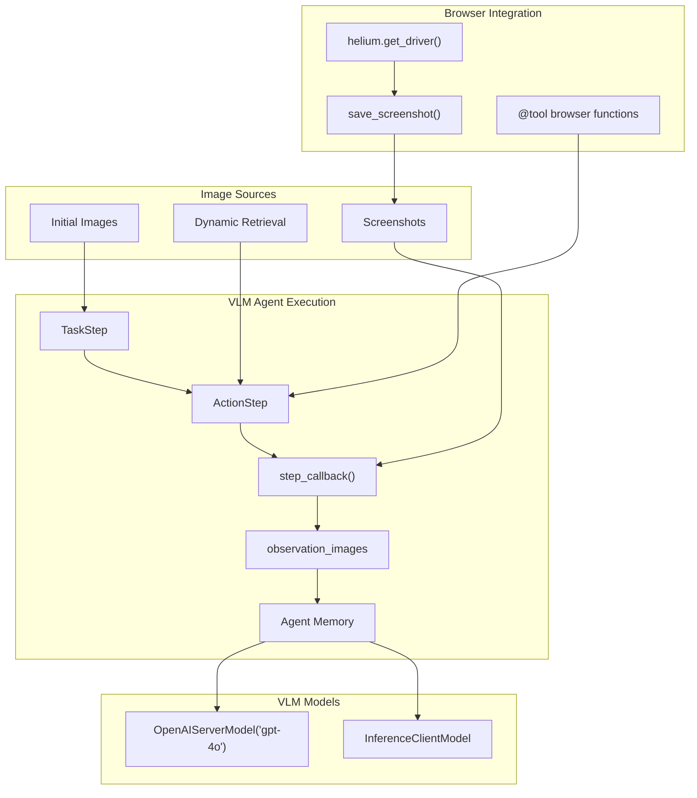
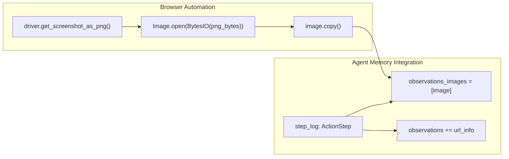
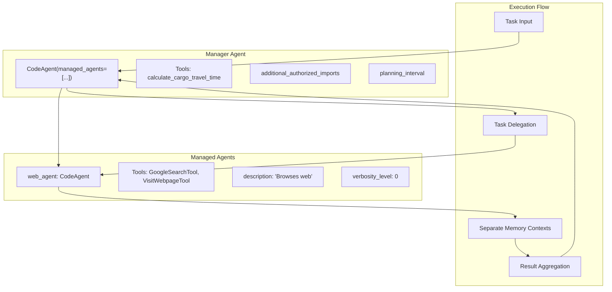
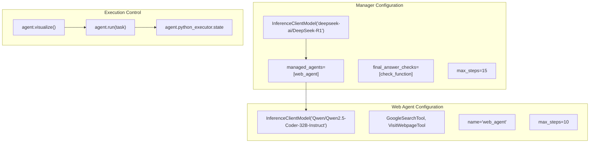
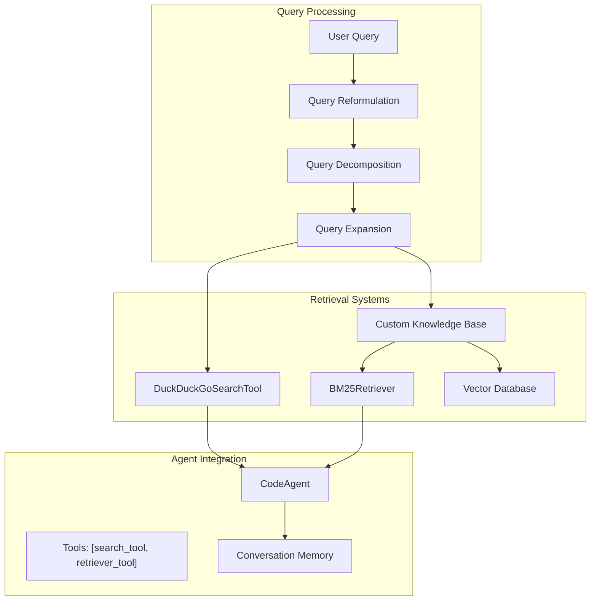
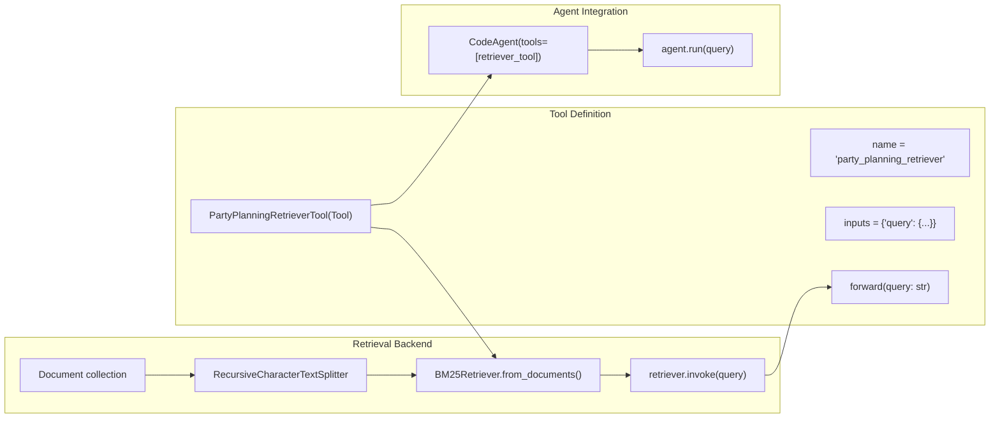
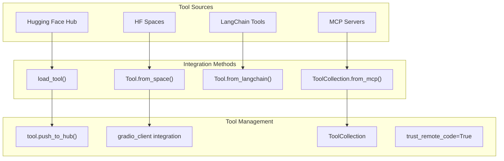
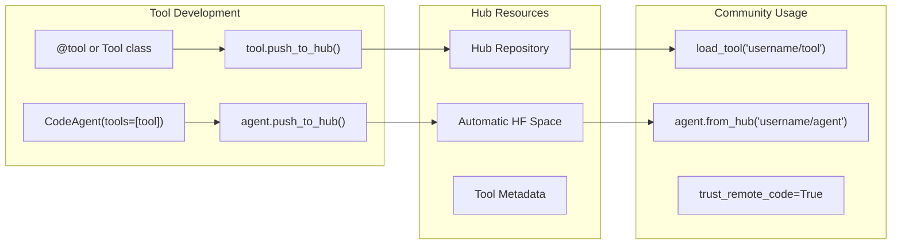
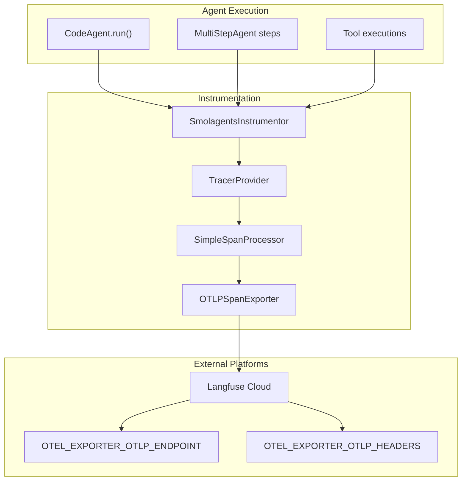

<!-- source: DeepWiki mcp.deepwiki.com · repo huggingface/agents-course · extra page Advanced smolagents Features · fetched 2026-10-26 -->

# Advanced smolagents Features

Relevant source files

The following files were used as context for generating this wiki page:

- [units/en/unit2/smolagents/code_agents.mdx](units/en/unit2/smolagents/code_agents.mdx)
- [units/en/unit2/smolagents/final_quiz.mdx](units/en/unit2/smolagents/final_quiz.mdx)
- [units/en/unit2/smolagents/introduction.mdx](units/en/unit2/smolagents/introduction.mdx)
- [units/en/unit2/smolagents/multi_agent_systems.mdx](units/en/unit2/smolagents/multi_agent_systems.mdx)
- [units/en/unit2/smolagents/quiz1.mdx](units/en/unit2/smolagents/quiz1.mdx)
- [units/en/unit2/smolagents/quiz2.mdx](units/en/unit2/smolagents/quiz2.mdx)
- [units/en/unit2/smolagents/retrieval_agents.mdx](units/en/unit2/smolagents/retrieval_agents.mdx)
- [units/en/unit2/smolagents/tool_calling_agents.mdx](units/en/unit2/smolagents/tool_calling_agents.mdx)
- [units/en/unit2/smolagents/tools.mdx](units/en/unit2/smolagents/tools.mdx)
- [units/en/unit2/smolagents/vision_agents.mdx](units/en/unit2/smolagents/vision_agents.mdx)
- [units/en/unit2/smolagents/why_use_smolagents.mdx](units/en/unit2/smolagents/why_use_smolagents.mdx)
- [units/zh-CN/unit2/smolagents/introduction.mdx](units/zh-CN/unit2/smolagents/introduction.mdx)
- [units/zh-CN/unit2/smolagents/multi_agent_systems.mdx](units/zh-CN/unit2/smolagents/multi_agent_systems.mdx)
- [units/zh-CN/unit2/smolagents/quiz2.mdx](units/zh-CN/unit2/smolagents/quiz2.mdx)
- [units/zh-CN/unit2/smolagents/retrieval_agents.mdx](units/zh-CN/unit2/smolagents/retrieval_agents.mdx)
- [units/zh-CN/unit2/smolagents/tool_calling_agents.mdx](units/zh-CN/unit2/smolagents/tool_calling_agents.mdx)
- [units/zh-CN/unit2/smolagents/tools.mdx](units/zh-CN/unit2/smolagents/tools.mdx)
- [units/zh-CN/unit2/smolagents/vision_agents.mdx](units/zh-CN/unit2/smolagents/vision_agents.mdx)
- [units/zh-CN/unit2/smolagents/why_use_smolagents.mdx](units/zh-CN/unit2/smolagents/why_use_smolagents.mdx)

This document covers the advanced capabilities of the smolagents framework that extend beyond basic agent functionality. These features enable sophisticated multi-modal interactions, system orchestration, and tool ecosystem integration. For information about core agent types like `CodeAgent` and `ToolCallingAgent`, see [3.1.1](#3.1.1).

## Vision-Language Model Integration

The smolagents framework provides built-in support for vision-language models (VLMs) through specialized agent configurations and image handling mechanisms. This enables agents to process visual content dynamically during execution.

### Vision Agent Architecture

The vision system operates through the `MultiStepAgent` framework where images are captured and stored at different execution stages:

- **TaskStep**: Stores initial images provided via the `images` parameter
- **ActionStep**: Captures dynamic images through `observation_images` during execution
- **step_callbacks**: Functions that execute after each agent step to capture screenshots

Sources: [units/en/unit2/smolagents/vision_agents.mdx:104-111]()

### Dynamic Image Capture

Vision agents can dynamically capture and process images during web browsing sessions. The `save_screenshot` function integrates with browser automation tools to capture visual state:

The browser integration uses `helium` and `selenium` for web automation, with specialized tools like `search_item_ctrl_f`, `go_back`, and `close_popups` enabling human-like web navigation.

Sources: [units/en/unit2/smolagents/vision_agents.mdx:155-174]()

## Multi-Agent System Orchestration

The smolagents framework supports sophisticated multi-agent workflows through the `managed_agents` parameter and hierarchical task delegation. This enables specialized agents to collaborate on complex tasks while maintaining separate memory contexts.

### Multi-Agent Coordination Architecture

The multi-agent system provides two key benefits:
- **Focused Performance**: Each agent specializes in specific tasks
- **Memory Efficiency**: Separate contexts reduce token count and latency

Sources: [units/en/unit2/smolagents/multi_agent_systems.mdx:227-232]()

### Agent Hierarchy Implementation

The framework implements agent coordination through the `managed_agents` parameter, enabling a manager agent to delegate tasks to specialized sub-agents:

The `visualize()` method provides a hierarchical view of the agent structure, showing tools, imports, and managed agent relationships.

Sources: [units/en/unit2/smolagents/multi_agent_systems.mdx:299-322]()

## Agentic RAG Systems

Smolagents implements advanced Retrieval-Augmented Generation through intelligent query processing, multi-step retrieval, and source integration. This extends traditional RAG systems with autonomous query formulation and result critique capabilities.

### RAG System Architecture

The agentic RAG system enables several advanced strategies:
- **Query Reformulation**: Optimizing search terms for better document matching
- **Multi-Step Retrieval**: Using initial results to inform subsequent queries  
- **Source Integration**: Combining web search with local documentation
- **Result Validation**: Analyzing content relevance before inclusion

Sources: [units/en/unit2/smolagents/retrieval_agents.mdx:154-164]()

### Custom Knowledge Base Implementation

The framework supports custom retrieval tools through the `Tool` class hierarchy and integration with LangChain retrievers:

The custom retrieval tool integrates document splitting, semantic search, and result formatting to provide context-aware responses.

Sources: [units/en/unit2/smolagents/retrieval_agents.mdx:78-144]()

## Advanced Tool Ecosystem

Smolagents provides extensive tool integration capabilities, supporting multiple source types including Hugging Face Spaces, LangChain tools, and MCP servers. This creates a rich ecosystem for extending agent functionality.

### Tool Integration Architecture

### Hub Integration and Sharing

The framework enables seamless tool sharing through the Hugging Face Hub with automatic Space generation:

Shared agents automatically become available as interactive Hugging Face Spaces, enabling real-time community interaction.

Sources: [units/en/unit2/smolagents/tools.mdx:185-216]()

### External Tool Integration

The framework supports three major external tool sources:

**Hugging Face Spaces Integration**: Uses `gradio_client` to connect with Space backends, requiring the `gradio_client` package installation.

**LangChain Tools**: Enables reuse of existing LangChain tools through `Tool.from_langchain(load_tools(["serpapi"])[0])`, bridging the ecosystems.

**MCP Server Integration**: Supports hundreds of MCP servers through `ToolCollection.from_mcp()` with `StdioServerParameters` configuration.

Sources: [units/en/unit2/smolagents/tools.mdx:243-301]()

## Observability and Monitoring

Smolagents integrates with OpenTelemetry for comprehensive agent tracing and monitoring, enabling production-ready observability through platforms like Langfuse.

### Observability Architecture

The observability system captures comprehensive execution traces including step-by-step agent reasoning, tool calls, and error handling, enabling debugging and performance analysis.

Sources: [units/en/unit2/smolagents/code_agents.mdx:349-378]()

---

