<!-- source: DeepWiki mcp.deepwiki.com · repo huggingface/agents-course · extra page CodeAgent and ToolCallingAgent · fetched 2026-10-26 -->

# CodeAgent and ToolCallingAgent

Relevant source files

The following files were used as context for generating this wiki page:

- [units/en/unit2/smolagents/code_agents.mdx](units/en/unit2/smolagents/code_agents.mdx)
- [units/en/unit2/smolagents/final_quiz.mdx](units/en/unit2/smolagents/final_quiz.mdx)
- [units/en/unit2/smolagents/introduction.mdx](units/en/unit2/smolagents/introduction.mdx)
- [units/en/unit2/smolagents/multi_agent_systems.mdx](units/en/unit2/smolagents/multi_agent_systems.mdx)
- [units/en/unit2/smolagents/quiz1.mdx](units/en/unit2/smolagents/quiz1.mdx)
- [units/en/unit2/smolagents/quiz2.mdx](units/en/unit2/smolagents/quiz2.mdx)
- [units/en/unit2/smolagents/retrieval_agents.mdx](units/en/unit2/smolagents/retrieval_agents.mdx)
- [units/en/unit2/smolagents/tool_calling_agents.mdx](units/en/unit2/smolagents/tool_calling_agents.mdx)
- [units/en/unit2/smolagents/tools.mdx](units/en/unit2/smolagents/tools.mdx)
- [units/en/unit2/smolagents/vision_agents.mdx](units/en/unit2/smolagents/vision_agents.mdx)
- [units/en/unit2/smolagents/why_use_smolagents.mdx](units/en/unit2/smolagents/why_use_smolagents.mdx)

This document covers the two primary agent types in the smolagents framework: `CodeAgent` and `ToolCallingAgent`. These agents represent different approaches to structuring tool calls - through executable Python code versus JSON specifications. Both inherit from the same `MultiStepAgent` base class but handle action execution differently.

For information about tool creation and sharing mechanisms, see section 3.1.2. For multi-agent system orchestration, see section 3.1.2.

## Agent Architecture Overview

Both `CodeAgent` and `ToolCallingAgent` inherit from `MultiStepAgent` and share the same foundational architecture, differing primarily in how they structure and execute actions.

### Shared Architecture Components

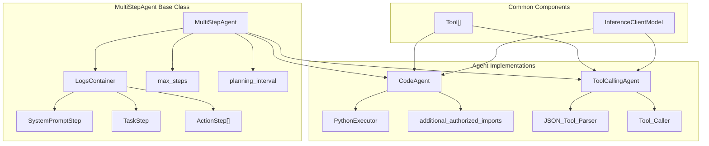

Both agent types share the same logging system, step management, and tool registration mechanisms while implementing different action execution strategies.

Sources: [units/en/unit2/smolagents/code_agents.mdx:37-45](), [units/en/unit2/smolagents/tool_calling_agents.mdx:42-45]()

### Action Structure Comparison

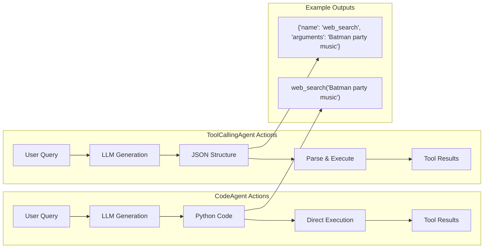

The fundamental difference lies in action representation: `CodeAgent` generates executable Python while `ToolCallingAgent` generates structured JSON that requires parsing.

Sources: [units/en/unit2/smolagents/code_agents.mdx:22-33](), [units/en/unit2/smolagents/tool_calling_agents.mdx:16-33]()

## CodeAgent Implementation

`CodeAgent` is the primary agent type in smolagents, generating Python code to perform actions. This approach provides more expressive and composable tool interactions compared to JSON-based alternatives.

### Code Generation and Execution

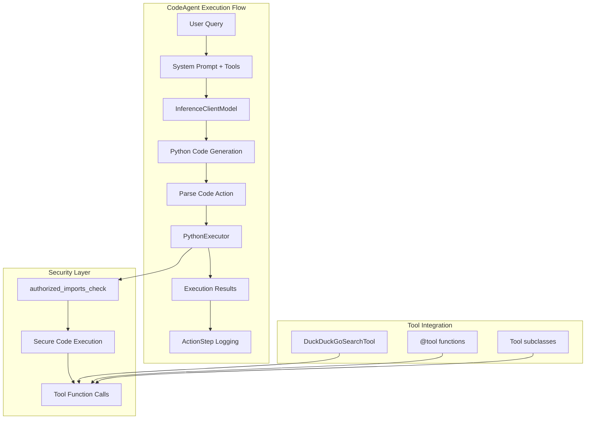

The `CodeAgent` generates Python code that directly calls tool functions, enabling complex operations like loops and variable management.

Sources: [units/en/unit2/smolagents/code_agents.mdx:35-55](), [units/en/unit2/smolagents/code_agents.mdx:160-162]()

### Example Code Generation

The following demonstrates typical `CodeAgent` output patterns:

| Task Type | Generated Code Example |
|-----------|------------------------|
| Simple Search | `results = web_search(query="Batman party music")` |
| Multiple Queries | `for query in ["catering", "decorations"]: print(web_search(query))` |
| Data Processing | `import pandas as pd; df = pd.DataFrame(results); df.head()` |
| Complex Logic | `if weather == "rainy": venue = indoor_venues() else: venue = outdoor_venues()` |

Sources: [units/en/unit2/smolagents/code_agents.mdx:104-108](), [units/en/unit2/smolagents/code_agents.mdx:168-186]()

## ToolCallingAgent Implementation

`ToolCallingAgent` uses the built-in tool-calling capabilities of LLM providers, generating JSON structures that specify tool names and arguments. This approach aligns with standard API patterns from OpenAI, Anthropic, and similar providers.

### JSON-Based Tool Calling

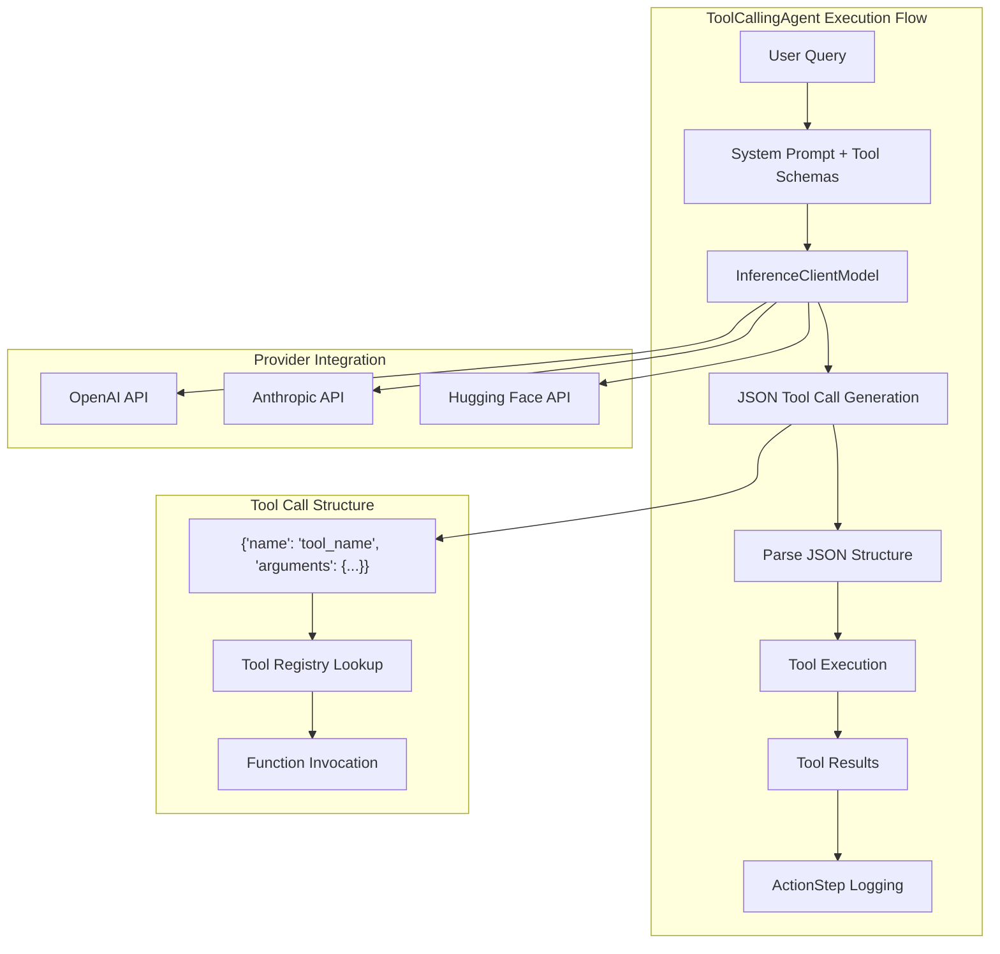

The `ToolCallingAgent` leverages native tool-calling capabilities of language model providers, generating structured JSON that gets parsed and executed.

Sources: [units/en/unit2/smolagents/tool_calling_agents.mdx:14-45]()

### Execution Trace Comparison

| Agent Type | Execution Output | Description |
|------------|------------------|-------------|
| `CodeAgent` | `Executing parsed code: web_search(query="Batman music")` | Direct Python code execution |
| `ToolCallingAgent` | `Calling tool: 'web_search' with arguments: {'query': "Batman music"}` | JSON structure parsing and tool invocation |

Sources: [units/en/unit2/smolagents/tool_calling_agents.mdx:59-66]()

## Shared Execution Workflow

Both agent types implement the same ReAct (Reasoning, Acting, Observing) pattern through the inherited `MultiStepAgent` architecture.

### Common ReAct Cycle

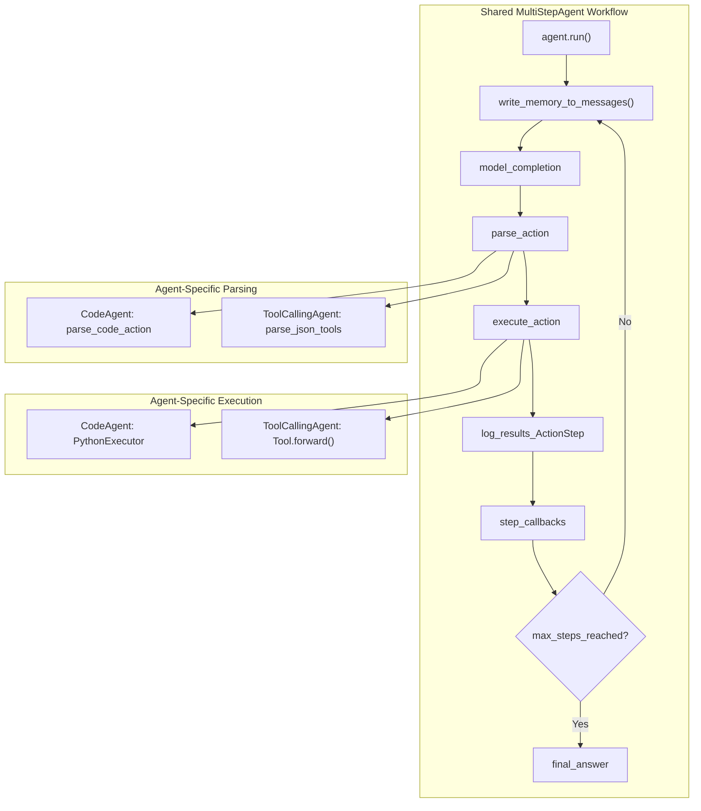

The workflow remains identical, with differences only in action parsing and execution methods.

Sources: [units/en/unit2/smolagents/code_agents.mdx:42-55](), [units/en/unit2/smolagents/tool_calling_agents.mdx:42-45]()

### Memory Management System

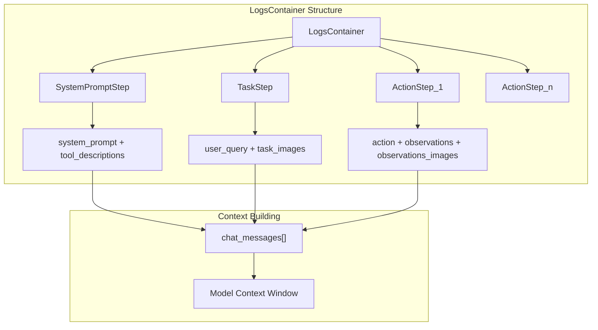

Both agent types use the same memory management and context building mechanisms through the shared `LogsContainer` system.

Sources: [units/en/unit2/smolagents/vision_agents.mdx:103-109](), [units/en/unit2/smolagents/code_agents.mdx:42-55]()

## Multi-Agent Orchestration

### Agent Composition Patterns

Multi-agent systems in smolagents enable task distribution across specialized agents, improving modularity and reducing token usage per agent.

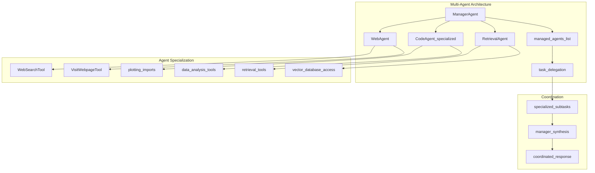

Manager agents coordinate specialized sub-agents, each with focused toolsets and capabilities.

Sources: [units/en/unit2/smolagents/multi_agent_systems.mdx:226-314]()

### Memory Separation Benefits

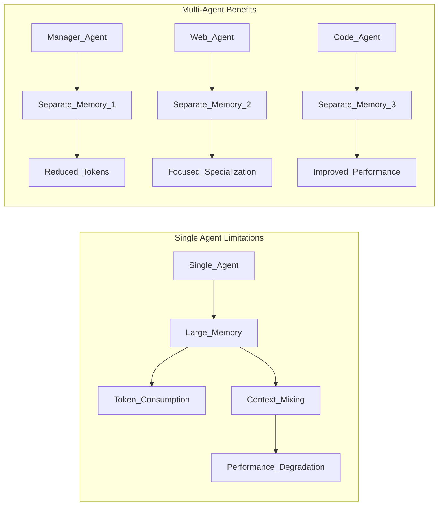

Separating agent memories reduces token counts and allows each agent to maintain focused context for their specialized tasks.

Sources: [units/en/unit2/smolagents/multi_agent_systems.mdx:228-231]()

## Advanced Capabilities

### Vision Integration

The `CodeAgent` supports vision-language models for processing images alongside text instructions, enabling multimodal agent capabilities.

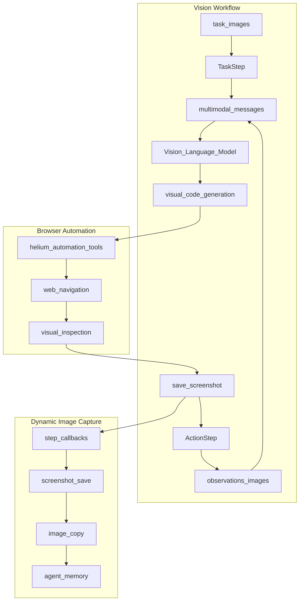

Vision agents can process initial images and dynamically capture screenshots during web browsing or other visual tasks.

Sources: [units/en/unit2/smolagents/vision_agents.mdx:154-176]()

### Security and Code Execution

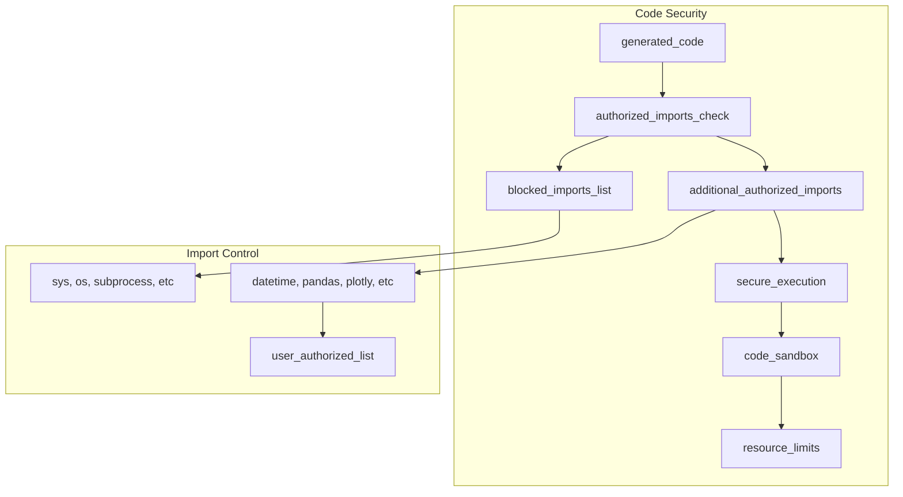

The execution environment restricts dangerous imports while allowing user-specified safe modules for specialized tasks.

Sources: [units/en/unit2/smolagents/code_agents.mdx:160-162]()

### Hub Integration and Sharing

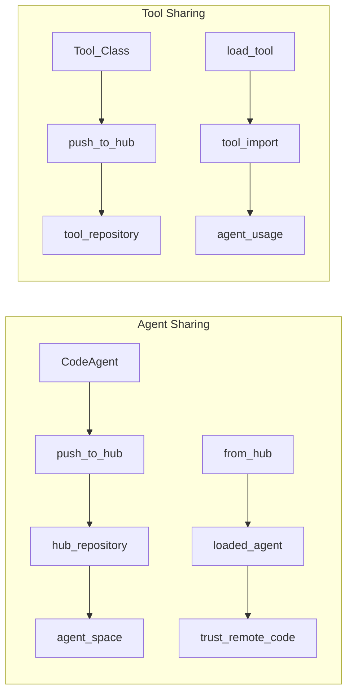

Agents and tools can be shared via Hugging Face Hub, enabling community reuse and collaboration.

Sources: [units/en/unit2/smolagents/code_agents.mdx:194-213]()

The `CodeAgent` architecture provides a flexible foundation for building sophisticated AI agents that can reason, plan, and execute complex tasks through code generation and tool orchestration. Its integration with the broader smolagents ecosystem enables rapid prototyping and deployment of capable agent systems.

---

