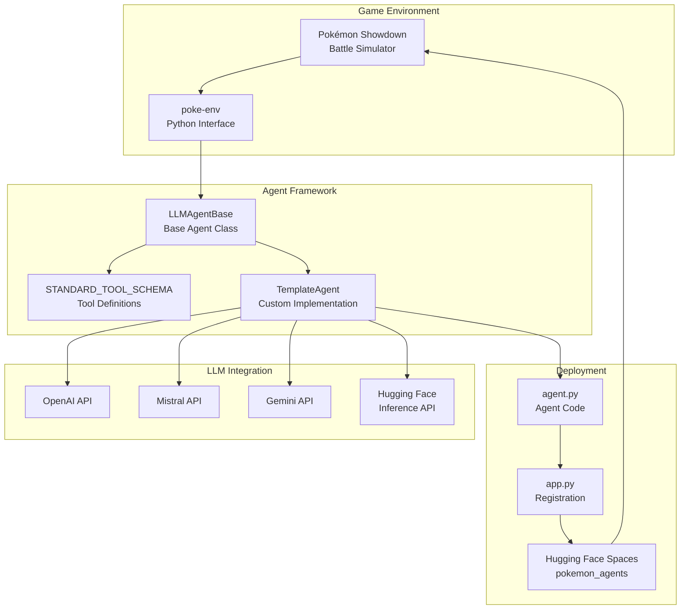
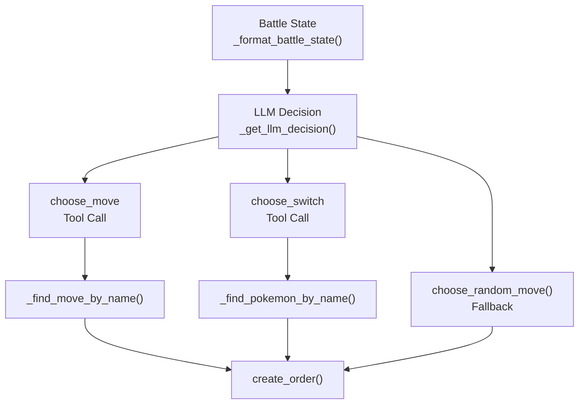
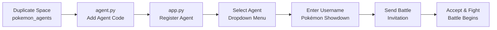

<!-- source: DeepWiki mcp.deepwiki.com · repo huggingface/agents-course · unicode-title page 页**：5.2 Pokémon Battle Agents · patched 2026-10-26 -->

# Pokémon Battle Agents
# Pokémon Battle Agents

<details>
<summary>Relevant source files</summary>

The following files were used as context for generating this wiki page:

- [units/en/_toctree.yml](units/en/_toctree.yml)
- [units/en/bonus-unit3/building_your_pokemon_agent.mdx](units/en/bonus-unit3/building_your_pokemon_agent.mdx)
- [units/en/bonus-unit3/conclusion.mdx](units/en/bonus-unit3/conclusion.mdx)
- [units/en/bonus-unit3/from-llm-to-agents.mdx](units/en/bonus-unit3/from-llm-to-agents.mdx)
- [units/en/bonus-unit3/introduction.mdx](units/en/bonus-unit3/introduction.mdx)
- [units/en/bonus-unit3/launching_agent_battle.mdx](units/en/bonus-unit3/launching_agent_battle.mdx)
- [units/en/bonus-unit3/state-of-art.mdx](units/en/bonus-unit3/state-of-art.mdx)

</details>


This document covers the implementation of AI agents for Pokémon-style turn-based battles, demonstrating how to integrate Large Language Models with game environments. The system enables the creation of intelligent battle agents that can strategically choose moves and switches in competitive Pokémon battles.

For general information about AI agent fundamentals, see [AI Agent Fundamentals](#2). For other gaming applications and use cases, see [Use Cases and Applications](#5).

## System Architecture

The Pokémon Battle Agent system consists of four main components that work together to enable LLM-powered battle agents:

### Core Architecture Diagram



Sources: [units/en/bonus-unit3/building_your_pokemon_agent.mdx:17-50](), [units/en/bonus-unit3/launching_agent_battle.mdx:30-70]()

### Battle Decision Flow



Sources: [units/en/bonus-unit3/building_your_pokemon_agent.mdx:51-211]()

## Core Components

### LLMAgentBase Class

The `LLMAgentBase` class serves as the foundation for all Pokémon battle agents. It extends the `Player` class from poke-env and provides the interface between LLMs and the battle environment.

| Method | Purpose | Return Type |
|--------|---------|-------------|
| `_format_battle_state()` | Converts battle state to string format | `str` |
| `_get_llm_decision()` | Abstract method for LLM queries | `Dict[str, Any]` |
| `_find_move_by_name()` | Locates moves by name | `Optional[Move]` |
| `_find_pokemon_by_name()` | Locates Pokémon by species name | `Optional[Pokemon]` |
| `choose_move()` | Main decision-making method | `str` |

Sources: [units/en/bonus-unit3/building_your_pokemon_agent.mdx:39-211]()

### STANDARD_TOOL_SCHEMA

The system defines two primary tools for battle actions:

```python
STANDARD_TOOL_SCHEMA = {
    "choose_move": {
        # Tool for selecting attack moves
    },
    "choose_switch": {
        # Tool for switching Pokémon
    },
}
```

These tools enable structured communication between the LLM and the battle environment, ensuring valid actions are executed.

Sources: [units/en/bonus-unit3/building_your_pokemon_agent.mdx:44-49](), [units/en/bonus-unit3/building_your_pokemon_agent.mdx:69-76]()

### Battle State Formatting

The `_format_battle_state()` method creates comprehensive battle descriptions including:

- Active Pokémon status (HP, type, status conditions, stat boosts)
- Opponent Pokémon information
- Available moves with power, accuracy, and PP
- Available switches with HP and status
- Environmental conditions (weather, terrain, side conditions)

Sources: [units/en/bonus-unit3/building_your_pokemon_agent.mdx:84-128]()

## Agent Implementation Process

### TemplateAgent Structure

Custom agents inherit from `LLMAgentBase` and implement the `_get_llm_decision()` method:

```python
class TemplateAgent(LLMAgentBase):
    def __init__(self, api_key: str = None, model: str = "model-name", *args, **kwargs):
        super().__init__(*args, **kwargs)
        self.model = model
        self.template_client = TemplateModelProvider(api_key=...)
    
    async def _get_llm_decision(self, battle_state: str) -> Dict[str, Any]:
        # Custom LLM integration logic
        pass
```

Sources: [units/en/bonus-unit3/building_your_pokemon_agent.mdx:224-254]()

### Supported LLM Providers

The system supports multiple LLM providers through different agent implementations:

| Provider | Agent Class | API Integration |
|----------|-------------|-----------------|
| OpenAI | `OpenAIAgent` | `openai.AsyncOpenAI` |
| Mistral | `MistralAgent` | `mistralai.Mistral` |
| Google | `GeminiAgent` | `google.generativeai` |
| Hugging Face | Custom | `InferenceClient` |

Sources: [units/en/bonus-unit3/building_your_pokemon_agent.mdx:219-220]()

## Deployment and Testing

### Hugging Face Spaces Integration

Agents are deployed using the Hugging Face Spaces platform:



Sources: [units/en/bonus-unit3/launching_agent_battle.mdx:46-68]()

### Battle Platform

The system connects to a dedicated Pokémon Showdown server for live battles:

- **Pokémon Showdown Space**: [https://huggingface.co/spaces/Jofthomas/Pokemon_showdown]()
- **Agent Deployment Space**: [https://huggingface.co/spaces/PShowdown/pokemon_agents]()
- **Live Stream Integration**: Twitch streaming for automated battles

Sources: [units/en/bonus-unit3/launching_agent_battle.mdx:5-27](), [units/en/bonus-unit3/launching_agent_battle.mdx:30-44]()

## Technical Implementation Details

### Error Handling and Fallbacks

The system implements robust error handling:

1. **Invalid Move Selection**: Falls back to random valid move
2. **API Errors**: Logs error and chooses random action
3. **Parsing Failures**: Uses `choose_random_move()` or `choose_default_move()`
4. **No Available Actions**: Defaults to Struggle move

Sources: [units/en/bonus-unit3/building_your_pokemon_agent.mdx:192-207]()

### Move and Pokémon Matching

The system uses normalized name matching for reliable identification:

- `normalize_name()` function standardizes names
- Exact ID matching prioritized over display name matching
- Fallback mechanisms for ambiguous matches

Sources: [units/en/bonus-unit3/building_your_pokemon_agent.mdx:130-149]()

### Limitations and Considerations

The system addresses key limitations of LLM-based game agents:

| Limitation | Impact | Mitigation |
|------------|--------|------------|
| **Latency** | Slow decision making | Turn-based format suitable |
| **Token Usage** | High API costs | Efficient state formatting |
| **Real-time Requirements** | Not suitable for 30 FPS games | Perfect for turn-based strategy |

Sources: [units/en/bonus-unit3/from-llm-to-agents.mdx:24-38]()

## System Integration

### poke-env Integration

The system leverages the poke-env library's core functionality:

- **Player Class**: Base class for all battle agents
- **Battle Object**: Contains complete battle state information
- **Move/Pokemon Objects**: Structured data for game entities
- **Action Creation**: `create_order()` method for valid actions

Sources: [units/en/bonus-unit3/building_your_pokemon_agent.mdx:17-27]()

### Pokémon Showdown Protocol

Agents communicate with Pokémon Showdown through:

- WebSocket connections for real-time battles
- Standardized message formats for actions
- Battle state synchronization
- Turn-based action validation

Sources: [units/en/bonus-unit3/building_your_pokemon_agent.mdx:29-37]()

---

