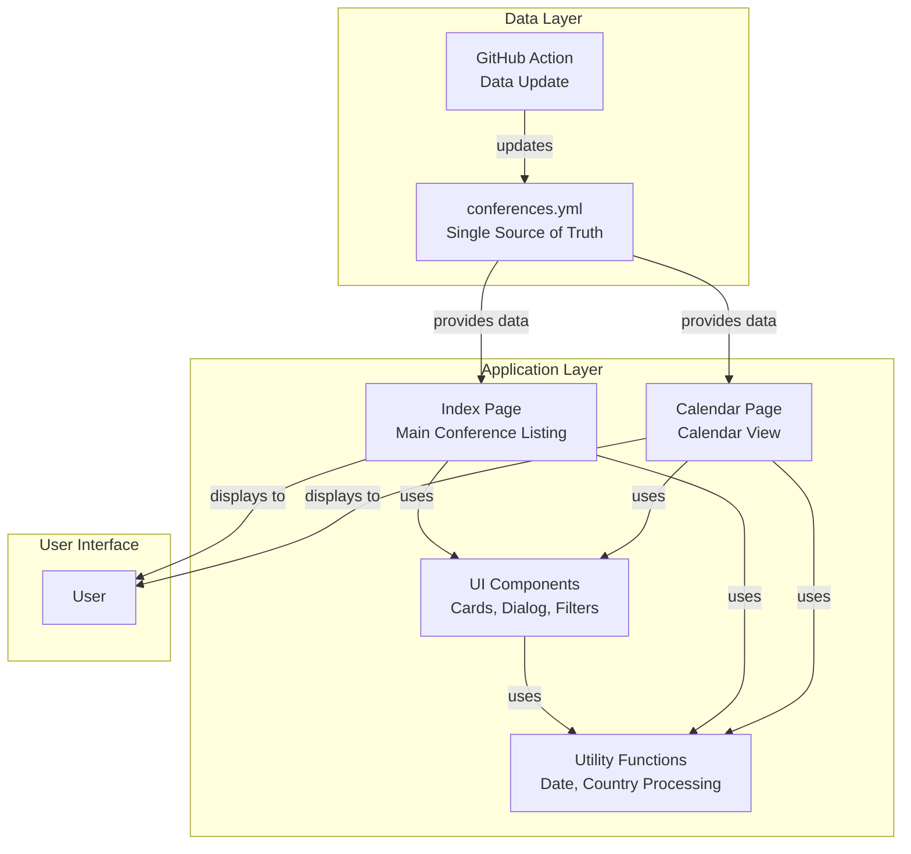
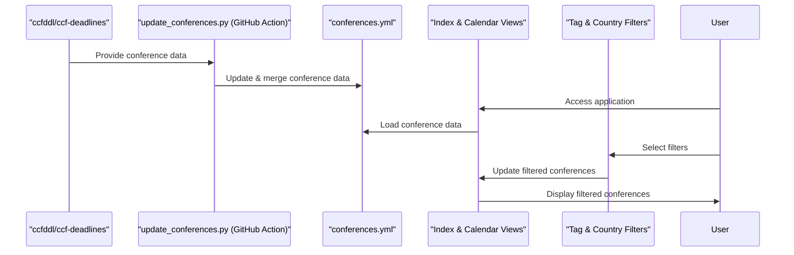
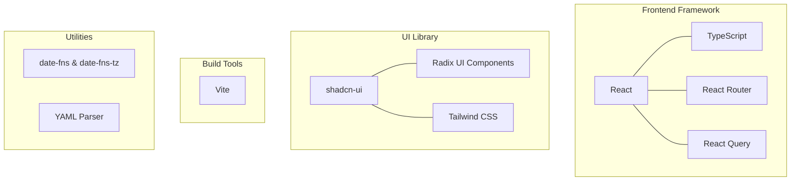
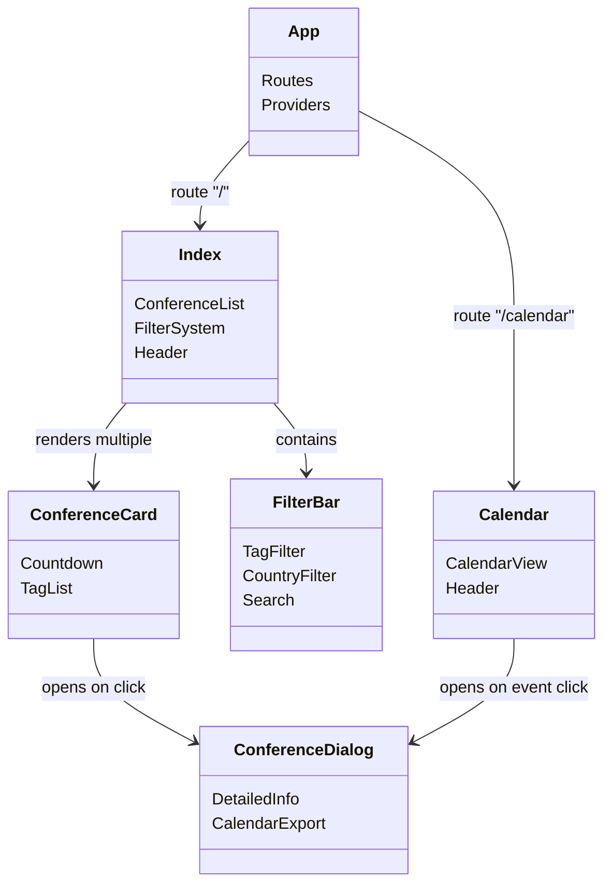

<!-- source: DeepWiki mcp.deepwiki.com · repo huggingface/ai-deadlines · page 1 Overview · fetched 2026-10-26 -->

# Overview

Relevant source files

The following files were used as context for generating this wiki page:

- [LICENSE](LICENSE)
- [README.md](README.md)
- [package.json](package.json)
- [src/App.tsx](src/App.tsx)

This document provides a high-level introduction to the AI Deadlines application, a web application designed to help AI researchers track submission deadlines for academic conferences. It gives an overview of the system architecture, core components, and general functionality of the application.

For detailed information about the conference data structure, see [Conference Data System](#2) and [Conference Data Model](#2.1).

## Purpose and Scope

AI Deadlines is a web application that displays submission deadlines for top AI conferences in an easily accessible format. The primary purpose is to help researchers quickly identify upcoming paper submission deadlines to plan their work accordingly. 

The application provides:
- A list view of conferences with detailed information and filtering capabilities
- A calendar view to visualize deadlines chronologically
- Automatic updates of conference data
- Tools to export conference deadlines to personal calendars

Sources: [README.md:11-15]()

## System Architecture

The AI Deadlines application follows a clean, modular architecture centered around a single source of truth for conference data.

### High-Level System Overview

Sources: [README.md:11-19](), [src/App.tsx:12-28]()

### Core Data Flow

The application operates on a straightforward data flow model, where external conference data is automatically processed, made available to the application, and then presented to users through filtering and display systems.

Sources: [README.md:25-27]()

## Key Features

### 1. Conference Listing

The main page displays conferences as cards with essential information and countdown timers. Users can filter conferences by:
- Tags (topic areas)
- Countries
- Search queries
- Past/upcoming status

### 2. Calendar View

The calendar view presents conferences in a monthly calendar format, allowing users to:
- See conferences scheduled for specific dates
- Navigate between months
- Get a visual overview of conference timelines

### 3. Automated Data Updates

Conference data is automatically kept up-to-date through:
- GitHub Actions that run periodically
- Data synchronization with ccfddl/ccf-deadlines repository
- Merged updates to the central conferences.yml file

Sources: [README.md:25-27]()

## Technology Stack

The application is built using modern web technologies:

Sources: [README.md:126-134](), [package.json:13-63]()

### Key Libraries

| Category | Libraries | Purpose |
|----------|-----------|---------|
| Core Framework | React, TypeScript | Application foundation |
| Routing | React Router | Page navigation |
| State Management | React Query | Data fetching & caching |
| UI Components | shadcn-ui, Radix UI | UI elements & accessibility |
| Styling | Tailwind CSS | Utility-based styling |
| Date Handling | date-fns, date-fns-tz | Date formatting & timezone handling |
| Build | Vite | Development & production builds |

Sources: [package.json:13-63]()

## Application Structure

The application consists of two main views:

1. **Index Page** (`/`) - The main conference listing with filtering capabilities
2. **Calendar Page** (`/calendar`) - Calendar visualization of conferences

Both views access the same conference data from `conferences.yml` but present it in different formats and with different interaction models.

Sources: [src/App.tsx:18-24]()

## Component Organization

Sources: [src/App.tsx:12-28]()

## Deployment Options

The application can be deployed using several methods:

1. **Docker Container**
   - Built using the included Dockerfile
   - Can be run locally or on cloud platforms

2. **Cloud Deployment**
   - Google Cloud Run (recommended in documentation)
   - Other container-based cloud services

Sources: [README.md:93-124]()

## Contributing

The project welcomes contributions, particularly:
- Adding or updating conference information
- UI/UX improvements
- Bug fixes

The contribution process involves updating the `conferences.yml` file with accurate conference information following the specified format.

Sources: [README.md:31-67]()

---

