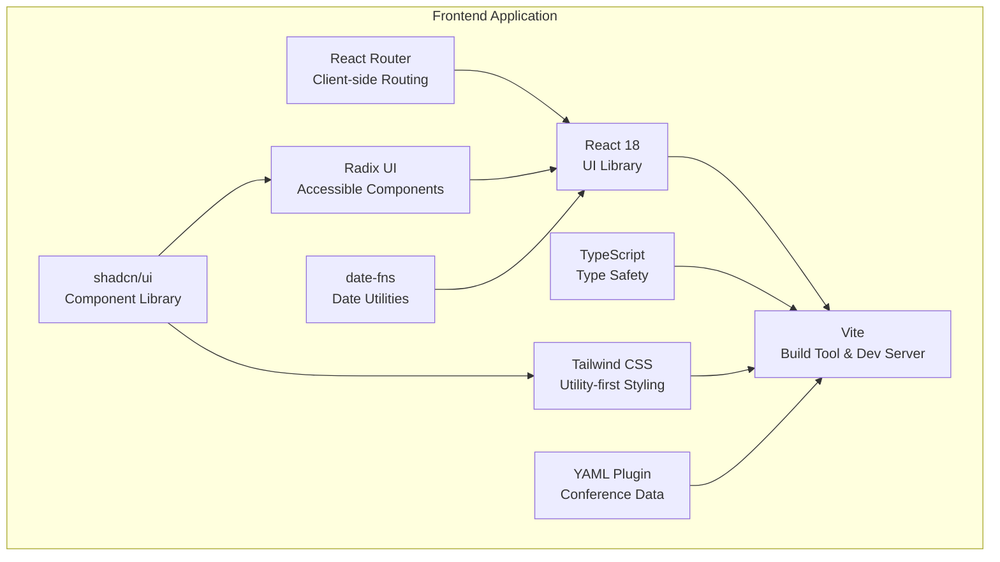
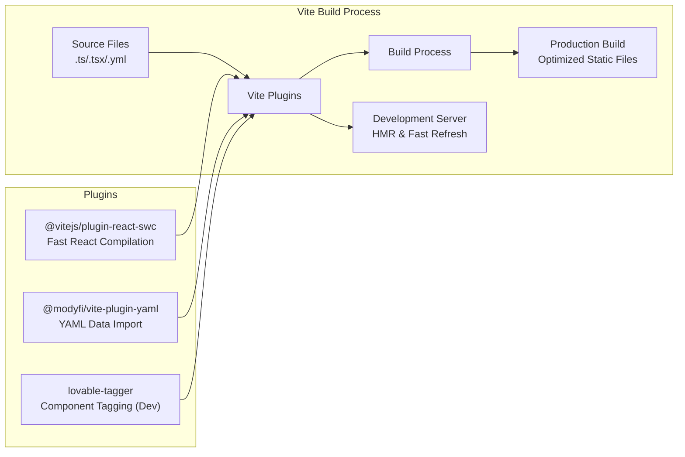
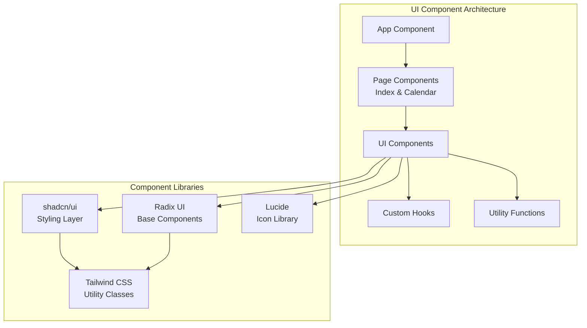
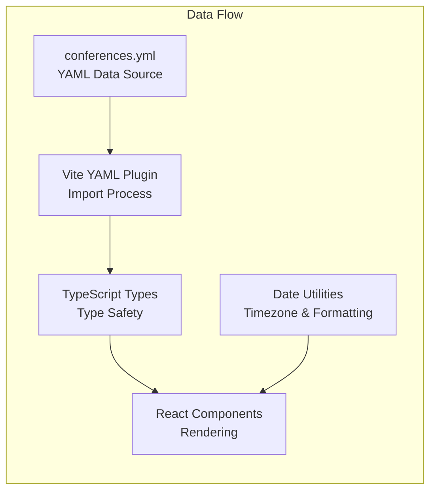
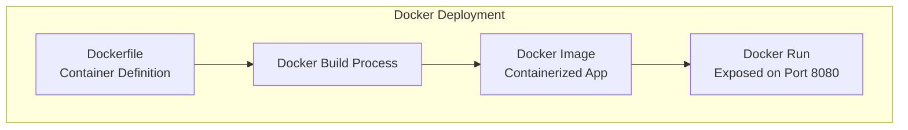

<!-- source: DeepWiki mcp.deepwiki.com · repo huggingface/ai-deadlines · page 1.1 Technology Stack · fetched 2026-10-26 -->

# Technology Stack

Relevant source files

The following files were used as context for generating this wiki page:

- [LICENSE](LICENSE)
- [README.md](README.md)
- [package.json](package.json)
- [src/types/yaml.d.ts](src/types/yaml.d.ts)
- [tailwind.config.ts](tailwind.config.ts)
- [vite.config.ts](vite.config.ts)

This page provides a comprehensive overview of the technologies, frameworks, and tools used in the AI Deadlines application. It covers the front-end development stack, UI components, data handling mechanisms, and deployment configurations. For information about the conference data model itself, see [Conference Data Model](#2.1).

## Overview

The AI Deadlines application uses a modern JavaScript stack centered around React and Vite, with TypeScript for type safety. The application provides a clean, responsive interface for viewing AI conference deadlines using a component-based architecture.

Sources: [README.md:126-134](), [package.json:4-84](), [vite.config.ts:1-27]()

## Core Framework

The application is built using React 18, a popular JavaScript library for building user interfaces. TypeScript is used throughout the codebase to provide static typing and improve developer experience.

### Build System

Vite serves as the build tool and development server, providing fast development experience with features like:

- Hot module replacement (HMR)
- Fast builds through esbuild
- Plugin system for extensions
- Configuration for server port (8080) and host settings

Sources: [vite.config.ts:1-27](), [package.json:65-84]()

## UI Architecture

The UI is built with a component-based architecture using several complementary technologies:

### Component Libraries

- **Radix UI**: Provides unstyled, accessible components
- **shadcn/ui**: A collection of reusable components built on Radix UI
- **Various UI Components**: Dialog, popover, accordion and other specialized components

### Styling

Tailwind CSS is used for styling with:
- Utility-first approach
- Custom configuration for colors, animations and themes
- Mobile-responsive design
- Dark mode support

Sources: [README.md:126-134](), [package.json:13-64](), [tailwind.config.ts:1-56]()

## Data Handling

The application deals primarily with conference data and date management:

### Conference Data

- Conference information is stored in YAML format
- YAML files are imported directly into the application using a Vite plugin
- TypeScript type definitions ensure data integrity

### Date and Time Processing

- **date-fns**: For manipulating and formatting dates
- **date-fns-tz**: For timezone handling (critical for conference deadlines)

Sources: [vite.config.ts:15-20](), [src/types/yaml.d.ts:1-4](), [package.json:46-47]()

## Development Tools

The project includes several development tools to ensure code quality:

- **ESLint**: For code linting and static analysis
- **TypeScript**: For static type checking
- **SWC**: For fast compilation via Vite
- **npm scripts**: For development, building, and previewing

## Deployment Options

The application supports multiple deployment options:

### Docker Deployment

The application can be containerized using Docker:

Sources: [README.md:93-107]()

### Cloud Deployment

The application is designed to be deployed to cloud services such as:

- **Google Cloud Run**: For serverless container deployment
- **Hugging Face Spaces**: Current hosting location (huggingface.co/spaces/huggingface/ai-deadlines)

## Technology Dependencies

The following table lists the key dependencies and their purposes:

| Category | Technology | Purpose |
|----------|------------|---------|
| **Core** | React | UI library |
| | TypeScript | Static typing |
| | Vite | Build tool & dev server |
| **Routing** | React Router | Client-side routing |
| **UI** | Radix UI | Unstyled, accessible components |
| | shadcn/ui | Component system |
| | Tailwind CSS | Utility-first styling |
| | Lucide React | Icon library |
| **Form Handling** | React Hook Form | Form state management |
| | Zod | Schema validation |
| **Data Fetching** | TanStack Query | Data fetching & caching |
| **Date Handling** | date-fns | Date manipulation |
| | date-fns-tz | Timezone support |
| **Build Tools** | SWC | Fast JavaScript compiler |
| | ESLint | Code linting |

Sources: [package.json:13-84](), [README.md:126-134]()

## License and Maintenance

The project is licensed under the MIT License and maintained by the Hugging Face team. Contributions are welcome through pull requests to the GitHub repository.

Sources: [LICENSE:1-21](), [README.md:136-142]()

---

