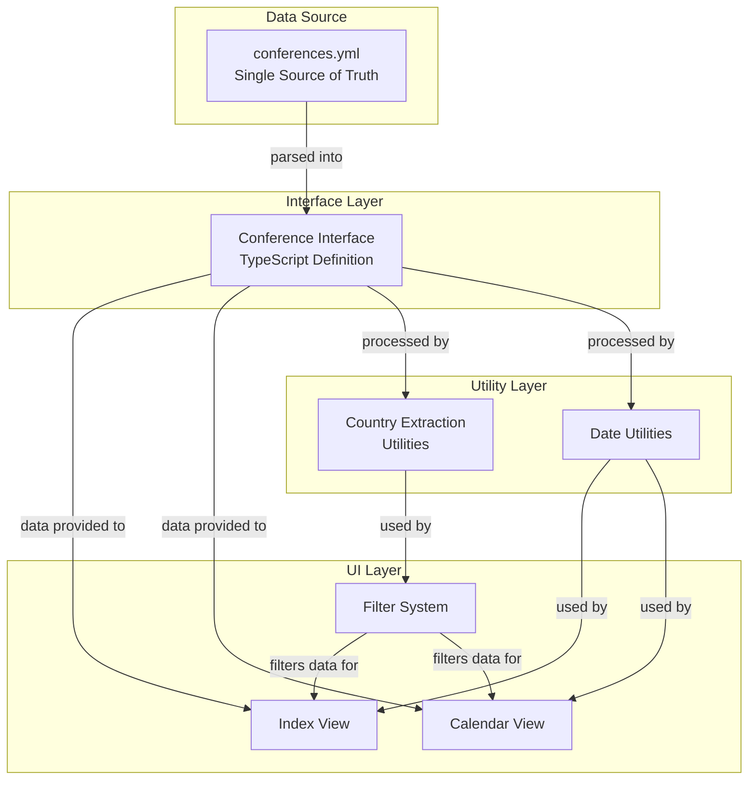
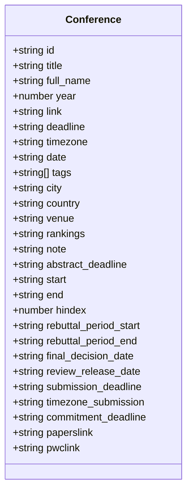
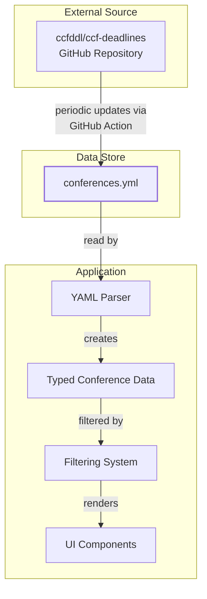
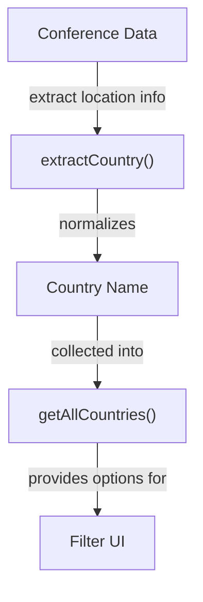
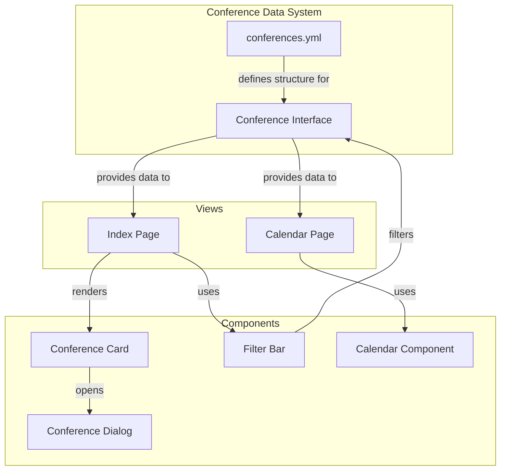

<!-- source: DeepWiki mcp.deepwiki.com · repo huggingface/ai-deadlines · page 2 Conference Data System · fetched 2026-10-26 -->

# Conference Data System

<details>
<summary>Relevant source files</summary>

The following files were used as context for generating this wiki page:

- [src/data/conferences.yml](src/data/conferences.yml)
- [src/types/conference.ts](src/types/conference.ts)
- [src/utils/countryExtractor.ts](src/utils/countryExtractor.ts)

</details>


The Conference Data System is the core data infrastructure that powers the AI Deadlines application. It defines how conference information is structured, stored, and accessed throughout the application. This documentation explains the data model, storage format, and how other components interact with the conference data.

For information about how this data is automatically kept up-to-date, see [Data Update System](#2.2). For details about the specific fields in the conference data model, see [Conference Data Model](#2.1).

## Data Structure Overview

The Conference Data System is built around a single, centralized YAML file that serves as the authoritative source of all conference information.

Conference Data System Architecture


Sources: [src/data/conferences.yml:1-787](), [src/types/conference.ts:1-30]()

### YAML Data Store

The primary data store for all conference information is the `conferences.yml` file. This file contains an array of conference objects, each representing an academic conference with its associated metadata.

Example of a conference entry in the YAML file:

```yaml
- title: ICML
  year: 2025
  id: icml25
  full_name: International Conference on Machine Learning
  link: https://icml.cc/Conferences/2025
  deadline: '2025-01-30 23:59:59'
  timezone: UTC-12
  date: July 11-19, 2025
  tags:
  - machine-learning
  city: Vancouver
  country: Canada
  abstract_deadline: '2025-01-23 23:59:59'
  rankings: 'CCF: A, CORE: A*, THCPL: A'
  venue: Vancouver Convention Center
```

This human-readable format makes it easy to maintain and update conference information, while still providing structured data for the application.

Sources: [src/data/conferences.yml:1-787]()

### Conference Interface

The TypeScript interface `Conference` defines the structure of conference data objects throughout the application. This interface ensures type safety and provides a clear contract for how conference data should be structured.

Conference Data Model


Sources: [src/types/conference.ts:1-30]()

## Data Flow

The Conference Data System follows a unidirectional data flow pattern from storage to presentation layers.

Conference Data Flow


Sources: [src/data/conferences.yml:1-787]()

### Data Access Pattern

When the application starts:

1. The `conferences.yml` file is loaded and parsed
2. The parsed data is validated against the `Conference` interface
3. The data is processed by utility functions as needed (e.g., country extraction)
4. UI components receive and display the processed data
5. Filter components allow users to refine the displayed conferences

## Country Extraction Utility

The Conference Data System includes a utility for extracting and normalizing country information from conference data. This functionality supports the location-based filtering feature.

Country Extraction Process


The country extractor handles various formats and special cases:
- Extracts country from city/venue strings
- Normalizes country names (e.g., "USA", "U.S.A.", "United States" → "USA")
- Handles special cases for countries like the UK

Sources: [src/utils/countryExtractor.ts:1-55]()

## Integration with UI Components

The Conference Data System serves as the foundation for all UI views and components in the application.

Component Integration


Sources: [src/data/conferences.yml:1-787](), [src/types/conference.ts:1-30]()

### Key Integration Points

1. **Index View**: Displays conferences as cards with filtering options
2. **Calendar View**: Shows conferences in a calendar format
3. **Filter System**: Filters conferences by tags, countries, and search queries
4. **Conference Cards/Dialog**: Display conference information at different detail levels

## Summary

The Conference Data System provides a solid foundation for the AI Deadlines application through:

1. **Centralized Data Storage**: The `conferences.yml` file serves as a single source of truth
2. **Structured Data Model**: The TypeScript interface ensures consistent data structure
3. **Utility Functions**: Support extraction and processing of specific data aspects
4. **Clear Data Flow**: Data flows from storage to UI in a predictable pattern

This design makes the application easy to maintain and extend, as all conference data is stored in a single, well-structured format that can be accessed and processed throughout the application.

---

