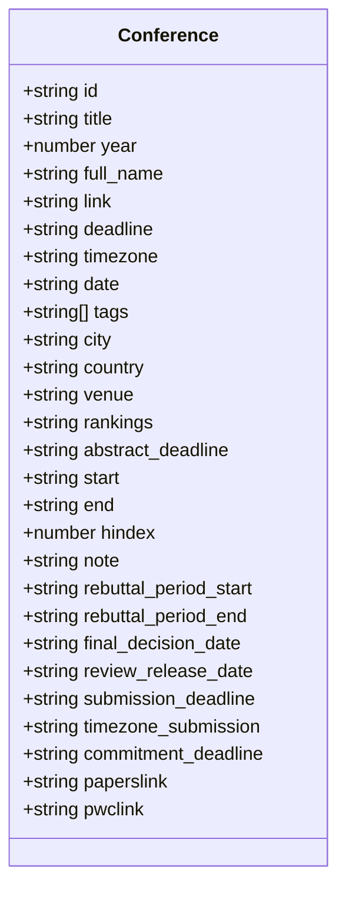
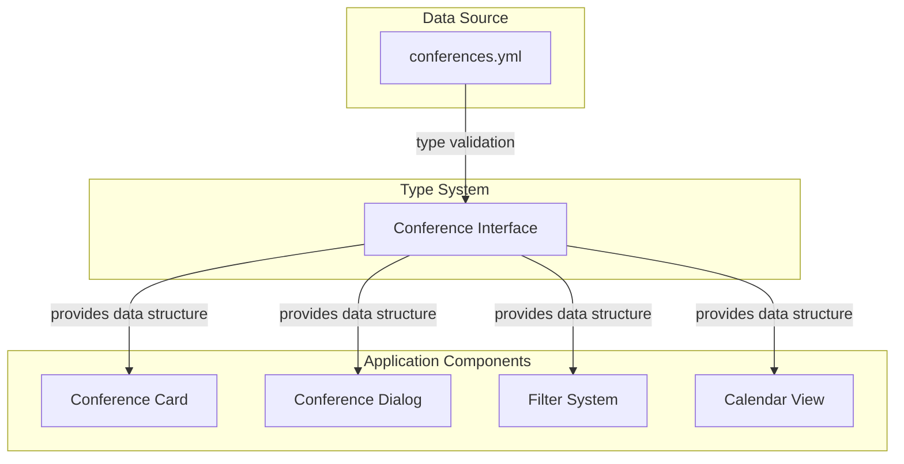
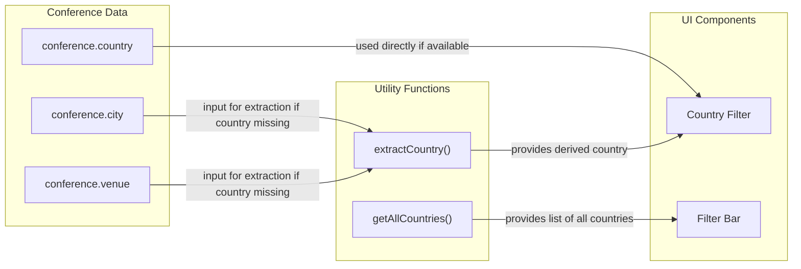

<!-- source: DeepWiki mcp.deepwiki.com · repo huggingface/ai-deadlines · page 2.1 Conference Data Model · fetched 2026-10-26 -->

# Conference Data Model

<details>
<summary>Relevant source files</summary>

The following files were used as context for generating this wiki page:

- [src/data/conferences.yml](src/data/conferences.yml)
- [src/types/conference.ts](src/types/conference.ts)
- [src/utils/countryExtractor.ts](src/utils/countryExtractor.ts)

</details>


The Conference Data Model is the core data structure that powers the AI Deadlines application. It defines the schema for all conference information displayed throughout the application and serves as the single source of truth for conference data. This page documents the complete data model, all available fields, their purposes, and how they're used within the system.

For information about how conference data is automatically updated, see [Data Update System](#2.2).

## Overview

The AI Deadlines application uses a structured data model to represent academic conferences. This data is primarily stored in the `conferences.yml` file, which acts as the centralized data source for the entire application. The data model is defined as a TypeScript interface in the codebase, ensuring type safety throughout the application.

### Conference Data Structure



Sources: [src/types/conference.ts:1-30](), [src/data/conferences.yml:1-787]()

## Field Reference

The Conference data model consists of the following fields:

| Field | Type | Required | Description |
|-------|------|----------|-------------|
| `id` | string | ✅ | Unique identifier for the conference (usually abbreviation + year) |
| `title` | string | ✅ | Short name/abbreviation of the conference |
| `year` | number | ✅ | The year the conference takes place |
| `full_name` | string | ❌ | Complete name of the conference |
| `link` | string | ❌ | URL to the conference website |
| `deadline` | string | ✅ | Paper submission deadline in ISO format |
| `timezone` | string | ❌ | Timezone for the deadline (e.g., UTC-12, AoE) |
| `date` | string | ✅ | Human-readable date range of the conference |
| `tags` | string[] | ❌ | Array of topic categories for filtering |
| `city` | string | ❌ | Host city of the conference |
| `country` | string | ❌ | Host country of the conference |
| `venue` | string | ❌ | Specific location where the conference is held |
| `rankings` | string | ❌ | Academic rankings (e.g., 'CCF: A, CORE: A*, THCPL: A') |
| `abstract_deadline` | string | ❌ | Abstract submission deadline in ISO format |
| `start` | string | ❌ | Conference start date in ISO format |
| `end` | string | ❌ | Conference end date in ISO format |
| `hindex` | number | ❌ | H-index of the conference (research impact metric) |
| `note` | string | ❌ | Additional information about the conference |
| `rebuttal_period_start` | string | ❌ | Start date of author rebuttal period |
| `rebuttal_period_end` | string | ❌ | End date of author rebuttal period |
| `final_decision_date` | string | ❌ | Date when final acceptance decisions are released |
| `review_release_date` | string | ❌ | Date when reviews are released to authors |
| `submission_deadline` | string | ❌ | Alternative deadline specification (sometimes used with specific timezone) |
| `timezone_submission` | string | ❌ | Timezone for submission_deadline |
| `commitment_deadline` | string | ❌ | Deadline for commitment (used by some conferences) |
| `paperslink` | string | ❌ | Link to the papers submission system |
| `pwclink` | string | ❌ | Link to the Papers with Code page |

Sources: [src/types/conference.ts:1-30](), [src/data/conferences.yml:1-787]()

## Conference Data Flow

The following diagram illustrates how conference data flows through the system:



Sources: [src/types/conference.ts:1-30](), [src/data/conferences.yml:1-787]()

## Date-Related Fields

The Conference model contains several date-related fields that serve different purposes:

```mermaid
flowchart TD
    subgraph "Conference"
        deadline["deadline (required)"]
        abstract_deadline["abstract_deadline (optional)"]
        timezone["timezone (optional)"]
        submission_deadline["submission_deadline (optional)"]
        timezone_submission["timezone_submission (optional)"]
        
        date["date (required)"]
        start["start (optional)"]
        end["end (optional)"]
        
        review_release_date["review_release_date (optional)"]
        rebuttal_period_start["rebuttal_period_start (optional)"]
        rebuttal_period_end["rebuttal_period_end (optional)"]
        final_decision_date["final_decision_date (optional)"]
        commitment_deadline["commitment_deadline (optional)"]
    end
    
    subgraph "Timeline"
        submission["Paper Submission"]
        review["Review Process"]
        conference["Conference Event"]
    end
    
    deadline -->|"main deadline for"| submission
    abstract_deadline -->|"precedes"| deadline
    timezone -->|"specifies timezone for"| deadline
    submission_deadline -->|"alternative specification for"| deadline
    timezone_submission -->|"specifies timezone for"| submission_deadline
    
    date -->|"human readable date for"| conference
    start -->|"start date for"| conference
    end -->|"end date for"| conference
    
    review_release_date -->|"part of"| review
    rebuttal_period_start -->|"start of rebuttal in"| review
    rebuttal_period_end -->|"end of rebuttal in"| review
    final_decision_date -->|"final step in"| review
    commitment_deadline -->|"deadline for committing accepted papers"| review
```

Sources: [src/types/conference.ts:1-30](), [src/data/conferences.yml:1-787]()

## Example Conference Data

Here's an example of a conference entry from the data source:

```yaml
- title: CVPR
  year: 2025
  id: cvpr25
  full_name: IEEE/CVF Conference on Computer Vision and Pattern Recognition
  link: https://cvpr.thecvf.com/Conferences/2025/CallForPapers
  deadline: '2024-11-14 23:59:00'
  timezone: UTC-8
  date: June 10-17, 2025
  tags:
  - computer-vision
  city: Nashville
  country: Tennessee
  abstract_deadline: '2024-11-07 23:59:00'
  rankings: 'CCF: A, CORE: A*, THCPL: A'
  venue: Music City Center, Nashville, USA
  hindex: 389
  rebuttal_period_end: '2025-01-31 07:59:59'
  final_decision_date: '2025-02-26 07:59:59'
  review_release_date: '2025-01-23 07:59:59'
  note: OpenReview account creation deadline on Nov 1st, paper registration deadline on Nov 8th, supplementary materials deadline on Nov 22nd. Reviews released on Jan 23rd, rebuttal period ends Jan 31st, and final decisions on Feb 26th.
```

Sources: [src/data/conferences.yml:253-272]()

## Country and Location Handling

The system uses both `city` and `country` fields to represent the location of conferences. An auxiliary utility extracts country information for filtering and display purposes:



Sources: [src/utils/countryExtractor.ts:1-55](), [src/types/conference.ts:11-13]()

## Usage in the Application

The Conference data model is central to the application and is used by various components:

1. **Conference Cards**: Displays summarized conference information
2. **Conference Dialog**: Shows detailed conference information when a card is clicked
3. **Filter System**: Filters conferences by tags, countries, and search queries
4. **Calendar View**: Displays conferences in a calendar format

The structure enables efficient filtering, sorting, and display of conference information throughout the application.

Sources: [src/types/conference.ts:1-30](), [src/data/conferences.yml:1-787]()

## The Source of Truth

The `conferences.yml` file serves as the single source of truth for all conference data in the application. This YAML file contains an array of conference objects, each following the Conference data model structure. The file is updated through an automated process (see [Data Update System](#2.2)) and provides the data that powers all views in the application.

Sources: [src/data/conferences.yml:1-787]()

---

