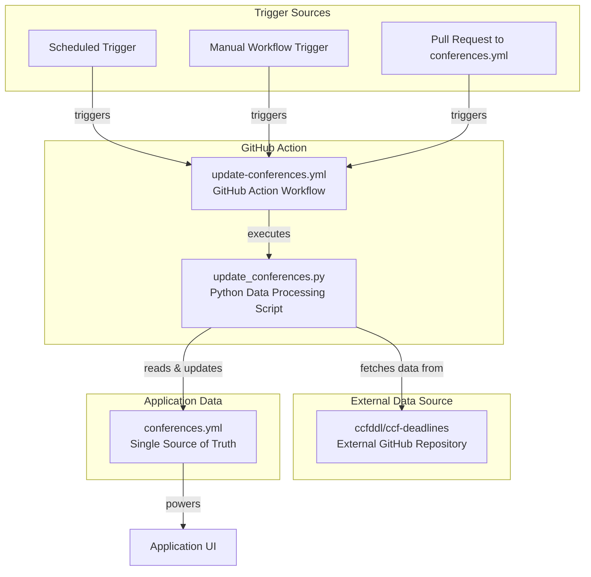
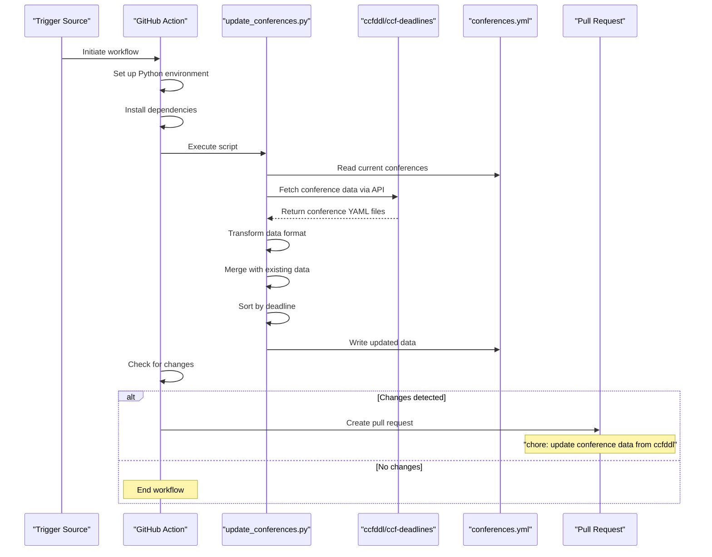
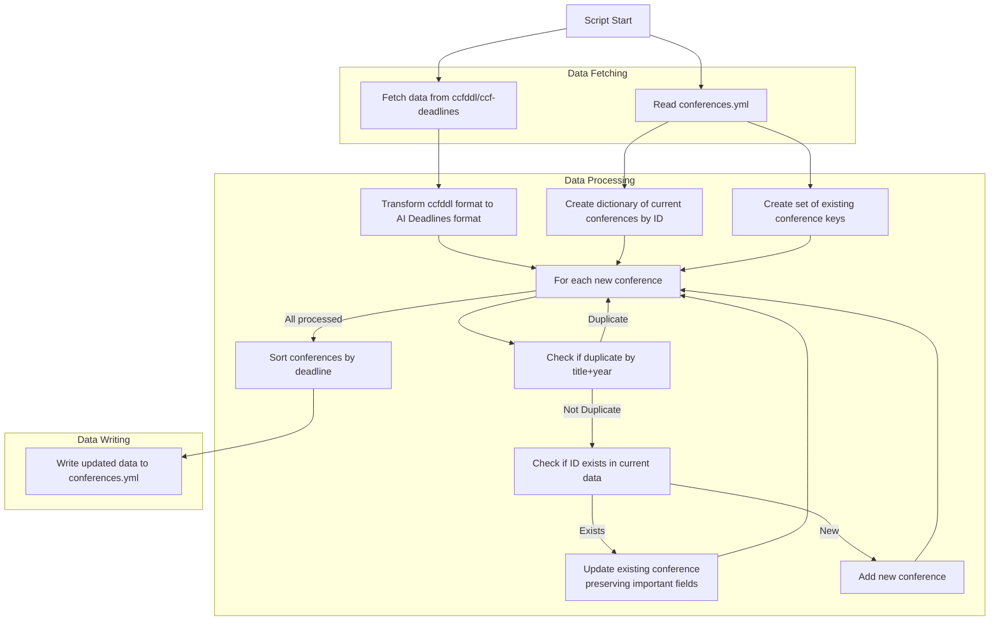

<!-- source: DeepWiki mcp.deepwiki.com · repo huggingface/ai-deadlines · page 2.2 Data Update System · fetched 2026-10-26 -->

# Data Update System

<details>
<summary>Relevant source files</summary>

The following files were used as context for generating this wiki page:

- [.github/scripts/update_conferences.py](.github/scripts/update_conferences.py)
- [.github/workflows/update-conferences.yml](.github/workflows/update-conferences.yml)
- [LICENSE](LICENSE)
- [README.md](README.md)
- [src/data/conferences.yml](src/data/conferences.yml)

</details>


## Purpose and Scope

This document describes the automated system that keeps the AI Deadlines conference data up-to-date. It explains how GitHub Actions are used to periodically fetch data from external sources, transform it into the application's data format, and update the central conference database. For details about the conference data model itself, see [Conference Data Model](#2.1).

## System Overview

The Data Update System automatically refreshes the conference data in the application by fetching the latest information from external sources. This ensures users always have access to current conference deadlines without requiring manual maintenance.



Sources: [.github/workflows/update-conferences.yml:1-49](), [README.md:24-27]()

## Update Workflow

The update process is implemented as a GitHub Action workflow that can be triggered manually or automatically when changes are made to the conference data file.



Sources: [.github/workflows/update-conferences.yml:12-49](), [.github/scripts/update_conferences.py:163-261]()

## GitHub Action Configuration

The GitHub Action workflow is defined in `.github/workflows/update-conferences.yml` and contains the following key components:

### Trigger Conditions

The workflow can be triggered in two ways:

1. **Manual Trigger**: Using GitHub's `workflow_dispatch` event, allowing maintainers to run the update on demand
2. **Pull Request**: When changes are made to the `src/data/conferences.yml` file

### Workflow Steps

1. **Checkout Repository**: Fetches the repository code
2. **Set up Python**: Installs the required Python environment
3. **Install Dependencies**: Installs necessary Python packages (PyYAML and requests)
4. **Run Update Script**: Executes the Python script to update conference data
5. **Check for Changes**: Determines if any changes were made to the conference data
6. **Create Pull Request**: If changes are detected, creates a PR with the updates

Sources: [.github/workflows/update-conferences.yml:6-49]()

## Data Update Script

The core of the update system is the Python script located at `.github/scripts/update_conferences.py`. This script is responsible for fetching, transforming, and merging conference data.

### Script Functionality

The script performs the following operations:

1. **Fetch External Data**: Retrieves conference data from the ccfddl/ccf-deadlines GitHub repository
2. **Read Current Data**: Loads the existing `conferences.yml` file
3. **Transform Data Format**: Converts ccfddl format to AI Deadlines format
4. **Merge Data**: Combines new data with existing data, preserving important fields
5. **Sort Conferences**: Orders conferences by submission deadline
6. **Write Updated Data**: Saves the updated conference list back to `conferences.yml`



Sources: [.github/scripts/update_conferences.py:163-261]()

### Data Transformation Process

The script carefully transforms data from the ccfddl format to the AI Deadlines format, performing these key transformations:

| ccfddl Field | AI Deadlines Field | Transformation |
|--------------|-------------------|----------------|
| `title` | `title` | Direct copy |
| `description` | `full_name` | Direct copy |
| `confs[].year` | `year` | Direct copy from most recent instance |
| `confs[].id` | `id` | Direct copy from most recent instance |
| `confs[].link` | `link` | Direct copy from most recent instance |
| `confs[].timeline[0].deadline` | `deadline` | Direct copy from most recent instance |
| `confs[].timezone` | `timezone` | Direct copy from most recent instance |
| `confs[].date` | `date` | Direct copy from most recent instance |
| `confs[].date` | `start`, `end` | Parsed from date string |
| `confs[].place` | `city`, `country` | Split on comma if possible |
| `confs[].rank` | `rankings` | Concatenated with format specifiers |

Sources: [.github/scripts/update_conferences.py:91-160]()

### Field Preservation Logic

When updating existing conferences, the script preserves important fields that may contain manually added or curated information:

```
preserved_fields = [
    'tags', 'venue', 'hindex', 'submission_deadline',
    'timezone_submission', 'rebuttal_period_start',
    'rebuttal_period_end', 'final_decision_date',
    'review_release_date', 'commitment_deadline',
    'start', 'end', 'note', 'city', 'country'
]
```

This ensures that valuable information like conference tags, venue details, and important dates are not lost during updates.

Sources: [.github/scripts/update_conferences.py:202-207]()

## Date Parsing System

One important component of the update system is its ability to parse various date formats and extract standardized start and end dates from conference date strings.

### Date Format Handling

The script can handle various date formats:

1. Single dates: "May 19, 2025"
2. Date ranges with hyphens: "May 19-23, 2025"
3. Date ranges with dashes: "May 19 - May 23, 2025"
4. Cross-month ranges: "April 29-May 4, 2025"

The date parser handles month abbreviations and extracts both start and end dates in the standardized format `YYYY-MM-DD`.

Sources: [.github/scripts/update_conferences.py:27-88]()

## Conference Data Output Format

The resulting conference data is written to `src/data/conferences.yml` in a structured YAML format with each conference entry containing all necessary fields. The script ensures proper formatting with two newlines between conferences.

Example output format:

```yaml
- title: ICRA
  year: 2025
  id: icra25
  full_name: IEEE International Conference on Robotics and Automation
  link: https://2025.ieee-icra.org
  deadline: '2024-07-15 12:00:00'
  timezone: UTC-4
  date: May 19-23, 2025
  tags:
  - machine-learning
  - robotics
  city: Atlanta
  country: USA
  start: '2025-05-19'
  end: '2025-05-23'
  rankings: 'CCF: B, CORE: A*, THCPL: A'
  venue: Georgia World Congress Center, Atlanta, USA
```

Sources: [src/data/conferences.yml:1-70](), [.github/scripts/update_conferences.py:235-255]()

## Pull Request Creation

When changes are detected, the GitHub Action automatically creates a pull request with the title "Update conference data from ccfddl" using the `peter-evans/create-pull-request` action. This allows maintainers to review changes before they are merged into the main branch.

The pull request includes:
- A descriptive commit message
- A branch named `update-conferences`
- An auto-generated body explaining the nature of the update

Sources: [.github/workflows/update-conferences.yml:37-49]()

## Manual Contribution Process

In addition to the automated update system, the repository also supports manual contributions to the conference data. Contributors can:

1. Fork the repository
2. Update `src/data/conferences.yml` directly
3. Ensure all required fields are present
4. Submit a pull request

The README provides detailed instructions for contributors, including field requirements and example format.

Sources: [README.md:31-67]()

## Summary

The Data Update System provides an automated mechanism to keep the AI Deadlines application's conference data current and accurate. By combining automated data fetching with careful preservation of manually maintained information, the system balances automation with quality control. The pull request workflow ensures that updates can be reviewed before being incorporated into the main application data.

---

