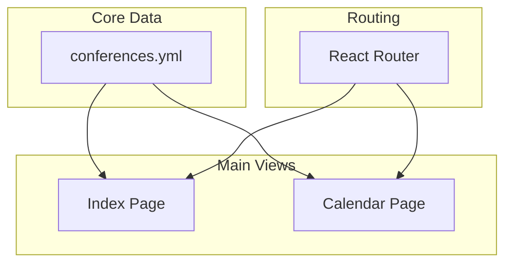
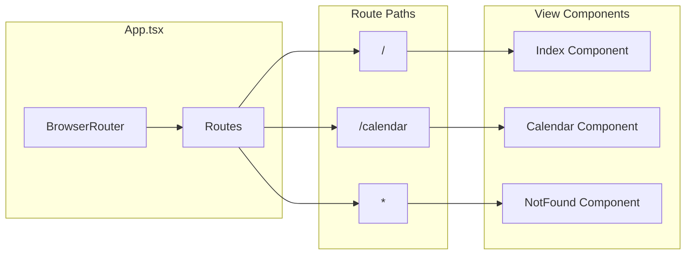
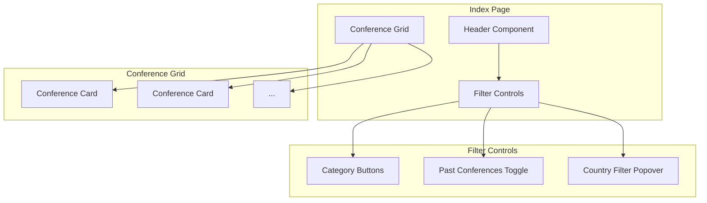
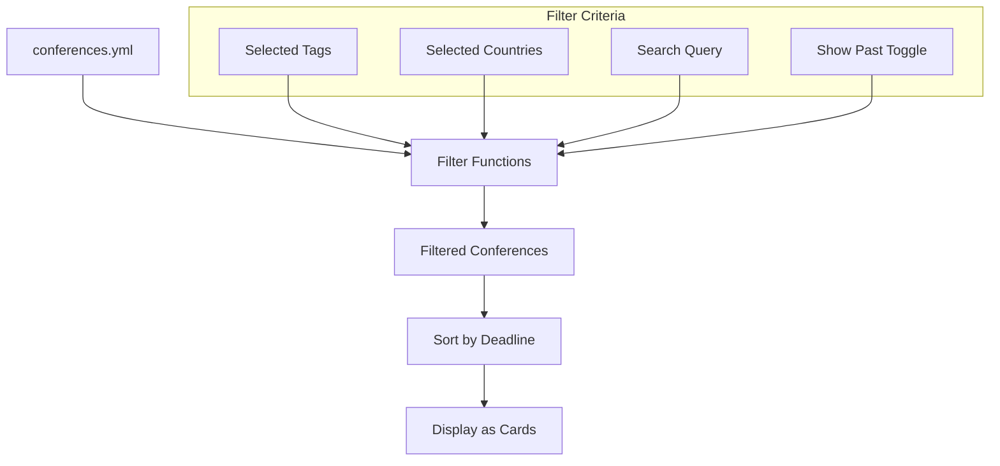
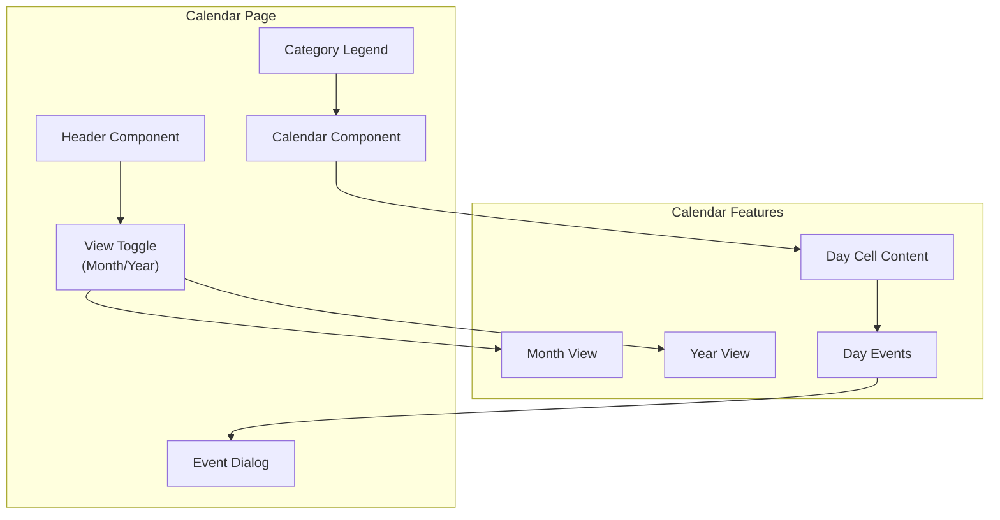
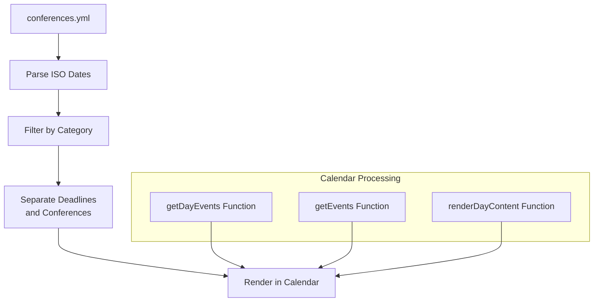
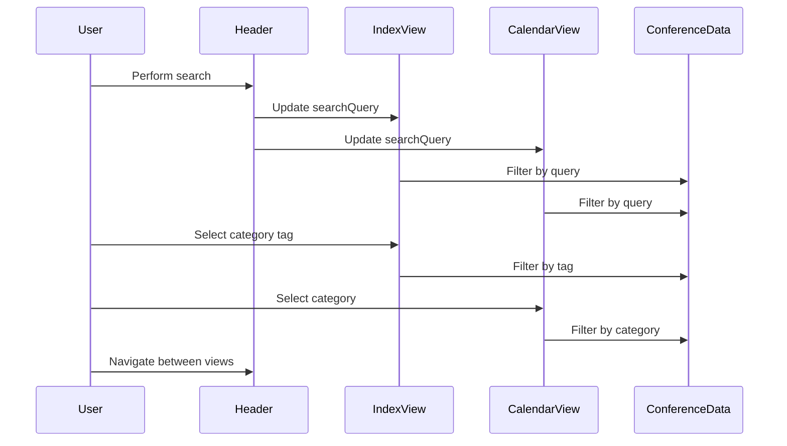
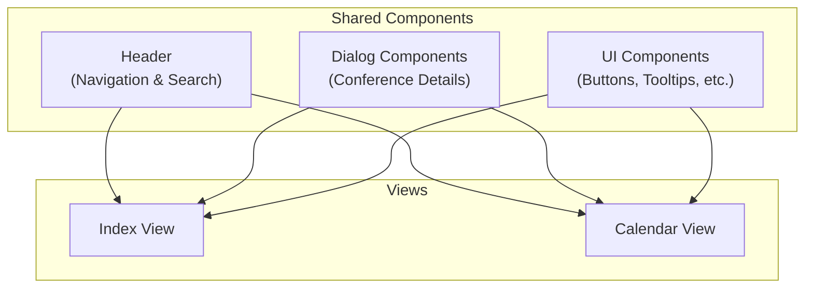
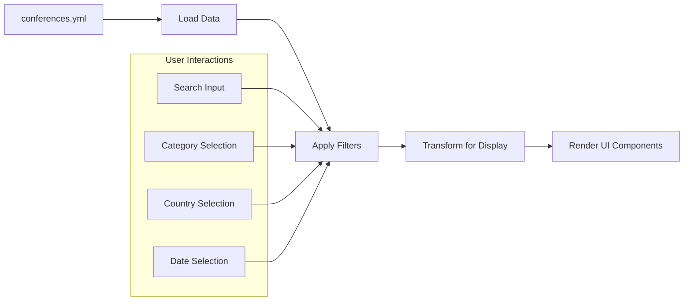

<!-- source: DeepWiki mcp.deepwiki.com · repo huggingface/ai-deadlines · page 3 Application Views · fetched 2026-10-26 -->

# Application Views

Relevant source files

The following files were used as context for generating this wiki page:

- [src/App.tsx](src/App.tsx)
- [src/pages/Calendar.tsx](src/pages/Calendar.tsx)
- [src/pages/Index.tsx](src/pages/Index.tsx)

This document provides a detailed explanation of the primary application views in the AI Deadlines system. It covers the structure, functionality, and implementation of the main pages that users interact with. For information about the underlying conference data model that powers these views, see [Conference Data System](#2).

## View Structure Overview

The AI Deadlines application provides two primary views for accessing conference information:

1. **Conference Listing View** - The main page that displays conferences as filterable cards
2. **Calendar View** - An alternative view showing conferences in a calendar format

These views represent different ways of interacting with the same underlying conference data.

Sources: [src/App.tsx:17-23](), [src/pages/Index.tsx:2-4](), [src/pages/Calendar.tsx:2-3]()

## Application Routing

The application uses React Router to manage navigation between the different views. The main routes are defined in the App component:

Sources: [src/App.tsx:12-28]()

## Conference Listing View

The Conference Listing View is the main entry point to the application. It presents conferences as a grid of cards with comprehensive filtering capabilities.

### Structure and Components

Sources: [src/pages/Index.tsx:140-284]()

### Key Features

1. **Category Filtering**: Users can filter conferences by selecting one or more category tags
2. **Country Filtering**: A popover control allows filtering by conference location
3. **Past Conference Toggle**: Option to show or hide conferences with past deadlines
4. **Search Functionality**: Header component provides search across conference titles and names
5. **URL Parameter Support**: Selected filters are reflected in URL parameters for bookmarking and sharing

### Implementation Details

The `Index` component manages several pieces of state:
- `selectedTags`: Set of category identifiers that are currently selected
- `selectedCountries`: Set of country names that are currently selected
- `searchQuery`: Current search text from the header
- `showPastConferences`: Boolean toggle for showing past events

The component applies these filters to the conference data and produces a filtered list for display:

Sources: [src/pages/Index.tsx:40-83](), [src/pages/Index.tsx:85-117]()

## Calendar View

The Calendar View provides a time-based visualization of conferences, showing both submission deadlines and conference dates in a calendar format.

### Structure and Components

Sources: [src/pages/Calendar.tsx:70-752]()

### Key Features

1. **Dual View Modes**: Toggle between month view and year view
2. **Category Filtering**: Select which conference categories to display
3. **Deadline Highlighting**: Shows submission deadlines with distinct styling
4. **Conference Duration**: Visualizes conference durations across calendar days
5. **Detailed Event Dialog**: Click on a day to view detailed information about events
6. **Search Functionality**: Header component provides search across all conferences

### Implementation Details

The Calendar component maintains several key state variables:
- `selectedDate`: Currently selected date in the calendar
- `isYearView`: Boolean toggle between year and month views
- `currentMonth`/`currentYear`: Current display period
- `selectedCategories`: Set of categories to display
- `showDeadlines`: Boolean to toggle deadline display

The component processes conference data to extract deadline and event dates for display in the calendar:

Sources: [src/pages/Calendar.tsx:116-154](), [src/pages/Calendar.tsx:156-197](), [src/pages/Calendar.tsx:263-313]()

## View Interaction Patterns

The two main views share common interaction patterns and components:

Sources: [src/pages/Index.tsx:142-145](), [src/pages/Calendar.tsx:578]()

## Shared Components

Both main views leverage several shared components:

1. **Header Component**: Provides navigation and search functionality
2. **Dialog Components**: Display detailed information about conferences
3. **UI Components**: Tooltips, popovers, buttons, and other UI elements

Sources: [src/pages/Index.tsx:142](), [src/pages/Calendar.tsx:578](), [src/pages/Calendar.tsx:706-749]()

## Data Flow in Views

Both views follow a similar data flow pattern where conference data is filtered and transformed for display:

Sources: [src/pages/Index.tsx:40-83](), [src/pages/Calendar.tsx:116-197]()

## Summary

The application views provide two complementary ways to interact with conference data:

1. **Conference Listing View** offers a list-based approach with powerful filtering options, ideal for quickly finding specific conferences.

2. **Calendar View** provides a temporal visualization, making it easier to understand submission deadlines and conference dates in relation to each other.

Both views access the same underlying conference data but present it in different ways to support different user tasks and preferences.

---

