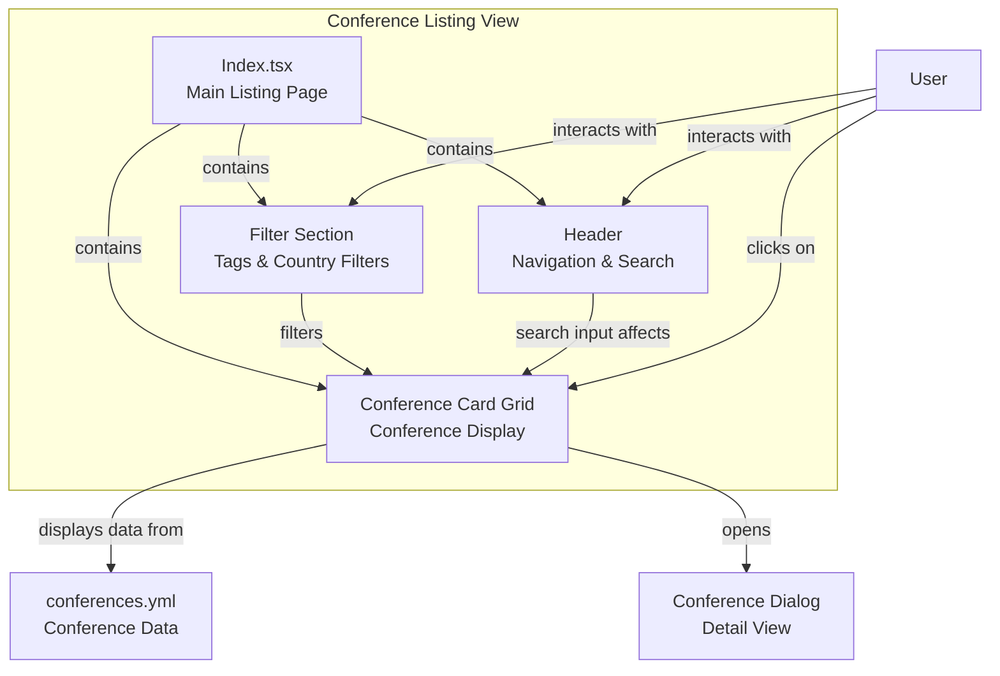
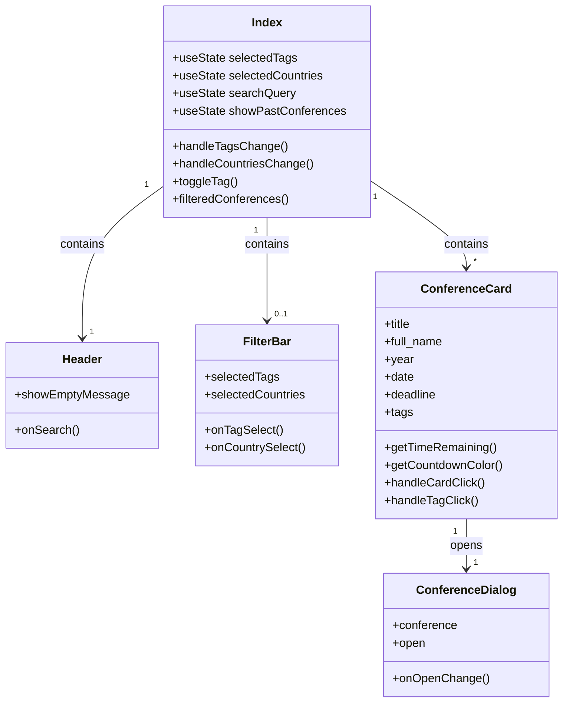
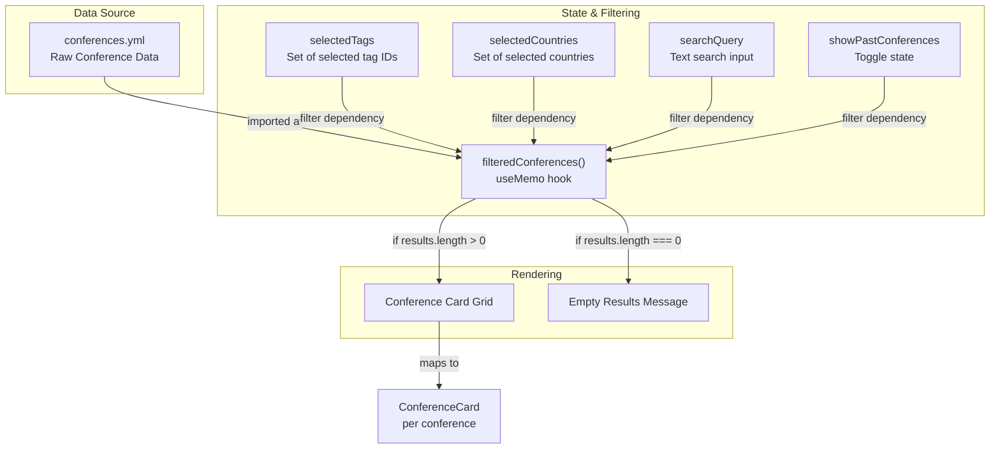
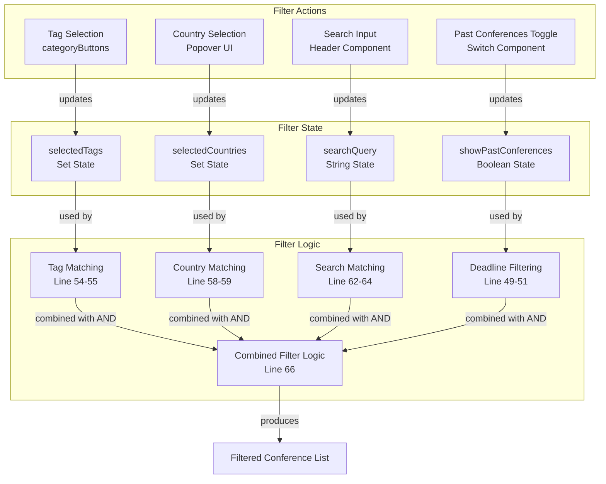
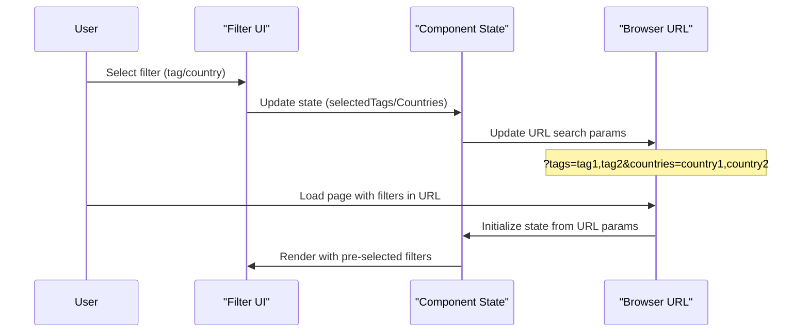
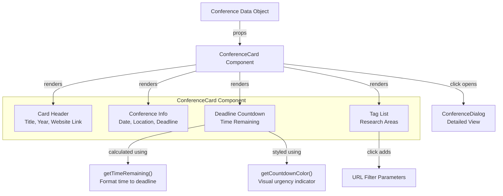
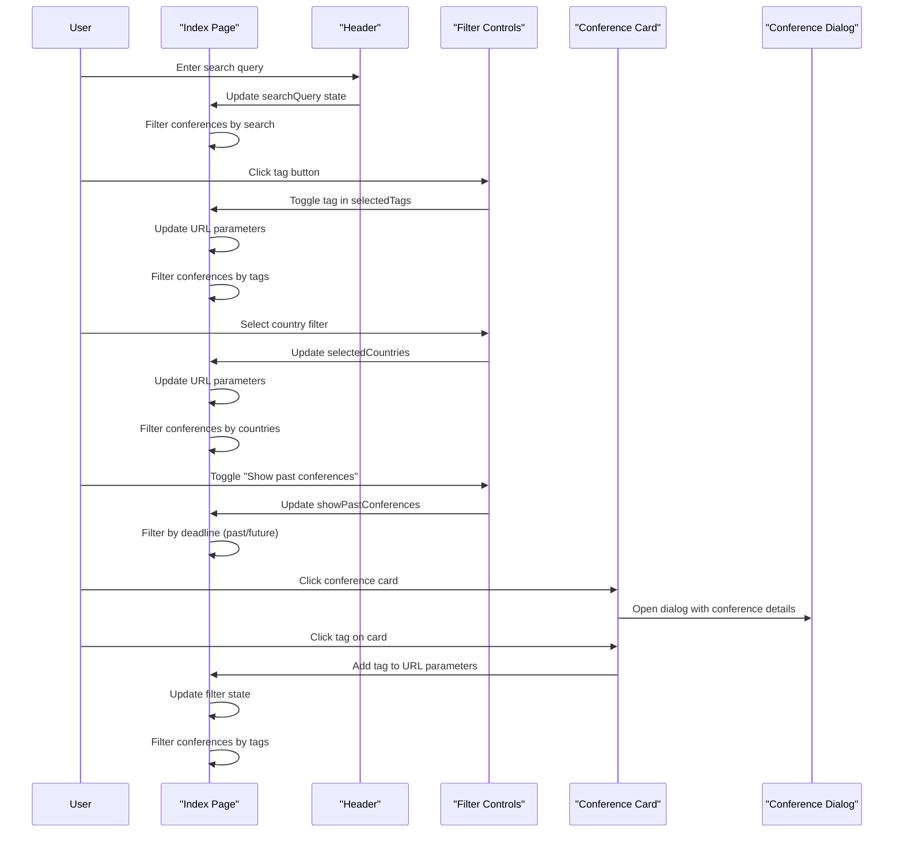

<!-- source: DeepWiki mcp.deepwiki.com · repo huggingface/ai-deadlines · page 3.1 Conference Listing View · fetched 2026-10-26 -->

# Conference Listing View

Relevant source files

The following files were used as context for generating this wiki page:

- [src/components/ConferenceCard.tsx](src/components/ConferenceCard.tsx)
- [src/components/FilterBar.tsx](src/components/FilterBar.tsx)
- [src/components/Header.tsx](src/components/Header.tsx)
- [src/pages/Index.tsx](src/pages/Index.tsx)

The Conference Listing View serves as the main interface for users to browse, search, and filter AI-related academic conferences. This page documents the architecture and functionality of the main conference listing page, which is the primary entry point for the application. For information about the Calendar View, see [Calendar View](#3.2).

## Overview

The Conference Listing View displays conferences as cards in a grid layout, with comprehensive filtering options allowing users to narrow down conferences by research areas, location, and search terms. It also provides functionality to toggle between upcoming and past conferences.

Sources: [src/pages/Index.tsx:140-286](), [src/components/Header.tsx:11-121]()

## Component Architecture

The Conference Listing View integrates several components to create a comprehensive user interface for browsing conferences.

### Core Components

| Component | File | Purpose |
|-----------|------|---------|
| Index | src/pages/Index.tsx | Main page component that composes all other components and handles conference filtering |
| Header | src/components/Header.tsx | Navigation, branding, and search functionality |
| FilterBar | src/components/FilterBar.tsx | Tag and country filtering interface |
| ConferenceCard | src/components/ConferenceCard.tsx | Individual conference display |
| ConferenceDialog | src/components/ConferenceDialog.tsx | Detailed conference information dialog |

Sources: [src/pages/Index.tsx:18-286](), [src/components/Header.tsx:11-121](), [src/components/FilterBar.tsx:21-135](), [src/components/ConferenceCard.tsx:8-179]()

## Data Flow

The Conference Listing View processes data from the conference source through several transformations before presenting it to the user.

Sources: [src/pages/Index.tsx:40-83](), [src/pages/Index.tsx:270-282]()

## Filtering System

The Conference Listing View implements a comprehensive filtering system that allows users to narrow down the list of conferences.

### Filter Types

1. **Tag Filtering**: Allows filtering by research areas like "Machine Learning," "Computer Vision," etc.
2. **Country Filtering**: Enables filtering conferences by location country
3. **Search Filtering**: Provides text search functionality
4. **Past/Future Toggle**: Option to show/hide conferences with past deadlines

Sources: [src/pages/Index.tsx:47-66](), [src/pages/Index.tsx:149-173](), [src/pages/Index.tsx:177-186](), [src/pages/Index.tsx:188-264]()

### URL State Management

The Conference Listing View preserves filter selections in the URL, allowing users to share filtered views and maintain their filtering state across page refreshes.

Sources: [src/pages/Index.tsx:85-95](), [src/pages/Index.tsx:97-106](), [src/pages/Index.tsx:120-134]()

## Conference Cards

The Conference Listing View displays conferences as cards in a grid layout, with each card showing key information about the conference.

### Card Content

Each conference card displays:

1. Conference title and year
2. Conference website link
3. Conference date
4. Conference location (city, country)
5. Submission deadline
6. Time remaining until deadline (with color coding)
7. Research area tags

Sources: [src/components/ConferenceCard.tsx:94-156](), [src/components/ConferenceCard.tsx:28-46](), [src/components/ConferenceCard.tsx:51-62]()

### Visual Cues

The Conference Listing View uses visual cues to indicate deadline urgency:

| Timeframe | Color | Purpose |
|-----------|-------|---------|
| ≤ 7 days | Red | Urgent deadline |
| ≤ 30 days | Orange | Approaching deadline |
| > 30 days | Green | Distant deadline |
| Invalid/TBD | Neutral | Unknown deadline |

Sources: [src/components/ConferenceCard.tsx:51-62]()

## User Interactions

The Conference Listing View supports several user interactions for browsing and filtering conferences.

Sources: [src/pages/Index.tsx:86-117](), [src/components/ConferenceCard.tsx:64-92]()

## Implementation Details

### Main Page Structure

The Index component serves as the container for the Conference Listing View, handling state management and rendering the various UI components:

1. **Header**: Navigation and search functionality
2. **Filter Controls**: Category buttons, country filter, and past conference toggle
3. **Conference Grid**: Grid layout of conference cards

The main structure follows a responsive design that adapts to different screen sizes.

Sources: [src/pages/Index.tsx:140-286]()

### Filtering Logic

The filtering logic is implemented in a `useMemo` hook that applies multiple filter conditions to the conference data:

1. Deadline filtering (past/future)
2. Tag filtering
3. Country filtering
4. Search term filtering

These filters are combined with logical AND operations, meaning a conference must satisfy all applied filter conditions to be displayed.

Sources: [src/pages/Index.tsx:40-83]()

### Conference Card Implementation

The ConferenceCard component is responsible for rendering each conference in a consistent, information-rich format. It handles:

1. Formatting conference date information
2. Calculating and displaying time remaining until deadline
3. Handling clicks on the card to open the detail dialog
4. Handling clicks on tags to update filters

Sources: [src/components/ConferenceCard.tsx:8-179]()

---

