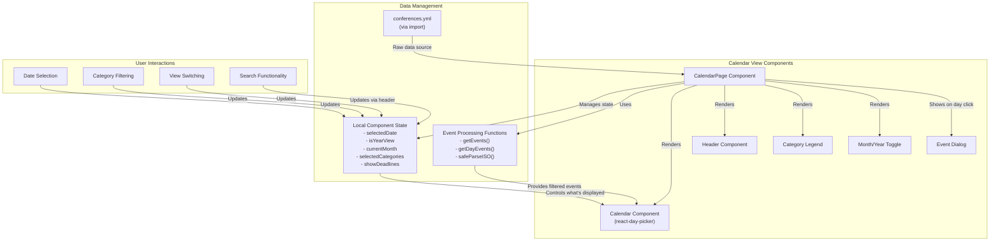
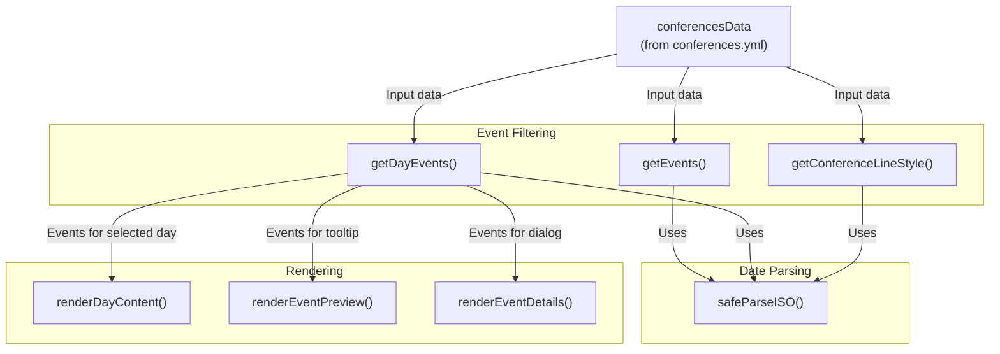
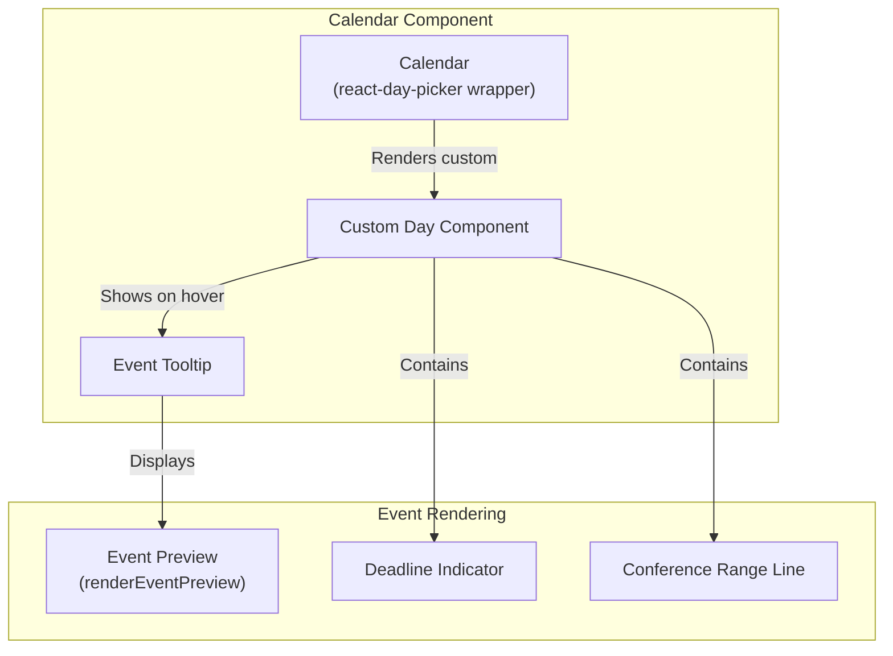
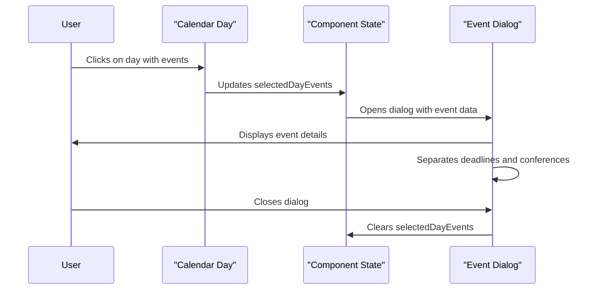
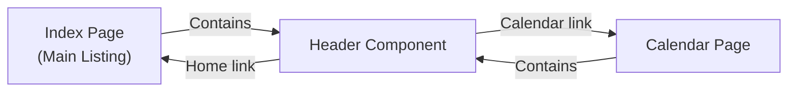
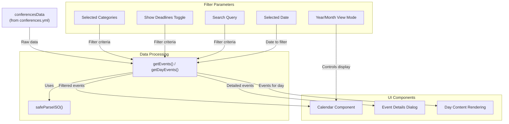

<!-- source: DeepWiki mcp.deepwiki.com · repo huggingface/ai-deadlines · page 3.2 Calendar View · fetched 2026-10-26 -->

# Calendar View

Relevant source files

The following files were used as context for generating this wiki page:

- [src/components/ConferenceCalendar.tsx](src/components/ConferenceCalendar.tsx)
- [src/components/Header.tsx](src/components/Header.tsx)
- [src/components/ui/calendar.tsx](src/components/ui/calendar.tsx)
- [src/pages/Calendar.tsx](src/pages/Calendar.tsx)

The Calendar View provides a visual representation of AI conference deadlines and event dates in a calendar format. This page allows users to view and filter conferences across time, with options to view either a monthly or yearly calendar. For information about the main list view of conferences, see [Conference Listing View](#3.1).

## Overview

The Calendar View offers a temporal organization of conference data, enabling users to:

- See conference submission deadlines and conference dates on a calendar
- Toggle between month and year views
- Filter conferences by categories (ML, CV, NLP, etc.)
- Search for specific conferences
- View detailed information about conferences on a particular date

Sources: [src/pages/Calendar.tsx:70-754]()

## Architecture

The Calendar View is implemented as a standalone page component that integrates with the application's data model and UI components.

Sources: [src/pages/Calendar.tsx:70-76](), [src/pages/Calendar.tsx:577-754]()

## Core State Management

The Calendar View utilizes several key state variables to manage its functionality:

| State Variable | Type | Purpose |
|----------------|------|---------|
| `selectedDate` | `Date \| undefined` | Currently selected date in the calendar |
| `isYearView` | `boolean` | Toggle between month view (false) and year view (true) |
| `currentMonth` | `Date` | Currently displayed month in month view |
| `searchQuery` | `string` | Current search term for filtering conferences |
| `selectedDayEvents` | `Object` | Stores events for the currently selected day |
| `selectedCategories` | `Set<string>` | Set of currently selected category filters |
| `showDeadlines` | `boolean` | Whether to display submission deadlines |
| `currentYear` | `number` | Current year being displayed in year view |

Sources: [src/pages/Calendar.tsx:71-83]()

## Data Processing Functions

The Calendar View contains several key functions for processing and filtering conference data:

### Key Data Processing Functions:

1. **safeParseISO**: Safely converts date strings to Date objects, handling various formats and edge cases.
   - Input: Date string, which might be in various formats or invalid
   - Output: Valid Date object or null if parsing fails

2. **getEvents**: Filters conferences based on search criteria and selected categories.
   - Filters by search query
   - Filters by selected categories
   - Checks if deadlines or conferences fall within the current year

3. **getDayEvents**: Retrieves events for a specific day, separated into deadlines and conferences.
   - Finds deadlines that match the exact day
   - Finds conferences that include the day in their date range

4. **getConferenceLineStyle**: Generates styling for conference date ranges in the calendar.
   - Determines visual representation for conferences spanning multiple days
   - Handles edge cases like start/end of ranges

Sources: [src/pages/Calendar.tsx:85-114](), [src/pages/Calendar.tsx:116-197](), [src/pages/Calendar.tsx:227-261]()

## User Interface Components

### Calendar Rendering

The main calendar component is customized to display conference data with specialized day rendering:

The Calendar component is extensively customized with:
- Custom day rendering to show conference data
- Specialized styling for different view modes (month vs. year)
- Event indicators for deadlines and conferences
- Tooltips for preview information

Sources: [src/pages/Calendar.tsx:653-700](), [src/pages/Calendar.tsx:280-313]()

### Filtering Interface

The Calendar View includes a comprehensive filtering system:

1. **Category Filters**: Toggle buttons for each conference category (ML, CV, NLP, etc.)
2. **Deadline Toggle**: Option to show/hide submission deadlines
3. **View Mode Toggle**: Switch between month and year views
4. **Search Box**: Filter conferences by name or content

These filters affect both what's displayed in the calendar and in the event details dialog.

Sources: [src/pages/Calendar.tsx:412-508](), [src/pages/Calendar.tsx:510-569]()

### Event Details Dialog

When a user clicks on a day with events, a dialog displays detailed information:

The dialog shows:
- Conference titles and full names
- Deadline information with timezone
- Conference date ranges
- Location information
- Notes and additional details
- Category tags for each conference

Sources: [src/pages/Calendar.tsx:706-749](), [src/pages/Calendar.tsx:320-404]()

## View Modes

### Month View
- Displays a single month at a time
- Shows conference deadlines and date ranges with colored indicators
- Provides navigation buttons to move between months

### Year View
- Displays all 12 months of a year
- Maintains the same event indicators as month view
- Provides year navigation controls
- Useful for an annual overview of conferences

The view mode can be toggled using the "Month View" and "Year View" buttons at the top of the page.

Sources: [src/pages/Calendar.tsx:510-569](), [src/pages/Calendar.tsx:653-700]()

## Calendar Day Rendering

Each day in the calendar is rendered with custom content to display event information:

1. **Date Display**: Shows the day number
2. **Event Indicators**:
   - Red lines for submission deadlines
   - Colored lines for conference dates based on category
   - Multiple lines can appear for overlapping conferences
3. **Tooltips**: Hover over days with events to see preview information
4. **Click Interaction**: Click on a day to open the detailed event dialog

The calendar visually distinguishes between:
- Regular days
- Days with deadlines
- Days with conferences
- Days with both deadlines and conferences
- Selected days

Sources: [src/pages/Calendar.tsx:280-313](), [src/pages/Calendar.tsx:227-261]()

## Search Functionality

The search function in the Calendar View:
1. Filters conferences based on the search query
2. Shows matching conferences in a separate section above the calendar
3. Allows clicking on search results to navigate to the relevant date
4. Persists the filter across view mode changes

The search box is integrated in the Header component and shared across the application.

Sources: [src/pages/Calendar.tsx:580-644](), [src/components/Header.tsx:11-48]()

## Integration with App Navigation

The Calendar View is accessible from the main application header:

The Header component provides consistent navigation and search functionality across both main views of the application.

Sources: [src/components/Header.tsx:11-40]()

## Data Flow for Event Handling

Sources: [src/pages/Calendar.tsx:116-197](), [src/pages/Calendar.tsx:280-313](), [src/pages/Calendar.tsx:706-749]()

## Usage Scenarios

### Viewing Conferences by Month/Year
1. User navigates to the Calendar View
2. User toggles between month and year views
3. Calendar displays conferences and deadlines for the selected period
4. User can navigate between months/years using navigation controls

### Filtering by Category
1. User selects specific categories from the filter buttons
2. Calendar updates to show only conferences in selected categories
3. User can toggle deadline visibility separately

### Viewing Event Details
1. User hovers over a day with events to see preview information
2. User clicks on a day to open the detailed event dialog
3. Dialog displays comprehensive information about deadlines and conferences
4. User can navigate to conference websites from the dialog

### Searching for Conferences
1. User enters a search term in the header search box
2. Calendar view filters to show only matching conferences
3. Search results are displayed above the calendar
4. User can click on search results to navigate to relevant dates

Sources: [src/pages/Calendar.tsx:577-754]()

---

