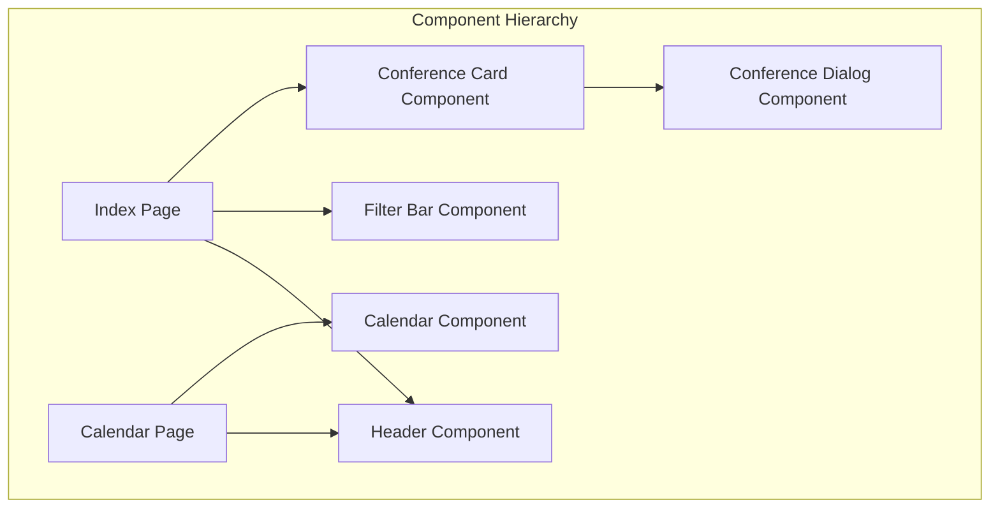
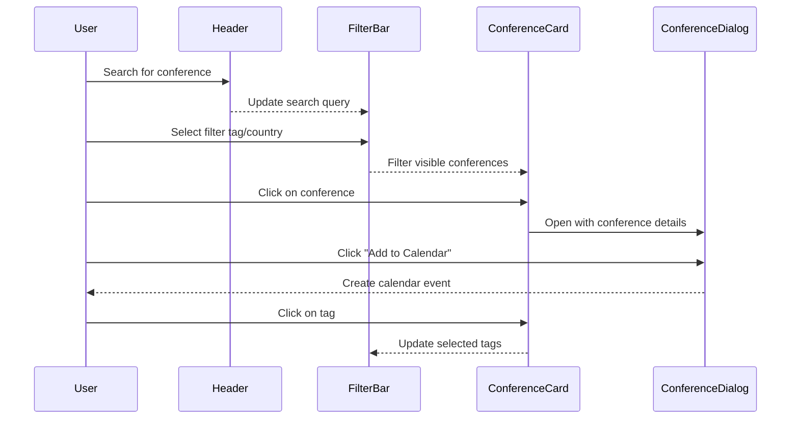
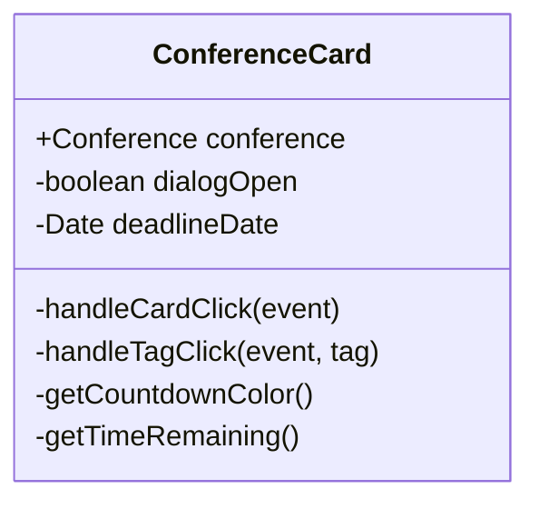
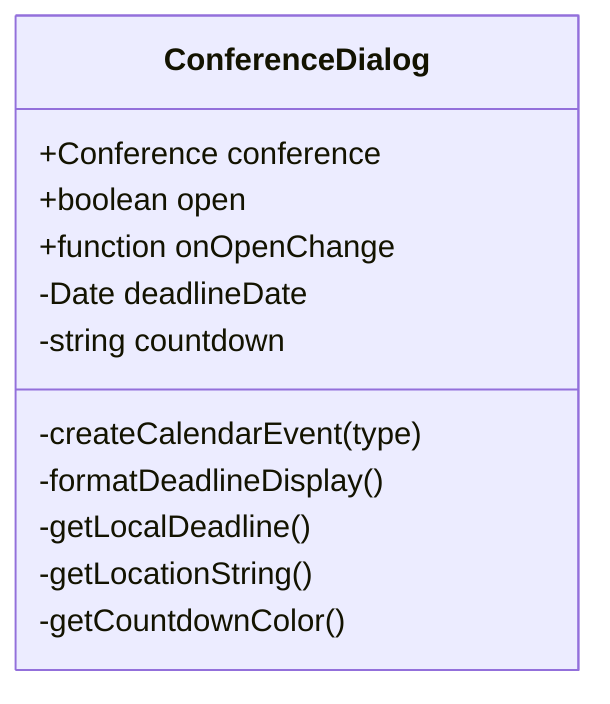
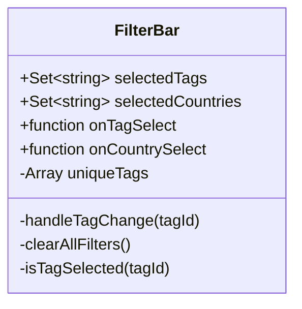
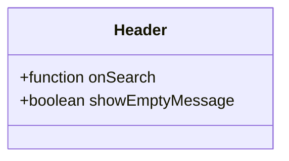
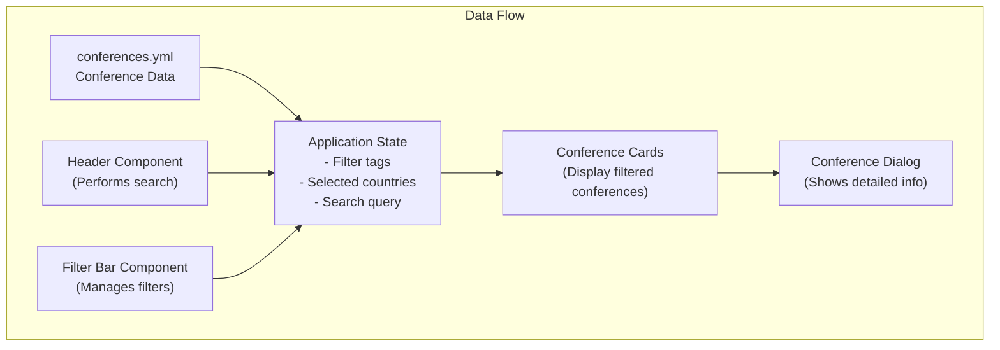

<!-- source: DeepWiki mcp.deepwiki.com · repo huggingface/ai-deadlines · page 4 UI Components · fetched 2026-10-26 -->

# UI Components

Relevant source files

The following files were used as context for generating this wiki page:

- [src/components/ConferenceCard.tsx](src/components/ConferenceCard.tsx)
- [src/components/ConferenceDialog.tsx](src/components/ConferenceDialog.tsx)
- [src/components/FilterBar.tsx](src/components/FilterBar.tsx)
- [src/components/Header.tsx](src/components/Header.tsx)

This document provides an overview of the reusable UI components that make up the AI Deadlines application interface. These components serve as the building blocks of the application's user interface, providing consistent interaction patterns and visual styling throughout the application.

For information about the main application views that utilize these components, see [Application Views](#3).

## Component Overview and Relationships

The AI Deadlines application is structured around several key UI components that are combined to create the complete user interface. These components interact to provide a cohesive user experience.

Sources: [src/components/ConferenceCard.tsx:1-182](), [src/components/ConferenceDialog.tsx:1-368](), [src/components/Header.tsx:1-123](), [src/components/FilterBar.tsx:1-135]()

## Component Interaction Flow

The following diagram illustrates how users interact with the different UI components and how these components communicate with each other.

Sources: [src/components/ConferenceCard.tsx:64-92](), [src/components/ConferenceDialog.tsx:113-173](), [src/components/FilterBar.tsx:45-62]()

## Conference Card Component

The Conference Card component displays a summary of a conference, providing essential information in a compact, clickable card format.

Key features:
- Displays conference title, year, date, location, and deadline
- Shows a color-coded countdown to the submission deadline
- Renders conference tags as clickable elements for filtering
- Opens a detailed dialog when clicked

The card uses color coding for the countdown display:
- Green: More than 30 days to deadline
- Orange: 8-30 days to deadline
- Red: 7 days or less to deadline
- Neutral gray: No deadline or deadline passed

Sources: [src/components/ConferenceCard.tsx:8-182](), [src/components/ConferenceCard.tsx:51-62]()

## Conference Dialog Component

The Conference Dialog component provides detailed information about a conference when a user clicks on a conference card.

Key features:
- Displays comprehensive conference information including full name, dates, and location
- Lists all important deadlines (abstract, submission, rebuttal periods, etc.)
- Shows a real-time countdown to the submission deadline
- Provides links to the conference website
- Allows adding the deadline to Google or Apple calendar
- Displays conference tags and notes

Sources: [src/components/ConferenceDialog.tsx:21-366](), [src/components/ConferenceDialog.tsx:113-173]()

## Filter Bar Component

The Filter Bar component enables users to filter conferences by tags and countries, providing an intuitive interface for narrowing down the conference list.

Key features:
- Provides tag filtering through a popover menu
- Displays selected filters as removable pills
- Offers a "Clear all" button to reset all filters
- Extracts unique tags from all conferences

Sources: [src/components/FilterBar.tsx:14-135](), [src/components/FilterBar.tsx:45-62]()

## Header Component

The Header component appears at the top of the application and provides navigation, search functionality, and contextual information.

Key features:
- Displays the application logo and title
- Provides navigation to the calendar view
- Contains a search input for finding conferences
- Can show a warning message when no conferences match the current filters
- Includes informational text about the application

The header adapts to different screen sizes:
- On larger screens, it shows "AI Conference Deadlines"
- On smaller screens, it displays the abbreviated "AI Deadlines"

Sources: [src/components/Header.tsx:6-123](), [src/components/Header.tsx:23-26]()

## Component Data Flow

This diagram illustrates how data flows through the UI components:

Sources: [src/components/ConferenceCard.tsx:64-92](), [src/components/FilterBar.tsx:45-62](), [src/components/Header.tsx:43-48]()

## UI Component Styling

All UI components use a combination of:

1. Tailwind CSS for styling (using utility classes)
2. Shadcn UI components for common UI elements (buttons, dialogs, etc.)
3. Lucide icons for consistent iconography

Components maintain a consistent visual language with:
- Rounded corners (rounded-lg)
- Subtle shadows (shadow-sm with hover:shadow-md)
- Consistent color palette (primary, neutral, semantic colors)
- Responsive design patterns

Sources: [src/components/ConferenceCard.tsx:96-155](), [src/components/ConferenceDialog.tsx:213-364](), [src/components/Header.tsx:13-119](), [src/components/FilterBar.tsx:64-132]()

## Summary

The UI components in AI Deadlines work together to create a cohesive user experience. Each component has a specific responsibility:

| Component | Primary Responsibility | Key Features |
|-----------|------------------------|--------------|
| ConferenceCard | Display conference summary | Countdown, clickable tags, opens dialog |
| ConferenceDialog | Show conference details | All dates, add to calendar, website link |
| FilterBar | Manage filtering | Tag filters, filter pills, clear filters |
| Header | Navigation and search | Search input, navigation links, responsive design |
| Calendar Components | Display calendar view | Conference date visualization |

For detailed information about specific components, see:
- [Conference Card](#4.1)
- [Conference Dialog](#4.2)
- [Filter System](#4.3)
- [Header Component](#4.4)
- [Calendar Components](#4.5)

---

