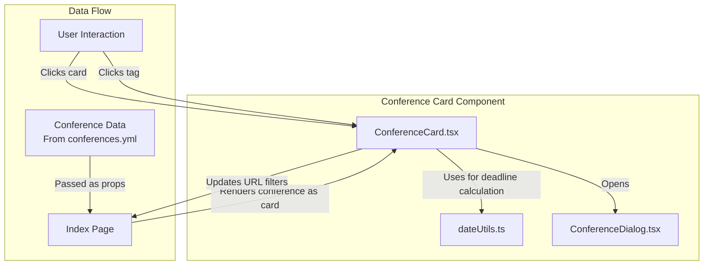
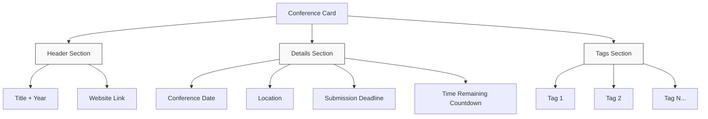
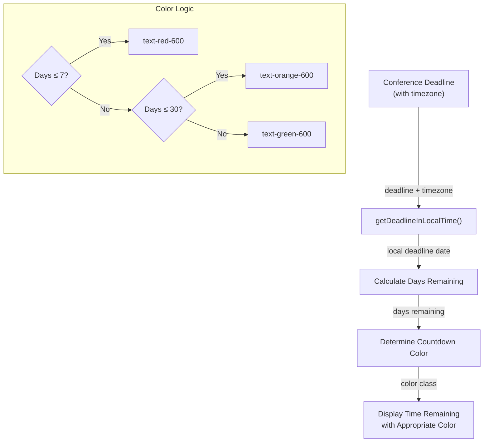
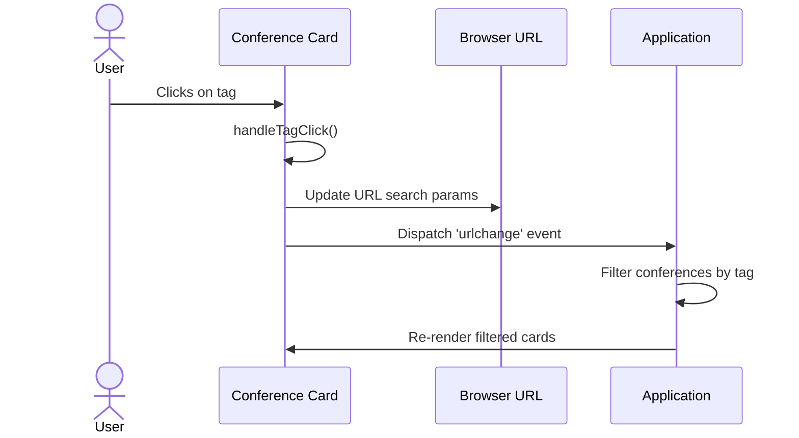
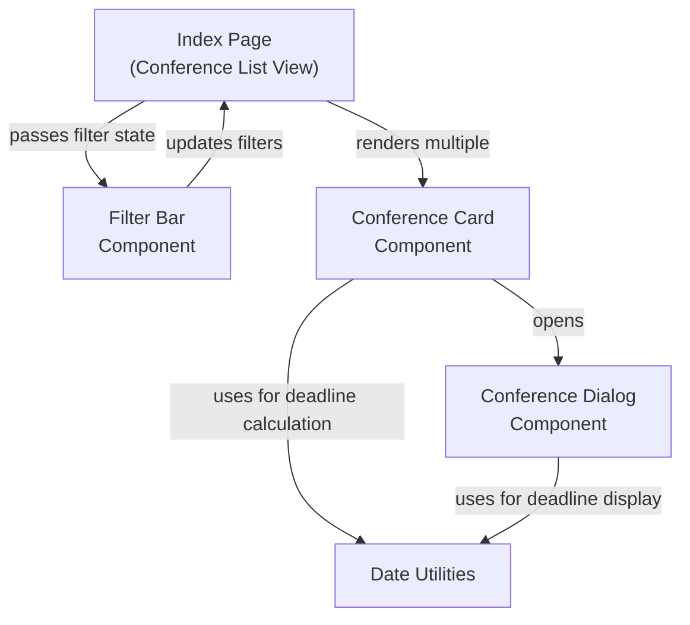

<!-- source: DeepWiki mcp.deepwiki.com · repo huggingface/ai-deadlines · page 4.1 Conference Card · fetched 2026-10-26 -->

# Conference Card

<details>
<summary>Relevant source files</summary>

The following files were used as context for generating this wiki page:

- [src/components/ConferenceCard.tsx](src/components/ConferenceCard.tsx)
- [src/utils/dateUtils.ts](src/utils/dateUtils.ts)

</details>


The Conference Card component is a key UI element in the AI Deadlines application that displays a summary of an academic conference. It serves as the primary interactive element on the main conference listing page, presenting essential conference information in a compact and user-friendly format.

For detailed information about viewing all conference cards together, see [Conference Listing View](#3.1). For information about the detailed view that appears when clicking a card, see [Conference Dialog](#4.2).

## Purpose and Responsibility

The Conference Card component is responsible for:
1. Displaying essential conference information in a standardized card format
2. Converting and displaying deadline times in the user's local timezone
3. Providing visual indicators for deadline proximity
4. Enabling tag-based filtering through interactive conference tags
5. Serving as an entry point to the detailed conference dialog



Sources: [src/components/ConferenceCard.tsx:8-179](). [src/utils/dateUtils.ts:4-70]()

## Component Interface

The Conference Card accepts a Conference object as props, which includes all information about a conference. The key properties used by the card include:

| Property | Type | Description |
|----------|------|-------------|
| title | string | Short name of the conference |
| full_name | string | Full name of the conference |
| year | number | Conference year |
| date | string | Conference date(s) |
| deadline | string | Submission deadline |
| timezone | string | Timezone of the deadline |
| tags | string[] | Conference categories/topics |
| link | string | URL to the conference website |
| city | string | Conference city |
| country | string | Conference country |
| note | string | Additional conference notes |
| abstract_deadline | string | Abstract submission deadline |
| venue | string | Conference venue |

Sources: [src/components/ConferenceCard.tsx:8-23]()

## Visual Structure

The Conference Card presents information in a hierarchical layout with carefully organized sections:



Sources: [src/components/ConferenceCard.tsx:94-156]()

## Deadline Handling and Display

One of the most important features of the Conference Card is how it handles and displays deadline information, particularly:

1. Converting deadline times to the user's local timezone
2. Calculating and displaying the time remaining until the deadline
3. Color-coding the countdown based on proximity to the deadline



Sources: [src/components/ConferenceCard.tsx:25-62](), [src/utils/dateUtils.ts:4-70]()

The deadline conversion process involves several steps:
1. Parsing the deadline string into a Date object
2. Normalizing the timezone format (handling special cases like "AoE")
3. Converting the deadline from conference timezone to UTC
4. Converting from UTC to the user's local timezone
5. Formatting the time remaining in a human-readable format

## User Interactions

The Conference Card supports two primary user interactions:

### 1. Card Click

When a user clicks anywhere on the card (except on links or tags), it opens a detailed Conference Dialog:

```javascript
const handleCardClick = (e: React.MouseEvent) => {
  if (!(e.target as HTMLElement).closest('a') && 
      !(e.target as HTMLElement).closest('.tag-button')) {
    setDialogOpen(true);
  }
};
```

Sources: [src/components/ConferenceCard.tsx:64-69]()

### 2. Tag Click

When a user clicks on a tag, it updates the URL query parameters to filter the conference list by that tag:



Sources: [src/components/ConferenceCard.tsx:71-92]()

## Component Implementation Details

### State Management

The Conference Card maintains a single piece of state:
- `dialogOpen`: Boolean state that controls whether the Conference Dialog is open or closed

```javascript
const [dialogOpen, setDialogOpen] = useState(false);
```

Sources: [src/components/ConferenceCard.tsx:24]()

### Deadline Calculation

The component calls the `getDeadlineInLocalTime` utility function to convert the deadline to the user's local time:

```javascript
const deadlineDate = getDeadlineInLocalTime(deadline, timezone);
```

This function handles complex timezone conversions, including special cases like "AoE" (Anywhere on Earth, UTC-12).

Sources: [src/components/ConferenceCard.tsx:25](), [src/utils/dateUtils.ts:4-70]()

### Time Remaining Display

The component calculates the time remaining until the deadline using the `formatDistanceToNow` function from date-fns:

```javascript
const getTimeRemaining = () => {
  if (!deadlineDate || !isValid(deadlineDate)) {
    return 'TBD';
  }
  
  if (isPast(deadlineDate)) {
    return 'Deadline passed';
  }
  
  try {
    return formatDistanceToNow(deadlineDate, { addSuffix: true });
  } catch (error) {
    console.error('Error formatting time remaining:', error);
    return 'Invalid date';
  }
};
```

Sources: [src/components/ConferenceCard.tsx:28-43]()

### Visual Countdown Indicators

The component uses a color-coding system to indicate the proximity of the deadline:
- Red: 7 days or less remaining
- Orange: 8-30 days remaining
- Green: More than 30 days remaining

```javascript
const getCountdownColor = () => {
  if (!deadlineDate || !isValid(deadlineDate)) return "text-neutral-600";
  try {
    const daysRemaining = Math.ceil((deadlineDate.getTime() - new Date().getTime()) / (1000 * 60 * 60 * 24));
    if (daysRemaining <= 7) return "text-red-600";
    if (daysRemaining <= 30) return "text-orange-600";
    return "text-green-600";
  } catch (error) {
    console.error('Error calculating countdown color:', error);
    return "text-neutral-600";
  }
};
```

Sources: [src/components/ConferenceCard.tsx:51-62]()

## Integration with Other Components

The Conference Card plays a central role in the application's component hierarchy:



Sources: [src/components/ConferenceCard.tsx:158-177]()

When a user clicks on a Conference Card, it opens a Conference Dialog component with the full conference details:

```javascript
<ConferenceDialog
  conference={{
    title,
    full_name,
    year,
    date,
    deadline,
    timezone,
    tags,
    link,
    note,
    abstract_deadline,
    city,
    country,
    venue,
    ...conferenceProps
  }}
  open={dialogOpen}
  onOpenChange={setDialogOpen}
/>
```

Sources: [src/components/ConferenceCard.tsx:158-177]()

## Conclusion

The Conference Card component serves as the primary visual representation of conference data in the AI Deadlines application. By handling complex timezone calculations, providing visual deadline indicators, and enabling interactive filtering through tags, it creates an intuitive and informative user experience that helps researchers track important conference deadlines.

---

