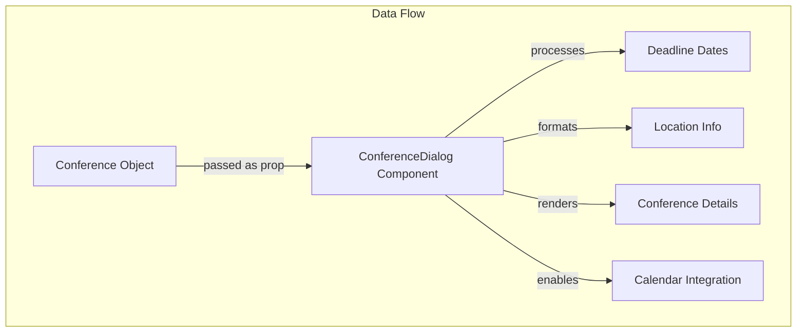
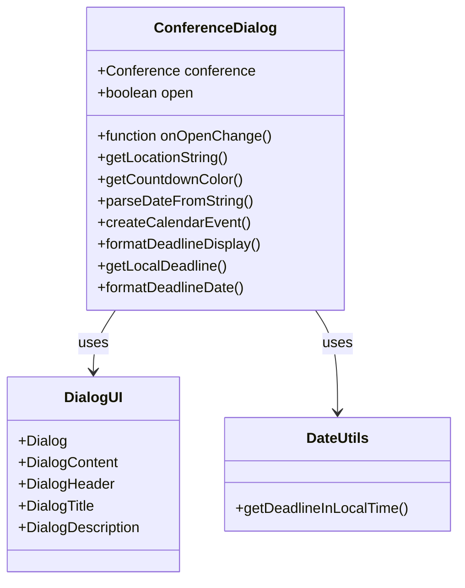
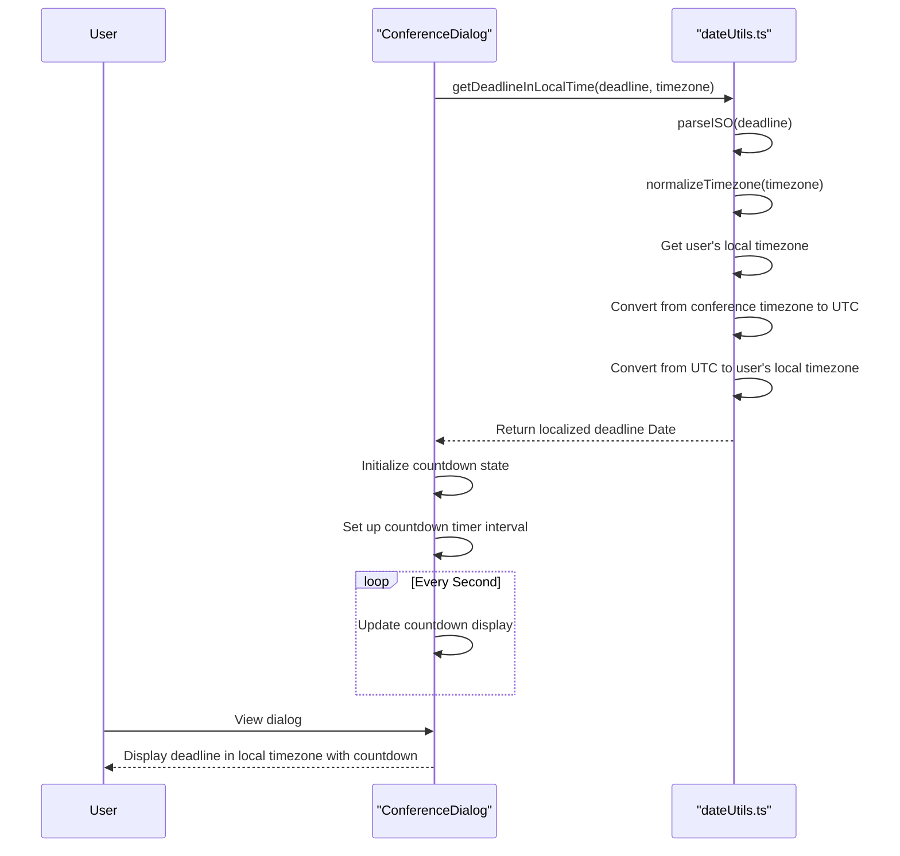
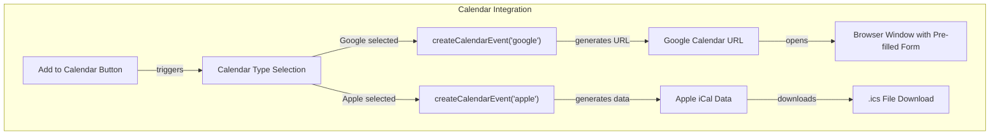
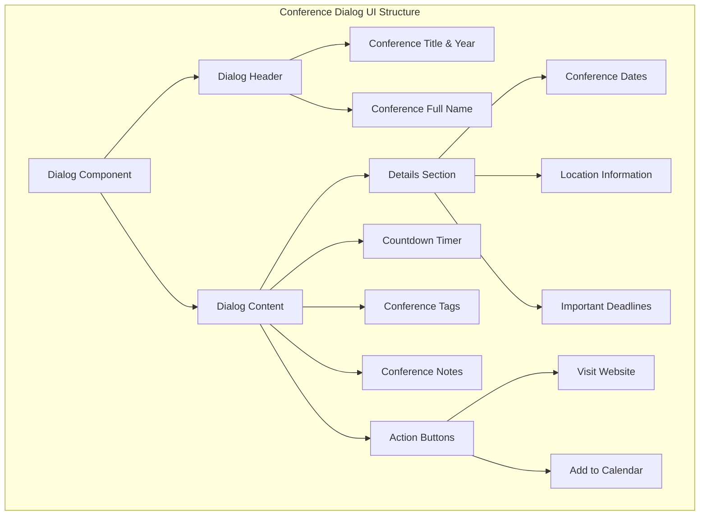
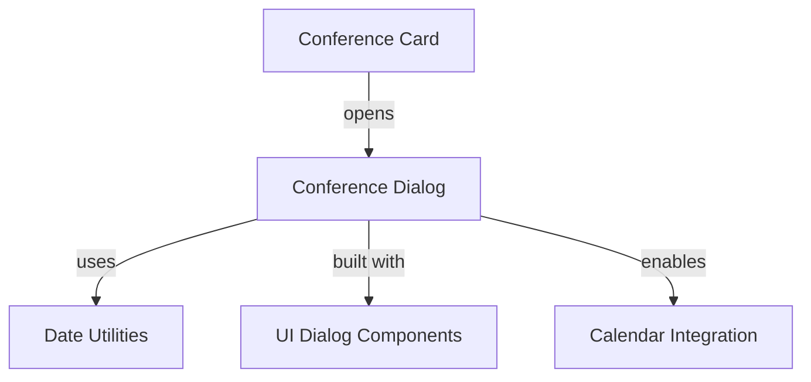

<!-- source: DeepWiki mcp.deepwiki.com · repo huggingface/ai-deadlines · page 4.2 Conference Dialog · fetched 2026-10-26 -->

# Conference Dialog

<details>
<summary>Relevant source files</summary>

The following files were used as context for generating this wiki page:

- [src/components/ConferenceDialog.tsx](src/components/ConferenceDialog.tsx)
- [src/components/ui/dialog.tsx](src/components/ui/dialog.tsx)
- [src/utils/dateUtils.ts](src/utils/dateUtils.ts)

</details>


The Conference Dialog component provides a detailed modal view of individual academic conferences in the AI Deadlines application. It displays comprehensive information about a conference, including deadlines, location details, important dates, and provides functionality for adding conference deadlines to calendars. This dialog appears when users click on a conference card in the main listing view.

For information about the summary view of conferences, see [Conference Card](#4.1).

## Overview

The Conference Dialog component serves as the detailed information layer in the application's UI hierarchy. When triggered, it presents a modal overlay containing comprehensive information about a specific academic conference, with special emphasis on deadline information and calendar integration.



Sources: [src/components/ConferenceDialog.tsx:21-26](), [src/components/ConferenceDialog.tsx:27-366]()

## Component Structure

The Conference Dialog component is built using Radix UI's Dialog primitives and consists of several sections that display different aspects of a conference.



Sources: [src/components/ConferenceDialog.tsx:1-7](), [src/components/ConferenceDialog.tsx:21-26](), [src/components/ui/dialog.tsx:1-121](), [src/utils/dateUtils.ts:1-70]()

## Key Features

### Timezone-Aware Deadline Display

The dialog converts conference deadlines from their original timezone to the user's local timezone for improved user experience. It maintains a live countdown timer to the submission deadline that updates every second.



Sources: [src/components/ConferenceDialog.tsx:19-30](), [src/components/ConferenceDialog.tsx:54-80](), [src/utils/dateUtils.ts:4-70]()

### Calendar Integration

The dialog provides functionality to add conference deadlines to calendar applications, supporting both Google Calendar and Apple Calendar formats.



Sources: [src/components/ConferenceDialog.tsx:113-173](), [src/components/ConferenceDialog.tsx:335-360]()

### Multiple Deadline Types

The dialog supports displaying various types of academic conference deadlines, presenting them in a structured, easy-to-scan format.

| Deadline Type | Description | Source |
|---------------|-------------|--------|
| Abstract Deadline | The date by which abstract submissions are due | [ConferenceDialog.tsx:251-255]() |
| Submission Deadline | The main paper submission deadline | [ConferenceDialog.tsx:256-258]() |
| Commitment Deadline | The date for authors to commit to submission | [ConferenceDialog.tsx:259-263]() |
| Review Release Date | When reviews will be released to authors | [ConferenceDialog.tsx:264-268]() |
| Rebuttal Period | The start and end dates for author rebuttals | [ConferenceDialog.tsx:269-273]() |
| Final Decision Date | When final acceptance decisions will be announced | [ConferenceDialog.tsx:274-278]() |

Sources: [src/components/ConferenceDialog.tsx:250-279]()

## Implementation Details

### Conference Dialog Props Interface

The component accepts three props:

```typescript
interface ConferenceDialogProps {
  conference: Conference;  // The conference data object
  open: boolean;           // Dialog open state
  onOpenChange: (open: boolean) => void;  // Dialog state change handler
}
```

Sources: [src/components/ConferenceDialog.tsx:21-25]()

### Deadline Handling Functions

The component includes several utility functions for handling and formatting deadlines:

1. `getCountdownColor`: Returns the appropriate CSS color class based on deadline proximity
2. `formatDeadlineDisplay`: Formats the deadline with timezone information
3. `getLocalDeadline`: Retrieves the deadline in user's local timezone
4. `formatDeadlineDate`: Formats any deadline date consistently

Sources: [src/components/ConferenceDialog.tsx:82-88](), [src/components/ConferenceDialog.tsx:179-210]()

### Calendar Event Creation

The `createCalendarEvent` function handles the creation of calendar events for both Google Calendar and Apple Calendar:

```mermaid
flowchart TD
    start["createCalendarEvent(type)"] -->|validate| check{"Is deadline valid?"}
    check -->|no| error["Throw Error"]
    check -->|yes| parse["Parse deadline date"]
    parse --> end["Create end date (deadline + 1 hour)"]
    end --> format{"Which calendar type?"}
    
    format -->|Google| google["Format for Google Calendar"]
    format -->|Apple| apple["Format for Apple Calendar"]
    
    google --> gUrl["Create Google Calendar URL"]
    apple --> aUrl["Create Apple iCal data URL"]
    
    gUrl --> gOpen["Open URL in new tab"]
    aUrl --> aCreate["Create download link"]
    aCreate --> aClick["Trigger download"]
    aClick --> aCleanup["Clean up DOM element"]
```

Sources: [src/components/ConferenceDialog.tsx:113-173]()

## UI Layout and Rendering

The dialog UI is structured into several sections:

1. **Header**: Contains the conference title and full name
2. **Conference Details**: Includes dates, location, and important deadlines
3. **Countdown Timer**: Shows time remaining until the submission deadline
4. **Tags**: Displays conference category tags
5. **Notes**: Shows additional notes about the conference
6. **Action Buttons**: Provides links to the conference website and calendar integration



Sources: [src/components/ConferenceDialog.tsx:212-364]()

## Integration with Other Components

The Conference Dialog integrates with several other components and utilities in the system:

1. It receives Conference objects from the Conference Card component
2. It uses date utilities from the Date Utilities module
3. It leverages UI components from the UI library
4. It provides calendar integration functionality



Sources: [src/components/ConferenceDialog.tsx:1-18](), [src/components/ConferenceDialog.tsx:113-173]()

## Key Rendering Functions

| Function | Purpose | Source |
|----------|---------|--------|
| `getLocationString` | Format location from venue, city, and country | [ConferenceDialog.tsx:32-49]() |
| `formatDeadlineDisplay` | Format deadline with timezone information | [ConferenceDialog.tsx:179-193]() |
| `formatDeadlineDate` | Format any deadline date consistently | [ConferenceDialog.tsx:202-210]() |

Sources: [src/components/ConferenceDialog.tsx:32-49](), [src/components/ConferenceDialog.tsx:179-210]()

## Accessibility and User Experience

The dialog component includes several features to enhance accessibility and user experience:

1. Responsive design that works well on different screen sizes
2. Timezone conversion to show deadlines in the user's local timezone
3. Visual countdown timer with color-coding based on urgency
4. Close button with keyboard accessibility
5. Overflow scrolling for tall content

Sources: [src/components/ui/dialog.tsx:30-53](), [src/components/ConferenceDialog.tsx:82-88]()

## Example Usage

The Conference Dialog is typically opened when a user clicks on a conference card in the main listing view. The parent component passes the conference data, open state, and change handler to the dialog component.

---

