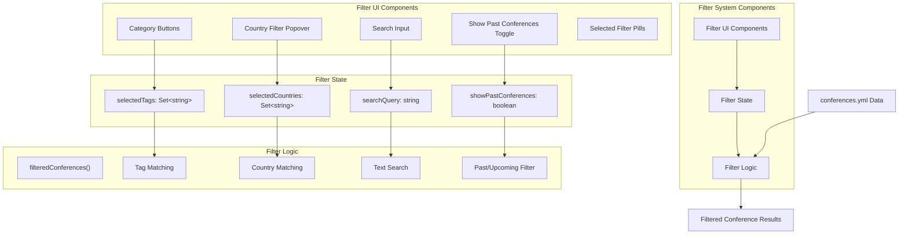
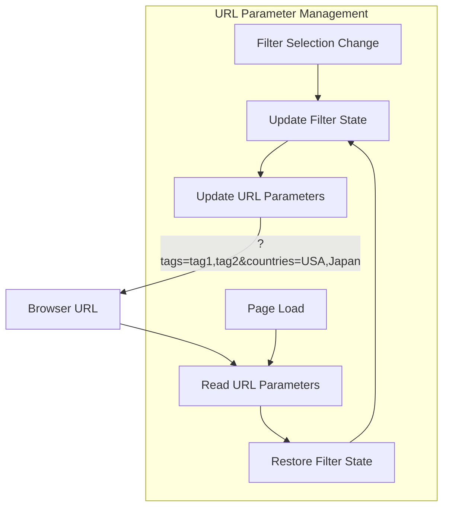
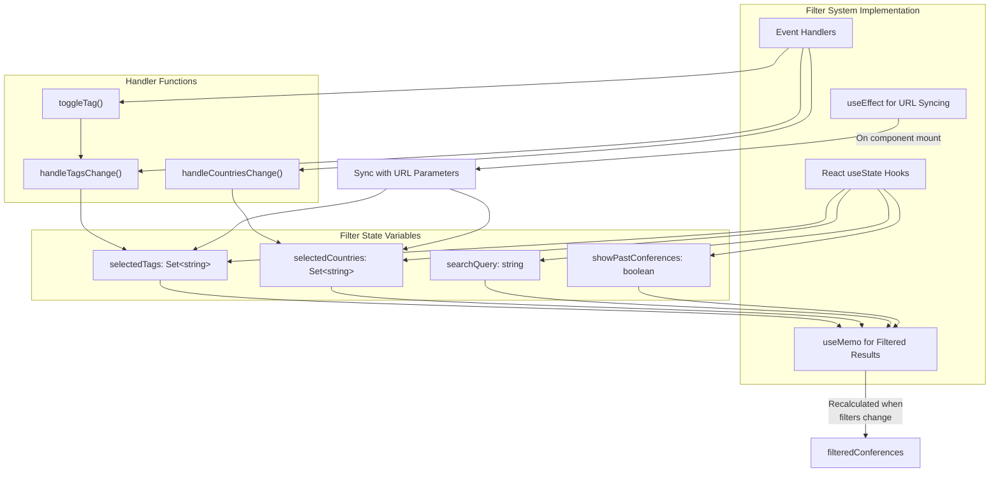

<!-- source: DeepWiki mcp.deepwiki.com · repo huggingface/ai-deadlines · page 4.3 Filter System · fetched 2026-10-26 -->

# Filter System

<details>
<summary>Relevant source files</summary>

The following files were used as context for generating this wiki page:

- [src/components/FilterBar.tsx](src/components/FilterBar.tsx)
- [src/pages/Index.tsx](src/pages/Index.tsx)

</details>


The Filter System enables users to refine the conference listing based on multiple criteria including research categories (tags), conference locations (countries), text search, and conference timing. It is a core component of the main listing view, allowing users to quickly find relevant conferences that match their specific interests and requirements.

For information about the Conference Listing View that uses this filter system, see [Conference Listing View](#3.1).

## Overview

The Filter System consists of multiple interconnected components and state management mechanisms that allow users to filter the conference listing in several ways:

1. **Tag filtering**: Conferences can be filtered by research categories like "Machine Learning", "Computer Vision", etc.
2. **Country filtering**: Users can filter conferences by the country where they take place
3. **Text search**: Users can search for conferences by name
4. **Timeline filtering**: Toggle to show or hide past conferences



Sources: [src/pages/Index.tsx:19-22](), [src/pages/Index.tsx:40-83](), [src/components/FilterBar.tsx:14-19]()

## Filter State Management

The Filter System maintains its state primarily in the Index component with the following state variables:

```typescript
const [selectedTags, setSelectedTags] = useState<Set<string>>(new Set());
const [selectedCountries, setSelectedCountries] = useState<Set<string>>(new Set());
const [searchQuery, setSearchQuery] = useState("");
const [showPastConferences, setShowPastConferences] = useState(false);
```

These state variables control which filters are currently applied. The Filter System also persists filter selections in the URL, allowing users to share filtered views and maintain state across page refreshes.

```mermaid
sequenceDiagram
    participant User
    participant UI as "Filter UI Components"
    participant State as "Filter State"
    participant URL as "URL Parameters"
    participant Results as "Conference Results"

    User->>UI: Select Tag/Country Filter
    UI->>State: Update selectedTags/Countries
    State->>URL: Update URL parameters
    State->>Results: Recompute filtered conferences
    Results->>UI: Update displayed conferences

    Note over State,URL: URL persistence enables sharing<br>filtered views with others

    User->>+UI: Page Load/Refresh
    UI->>URL: Read URL parameters
    URL->>State: Restore filter state
    State->>Results: Apply saved filters
    Results->>-UI: Display filtered conferences
```

Sources: [src/pages/Index.tsx:19-22](), [src/pages/Index.tsx:87-106](), [src/pages/Index.tsx:119-134]()

## Filter Types and Implementation

### Tag Filtering

The system provides pre-defined research area tags that users can select to filter conferences. These include Machine Learning, Computer Vision, Natural Language Processing, and others.

- Tag selection is implemented using a `Set<string>` to track selected tags
- Multiple tags can be selected simultaneously (OR logic is applied)
- Tags are derived from the `tags` array in each conference object

Tag filtering logic:
```javascript
const matchesTags = selectedTags.size === 0 || 
  (Array.isArray(conf.tags) && conf.tags.some(tag => selectedTags.has(tag)));
```

Sources: [src/pages/Index.tsx:25-38](), [src/pages/Index.tsx:54-55](), [src/components/FilterBar.tsx:45-57]()

### Country Filtering

Users can filter conferences based on the country where they take place:

- Countries are extracted from conference data using the `extractCountry` and `getAllCountries` utility functions
- Like tags, countries use a `Set<string>` to track selections
- The UI displays countries in a popover menu with checkboxes

Country filtering logic:
```javascript
const matchesCountry = selectedCountries.size === 0 || 
  (conf.country && selectedCountries.has(conf.country));
```

Sources: [src/pages/Index.tsx:58-59](), [src/pages/Index.tsx:97-106](), [src/pages/Index.tsx:205-229]()

### Text Search

The search functionality allows users to find conferences by name:

- Searches both the short title and full conference name
- Case-insensitive matching
- Provided through the Header component's search input

Text search logic:
```javascript
const matchesSearch = searchQuery === "" || 
  conf.title.toLowerCase().includes(searchQuery.toLowerCase()) ||
  (conf.full_name && conf.full_name.toLowerCase().includes(searchQuery.toLowerCase()));
```

Sources: [src/pages/Index.tsx:62-64](), [src/pages/Index.tsx:142-145]()

### Past/Upcoming Conference Toggle

A toggle switch allows users to control whether past conferences are included in the results:

- By default, only upcoming conferences are shown
- Past conference detection uses the `isPast` function from date-fns

Timeline filtering logic:
```javascript
const deadlineDate = conf.deadline && conf.deadline !== 'TBD' ? parseISO(conf.deadline) : null;
const isUpcoming = !deadlineDate || !isValid(deadlineDate) || !isPast(deadlineDate);
if (!showPastConferences && !isUpcoming) return false;
```

Sources: [src/pages/Index.tsx:49-51](), [src/pages/Index.tsx:177-186]()

## Filter Combination and Results

All filter types are combined using AND logic in the `filteredConferences` function. This means a conference must satisfy all active filter criteria to appear in the results:

```javascript
return matchesTags && matchesCountry && matchesSearch;
```

After filtering, conferences are sorted by deadline date using the `getDeadlineInLocalTime` utility function to ensure deadlines are correctly compared across different timezones.

Sources: [src/pages/Index.tsx:66](), [src/pages/Index.tsx:68-82]()

## URL Parameter Management

The Filter System persists filter selections in the URL using URL parameters:

- `tags`: Comma-separated list of selected tags
- `countries`: Comma-separated list of selected countries

This implementation allows users to:
- Share filtered views with others
- Maintain filter state across page refreshes
- Bookmark specific filtered views

The system reads these parameters on initial load and updates them when filters change.



Sources: [src/pages/Index.tsx:87-106](), [src/pages/Index.tsx:119-134]()

## UI Components

The Filter System's UI consists of several interactive components:

### Category Buttons

Quick-access buttons for the most common research categories (tags) displayed at the top of the page.

Sources: [src/pages/Index.tsx:148-173]()

### Country Filter Popover

A dropdown menu allowing users to select countries from a scrollable list with checkboxes.

Sources: [src/pages/Index.tsx:187-233](), [src/components/FilterBar.tsx:68-102]()

### Selected Filter Pills

Pills displaying currently active filters with an "X" button to remove individual filters.

Sources: [src/pages/Index.tsx:235-249](), [src/components/FilterBar.tsx:116-128]()

### "Clear All Filters" Button

A button to reset all filters at once.

Sources: [src/pages/Index.tsx:251-265](), [src/components/FilterBar.tsx:104-114]()

### "Show Past Conferences" Toggle

A switch to include or exclude conferences with past deadlines.

Sources: [src/pages/Index.tsx:177-186]()

## Implementation Details

The Filter System combines React hooks, state management, and memoization for efficient filtering:



Sources: [src/pages/Index.tsx:19-22](), [src/pages/Index.tsx:40-83](), [src/pages/Index.tsx:85-118](), [src/pages/Index.tsx:119-134]()

## Integration with Other Components

The Filter System integrates with several other components in the application:

1. **Header Component**: Provides the search input that feeds into the filter system
2. **ConferenceCard Component**: Receives and displays the filtered conference results
3. **Country Extractor Utility**: Extracts country information from conference location data
4. **Date Utilities**: Helps with deadline comparison and timezone handling

Sources: [src/pages/Index.tsx:1-3](), [src/pages/Index.tsx:9](), [src/pages/Index.tsx:14-16](), [src/pages/Index.tsx:142-145]()

---

