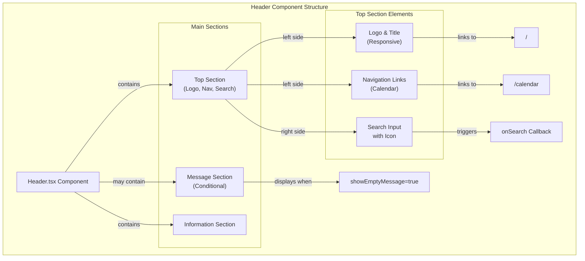
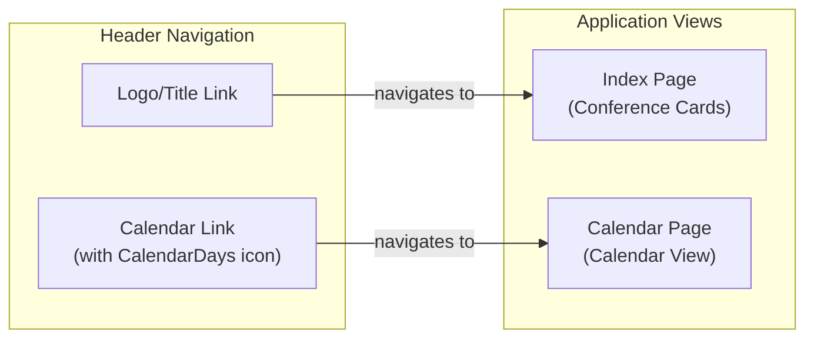
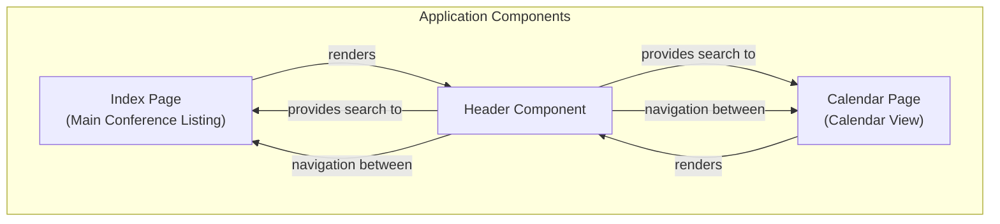

<!-- source: DeepWiki mcp.deepwiki.com · repo huggingface/ai-deadlines · page 4.4 Header Component · fetched 2026-10-26 -->

# Header Component

<details>
<summary>Relevant source files</summary>

The following files were used as context for generating this wiki page:

- [src/components/Header.tsx](src/components/Header.tsx)

</details>


## Purpose and Scope

The Header Component provides the primary navigation and search interface for the AI Deadlines application. This document details the structure, functionality, and integration of the Header component which appears consistently at the top of the application across different views.

The Header offers:
- Application branding and navigation
- Search functionality
- Conditional notification messages
- Information about the project with relevant links

For information about filtering conferences by tags and other criteria, see the [Filter System](#4.3).

## Component Structure

The Header component is implemented as a React functional component that accepts specific props through a defined interface.



Sources: [src/components/Header.tsx:11-120]()

### Props Interface

The Header component accepts the following props:

```typescript
interface HeaderProps {
  onSearch: (query: string) => void;
  showEmptyMessage?: boolean;
}
```

- `onSearch`: A callback function that receives the user's search input
- `showEmptyMessage`: Optional boolean that controls visibility of a notification when no conferences match filters

Sources: [src/components/Header.tsx:6-9]()

## Visual Layout

The Header component is structured in three main sections:

1. **Top Bar (Navigation and Search)**:
   - Left: Hugging Face logo and application title that link to home
   - Left (Desktop only): Navigation link to Calendar view with icon
   - Right: Search input with search icon

2. **Notification Area (Conditional)**:
   - Displays a message when no conferences match the current filters
   - Only shown when `showEmptyMessage` is true

3. **Information Footer**:
   - Description of the site's purpose
   - Link to GitHub repository for contributions
   - Links to Hugging Face resources (papers, models, datasets, demos)

Sources: [src/components/Header.tsx:13-118]()

## Navigation System

The Header provides application navigation through React Router Link components:



Sources: [src/components/Header.tsx:17-36]()

## Search Functionality

The search implementation provides a key filtering capability in the application:

```mermaid
sequenceDiagram
    participant User
    participant HeaderComponent as "Header Component"
    participant ParentComponent as "Parent Component"
    participant ConferenceData as "Conference Listing"
    
    User->>HeaderComponent: Types in search box
    HeaderComponent->>ParentComponent: Calls onSearch(query)
    ParentComponent->>ConferenceData: Filters conferences by query
    ConferenceData-->>User: Displays filtered results
    
    Note over HeaderComponent,ParentComponent: Header passes query to parent;<br>parent handles actual filtering
```

The search input is styled with:
- A magnifying glass icon from lucide-react
- Left padding to accommodate the icon
- Full width on mobile, constrained width on desktop

Sources: [src/components/Header.tsx:38-49]()

## Responsive Design

The Header adapts to different screen sizes:

| Feature | Mobile (<768px) | Desktop (≥768px) |
|---------|-----------------|------------------|
| Title | "AI Deadlines" (short) | "AI Conference Deadlines" (full) |
| Layout | Vertical (stacked) | Horizontal (row) |
| Navigation | Hidden | Visible |
| Content width | Full width | Max-width with padding |

The responsive behavior is implemented using Tailwind CSS utility classes:

- Flex direction changes: `flex-col md:flex-row`
- Conditional text display: `hidden md:inline` and `md:hidden`
- Padding adjustments: `py-4 md:py-0`
- Width control: `w-full md:max-w-lg`

Sources: [src/components/Header.tsx:15-26](), [src/components/Header.tsx:28-36](), [src/components/Header.tsx:38]()

## Empty Results Notification

When `showEmptyMessage` is true, the Header displays a notification banner indicating that no conferences match the current filter criteria. This typically appears when:

1. The user has applied filters that exclude all conferences
2. The user has searched for terms that don't match any conferences
3. The "Show past conferences" option is disabled but all conferences in the selected categories are in the past

The message is styled as an amber alert banner that stands out visually.

Sources: [src/components/Header.tsx:52-58]()

## Information Area

The bottom section of the Header contains informational text that:

1. Explains the site's purpose (tracking AI conference deadlines)
2. Provides a link to GitHub for contributing via pull requests
3. Includes links to Hugging Face resources for:
   - Paper submissions
   - Model uploads
   - Dataset sharing
   - Demo creation

This information helps users understand how to contribute to the project and utilize related Hugging Face resources.

Sources: [src/components/Header.tsx:59-117]()

## Integration with Application Views

The Header component is used by both main views in the application:



The Header component provides a consistent user experience across these views, with the parent components handling the search functionality by passing an appropriate `onSearch` callback.

Sources: [src/components/Header.tsx:11]()

---

