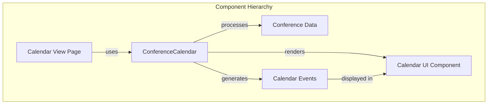
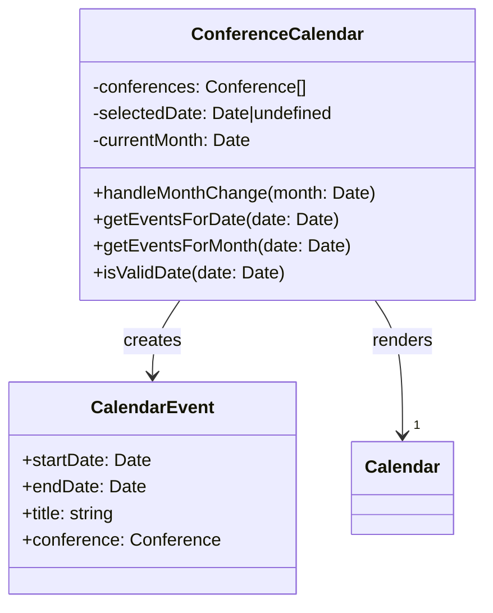
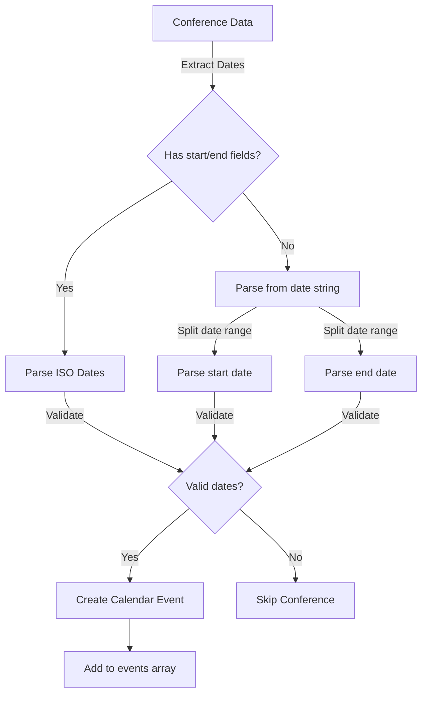
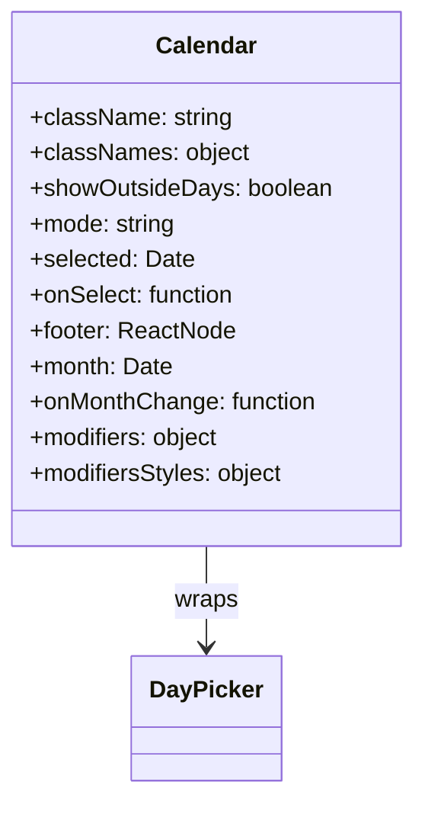
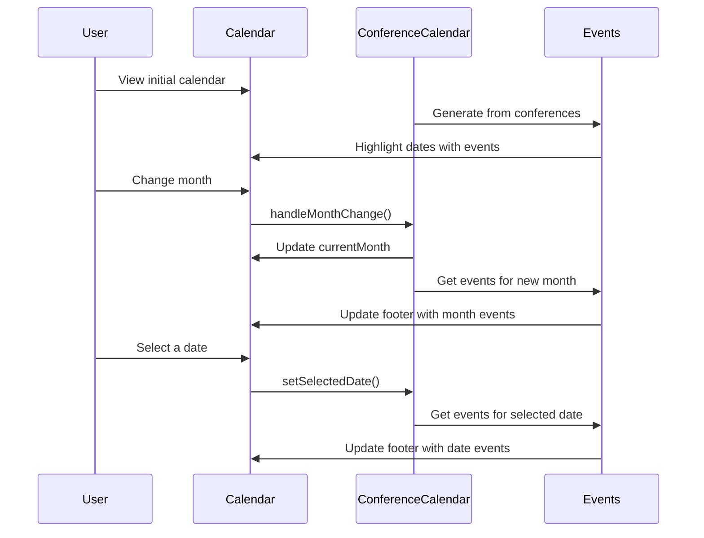

<!-- source: DeepWiki mcp.deepwiki.com · repo huggingface/ai-deadlines · page 4.5 Calendar Components · fetched 2026-10-26 -->

# Calendar Components

<details>
<summary>Relevant source files</summary>

The following files were used as context for generating this wiki page:

- [src/components/ConferenceCalendar.tsx](src/components/ConferenceCalendar.tsx)
- [src/components/ui/calendar.tsx](src/components/ui/calendar.tsx)

</details>


This page documents the calendar components used in the AI Deadlines application to display conferences in a calendar format. These components transform raw conference data into interactive calendar views, allowing users to explore conferences by date. For information about the main conference listing view, see [Conference Listing View](#3.1).

## Component Architecture

The calendar functionality is implemented through two main components:

1. **ConferenceCalendar** - A specialized component that processes conference data, manages calendar state, and displays conference events
2. **Calendar** - A UI wrapper around the react-day-picker library that provides consistent styling and interaction



Sources: [src/components/ConferenceCalendar.tsx:1-164](), [src/components/ui/calendar.tsx:1-64]()

## ConferenceCalendar Component

The `ConferenceCalendar` component is the core of the calendar functionality, responsible for:

- Converting conference data into calendar events
- Managing state for selected dates and current month
- Providing methods to filter events by date and month
- Rendering the calendar UI with event indicators
- Displaying event details for selected dates and the current month



Sources: [src/components/ConferenceCalendar.tsx:6-142]()

### State Management

The component maintains two key pieces of state:

1. `selectedDate` - The currently selected date in the calendar
2. `currentMonth` - The month currently being displayed

```typescript
const [selectedDate, setSelectedDate] = useState<Date | undefined>(undefined);
const [currentMonth, setCurrentMonth] = useState<Date>(new Date());
```

Sources: [src/components/ConferenceCalendar.tsx:11-12]()

### Conference to Event Transformation

The component converts conference data into calendar events by extracting and parsing conference dates. It handles various date formats and patterns, including:

1. Dedicated `start` and `end` ISO date fields
2. Date ranges in string format (e.g., "Aug 15, 2023 - Aug 20, 2023")



Sources: [src/components/ConferenceCalendar.tsx:21-69]()

### Event Filtering

The component provides two methods for filtering events:

1. `getEventsForDate` - Returns events occurring on a specific date
2. `getEventsForMonth` - Returns events occurring within or overlapping a specific month

Sources: [src/components/ConferenceCalendar.tsx:76-96]()

### Event Display

Events are displayed in the calendar's footer section, which shows:

1. A list of all events in the current month
2. A list of events occurring on the selected date (if any)

For each event, it displays:
- Conference title
- Date range
- Location information (venue, city, and/or country)

Sources: [src/components/ConferenceCalendar.tsx:98-142]()

## Calendar UI Component

The `Calendar` component is a styled wrapper around the `react-day-picker` library that provides:

1. Consistent styling with the application's design system
2. Month navigation controls
3. Day highlighting for today and selected dates
4. Support for custom modifiers to highlight dates with events



Sources: [src/components/ui/calendar.tsx:10-60]()

### Styling and Customization

The Calendar component uses the `cn` utility function to apply consistent styling. It defines custom classNames for various calendar elements:

- months, month, caption, nav, table, etc.
- Special styling for different day states (selected, today, outside days)

Sources: [src/components/ui/calendar.tsx:19-52]()

### Custom Navigation Icons

The Calendar component uses custom icons from the `lucide-react` library for month navigation:

- `ChevronLeft` for previous month
- `ChevronRight` for next month

Sources: [src/components/ui/calendar.tsx:53-56]()

## Integration and Usage

The `ConferenceCalendar` component is integrated into the Calendar View page of the application. When rendered, it:

1. Receives the list of conferences as props
2. Processes this data into calendar events
3. Renders the Calendar UI component with event highlighting
4. Displays event information in the footer

Events are highlighted in the calendar using custom modifiers:

```typescript
modifiers={{
  event: (date) => getEventsForDate(date).length > 0
}}
modifiersStyles={{
  event: { fontWeight: 'bold', textDecoration: 'underline' }
}}
```

This creates a visual indicator for dates that have associated conference events.

Sources: [src/components/ConferenceCalendar.tsx:144-160]()

## User Interaction Flow

The calendar components support several key user interactions:



Sources: [src/components/ConferenceCalendar.tsx:15-18](), [src/components/ConferenceCalendar.tsx:144-160]()

## Summary

The Calendar Components provide a specialized way to visualize conference data in a calendar format. They handle the complexity of:

1. Parsing diverse date formats from conference data
2. Converting raw data into calendar-friendly event objects
3. Filtering events by date and month
4. Displaying highlighted dates with event information
5. Providing an interactive interface for exploring conferences chronologically

This calendar view complements the main conference listing view, giving users multiple ways to discover and explore academic conferences.

---

